# Prism MCP: research, news and evidence intelligence for AI

**Search engines return pages. Chatbots return prose. Prism returns measurements.**

```bash
curl -fsSL https://radar-api.fliarbi.com/prism/install.sh | bash      # installs the `prism` command, no sudo
prism login                                                          # paste your rdr_ key
prism compare "narendra modi" "donald trump"
```

Prism is an intelligence API and MCP server for Claude, ChatGPT, Codex, Cursor and any agent: news
intelligence, research evidence, health and clinical evidence, patents and innovation signals, geography,
trend history and forecasting, citations and grounded writing, in **more than 50 tools** over MCP, REST and a command-line client. It sits on
**more than a billion records**: global news, scientific journals and research papers, health literature,
patents and social signals, indexed so an assistant can *count, compare, trace and cite* instead of recalling.

Give it a **company, person, place or phrase** (*Tata Motors*, *Narendra Modi*, *Bengaluru*, *"air pollution"*,
*"GLP-1"*) and it measures attention, growth, tone, themes, the people, organisations and places around it, and how
it compares with rivals. Ask it a question (*"is the evidence that metformin prevents cancer getting stronger?"*)
and it reads the research for and against. The numbers come from a query, the quotes are copied from the source and
verified, and every answer says the window it was counted over and what it cannot tell you.

> **The one rule: the model never supplies a fact.** Every count, share and trend is measured by Prism.
> Quotes are verified verbatim against their source. Numbers written into generated prose are checked against
> the material the prose was given, and rejected when they are not there. When the data has nothing, the tool
> says `ok: false` and why. It never fills the gap with something plausible.

**Live.** Base URL `https://radar-api.fliarbi.com/prism` · MCP `https://radar-api.fliarbi.com/prism/mcp` ·
create a key in the [Fliar dashboard](https://fliarbi.com/radar/dashboard?tab=radarapi) (**API keys**). One key works
on Prism, the [Radar API](https://github.com/fliarbi/radar-api-mcp) and the Prism News APIs, and one prepaid wallet
pays for all of them.

## Analyse any company, person, place or phrase

Prism treats a name or a phrase as a measured entity: how much the world writes about it, whether that is rising,
how negative the coverage runs against all news, which themes, people, organisations and places surround it, and
how it compares with its rivals on one scale. Every number below is a live Prism result for June 2024 to May 2026.

### Narendra Modi vs Donald Trump

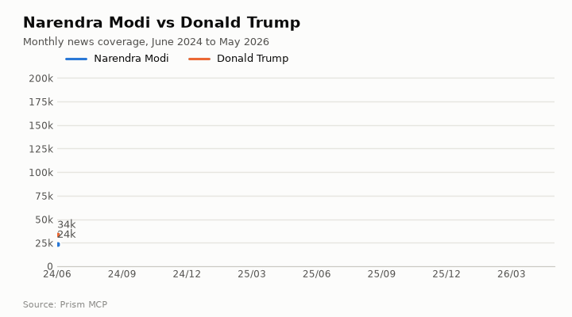

| | Articles | Share | Direction | Negative : positive | High-priority stories |
| --- | ---: | ---: | --- | ---: | ---: |
| **Narendra Modi** | 381,708 | 12.2% | flat (1.0×) | 0.6 | 296,417 |
| **Donald Trump** | 2,740,019 | 87.8% | rising (1.5×) | 4.45 | 2,141,104 |

Trump draws about 7.2× Modi's coverage and it is still rising, while Modi's is flat.
The tone gap is wider than the volume gap: Trump's coverage runs 4.45 negative articles for every positive
one, Modi's 0.6. [Full comparison](docs/use-cases/entities/modi-vs-trump.md) · try it: `prism compare "narendra modi" "donald trump"`

### Indian public companies

| Company | Articles | Trend | Negative : positive | Themes | Around it |
| --- | ---: | --- | --- | --- | --- |
| [Reliance Industries](docs/use-cases/entities/reliance-industries-pulse.md) | 30,862 | flat, 5.3% a year | 0.41 (0.71× baseline) | stock market, economy, finance | jio, hindustan unilever; mukesh ambani, nita ambani |
| [HDFC Bank](docs/use-cases/entities/hdfc-bank-pulse.md) | 32,321 | flat, 3.6% a year | 0.42 (0.72× baseline) | banking, stock market, economy | indusind bank, icici bank; atanu chakraborty, nirmala sitharaman |
| [Tata Motors](docs/use-cases/entities/tata-motors-pulse.md) | 41,964 | rising, 9.9% a year | 0.25 (0.43× baseline) | automotive industry, automotive, electric vehicles | tata group, jaguar land rover; natarajan chandrasekaran, noel tata |

**Infosys vs TCS vs Wipro:** 40,012 vs 39,787 vs 15,867 articles;
TCS is the only one rising (1.44×), and Wipro's coverage is the least negative (0.36).
[Comparison](docs/use-cases/entities/infosys-tcs-wipro.md) · try it: `prism entity "reliance industries"`

### Places and public bodies

* **[Mumbai vs Delhi vs Bengaluru](docs/use-cases/entities/mumbai-delhi-bengaluru.md):** Delhi carries 53.6% of the three
  cities' coverage (1,176,901 articles, much of it national government), Mumbai 32.2%, Bengaluru
  14.2%; Mumbai and Bengaluru are growing faster (1.24× and 1.22×).
* **[Bengaluru](docs/use-cases/entities/bengaluru-pulse.md):** 312,082 articles; the people around it are
  siddaramaiah, sivakumar, g. parameshwara; the organisations swiggy, zepto, zomato.
* **[ISRO](docs/use-cases/entities/isro-pulse.md):** 18,871 articles with unusually positive coverage
  (0.21 negative per positive, 0.36× the all-news baseline); themes
  space exploration, space, science.

All eight are in [Companies, people & places](docs/use-cases/entities/README.md). Ask for any other name the same way.

<!-- investors:start -->
## Investor briefs: global public companies

For investors and stock buyers, Prism turns a company's coverage into decision inputs: is attention building or fading,
is the tone turning, are risk events (lawsuits, regulatory action, layoffs) rising against catalyst events (new
products, contracts, M&A), which risk and catalyst sections are growing inside its coverage, how it stands against its
peers, and what happened month by month. Each brief has a written analysis and a "what to watch" list.

<table><tr><td width="33%" valign="top"><a href="docs/investors/apple/README.md"></a><br><b><a href="docs/investors/apple/README.md">Apple</a></b><br><sub>United States · NASDAQ: AAPL · <a href="https://fliarbi.com/demo/docs/prism-dashboards-3bb43e4c/investors/apple/">interactive</a></sub></td><td width="33%" valign="top"><a href="docs/investors/nvidia/README.md">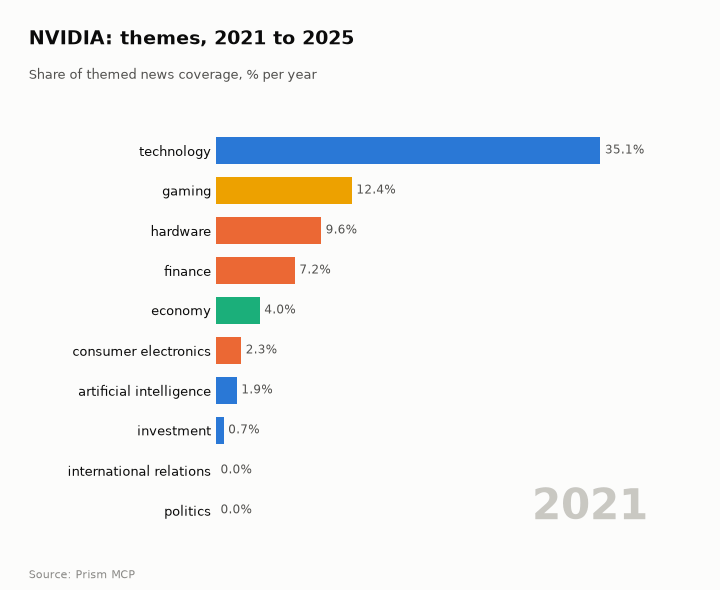</a><br><b><a href="docs/investors/nvidia/README.md">NVIDIA</a></b><br><sub>United States · NASDAQ: NVDA · <a href="https://fliarbi.com/demo/docs/prism-dashboards-3bb43e4c/investors/nvidia/">interactive</a></sub></td><td width="33%" valign="top"><a href="docs/investors/tesla/README.md">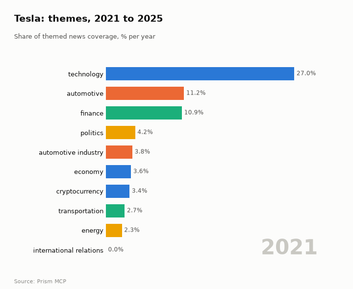</a><br><b><a href="docs/investors/tesla/README.md">Tesla</a></b><br><sub>United States · NASDAQ: TSLA · <a href="https://fliarbi.com/demo/docs/prism-dashboards-3bb43e4c/investors/tesla/">interactive</a></sub></td></tr><tr><td width="33%" valign="top"><a href="docs/investors/jpmorgan/README.md"></a><br><b><a href="docs/investors/jpmorgan/README.md">JPMorgan Chase</a></b><br><sub>United States · NYSE: JPM · <a href="https://fliarbi.com/demo/docs/prism-dashboards-3bb43e4c/investors/jpmorgan/">interactive</a></sub></td><td width="33%" valign="top"><a href="docs/investors/hsbc/README.md"></a><br><b><a href="docs/investors/hsbc/README.md">HSBC</a></b><br><sub>United Kingdom · LSE: HSBA · <a href="https://fliarbi.com/demo/docs/prism-dashboards-3bb43e4c/investors/hsbc/">interactive</a></sub></td><td width="33%" valign="top"><a href="docs/investors/astrazeneca/README.md">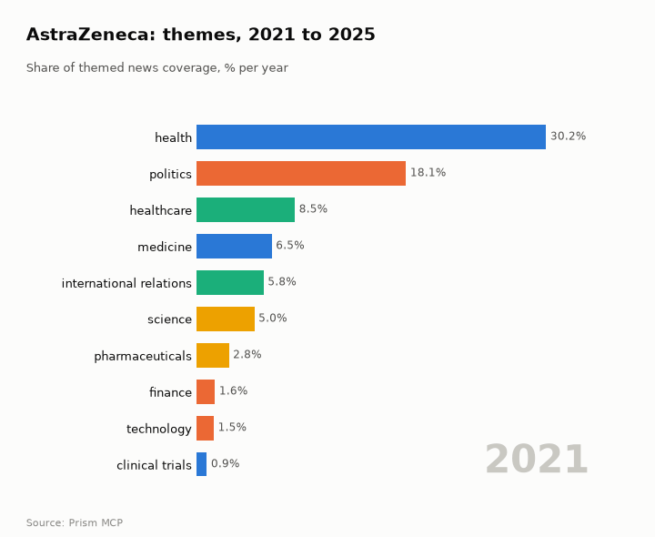</a><br><b><a href="docs/investors/astrazeneca/README.md">AstraZeneca</a></b><br><sub>United Kingdom · LSE: AZN · <a href="https://fliarbi.com/demo/docs/prism-dashboards-3bb43e4c/investors/astrazeneca/">interactive</a></sub></td></tr></table>

| Company | Listing | Attention, last 3 months vs 3 before | Tone | Risk events, 6 months | Catalyst events, 6 months | Fastest-growing section |
| --- | --- | --- | --- | --- | --- | --- |
| [Apple](docs/investors/apple/README.md) | United States · NASDAQ: AAPL | rising (1.32×) | more negative | falling | steady | tariff (2.34×) |
| [Microsoft](docs/investors/microsoft/README.md) | United States · NASDAQ: MSFT | steady (1.1×) | more negative | falling | steady | openai (1.46×) |
| [NVIDIA](docs/investors/nvidia/README.md) | United States · NASDAQ: NVDA | steady (1.06×) | steady | falling | steady | data center (3.03×) |
| [Amazon](docs/investors/amazon/README.md) | United States · NASDAQ: AMZN | rising (1.24×) | steady | rising | falling | layoffs (5.71×) |
| [Tesla](docs/investors/tesla/README.md) | United States · NASDAQ: TSLA | rising (1.2×) | more negative | falling | rising | optimus (2.39×) |
| [JPMorgan Chase](docs/investors/jpmorgan/README.md) | United States · NYSE: JPM | rising (1.44×) | steady | falling | rising | lawsuit (4.79×) |
| [HSBC](docs/investors/hsbc/README.md) | United Kingdom · LSE: HSBA | rising (1.46×) | more negative | rising | falling | wealth (2.16×) |
| [Unilever](docs/investors/unilever/README.md) | United Kingdom · LSE: ULVR | rising (1.44×) | more negative | rising | rising | demerger (4.32×) |
| [AstraZeneca](docs/investors/astrazeneca/README.md) | United Kingdom · LSE: AZN | falling (0.83×) | less negative | falling | rising | tariff (25.89×) |
| [Nestlé](docs/investors/nestle/README.md) | Switzerland · SIX: NESN | steady (0.9×) | less negative | steady | rising | recall (26.0×) |
| [Samsung Electronics](docs/investors/samsung/README.md) | South Korea · KRX: 005930 | rising (1.2×) | more negative | — | — | hbm (2.11×) |
| [Toyota](docs/investors/toyota/README.md) | Japan · TSE: 7203 | rising (1.41×) | steady | — | — | tariff (2.22×) |

> Decision inputs, not investment advice. News attention, tone and event counts describe what is being reported; they are not price forecasts and do not account for valuation, fundamentals or your circumstances.

[All investor briefs](docs/investors/README.md) · Indian listed companies: [Reliance Industries](docs/use-cases/entities/reliance-industries-pulse.md),
[HDFC Bank](docs/use-cases/entities/hdfc-bank-pulse.md), [Tata Motors](docs/use-cases/entities/tata-motors-pulse.md), [Infosys vs TCS vs Wipro](docs/use-cases/entities/infosys-tcs-wipro.md)
<!-- investors:end -->

## More than a news trend

Every demonstration page shows a different Prism capability, so the same name or topic can be taken as far as the
question needs:

| Capability | What you get | Tool | See it on |
| --- | --- | --- | --- |
| **Entity pulse** | volume, growth, tone against all news, themes and the top tags they are built from, people, organisations, places | `news.overview` | [Tata Motors](docs/use-cases/entities/tata-motors-pulse.md), [ISRO](docs/use-cases/entities/isro-pulse.md) |
| **Areas of activity** | the industry areas an entity's coverage falls into (oil & gas, telecom, retail, entertainment…) and its company events by type (earnings, M&A, contracts, new products, lawsuits) | `news.activities` | [Reliance Industries](docs/use-cases/entities/reliance-industries-pulse.md), [HDFC Bank](docs/use-cases/entities/hdfc-bank-pulse.md) |
| **Drill into a section** | one section inside an entity in the same scope ("Reliance" → "partnership" → "partnership + AI"): its share of the entity's coverage month by month, tone, tags and dated events | `news.drill` | [Reliance: AI partnerships](docs/use-cases/entities/reliance-industries-pulse.md), [Trump on India](docs/use-cases/entities/modi-vs-trump.md), [Tata Motors: EVs](docs/use-cases/entities/tata-motors-pulse.md) |
| **Month-by-month ultra research** | Prism reads the most reported stories one month at a time and writes what happened and why it mattered, every point cited; then the arc and turning points | `analysis.timeline` | [ISRO](docs/use-cases/entities/isro-pulse.md), [Reliance](docs/use-cases/entities/reliance-industries-pulse.md) |
| **Disease intelligence** | risk factors, protective factors, causes, treatments and mechanisms, each with its share from high-tier studies; evidence-quality mix | `research.disease` | [Diseases](docs/diseases/README.md) |
| **Evidence and counter-evidence** | papers read and labelled supports / contradicts / qualifies, weighted by study tier, with verbatim quotes | `research.evidence` | [Metformin and cancer](docs/use-cases/medical/metformin-cancer-risk.md) |
| **Literature mapping and radars** | how a field frames its findings year by year; what is new, rising and under-covered | `research.stance_trends`, `research.radar` | [Intermittent fasting](docs/use-cases/medical/intermittent-fasting-stance.md), [Green hydrogen](docs/use-cases/energy-climate/green-hydrogen-radar.md) |
| **History and forecasts** | long measured series with backtested three-year scenarios | `analysis.history`, `analysis.scenarios` | [Vaccine hesitancy](docs/use-cases/public-health/vaccine-hesitancy-trend.md) |
| **Geography lanes** | where a subject is studied, published, reported and patented, kept apart | `research.geography`, `news.geography` | [Dengue](docs/use-cases/public-health/dengue-geography.md) |
| **Reports and dashboards** | interactive HTML built by the assistant and checked in a browser | `compose.report_check` | [Air pollution dashboard](docs/dashboards/air-pollution-geo/README.md) |

<!-- topics:start -->
## Topic intelligence: 25 analytical pages

Each page is a topic intelligence report built from MCP calls: coverage and tone, the areas of activity and the top
tags behind its themes, **themes over five years** (heatmap, stacked mix and an animated theme race), world and India
maps, people and organisations, causes and impacts quoted from the reports, two sections drilled into, and a
month-by-month reading. On top of that, **three reader views** chosen by domain (for crime: policy makers, police &
enforcement, researchers; for finance: regulators, investors, researchers): trajectory with backtested scenarios and the
stories that matter; the evidence behind a claim, two claims head to head and a screen with quoted figures; the framing
of the literature, the frontier and its gaps. Each page also runs the **nine research exploration methods** and reads
each result in depth. Every GIF opens the GitHub page, and every page links to its interactive version.

<table><tr><td width="33%" valign="top"><a href="docs/topics/cybercrime/README.md">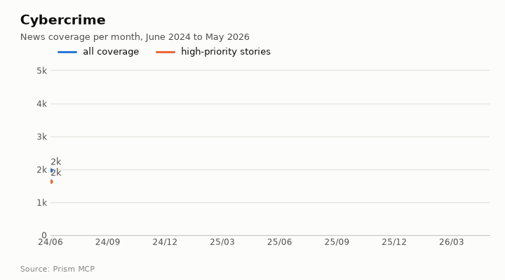</a><br><b><a href="docs/topics/cybercrime/README.md">Cybercrime</a></b> · Crime & public safety<br><sub>70,961 articles · flat · 3.48 negative per positive · <a href="https://fliarbi.com/demo/docs/prism-dashboards-3bb43e4c/topics/cybercrime/">interactive</a></sub></td><td width="33%" valign="top"><a href="docs/topics/metro-rail/README.md"></a><br><b><a href="docs/topics/metro-rail/README.md">Metro rail</a></b> · Infrastructure<br><sub>9,492 articles · flat · 0.33 negative per positive · <a href="https://fliarbi.com/demo/docs/prism-dashboards-3bb43e4c/topics/metro-rail/">interactive</a></sub></td><td width="33%" valign="top"><a href="docs/topics/startup-funding/README.md">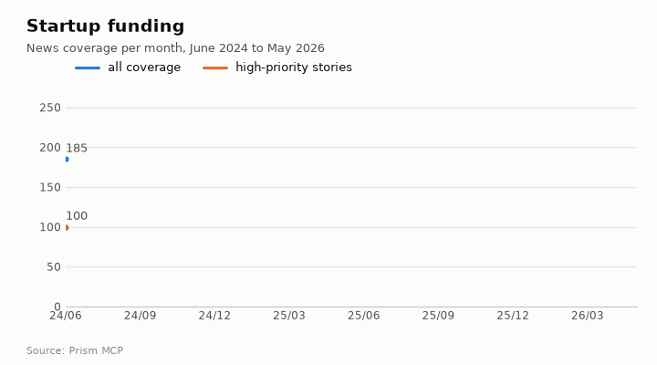</a><br><b><a href="docs/topics/startup-funding/README.md">Startup funding</a></b> · Business<br><sub>3,890 articles · flat · 0.05 negative per positive · <a href="https://fliarbi.com/demo/docs/prism-dashboards-3bb43e4c/topics/startup-funding/">interactive</a></sub></td></tr><tr><td width="33%" valign="top"><a href="docs/topics/inflation/README.md">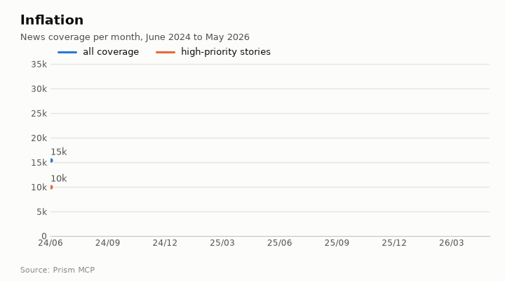</a><br><b><a href="docs/topics/inflation/README.md">Inflation</a></b> · Finance<br><sub>424,361 articles · flat · 1.81 negative per positive · <a href="https://fliarbi.com/demo/docs/prism-dashboards-3bb43e4c/topics/inflation/">interactive</a></sub></td><td width="33%" valign="top"><a href="docs/topics/electric-vehicles/README.md">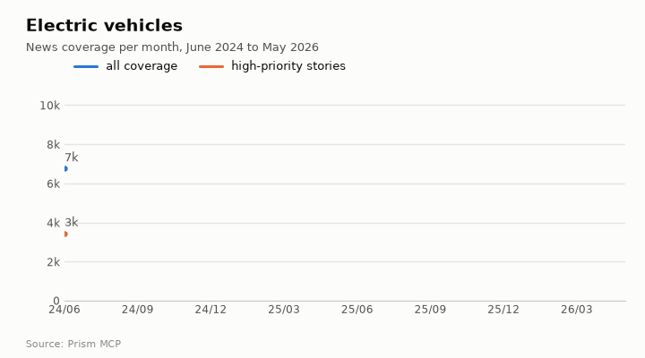</a><br><b><a href="docs/topics/electric-vehicles/README.md">Electric vehicles</a></b> · Business<br><sub>171,690 articles · flat · 0.2 negative per positive · <a href="https://fliarbi.com/demo/docs/prism-dashboards-3bb43e4c/topics/electric-vehicles/">interactive</a></sub></td><td width="33%" valign="top"><a href="docs/topics/heatwaves/README.md">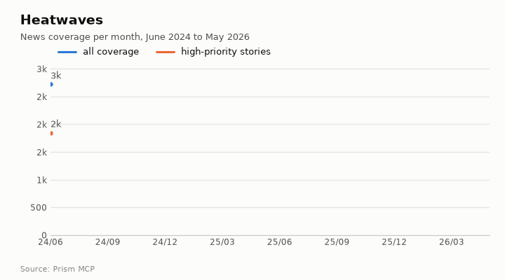</a><br><b><a href="docs/topics/heatwaves/README.md">Heatwaves</a></b> · Energy & climate<br><sub>20,936 articles · flat · 2.29 negative per positive · <a href="https://fliarbi.com/demo/docs/prism-dashboards-3bb43e4c/topics/heatwaves/">interactive</a></sub></td></tr><tr><td width="33%" valign="top"><a href="docs/topics/red-sea-shipping/README.md">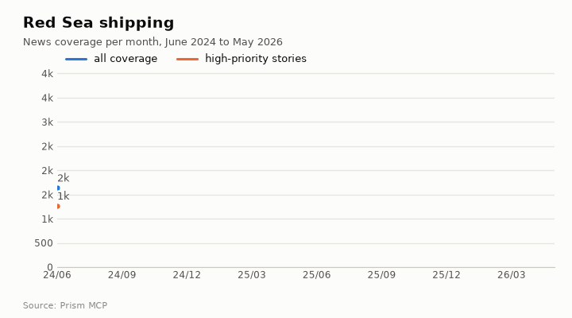</a><br><b><a href="docs/topics/red-sea-shipping/README.md">Red Sea shipping</a></b> · Supply chain & trade<br><sub>36,131 articles · rising · 1.34 negative per positive · <a href="https://fliarbi.com/demo/docs/prism-dashboards-3bb43e4c/topics/red-sea-shipping/">interactive</a></sub></td><td width="33%" valign="top"><a href="docs/topics/ai-regulation/README.md">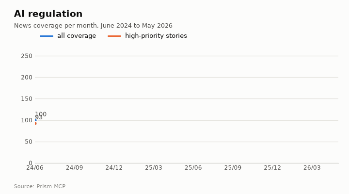</a><br><b><a href="docs/topics/ai-regulation/README.md">AI regulation</a></b> · Technology & policy<br><sub>3,768 articles · rising · 1.38 negative per positive · <a href="https://fliarbi.com/demo/docs/prism-dashboards-3bb43e4c/topics/ai-regulation/">interactive</a></sub></td><td width="33%" valign="top"><a href="docs/topics/upi-payments/README.md">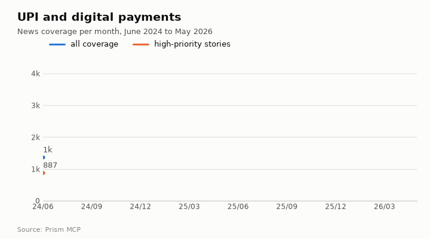</a><br><b><a href="docs/topics/upi-payments/README.md">UPI and digital payments</a></b> · Finance<br><sub>49,416 articles · rising · 0.49 negative per positive · <a href="https://fliarbi.com/demo/docs/prism-dashboards-3bb43e4c/topics/upi-payments/">interactive</a></sub></td></tr></table>

- **Crime & public safety:** [Cybercrime](docs/topics/cybercrime/README.md) · [Drug trafficking](docs/topics/drug-trafficking/README.md) · [Road accidents](docs/topics/road-accidents/README.md)
- **Infrastructure:** [Metro rail](docs/topics/metro-rail/README.md) · [Urban flooding](docs/topics/urban-flooding/README.md) · [Highways and expressways](docs/topics/highways/README.md) · [Data centres](docs/topics/data-centres/README.md)
- **Business:** [Startup funding](docs/topics/startup-funding/README.md) · [Quick commerce](docs/topics/quick-commerce/README.md) · [Electric vehicles](docs/topics/electric-vehicles/README.md) · [Semiconductors](docs/topics/semiconductors/README.md)
- **Finance:** [Inflation](docs/topics/inflation/README.md) · [Gold price](docs/topics/gold-price/README.md) · [Bitcoin](docs/topics/bitcoin/README.md) · [UPI and digital payments](docs/topics/upi-payments/README.md) · [IPO market](docs/topics/ipo-market/README.md)
- **Energy & climate:** [Solar power](docs/topics/solar-power/README.md) · [Heatwaves](docs/topics/heatwaves/README.md)
- **Environment:** [Air pollution](docs/topics/air-pollution/README.md)
- **Defence & geopolitics:** [Drone warfare](docs/topics/drone-warfare/README.md)
- **Supply chain & trade:** [Red Sea shipping](docs/topics/red-sea-shipping/README.md)
- **Technology & policy:** [AI regulation](docs/topics/ai-regulation/README.md) · [Data privacy](docs/topics/data-privacy/README.md)
- **Agriculture:** [Monsoon and crops](docs/topics/monsoon-agriculture/README.md)
- **Education & labour:** [Layoffs](docs/topics/layoffs/README.md)

[All topic pages](docs/topics/README.md) · [Disease pages](docs/diseases/README.md)
<!-- topics:end -->

<!-- diseases:start -->
## Disease intelligence

One report per disease with a view for each reader. **Policy makers:** research volume with backtested scenarios, news coverage, where the disease is studied and reported, causes and impacts named in the news. **Doctors:** risk factors screened with quoted effect sizes, the evidence behind a clinical claim and what disagrees with it, two interventions head to head. **Scientists:** how the literature frames its findings year by year, the frontier, the shape of the literature and its gaps. Each report also runs **nine research exploration methods** (evidence triangulation, head-to-head claims, cross-row screening, framing drift, frontier scan, gap mapping, count history with scenarios, geographic triangulation, faceted browsing) and reads each result in depth. All from MCP calls.

<table><tr><td width="25%"><a href="docs/diseases/tuberculosis/README.md"></a><br><b><a href="docs/diseases/tuberculosis/README.md">Tuberculosis</a></b>: 20 MCP calls; 3 of 6 risk factors with a quoted effect size · <a href="https://fliarbi.com/demo/docs/prism-dashboards-3bb43e4c/diseases/tuberculosis/">interactive</a></td><td width="25%"><a href="docs/diseases/type-2-diabetes/README.md"></a><br><b><a href="docs/diseases/type-2-diabetes/README.md">Type 2 diabetes</a></b>: 20 MCP calls; 3 of 6 risk factors with a quoted effect size · <a href="https://fliarbi.com/demo/docs/prism-dashboards-3bb43e4c/diseases/type-2-diabetes/">interactive</a></td><td width="25%"><a href="docs/diseases/breast-cancer/README.md"></a><br><b><a href="docs/diseases/breast-cancer/README.md">Breast cancer</a></b>: 20 MCP calls; 4 of 6 risk factors with a quoted effect size · <a href="https://fliarbi.com/demo/docs/prism-dashboards-3bb43e4c/diseases/breast-cancer/">interactive</a></td><td width="25%"><a href="docs/diseases/dengue/README.md"></a><br><b><a href="docs/diseases/dengue/README.md">Dengue</a></b>: 19 MCP calls; 2 of 6 risk factors with a quoted effect size · <a href="https://fliarbi.com/demo/docs/prism-dashboards-3bb43e4c/diseases/dengue/">interactive</a></td></tr><tr><td width="25%"><a href="docs/diseases/hypertension/README.md">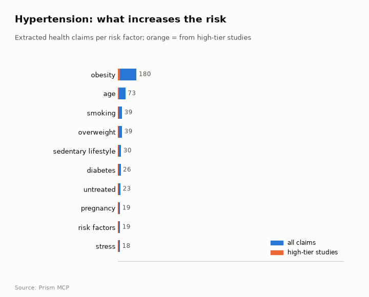</a><br><b><a href="docs/diseases/hypertension/README.md">Hypertension</a></b>: 19 MCP calls; 2 of 6 risk factors with a quoted effect size · <a href="https://fliarbi.com/demo/docs/prism-dashboards-3bb43e4c/diseases/hypertension/">interactive</a></td><td width="25%"><a href="docs/diseases/alzheimers-disease/README.md">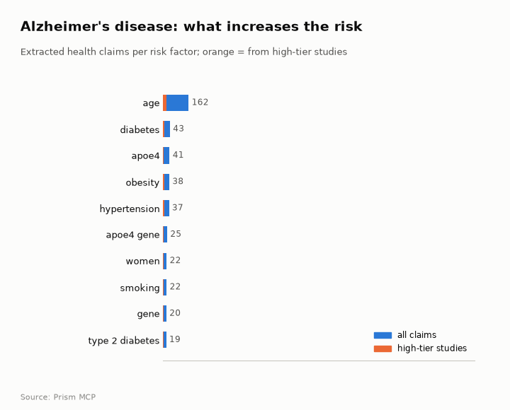</a><br><b><a href="docs/diseases/alzheimers-disease/README.md">Alzheimer's disease</a></b>: 19 MCP calls; 3 of 6 risk factors with a quoted effect size · <a href="https://fliarbi.com/demo/docs/prism-dashboards-3bb43e4c/diseases/alzheimers-disease/">interactive</a></td><td width="25%"><a href="docs/diseases/malaria/README.md">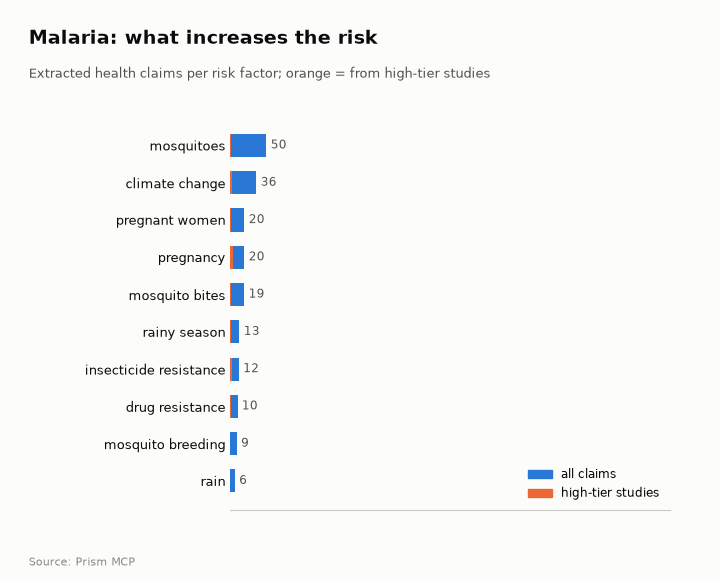</a><br><b><a href="docs/diseases/malaria/README.md">Malaria</a></b>: 19 MCP calls; 0 of 6 risk factors with a quoted effect size · <a href="https://fliarbi.com/demo/docs/prism-dashboards-3bb43e4c/diseases/malaria/">interactive</a></td><td width="25%"><a href="docs/diseases/copd/README.md"></a><br><b><a href="docs/diseases/copd/README.md">COPD</a></b>: 19 MCP calls; 1 of 6 risk factors with a quoted effect size · <a href="https://fliarbi.com/demo/docs/prism-dashboards-3bb43e4c/diseases/copd/">interactive</a></td></tr></table>

[All disease reports](docs/diseases/README.md)
<!-- diseases:end -->

## What Prism answers

| Capability | What you get | Typical question |
| --- | --- | --- |
| **News intelligence** | volume, tone against the all-news baseline, themes, people and organisations, the critical stories, source mix | *What is the world saying about NVIDIA, and which stories matter?* |
| **Competitive attention** | two to four subjects on one scale, month by month, with growth and tone | *Tesla vs BYD: who is gaining attention, and how is it framed?* |
| **Research evidence** | supporting and contradicting papers, read and labelled, weighted by study tier, with verbatim quotes and DOIs | *Does vitamin D help depression? Show the counter-evidence.* |
| **Health evidence** | clinical study designs, effect sizes with their populations, the direction of risk-factor claims | *GLP-1 drugs and muscle loss: how strong is the signal?* |
| **Literature mapping** | how a field frames its findings year by year: promising, cautionary, critical | *Is carbon-tax research becoming more favourable?* |
| **Geography** | the place coverage is about (country, state, city) with lift; where a subject is studied, published and patented, kept apart | *Where is dengue studied vs where is it reported?* |
| **Trend history and forecasting** | long measured series and backtested three-year scenarios with bounds | *Where is research on humanoid robots heading?* |
| **Innovation signals** | patent activity by assignee country and over time, next to research and news | *Is green hydrogen moving from papers to patents?* |
| **Fact-checking** | every checkable claim in a draft, with its status and a safer wording | *Audit this health article before it goes out.* |
| **Spreadsheet research** | one question across many rows, a value and a source per row, or an honest blank | *Energy density and cost for five battery chemistries.* |
| **Citations and reading lists** | APA, Vancouver, BibTeX and more from stored metadata; what a reading list is missing | *What is my AI-ethics reading list missing?* |
| **Reports and dashboards** | HTML reports and dashboards built by the assistant, checked in a real browser by `check_report` | *Build me a geo dashboard on air pollution in India.* |

## Who uses it

* **Policy and government teams:** decision briefings with India-vs-world comparisons, forecasts, options and the evidence against them.
* **Researchers and evidence-synthesis groups:** literature maps, counter-evidence on purpose, reproducible counts and exports for a methods section.
* **Newsrooms and fact-checkers:** draft audits, the critical stories behind a trend, and citations that resolve.
* **Strategy, consulting and competitive intelligence:** attention and tone for a rival set, themes, places and the people around a company.
* **Investors and finance research:** market narratives and sector sentiment measured over time, not recalled from training data.
* **Health, pharma and nutrition:** study-design-weighted evidence, effect sizes and the direction of risk-factor claims.

## Why it holds up

* **Measured, not recalled.** Counts and shares come from queries; a model only reads and explains them.
* **Time-aware.** Every series states its window and marks an incomplete newest period instead of plotting it as a collapse.
* **Evidence-weighted.** Papers are read and labelled supports, contradicts or qualifies, and weighted by study design.
* **Geography kept honest.** Where a subject is reported, studied, published and patented are four different questions, never added together.
* **Checkable.** One JSON envelope for every tool, with the window, the coverage check and the exact query, exportable to CSV, Excel, JSONL and BibTeX.
* **Honest about gaps.** An empty answer comes back as `ok: false` with a reason, so an assistant can say "not measured" rather than guess.

<!-- use-cases:start -->
## 121 live demonstrations, 18 domains

Each page asks a real intelligence question, runs Prism tools against the live corpora, draws the charts from the saved responses, and benchmarks **Claude and ChatGPT with and without Prism**. [Browse all](docs/use-cases/README.md) · [How the benchmark works](benchmarks/README.md)


With Prism, the same model scored higher in **113 of 113** scenarios for Claude (mean 32.0 → **72.0** out of 100) and **113 of 113** for ChatGPT (27.4 → **68.7**). Most of the gain is measurement and traceability; the accuracy criterion alone rose less. [Full results](benchmarks/README.md)

| Domain | Pages | Start with |
| --- | ---: | --- |
| **[Companies, people & places](docs/use-cases/entities/README.md)** | 8 | [Narendra Modi vs Donald Trump in the news](docs/use-cases/entities/modi-vs-trump.md) · [Reliance Industries: media intelligence](docs/use-cases/entities/reliance-industries-pulse.md) · [Infosys vs TCS vs Wipro](docs/use-cases/entities/infosys-tcs-wipro.md) |
| **[Medical & clinical evidence](docs/use-cases/medical/README.md)** | 10 | [Does metformin lower cancer risk?](docs/use-cases/medical/metformin-cancer-risk.md) · [GLP-1 drugs and muscle loss](docs/use-cases/medical/glp1-weight-loss-muscle.md) · [Vitamin D and depression](docs/use-cases/medical/vitamin-d-depression.md) |
| **[Public health & epidemiology](docs/use-cases/public-health/README.md)** | 7 | [Measles resurgence coverage](docs/use-cases/public-health/measles-outbreak-pulse.md) · [Where dengue is studied vs reported](docs/use-cases/public-health/dengue-geography.md) · [H5N1 bird flu coverage](docs/use-cases/public-health/bird-flu-h5n1.md) |
| **[Finance & markets](docs/use-cases/finance/README.md)** | 9 | [Gold price narrative](docs/use-cases/finance/gold-price-pulse.md) · [Inflation vs recession in the news](docs/use-cases/finance/inflation-vs-recession.md) · [Bitcoin ETF coverage](docs/use-cases/finance/crypto-etf-pulse.md) |
| **[Company & competitive intelligence](docs/use-cases/company/README.md)** | 8 | [NVIDIA media intelligence](docs/use-cases/company/nvidia-pulse.md) · [Tesla vs BYD](docs/use-cases/company/tesla-vs-byd.md) · [OpenAI vs Anthropic vs Google DeepMind](docs/use-cases/company/openai-anthropic-google.md) |
| **[Policy & regulation](docs/use-cases/policy/README.md)** | 8 | [AI regulation coverage](docs/use-cases/policy/ai-regulation-pulse.md) · [Universal basic income evidence](docs/use-cases/policy/ubi-evidence.md) · [Minimum wage and jobs](docs/use-cases/policy/minimum-wage-employment.md) |
| **[Crime & public safety](docs/use-cases/crime/README.md)** | 6 | [Cybercrime coverage](docs/use-cases/crime/cybercrime-pulse.md) · [Digital arrest scams in India](docs/use-cases/crime/digital-arrest-scam.md) · [Do body cameras reduce police use of force?](docs/use-cases/crime/policing-body-cameras.md) |
| **[Defence & geopolitics](docs/use-cases/defence/README.md)** | 7 | [Drone warfare coverage](docs/use-cases/defence/drone-warfare-pulse.md) · [Hypersonic weapons research](docs/use-cases/defence/hypersonic-radar.md) · [NATO vs Russia vs Ukraine attention](docs/use-cases/defence/nato-russia-ukraine.md) |
| **[Energy & climate](docs/use-cases/energy-climate/README.md)** | 8 | [Solar power coverage](docs/use-cases/energy-climate/solar-power-pulse.md) · [Green hydrogen research radar](docs/use-cases/energy-climate/green-hydrogen-radar.md) · [EV battery chemistries table](docs/use-cases/energy-climate/ev-battery-table.md) |
| **[Technology & AI](docs/use-cases/technology/README.md)** | 8 | [Generative AI in education](docs/use-cases/technology/gen-ai-education-stance.md) · [Quantum computing research radar](docs/use-cases/technology/quantum-computing-radar.md) · [AI agents in the news](docs/use-cases/technology/ai-agents-pulse.md) |
| **[Agriculture & food security](docs/use-cases/agriculture/README.md)** | 6 | [Millets in Indian news](docs/use-cases/agriculture/millets-india-pulse.md) · [Does glyphosate cause cancer?](docs/use-cases/agriculture/glyphosate-cancer.md) · [Precision agriculture research radar](docs/use-cases/agriculture/precision-farming-radar.md) |
| **[Education & labour](docs/use-cases/education-labour/README.md)** | 5 | [Does remote work hurt productivity?](docs/use-cases/education-labour/remote-work-productivity.md) · [Layoffs in the news](docs/use-cases/education-labour/layoffs-pulse.md) · [National Education Policy brief](docs/use-cases/education-labour/nep-2020-brief.md) |
| **[Legal & compliance](docs/use-cases/legal/README.md)** | 5 | [Google antitrust coverage](docs/use-cases/legal/antitrust-big-tech.md) · [Supreme Court of India coverage](docs/use-cases/legal/supreme-court-india.md) · [GDPR enforcement research](docs/use-cases/legal/gdpr-fines-radar.md) |
| **[Supply chain & trade](docs/use-cases/supply-chain/README.md)** | 5 | [Red Sea shipping disruption](docs/use-cases/supply-chain/red-sea-shipping.md) · [Rare earths vs lithium vs cobalt](docs/use-cases/supply-chain/rare-earths-compare.md) · [Nearshoring research radar](docs/use-cases/supply-chain/nearshoring-radar.md) |
| **[Journalism & fact-checking](docs/use-cases/journalism/README.md)** | 6 | [Audit a health article draft](docs/use-cases/journalism/audit-coffee-draft.md) · [Audit an EV explainer](docs/use-cases/journalism/audit-ev-draft.md) · [Fix an overstated claim](docs/use-cases/journalism/improve-microplastics.md) |
| **[Academic research & literature review](docs/use-cases/academic/README.md)** | 6 | [Gut microbiome and depression literature](docs/use-cases/academic/microbiome-depression-stance.md) · [What is my AI-ethics reading list missing?](docs/use-cases/academic/library-gaps-ai-ethics.md) · [Vancouver citations for exercise and depression](docs/use-cases/academic/citations-exercise-depression.md) |
| **[Environment & disasters](docs/use-cases/environment/README.md)** | 5 | [Microplastics in the news](docs/use-cases/environment/microplastics-pulse.md) · [Groundwater depletion in India](docs/use-cases/environment/groundwater-india-brief.md) · [Floods vs heatwaves vs wildfires](docs/use-cases/environment/floods-vs-heatwaves.md) |
| **[Consumer, brands & media](docs/use-cases/consumer-media/README.md)** | 4 | [Does ashwagandha reduce stress?](docs/use-cases/consumer-media/ashwagandha-evidence.md) · [Netflix vs Disney+ vs Prime Video](docs/use-cases/consumer-media/streaming-compare.md) · [Quick commerce in India](docs/use-cases/consumer-media/quick-commerce-pulse.md) |
<!-- use-cases:end -->

## Benchmark: full reports, not paragraphs

Every one of the 113 scenarios, re-run as a **decision-grade report**: verdict, measured trend, comparison, charts, drill-down, CSV exports and references. Four respondents per scenario, the same specification for all, scored by a rubric designed by Fable 5.1: a script traces every number, chart, CSV cell and DOI first, then two blind judges score under those ceilings.

| | Claude alone | Claude + Prism | ChatGPT alone | ChatGPT + Prism |
| --- | ---: | ---: | ---: | ---: |
| Mean score /100 | 32.0 | **72.0** | 27.4 | **68.7** |
| Numbers traced to the corpus | 0 / 1,647 | 7,406 / 7,555 | 0 / 264 | 2,999 / 3,101 |

Prism raised the same model's score in **113 of 113** scenarios for Claude and **113 of 113** for ChatGPT. Scores, parameter tables, before/after screens and a PDF for every scenario: **[benchmarks/README.md](benchmarks/README.md)**. Deep live-MCP tiers (a policy briefing and a researcher's report with a full article, as interactive HTML with maps and forecasts) are in [benchmarks/results/deep/](benchmarks/results/deep/).

## Dashboards, built from one brief

An assistant connected to Prism can turn a brief into a working dashboard: it picks the tools, builds the page,
and checks it with `check_report` before handing it over. First example, **[Air pollution geo-intelligence](docs/dashboards/air-pollution-geo/README.md)**:
a world map of where coverage is about, an India state map and city leaderboard, India against the world over time,
where the subject is studied vs reported vs patented, the critical stories, and a data-quality panel. Built by Claude
Opus 5.5 in 7 minutes from 19 Prism calls. [All dashboards](docs/dashboards/README.md)

## Gallery: what gets built on Prism

Dashboards, interactive reports and research papers made from Prism data. Click any image to open the live page.

<table>
<tr><td colspan="3"><b><a href="https://fliarbi.com/demo/docs/prism-dashboards-3bb43e4c/air-pollution-geo/">Air pollution geo-intelligence dashboard</a></b> · Built by Claude Opus 5.5 from one brief: world map, India states, cities, trend, studied vs reported vs patented.</td></tr>
<tr><td width="33%"><a href="https://fliarbi.com/demo/docs/prism-dashboards-3bb43e4c/air-pollution-geo/"></a></td><td width="33%"><a href="https://fliarbi.com/demo/docs/prism-dashboards-3bb43e4c/air-pollution-geo/"></a></td><td width="33%"><a href="https://fliarbi.com/demo/docs/prism-dashboards-3bb43e4c/air-pollution-geo/"></a></td></tr>
<tr><td colspan="3"><b><a href="https://fliarbi.com/prism/explore/reports/urban-heat/">Urban heat interactive report</a></b> · Research and news on urban heat: inequality, the places affected, what is rising and falling, what cools a city.</td></tr>
<tr><td width="33%"><a href="https://fliarbi.com/prism/explore/reports/urban-heat/"></a></td><td width="33%"><a href="https://fliarbi.com/prism/explore/reports/urban-heat/"></a></td><td width="33%"><a href="https://fliarbi.com/prism/explore/reports/urban-heat/"></a></td></tr>
<tr><td colspan="3"><b><a href="https://fliarbi.com/prism/explore/reports/groundwater-depletion/">Groundwater depletion interactive report</a></b> · Where the problem is, how the evidence is shaped, which responses are tried, and the companies working on it.</td></tr>
<tr><td width="33%"><a href="https://fliarbi.com/prism/explore/reports/groundwater-depletion/"></a></td><td width="33%"><a href="https://fliarbi.com/prism/explore/reports/groundwater-depletion/"></a></td><td width="33%"><a href="https://fliarbi.com/prism/explore/reports/groundwater-depletion/"></a></td></tr>
<tr><td colspan="3"><b><a href="https://fliarbi.com/assets/papers/hcc-input-audit-v2-20260915/index.html">Research: auditing a large biomedical claims corpus</a></b> · A preprint built on Prism's health-claims data: input recovery, model replay and a safeguard against unsupported extractions.</td></tr>
<tr><td width="33%"><a href="https://fliarbi.com/assets/papers/hcc-input-audit-v2-20260915/index.html"></a></td><td width="33%"><a href="https://fliarbi.com/assets/papers/hcc-input-audit-v2-20260915/index.html"></a></td><td width="33%"><a href="https://fliarbi.com/assets/papers/hcc-input-audit-v2-20260915/index.html"></a></td></tr>
</table>

## Why it changes what an assistant can do

| An assistant on its own | The same assistant with Prism |
| --- | --- |
| Recalls studies it may have half-remembered, sometimes with invented details | Reads the studies, quotes them verbatim, labels each as supports / contradicts / qualifies |
| Knowledge stops at a training cut-off | Measures news and research up to their latest complete periods, and says exactly where each window ends |
| "Coverage of X has grown" | 22,214 articles, a peak of 1,470 in March 2026, tone 1.05× the all-news baseline |
| "The evidence is mixed" | 334 papers: 98 supporting, 88 qualifying, 20 contradicting, 128 neutral; 32.3% contested |
| Guesses which countries care | Counts coverage by the place each article is about, with lift over all news |
| A citation that may not exist | APA, Vancouver, BibTeX and 6 more, rendered from stored metadata with a DOI |
| One answer, no way to check it | A JSON envelope with the window, the coverage check and the exact query, exportable to CSV |

[The benchmark](benchmarks/README.md) measures this across every demonstration: the same report brief, given
to Claude and ChatGPT with and without Prism, scored by a script that traces every number and two blind judges.

## What you can do with it

| Job | Tools | Demonstration |
| --- | --- | --- |
| **Media intelligence:** volume, tone, themes, people, places, the critical stories | `news.overview`, `news.trends`, `news.critical`, `news.geography` | [Ozempic in the news](docs/use-cases/medical/ozempic-news-pulse.md) |
| **Competitive attention:** two to four subjects, one scale | `news.compare` | [Tesla vs BYD](docs/use-cases/company/tesla-vs-byd.md) |
| **Evidence check:** for, against, how strong, which numbers | `research.evidence`, `research.counter_evidence`, `research.statistics` | [Metformin and cancer](docs/use-cases/medical/metformin-cancer-risk.md) |
| **Literature mapping:** how a field frames its findings, year by year | `research.stance_trends`, `research.browse` | [Intermittent fasting](docs/use-cases/medical/intermittent-fasting-stance.md) |
| **Briefs and radars:** what is established, contested, new | `research.brief`, `research.radar` | [Antimicrobial resistance](docs/use-cases/medical/antimicrobial-resistance-brief.md) |
| **Fact-checking a draft:** every checkable claim, with status | `research.audit`, `research.improve`, `research.citations` | [Audit a health article](docs/use-cases/journalism/audit-coffee-draft.md) |
| **Spreadsheet research:** one question across many rows | `research.table` | [EV battery chemistries](docs/use-cases/energy-climate/ev-battery-table.md) |
| **Trend history and scenarios:** a measured series, a backtested range | `analysis.history`, `analysis.scenarios` | [Vaccine hesitancy](docs/use-cases/public-health/vaccine-hesitancy-trend.md) |
| **Geography of a topic:** where it is studied vs where it is reported | `research.geography`, `news.geography` | [Dengue](docs/use-cases/public-health/dengue-geography.md) |
| **Grounded writing:** sections, titles, whole articles with sources | `compose.*`, `drive.*` | [API index](https://radar-api.fliarbi.com/prism/v1) |

Deeper guides: **[Research analysis workflows](docs/RESEARCH_ANALYSIS.md)** (literature review, evidence
synthesis, systematic-review screening, trend forecasting) and **[Data export](docs/DATA_EXPORT.md)** (CSV,
Excel, JSONL and BibTeX from any response, with provenance).

## Get started in four steps

| Step | Do this | You get |
|---:|---|---|
| 1 | [Fliar dashboard](https://fliarbi.com/radar/dashboard?tab=radarapi) → **API keys** → create a key with **All data** access | One `rdr_` key for Prism, Radar and Prism News |
| 2 | On the same page, buy prepaid credits and set a monthly spending limit | Credits at US$0.01 (₹0.84) each, minimum 500 |
| 3 | `curl -fsSL https://radar-api.fliarbi.com/prism/install.sh \| bash`, then `prism login` | The `prism` command, `PRISM_URL` set, your key saved owner-only |
| 4 | Connect your assistant (below), call `$PRISM_URL/v1/<feature>`, or use the `prism` command | The same 52 public tools over MCP, REST and the CLI |

**Claude Code**
```bash
claude mcp add --transport http prism "$PRISM_URL/mcp" --header "Authorization: Bearer $FLIAR_API_KEY"
```

**Codex / ChatGPT desktop (Codex CLI)**: add to `~/.codex/config.toml`
```toml
[mcp_servers.prism]
url = "https://radar-api.fliarbi.com/prism/mcp"
bearer_token_env_var = "FLIAR_API_KEY"
tool_timeout_sec = 600
```

**Claude Desktop, Cursor, VS Code**: an HTTP MCP server at `$PRISM_URL/mcp` with the header
`Authorization: Bearer $FLIAR_API_KEY`.

**ChatGPT connectors, n8n, Zapier**: point them at `$PRISM_URL/mcp` (streamable HTTP) or import
`$PRISM_URL/v1/openapi.json` (bearer auth).

**REST**
```bash
curl -s -X POST "$PRISM_URL/v1/news.compare" -H "Authorization: Bearer $FLIAR_API_KEY" \
  -H 'content-type: application/json' -d '{"terms":["tesla","byd"],"since":"2024-06-01"}' \
  | jq '.data.rows[] | {term, articles, growth}'
```

## Pricing

Pay as you go from the one Fliar API wallet: **1 credit = US$0.01 (₹0.84)**, charged per successful call by feature.
A call that fails or finds nothing costs nothing, and `list_features` and `freshness_status` are free. Every
response carries the credits it used in the `X-Prism-Credits` header; the full table is at `GET $PRISM_URL/v1/pricing`.

| Kind of call | Examples | Credits |
| --- | --- | ---: |
| Quick counts and series | `news.trends`, `news.trending`, `analysis.history`, `analysis.scenarios`, `compose.report_check` | 1 |
| Places, sources, tone | `news.geography`, `news.entities`, `news.sentiment`, `news.sources` | 2 |
| Literature and geography lanes | `research.stance_trends`, `research.geography`, `research.statistics`, `research.counter_evidence`, `news.critical` | 5 |
| Comparisons and browsing | `news.compare`, `research.browse`, `research.evidence_card` | 8 |
| Radars, rewrites, themes | `research.radar`, `research.improve`, `news.themes`, `news.recent` | 12 |
| Evidence reading and briefs | `research.evidence`, `research.brief`, `research.audit`, `research.citations`, `news.overview` | 20 |
| Tables across many rows | `research.table` | 30 |
| Claim against claim, full articles | `research.compare`, `compose.article` | 50 |

Prices are set from each feature's measured running cost (index compute time and model tokens) with headroom
for reliability; limits per minute, concurrent calls and daily credits rise with your usage level, as on Radar.

## Every answer carries its limits

Three fields ride on every payload, because each one has produced a confidently wrong answer before:

* **`window`**: the period the numbers cover. Recent news arrives over days, so series stop at the latest
  complete period and say so; research and patents have their own publication lags. A series run to today
  would show a collapse that never happened.
* **`meta.coverage`**: whether the whole index answered. A partial read returns *smaller* numbers rather than
  an error, so Prism checks completeness and says when it is not.
* **`lane`**: whether a count describes the claim (both sides of it) or only its subject. "Papers about
  coffee and heart disease" and "papers about heart disease" differ by three orders of magnitude.

What the showcase found and fixed in the server is in [Engineering flags](docs/ENGINEERING_FLAGS.md).

## Repository map

| Path | What |
| --- | --- |
| `prism_mcp.py` | the server: 63 features, stdio or HTTP (`--http --port 8790`) |
| `prism/` | retrieval, evidence reading, statistics, citations, news analytics, writing, gates |
| `docs/use-cases/` | the demonstration pages, by domain, with charts in `img/` |
| `docs/examples/` | the saved Prism responses behind every page |
| `docs/live_sessions/` | recorded live MCP sessions: which tools each model chose, with timings |
| `benchmarks/` | the benchmark: harness (`bench*.py`), rubric (`rubric/`), per-scenario answers, ground pass, judges and before/after screens (`results/full/`), live HTML tiers (`results/deep/`) |
| `docs/exports/` | sample CSV exports made with `tools/prism_export.py` |
| `showcase/` | the pipeline that builds all of it: `scenarios.py` → `capture.py` → `compare.py` / `live.py` → `build_pages.py` |
| `tools/prism_export.py` | any response to CSV, Excel, JSONL or BibTeX, with a provenance sidecar |
| `deploy/prism-mcp.service` | the systemd unit that keeps the HTTP server up |
| `wordpress/` | the Prism Research WordPress plugin and its Docker test site |
| `tests/`, `smoke_test.py` | regression suite (`python3 smoke_test.py --contracts`) and a live call of every tool |

Rebuild the showcase:
```bash
python3 showcase/capture.py --workers 4      # run every scenario's tools against the live corpora
python3 showcase/live.py                     # flagship live MCP sessions
python3 showcase/build_pages.py              # pages, charts, indexes, scoreboard
python3 benchmarks/bench_full.py --workers 4   # the benchmark over every scenario (resumable)
python3 benchmarks/bench_summary.py            # benchmarks/README.md, per-scenario pages, summary PDF
```
