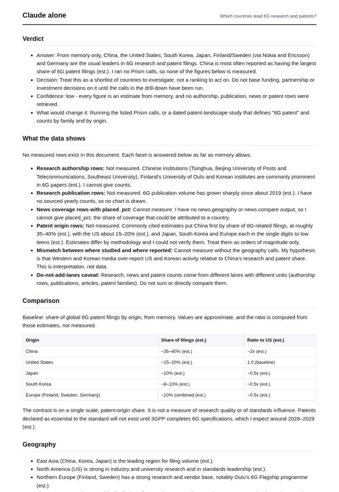
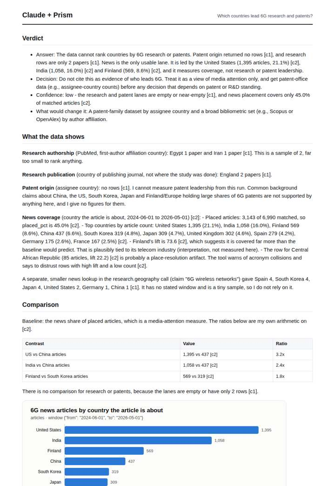
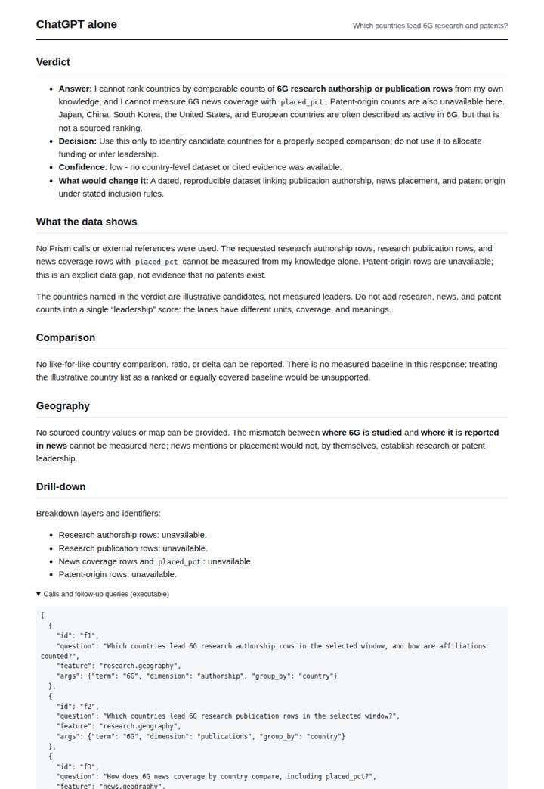
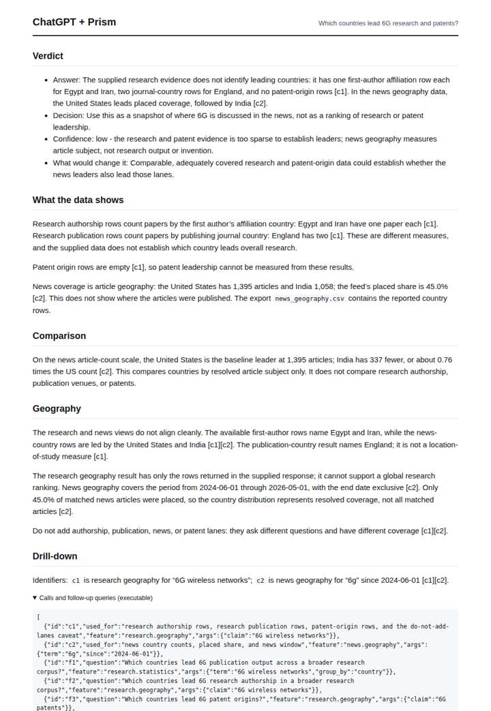

# 6G research geography

**Question.** Which countries lead 6G research and patents?

**Category:** Technology & AI · **Pattern:** `geo` · **Why it is hard:** Patents publish ~18 months late; recent years are censored, not falling.

| Score /100 | Claude alone | Claude + Prism | ChatGPT alone | ChatGPT + Prism |
|---|---|---|---|---|
| Weighted (strict) | 35.4 | **74.6** | 33.0 | 68.0 |
| Opus judge | 34.9 | 77.3 | 29.5 | 66.6 |
| GPT judge | 35.9 | 72.0 | 36.6 | 69.5 |

## Parameter scores (0-5)

| Parameter | Weight | Claude alone | Claude + Prism | ChatGPT alone | ChatGPT + Prism |
|---|---|---|---|---|---|
| Measured comparison | 7 | 2.0 | 4.0 | 0.0 | 4.0 |
| Visualisation from counted data | 10 | 0.0 | 3.0 | 0.0 | 0.0 |
| Exploration and drill-down | 7 | 1.0 | 3.0 | 0.5 | 3.0 |
| Data export with provenance | 8 | 1.0 | 3.5 | 0.0 | 3.0 |
| Reproducibility | 12 | 1.0 | 4.0 | 1.0 | 4.0 |
| Accuracy against the corpus | 12 | 3.5 | 4.0 | 4.0 | 4.5 |
| Calibration and limits | 8 | 2.5 | 3.5 | 3.0 | 4.0 |
| Decision-grade verdict | 12 | 3.0 | 4.0 | 3.0 | 4.0 |
| Facet coverage | 6 | 1.0 | 4.5 | 2.0 | 4.0 |

## Script findings

| Check | Claude alone | Claude + Prism | ChatGPT alone | ChatGPT + Prism |
|---|---|---|---|---|
| Numbers traced to the corpus | 0/16 | 44/45 | 0/0 | 12/12 |
| Charts (traced share) | none | 100% | none | none |
| DOIs that resolve | 0/0 | 0/0 | 0/0 | 0/0 |
| Follow-up queries that ran | 3/7 | 4/6 | 0/4 | 3/5 |
| Invention gate | clear | clear | clear | clear |

**Claude Opus judge:** C and A both read the database correctly: the research and patent lanes are empty or near-empty, and news shows only attention. C went further with recomputable ratios, a traced chart, both research and news exports, and it caught the Central African Republic place-resolution artifact. B and D answered from memory and were honest about it, but they give a decision-maker nothing measured, and B's patent shares are unverifiable.

**GPT judge:** C is the strongest decision aid: it separates the thin research evidence, empty patent-origin result and partial news geography, and its reported values trace cleanly. D adds a useful chart and broader exports, but its chart covers only news and it makes a stronger-than-supported claim about the Central African Republic row.

## Before / after (first screen)

| | Alone | With Prism |
|---|---|---|
| Claude |  |  |
| ChatGPT |  |  |

Full deliverables, rendered: [PDF](https://fliarbi.com/demo/docs/prism-benchmark-v2-4ed65c83/full/6g-research-geo.pdf). Raw answers, ground pass and judge outputs: `answers.json`, `ground.json`, `judge_opus.json`, `judge_gpt.json` in this folder.
