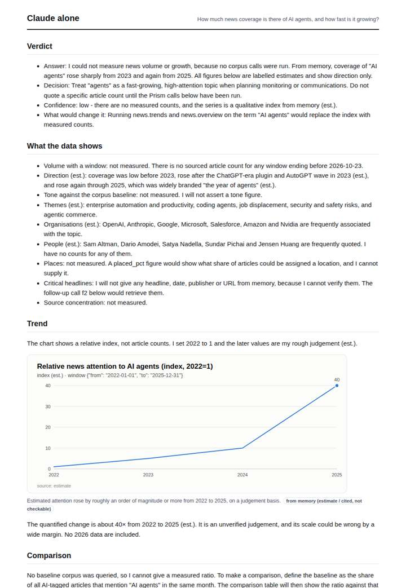
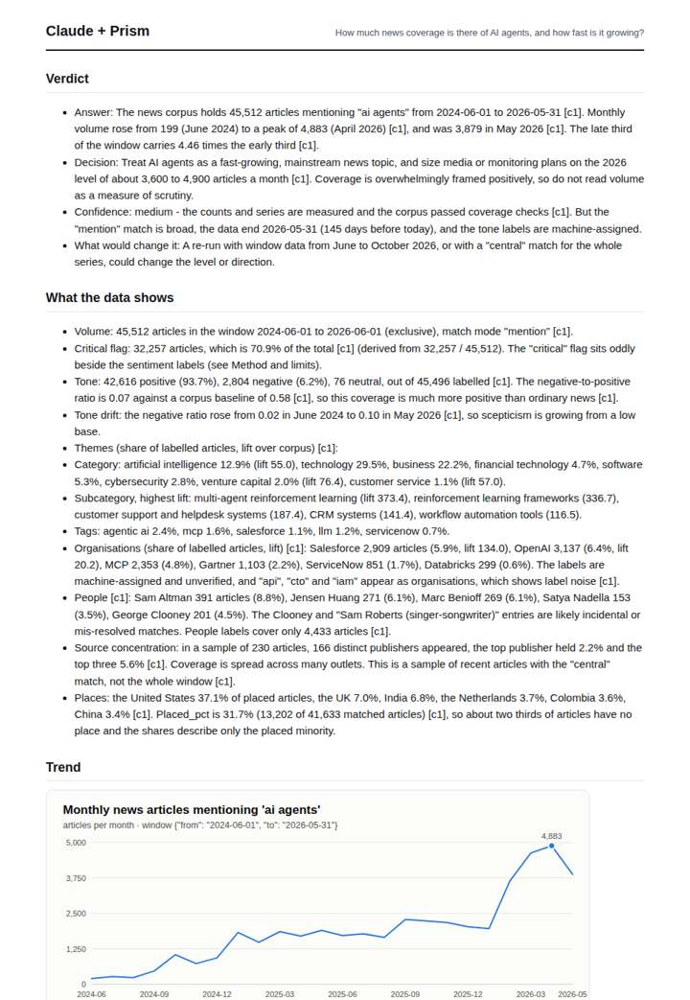
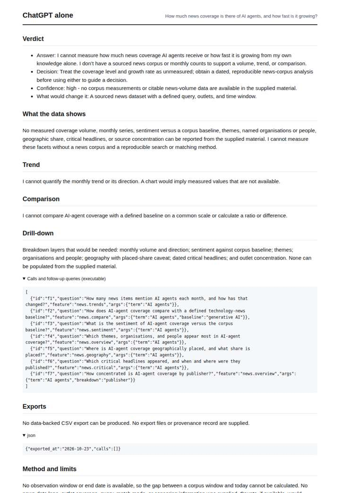
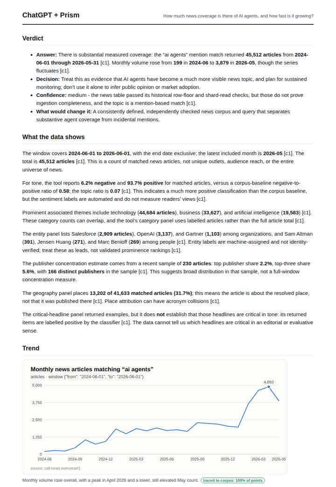

# AI agents in the news

**Question.** How much news coverage is there of AI agents, and how fast is it growing?

**Category:** Technology & AI · **Pattern:** `pulse` · **Why it is hard:** A 2024-2025 term: model knowledge is thin, the corpus is not.

| Score /100 | Claude alone | Claude + Prism | ChatGPT alone | ChatGPT + Prism |
|---|---|---|---|---|
| Weighted (strict) | 34.5 | **79.3** | 25.5 | 74.7 |
| Opus judge | 31.2 | 78.4 | 18.0 | 69.8 |
| GPT judge | 37.8 | 80.2 | 33.0 | 79.6 |

## Parameter scores (0-5)

| Parameter | Weight | Claude alone | Claude + Prism | ChatGPT alone | ChatGPT + Prism |
|---|---|---|---|---|---|
| Measured trend | 10 | 1.0 | 5.0 | 0.0 | 4.5 |
| Measured comparison | 7 | 0.0 | 4.5 | 0.0 | 4.5 |
| Visualisation from counted data | 10 | 1.0 | 4.5 | 0.0 | 3.5 |
| Exploration and drill-down | 7 | 1.5 | 4.0 | 1.5 | 1.0 |
| Data export with provenance | 8 | 1.0 | 3.0 | 0.0 | 4.5 |
| Reproducibility | 12 | 1.0 | 5.0 | 1.0 | 5.0 |
| Traceable references | 8 | 0.5 | 1.0 | 0.5 | 0.5 |
| Accuracy against the corpus | 12 | 3.5 | 4.0 | 4.0 | 4.0 |
| Calibration and limits | 8 | 3.5 | 4.5 | 2.5 | 4.0 |
| Decision-grade verdict | 12 | 3.5 | 3.0 | 2.5 | 4.0 |
| Facet coverage | 6 | 1.0 | 5.0 | 0.5 | 4.5 |

## Script findings

| Check | Claude alone | Claude + Prism | ChatGPT alone | ChatGPT + Prism |
|---|---|---|---|---|
| Numbers traced to the corpus | 0/1 | 129/130 | 0/0 | 30/31 |
| Charts (traced share) | memory | 100%, 100% | none | 100% |
| DOIs that resolve | 0/0 | 0/0 | 0/0 | 0/0 |
| Follow-up queries that ran | 3/5 | 5/7 | 5/7 | 0/5 |
| Invention gate | clear | clear | clear | clear |

**Claude Opus judge:** A and B both report the measured 45,512 articles and the 4.46× late-vs-early growth. A goes further: it decomposes tone and the critical flag, explains why 'critical' is not negativity, and gives URL-level headlines. Its limits are placed next to the numbers they bound. C and D answered from memory or declined, so they give a decision-maker nothing measurable about volume or growth.

**GPT judge:** B gives the strongest decision-grade answer: a reproducible monthly series, quantified growth, tone comparison, and useful breakdowns with explicit data limits. C is close and has cleaner export provenance, but offers less actionable drill-down; B’s small date and confidence overstatements keep it from a fully clean verdict.

## Before / after (first screen)

| | Alone | With Prism |
|---|---|---|
| Claude |  |  |
| ChatGPT |  |  |

Full deliverables, rendered: [PDF](https://fliarbi.com/demo/docs/prism-benchmark-v2-4ed65c83/full/ai-agents-pulse.pdf). Raw answers, ground pass and judge outputs: `answers.json`, `ground.json`, `judge_opus.json`, `judge_gpt.json` in this folder.
