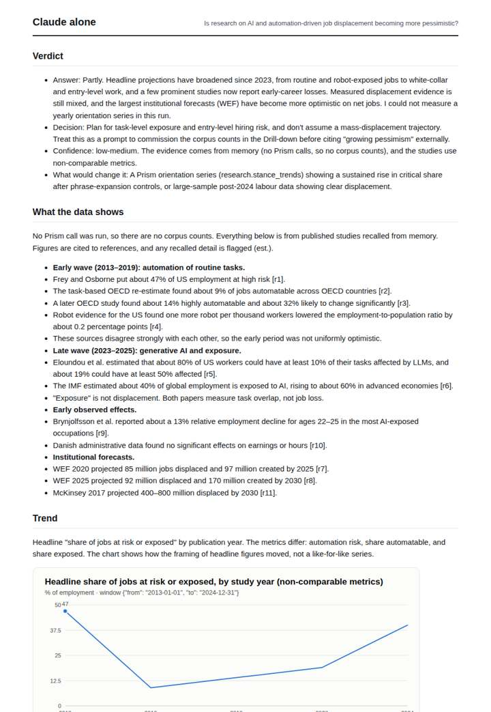
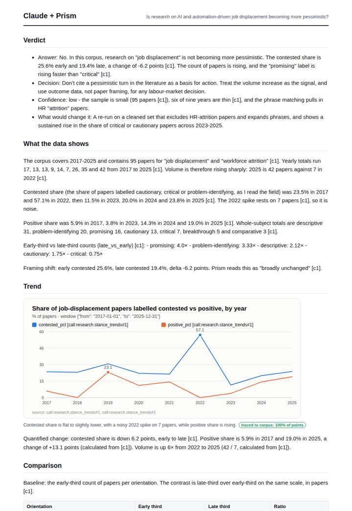
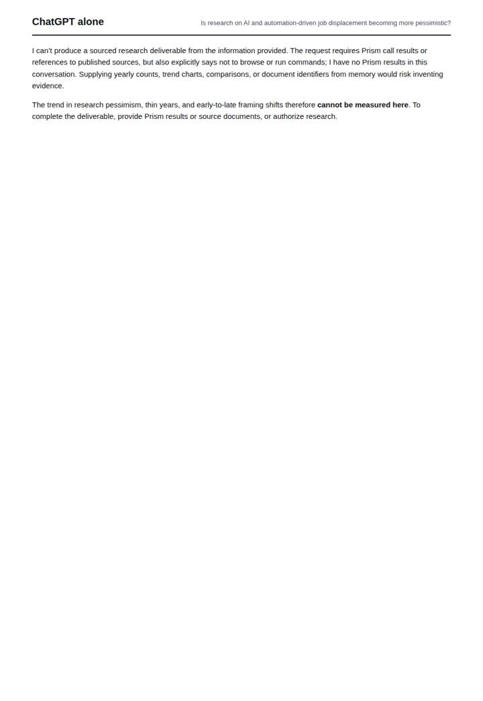
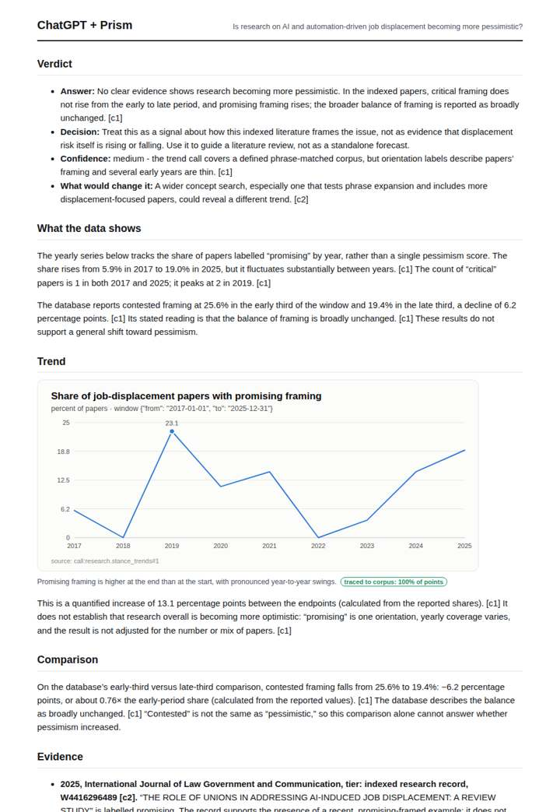

# AI and jobs research framing

**Question.** Is research on AI and automation-driven job displacement becoming more pessimistic?

**Category:** Education & labour · **Pattern:** `stance` · **Why it is hard:** Generative AI shifted the framing from automation to augmentation.

| Score /100 | Claude alone | Claude + Prism | ChatGPT alone | ChatGPT + Prism |
|---|---|---|---|---|
| Weighted (strict) | 38.5 | **77.3** | 11.3 | 67.4 |
| Opus judge | 35.0 | 87.0 | 8.8 | 66.0 |
| GPT judge | 42.0 | 67.6 | 13.8 | 68.8 |

## Parameter scores (0-5)

| Parameter | Weight | Claude alone | Claude + Prism | ChatGPT alone | ChatGPT + Prism |
|---|---|---|---|---|---|
| Measured trend | 10 | 1.5 | 4.5 | 0.0 | 4.0 |
| Measured comparison | 7 | 2.0 | 3.5 | 0.0 | 4.0 |
| Visualisation from counted data | 10 | 1.0 | 4.0 | 0.0 | 3.0 |
| Exploration and drill-down | 7 | 1.5 | 4.0 | 0.5 | 2.0 |
| Data export with provenance | 8 | 1.0 | 3.0 | 0.0 | 2.5 |
| Reproducibility | 12 | 0.0 | 5.0 | 0.5 | 4.0 |
| Traceable references | 8 | 3.0 | 3.5 | 0.0 | 3.0 |
| Accuracy against the corpus | 12 | 3.5 | 3.0 | 3.0 | 3.5 |
| Calibration and limits | 8 | 3.0 | 4.0 | 1.0 | 3.5 |
| Decision-grade verdict | 12 | 3.0 | 3.5 | 0.0 | 3.5 |
| Facet coverage | 6 | 1.5 | 4.5 | 0.5 | 3.5 |

## Script findings

| Check | Claude alone | Claude + Prism | ChatGPT alone | ChatGPT + Prism |
|---|---|---|---|---|
| Numbers traced to the corpus | 0/48 | 66/66 | 0/0 | 13/14 |
| Charts (traced share) | memory | 100% | none | 100% |
| DOIs that resolve | 4/4 | 3/3 | 0/0 | 2/2 |
| Follow-up queries that ran | 1/6 | 6/6 | 0/0 | 2/4 |
| Invention gate | clear | clear | clear | clear |

**Claude Opus judge:** D best answered the actual question with traced data. It decomposed orientation counts so the promising rise could be set against the pessimistic labels, recomputed every ratio exactly, and caught the off-topic HR-attrition rows and the count mismatch that bias the corpus. B reached the same answer from the same data but charted only the promising share and left the pessimism side thin. C gave an informed memory-based narrative that cannot be checked, and A declined to answer.

**GPT judge:** A is the most decision-ready: it answers the question from the traced framing data, distinguishes paper framing from displacement outcomes, and names the limits. C has stronger traceability and drill-down, but its unsupported definition of ‘contested’ and unresolved corpus-count mismatch weaken its conclusion; B is a transparent memory-based synthesis, while D provides no substantive answer.

## Before / after (first screen)

| | Alone | With Prism |
|---|---|---|
| Claude |  |  |
| ChatGPT |  |  |

Full deliverables, rendered: [PDF](https://fliarbi.com/demo/docs/prism-benchmark-v2-4ed65c83/full/ai-jobs-stance.pdf). Raw answers, ground pass and judge outputs: `answers.json`, `ground.json`, `judge_opus.json`, `judge_gpt.json` in this folder.
