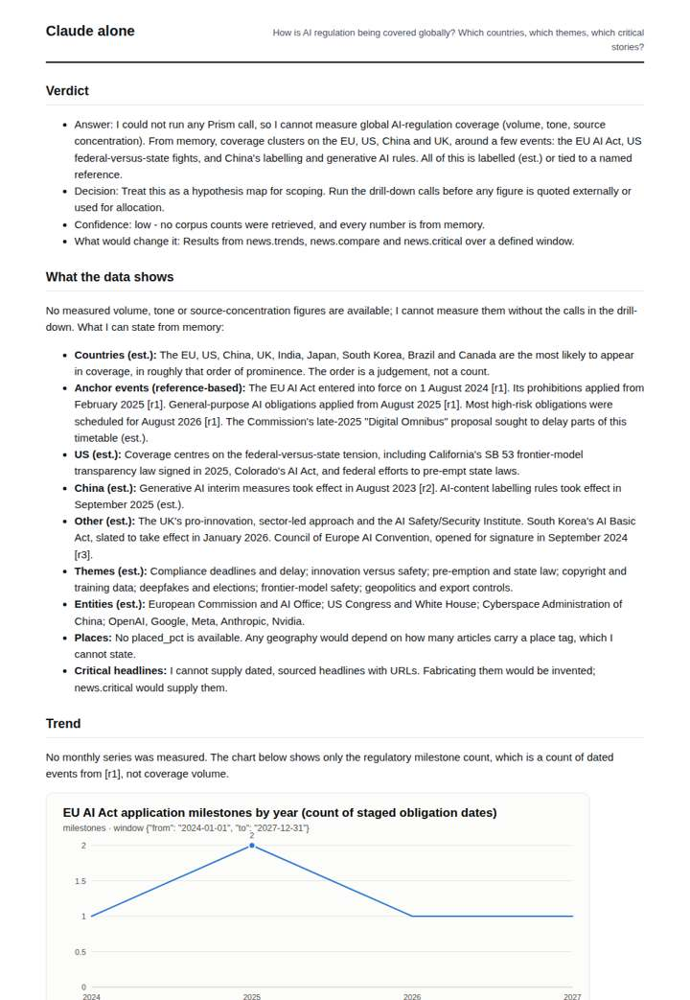
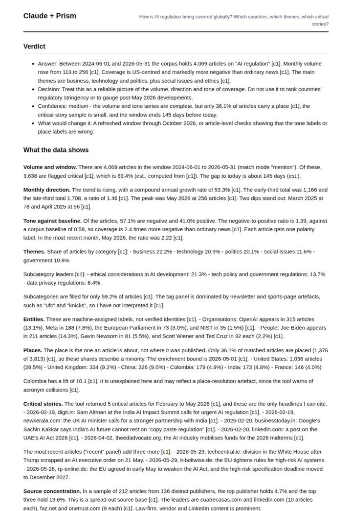
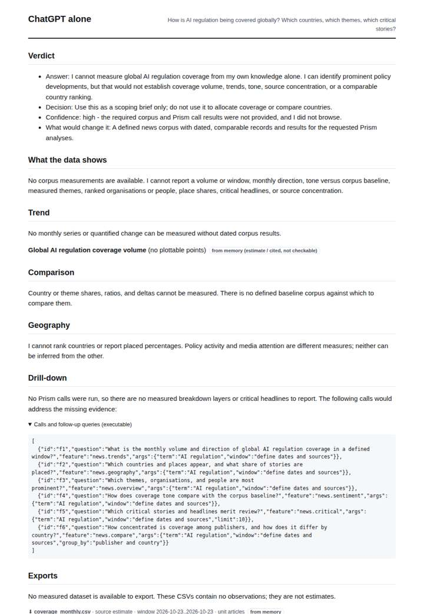
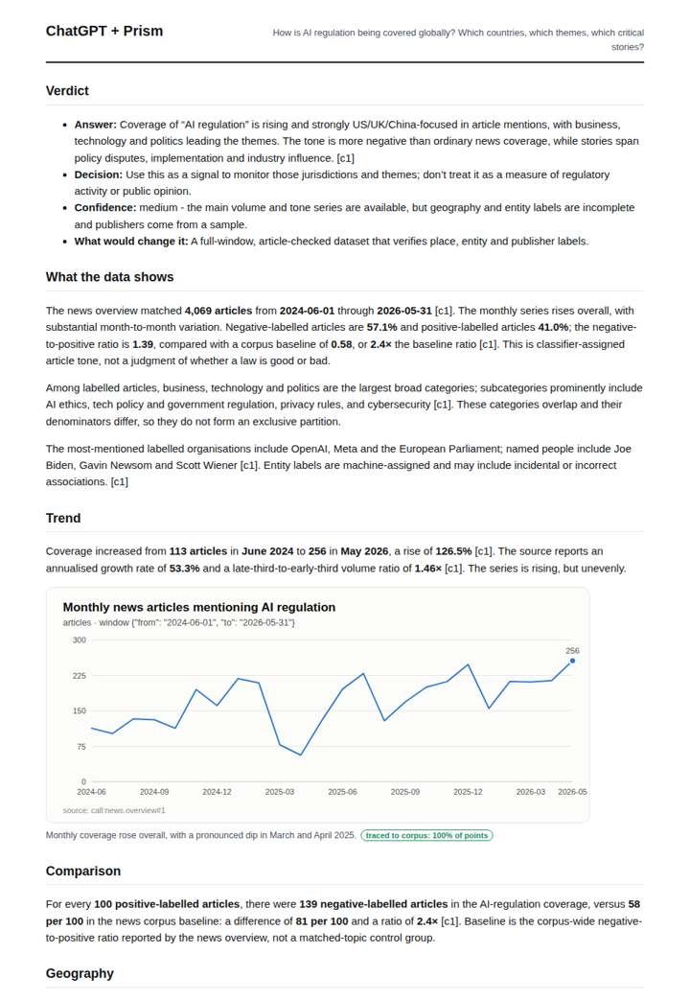

# AI regulation coverage

**Question.** How is AI regulation being covered globally? Which countries, which themes, which critical stories?

**Category:** Policy & regulation · **Pattern:** `pulse` · **Why it is hard:** EU AI Act, US executive orders and India's approach are covered very differently by country.

| Score /100 | Claude alone | Claude + Prism | ChatGPT alone | ChatGPT + Prism |
|---|---|---|---|---|
| Weighted (strict) | 28.8 | **77.6** | 21.9 | 70.0 |
| Opus judge | 21.0 | 72.6 | 14.2 | 60.4 |
| GPT judge | 36.6 | 82.6 | 29.6 | 79.6 |

## Parameter scores (0-5)

| Parameter | Weight | Claude alone | Claude + Prism | ChatGPT alone | ChatGPT + Prism |
|---|---|---|---|---|---|
| Measured trend | 10 | 1.0 | 4.5 | 0.0 | 4.0 |
| Measured comparison | 7 | 0.5 | 4.5 | 0.5 | 4.5 |
| Visualisation from counted data | 10 | 0.5 | 4.0 | 0.0 | 3.5 |
| Exploration and drill-down | 7 | 1.5 | 3.5 | 1.0 | 2.5 |
| Data export with provenance | 8 | 0.5 | 3.0 | 0.5 | 4.0 |
| Reproducibility | 12 | 0.0 | 4.5 | 0.5 | 4.5 |
| Traceable references | 8 | 1.0 | 1.0 | 0.0 | 1.0 |
| Accuracy against the corpus | 12 | 3.0 | 4.5 | 3.5 | 3.5 |
| Calibration and limits | 8 | 3.5 | 4.0 | 2.5 | 3.0 |
| Decision-grade verdict | 12 | 2.5 | 4.0 | 2.0 | 3.5 |
| Facet coverage | 6 | 1.5 | 4.5 | 0.5 | 4.0 |

## Script findings

| Check | Claude alone | Claude + Prism | ChatGPT alone | ChatGPT + Prism |
|---|---|---|---|---|
| Numbers traced to the corpus | 0/1 | 82/82 | 0/0 | 28/28 |
| Charts (traced share) | memory | 100% | memory | 100% |
| DOIs that resolve | 0/0 | 0/0 | 0/0 | 0/0 |
| Follow-up queries that ran | 3/7 | 4/6 | 0/6 | 1/4 |
| Invention gate | clear | clear | clear | clear |

**Claude Opus judge:** D and B both measured volume, tone and geography from the same traced call. D went further: it named the peak and trough, caught the Colombia and tag-panel artefacts, and placed its limits beside the numbers they bound. A and C could not measure coverage at all; C's memory map is honestly labelled but is not decision-grade. B is a solid second but slightly misreads the enrichment bound and gives a thinner drill-down.

**GPT judge:** A is the strongest decision aid: it combines a fully traced trend with tone, themes, geography, selected headlines, and unusually specific limits. B has cleaner complete exports, but answers less of the global country and story question; neither deliverable provides a verifiable linked reference set.

## Before / after (first screen)

| | Alone | With Prism |
|---|---|---|
| Claude |  |  |
| ChatGPT |  |  |

Full deliverables, rendered: [PDF](https://fliarbi.com/demo/docs/prism-benchmark-v2-4ed65c83/full/ai-regulation-pulse.pdf). Raw answers, ground pass and judge outputs: `answers.json`, `ground.json`, `judge_opus.json`, `judge_gpt.json` in this folder.
