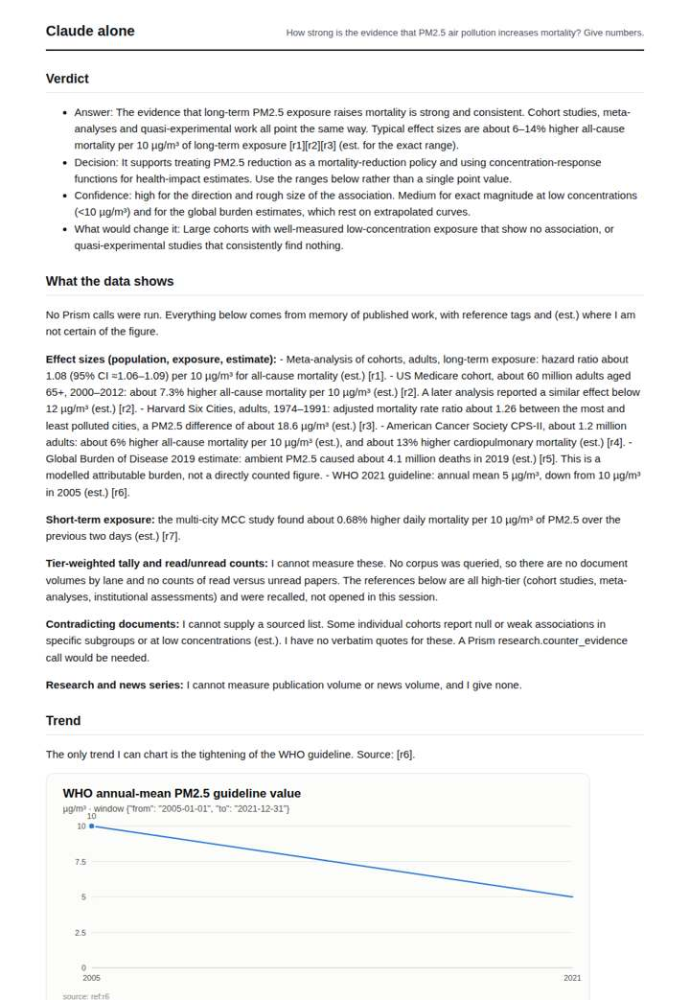
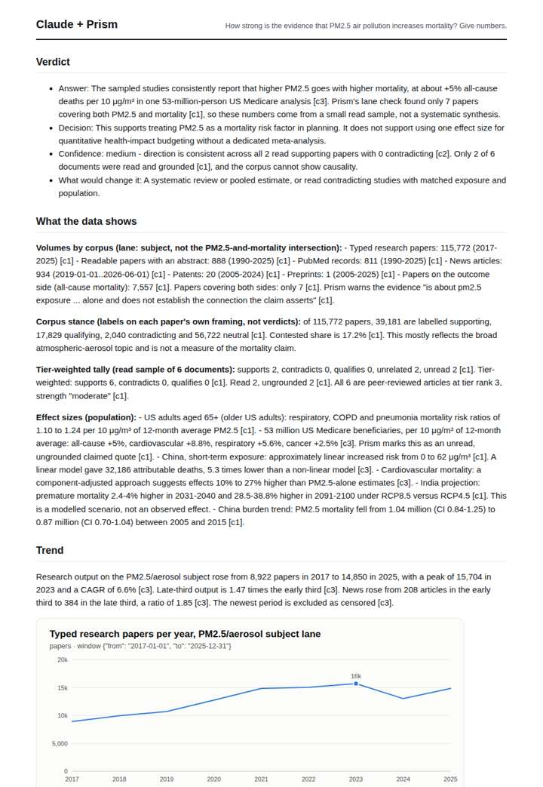
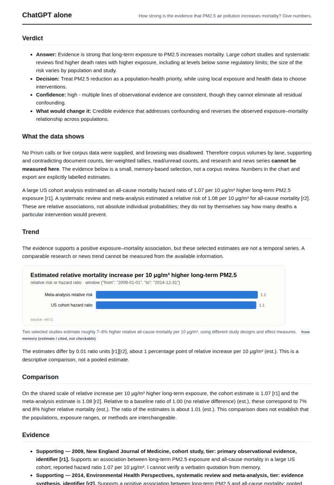
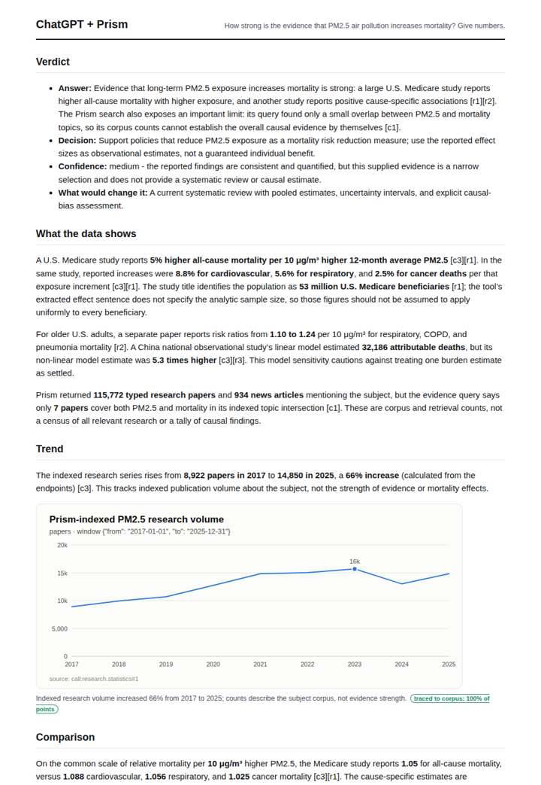

# Air pollution and mortality

**Question.** How strong is the evidence that PM2.5 air pollution increases mortality? Give numbers.

**Category:** Public health & epidemiology · **Pattern:** `evidence` · **Why it is hard:** The corpus files this under 'Air Quality and Health Impacts', not 'air pollution'; term discovery matters.

| Score /100 | Claude alone | Claude + Prism | ChatGPT alone | ChatGPT + Prism |
|---|---|---|---|---|
| Weighted (strict) | 25.4 | 65.2 | 24.1 | **79.1** |
| Opus judge | 28.6 | 72.6 | 23.6 | 73.0 |
| GPT judge | 22.2 | 57.8 | 24.6 | 85.2 |

## Parameter scores (0-5)

| Parameter | Weight | Claude alone | Claude + Prism | ChatGPT alone | ChatGPT + Prism |
|---|---|---|---|---|---|
| Measured trend | 10 | 1.0 | 4.0 | 0.5 | 3.5 |
| Measured comparison | 7 | 2.0 | 3.5 | 1.5 | 4.5 |
| Visualisation from counted data | 10 | 1.0 | 3.0 | 1.0 | 3.5 |
| Exploration and drill-down | 7 | 1.0 | 2.5 | 1.0 | 3.0 |
| Data export with provenance | 8 | 1.0 | 3.0 | 1.0 | 3.0 |
| Reproducibility | 12 | 1.0 | 3.5 | 0.0 | 4.5 |
| Traceable references | 8 | 1.5 | 3.0 | 1.0 | 4.5 |
| Accuracy against the corpus | 12 | 2.0 | 2.5 | 1.0 | 4.0 |
| Calibration and limits | 8 | 3.0 | 3.5 | 3.0 | 4.5 |
| Decision-grade verdict | 12 | 0.0 | 3.5 | 2.5 | 4.0 |
| Facet coverage | 6 | 1.0 | 4.0 | 1.0 | 4.5 |

## Script findings

| Check | Claude alone | Claude + Prism | ChatGPT alone | ChatGPT + Prism |
|---|---|---|---|---|
| Numbers traced to the corpus | 0/39 | 70/70 | 0/19 | 52/52 |
| Charts (traced share) | memory | 100%, 100% | memory | 100% |
| DOIs that resolve | 5/5 | 7/7 | 2/2 | 3/3 |
| Follow-up queries that ran | 1/6 | 2/6 | 0/4 | 1/5 |
| Invention gate | tripped | clear | clear | clear |

**Claude Opus judge:** C and D were both grounded in the recorded Prism responses and both flagged the 7-paper intersection limit. A and B relied on memory, and B's citations did not match its effect sizes. C edged D by covering more facets: the full trend with peak and CAGR, the news thirds, and a traced cause-specific effect chart. D was slightly cleaner on accuracy but charted and exported only research volume.

**GPT judge:** A best supports a decision: it pairs traceable mortality effect estimates with clear limits on what the selected corpus can establish, and it makes the policy implication conditional on observational evidence. B includes more material but introduces an unresolved, directionally inconsistent news trend and an unsupported study window; C and D rely on unverified memory estimates and conflicting reference details.

## Before / after (first screen)

| | Alone | With Prism |
|---|---|---|
| Claude |  |  |
| ChatGPT |  |  |

Full deliverables, rendered: [PDF](https://fliarbi.com/demo/docs/prism-benchmark-v2-4ed65c83/full/air-pollution-mortality.pdf). Raw answers, ground pass and judge outputs: `answers.json`, `ground.json`, `judge_opus.json`, `judge_gpt.json` in this folder.
