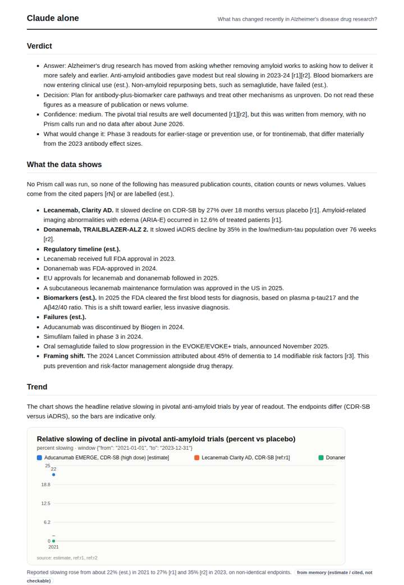
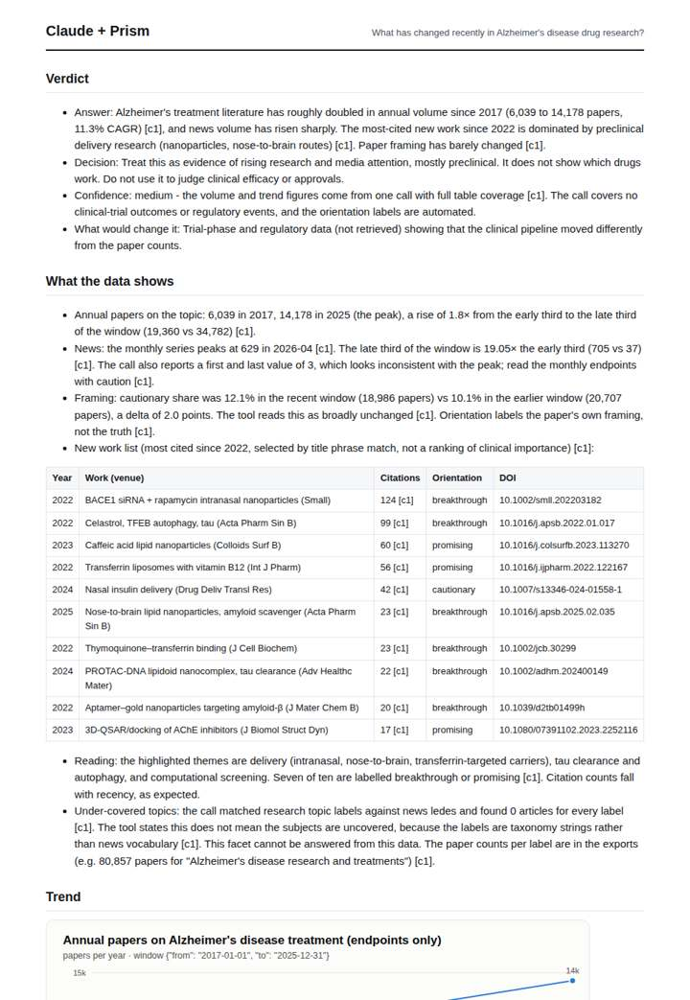
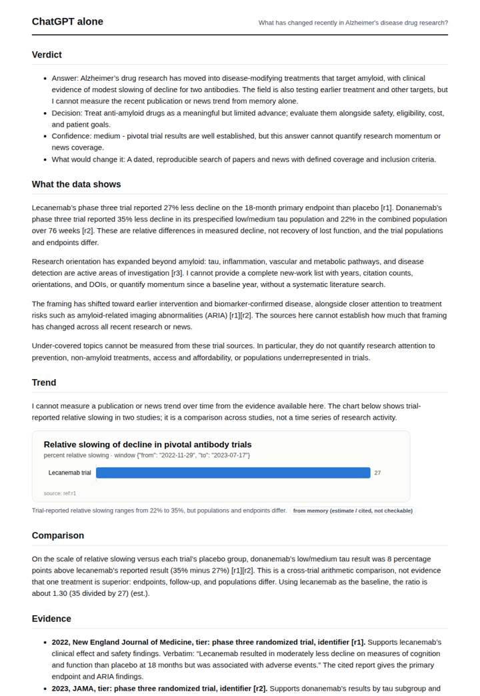
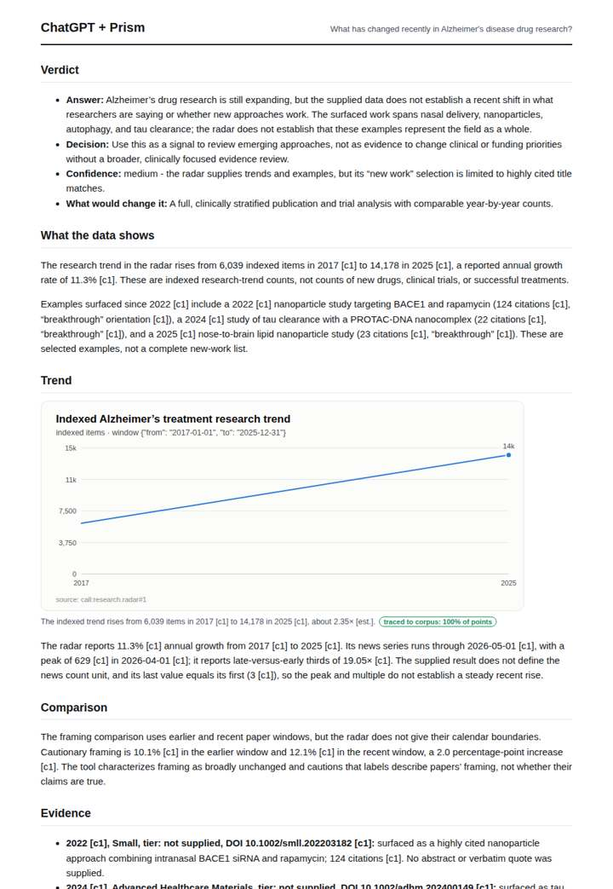

# Alzheimer's drug research radar

**Question.** What has changed recently in Alzheimer's disease drug research?

**Category:** Medical & clinical evidence · **Pattern:** `radar` · **Why it is hard:** Lecanemab and donanemab approvals moved the field in 2023-2025, after most models' training data.

| Score /100 | Claude alone | Claude + Prism | ChatGPT alone | ChatGPT + Prism |
|---|---|---|---|---|
| Weighted (strict) | 39.7 | 70.2 | 37.2 | **74.0** |
| Opus judge | 37.4 | 67.2 | 29.0 | 67.6 |
| GPT judge | 42.0 | 73.2 | 45.4 | 80.4 |

## Parameter scores (0-5)

| Parameter | Weight | Claude alone | Claude + Prism | ChatGPT alone | ChatGPT + Prism |
|---|---|---|---|---|---|
| Measured trend | 10 | 1.5 | 4.0 | 0.0 | 3.5 |
| Measured comparison | 7 | 2.0 | 2.5 | 2.0 | 4.0 |
| Visualisation from counted data | 10 | 1.0 | 3.5 | 1.0 | 3.5 |
| Exploration and drill-down | 7 | 1.5 | 2.5 | 1.0 | 2.0 |
| Data export with provenance | 8 | 1.0 | 2.5 | 1.0 | 3.0 |
| Reproducibility | 12 | 0.0 | 4.5 | 0.0 | 4.5 |
| Traceable references | 8 | 3.0 | 3.0 | 4.0 | 3.0 |
| Accuracy against the corpus | 12 | 3.0 | 3.0 | 3.0 | 4.5 |
| Calibration and limits | 8 | 3.0 | 4.0 | 3.5 | 4.5 |
| Decision-grade verdict | 12 | 4.0 | 4.0 | 3.5 | 3.5 |
| Facet coverage | 6 | 1.5 | 4.5 | 1.5 | 4.0 |

## Script findings

| Check | Claude alone | Claude + Prism | ChatGPT alone | ChatGPT + Prism |
|---|---|---|---|---|
| Numbers traced to the corpus | 0/32 | 61/61 | 0/13 | 19/19 |
| Charts (traced share) | memory | 100% | memory | 100% |
| DOIs that resolve | 3/3 | 10/10 | 3/3 | 3/3 |
| Follow-up queries that ran | 4/7 | 2/7 | 0/5 | 1/5 |
| Invention gate | clear | clear | clear | clear |

**Claude Opus judge:** A and D are the only grounded deliverables and score nearly level. D covers more facets, but it miscounts the orientation labels and mislabels the framing windows. A is cleaner but answers weakly. B gives the most domain-useful account of the lecanemab/donanemab shift, but it is from memory and cannot be reproduced.

**GPT judge:** B is the strongest decision deliverable: it traces and qualifies the research trend, covers framing and news, and supplies reproducible calls, while being candid about the limits of selected title matches. C covers more facets, but its cross-lane growth comparison and news-rise wording weaken its reading; neither database-backed response directly answers the clinical and regulatory changes highlighted by the question.

## Before / after (first screen)

| | Alone | With Prism |
|---|---|---|
| Claude |  |  |
| ChatGPT |  |  |

Full deliverables, rendered: [PDF](https://fliarbi.com/demo/docs/prism-benchmark-v2-4ed65c83/full/alzheimers-drugs-radar.pdf). Raw answers, ground pass and judge outputs: `answers.json`, `ground.json`, `judge_opus.json`, `judge_gpt.json` in this folder.
