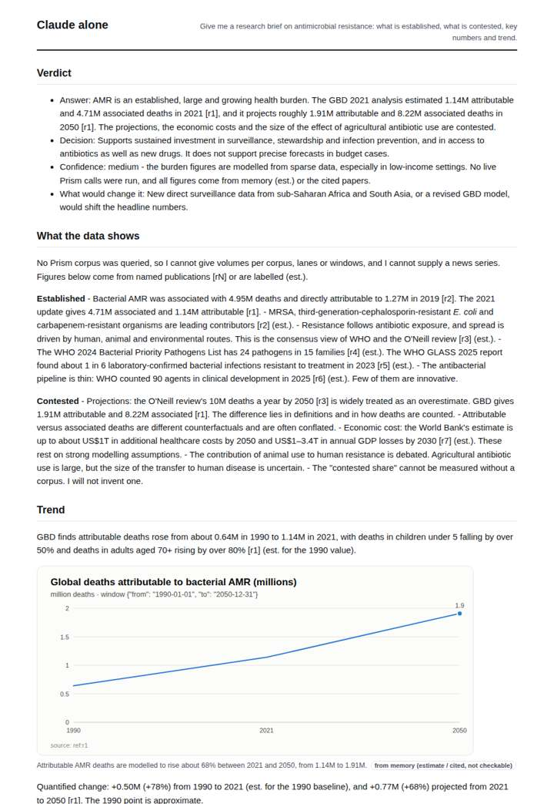
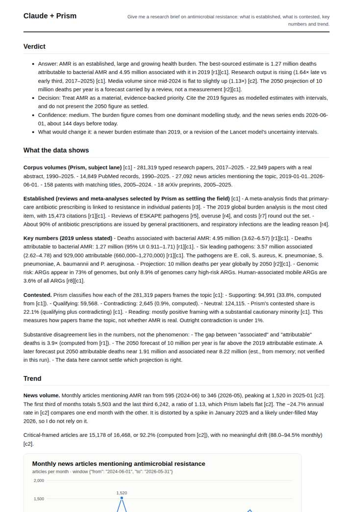
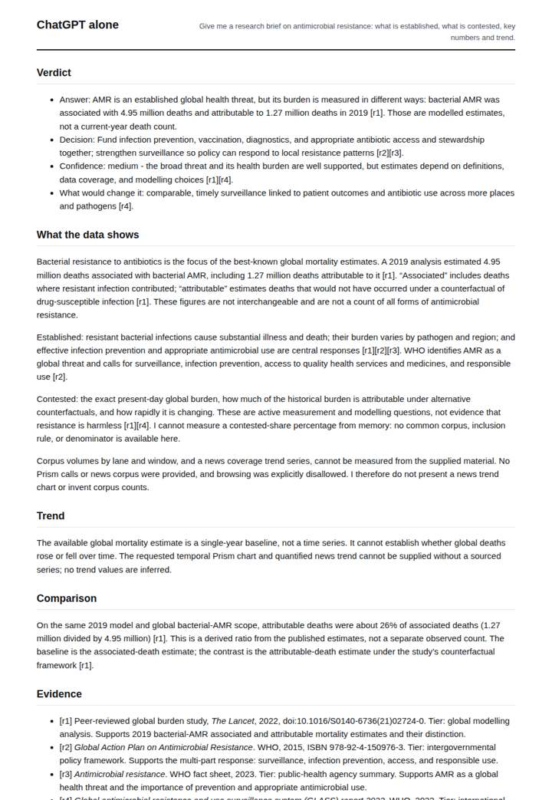
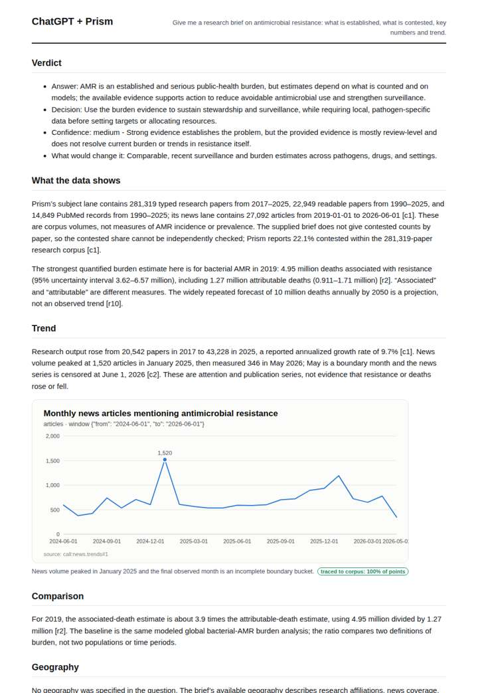

# Antimicrobial resistance brief

**Question.** Give me a research brief on antimicrobial resistance: what is established, what is contested, key numbers and trend.

**Category:** Medical & clinical evidence · **Pattern:** `brief` · **Why it is hard:** Volumes differ by orders of magnitude between corpora; the brief must say which lane each number is from.

| Score /100 | Claude alone | Claude + Prism | ChatGPT alone | ChatGPT + Prism |
|---|---|---|---|---|
| Weighted (strict) | 38.1 | **74.0** | 36.0 | 67.2 |
| Opus judge | 33.8 | 79.0 | 34.2 | 64.2 |
| GPT judge | 42.4 | 69.0 | 37.8 | 70.2 |

## Parameter scores (0-5)

| Parameter | Weight | Claude alone | Claude + Prism | ChatGPT alone | ChatGPT + Prism |
|---|---|---|---|---|---|
| Measured trend | 10 | 1.5 | 4.5 | 0.0 | 3.0 |
| Measured comparison | 7 | 2.0 | 4.5 | 2.0 | 4.0 |
| Visualisation from counted data | 10 | 1.0 | 1.0 | 0.0 | 3.0 |
| Exploration and drill-down | 7 | 1.5 | 3.5 | 1.0 | 1.0 |
| Data export with provenance | 8 | 1.0 | 1.0 | 0.0 | 3.0 |
| Reproducibility | 12 | 1.0 | 4.5 | 1.0 | 4.0 |
| Traceable references | 8 | 1.5 | 4.0 | 3.0 | 4.0 |
| Accuracy against the corpus | 12 | 2.5 | 4.5 | 4.0 | 3.5 |
| Calibration and limits | 8 | 3.5 | 4.5 | 3.0 | 4.0 |
| Decision-grade verdict | 12 | 3.5 | 4.0 | 3.5 | 3.5 |
| Facet coverage | 6 | 1.5 | 4.5 | 1.5 | 3.5 |

## Script findings

| Check | Claude alone | Claude + Prism | ChatGPT alone | ChatGPT + Prism |
|---|---|---|---|---|
| Numbers traced to the corpus | 0/39 | 112/115 | 0/7 | 30/31 |
| Charts (traced share) | memory | 100%, memory | none | 100% |
| DOIs that resolve | 2/2 | 8/8 | 1/1 | 3/3 |
| Follow-up queries that ran | 3/6 | 3/6 | 0/4 | 0/4 |
| Invention gate | clear | clear | clear | clear |

**Claude Opus judge:** B was the only deliverable that met the question's hard part. It labelled every volume with its lane and window, kept the two news series apart, read the flat 1.13 news trend correctly and caught the tool's anomalies. D was traced but thin and misread two fields. A and C were memory-only; C was honest, while A carried a probably wrong 1990 baseline.

**GPT judge:** C gives the broadest grounded brief: it separates corpus lanes, burden definitions, and framing; traces research and news trends; and calls out conflicting trend summaries and missing outcome data. Its chart-window and export provenance errors keep it from a clean decision-grade result, while B is more internally tidy but leaves more of the available evidence and trend detail unused.

## Before / after (first screen)

| | Alone | With Prism |
|---|---|---|
| Claude |  |  |
| ChatGPT |  |  |

Full deliverables, rendered: [PDF](https://fliarbi.com/demo/docs/prism-benchmark-v2-4ed65c83/full/antimicrobial-resistance-brief.pdf). Raw answers, ground pass and judge outputs: `answers.json`, `ground.json`, `judge_opus.json`, `judge_gpt.json` in this folder.
