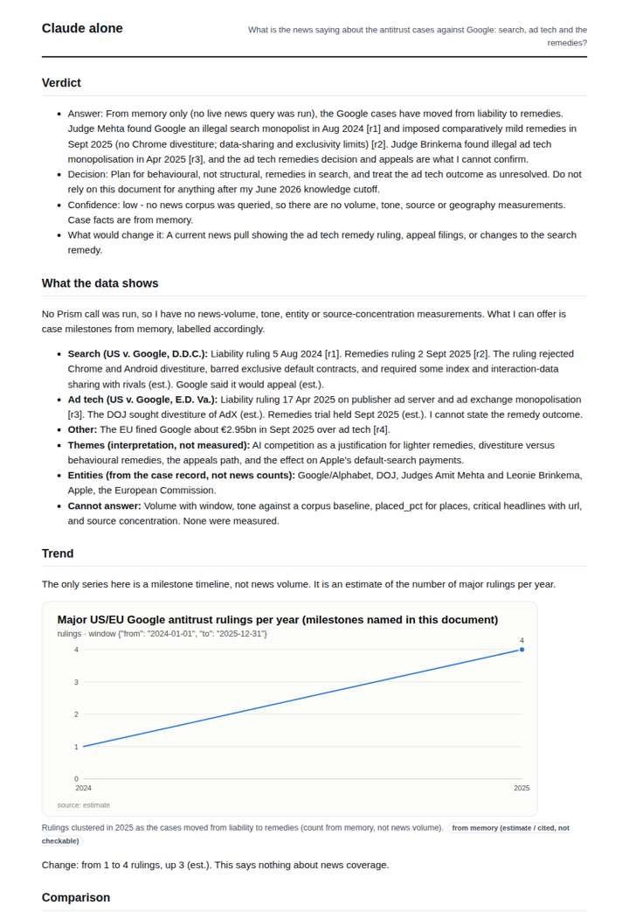
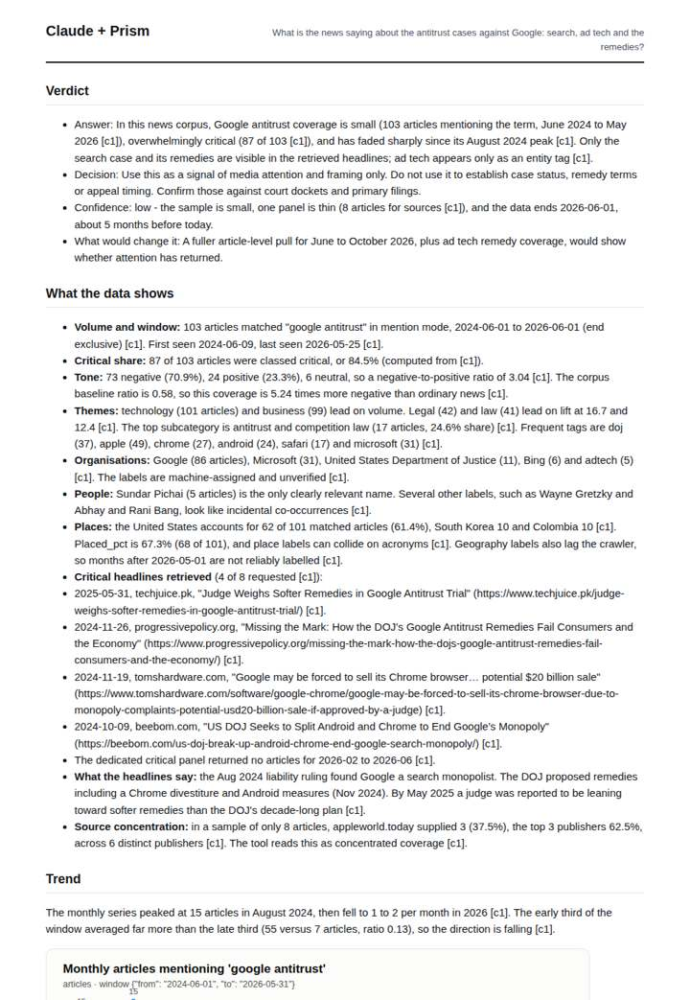
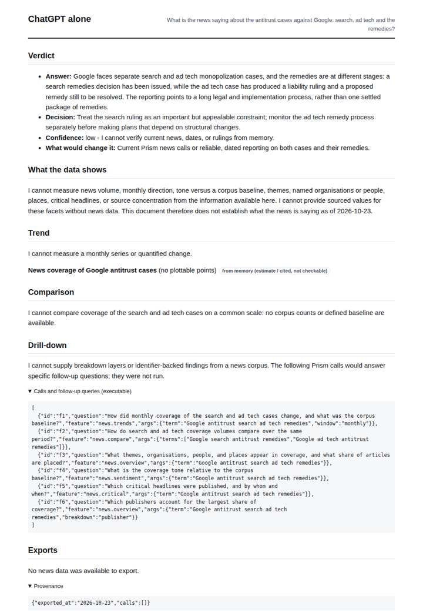
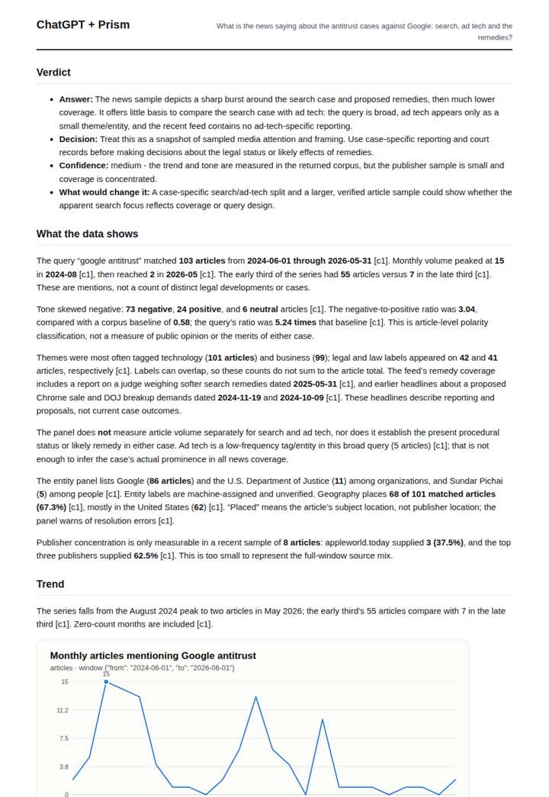

# Google antitrust coverage

**Question.** What is the news saying about the antitrust cases against Google: search, ad tech and the remedies?

**Category:** Legal & compliance · **Pattern:** `pulse` · **Why it is hard:** Google search ruling (2024) and remedies (2025) are post-training for many models.

| Score /100 | Claude alone | Claude + Prism | ChatGPT alone | ChatGPT + Prism |
|---|---|---|---|---|
| Weighted (strict) | 31.0 | 68.3 | 22.7 | **70.5** |
| Opus judge | 32.8 | 70.2 | 20.6 | 71.8 |
| GPT judge | 29.2 | 66.4 | 24.8 | 69.2 |

## Parameter scores (0-5)

| Parameter | Weight | Claude alone | Claude + Prism | ChatGPT alone | ChatGPT + Prism |
|---|---|---|---|---|---|
| Measured trend | 10 | 1.0 | 4.0 | 0.0 | 4.0 |
| Measured comparison | 7 | 1.0 | 4.0 | 0.5 | 4.0 |
| Visualisation from counted data | 10 | 1.0 | 3.0 | 0.0 | 3.0 |
| Exploration and drill-down | 7 | 1.0 | 2.5 | 1.0 | 2.5 |
| Data export with provenance | 8 | 1.0 | 3.0 | 0.0 | 3.0 |
| Reproducibility | 12 | 1.0 | 4.5 | 1.0 | 4.5 |
| Traceable references | 8 | 1.0 | 1.0 | 0.5 | 2.0 |
| Accuracy against the corpus | 12 | 2.5 | 3.5 | 3.0 | 4.0 |
| Calibration and limits | 8 | 3.0 | 4.0 | 3.0 | 4.0 |
| Decision-grade verdict | 12 | 2.5 | 3.5 | 2.0 | 3.5 |
| Facet coverage | 6 | 1.5 | 4.0 | 0.5 | 3.5 |

## Script findings

| Check | Claude alone | Claude + Prism | ChatGPT alone | ChatGPT + Prism |
|---|---|---|---|---|
| Numbers traced to the corpus | 0/2 | 65/65 | 0/0 | 28/28 |
| Charts (traced share) | memory | 100% | memory | 100% |
| DOIs that resolve | 0/0 | 0/0 | 0/0 | 0/0 |
| Follow-up queries that ran | 2/6 | 2/6 | 1/6 | 2/4 |
| Invention gate | clear | clear | clear | clear |

**Claude Opus judge:** A and B both read the measured corpus correctly: a 103-article volume that peaked in August 2024 and faded, with tone 5.24x more negative than baseline. A edges ahead with richer decomposition (critical share, secondary bumps) and by flagging label anomalies such as Colombia and incidental people. Both are honest that ad tech is effectively unmeasured and that the five months before today are missing. C gives useful case milestones from memory, but nothing about what the news measured; D offers almost nothing.

**GPT judge:** C gives the broadest traceable picture of coverage, tone, themes and headlines, and clearly flags the stale window and thin publisher sample. A is more restrained, but neither establishes what current reporting says about the search and ad-tech remedies; C’s unsupported links between tags or volume bumps and case coverage keep its conclusion tentative.

## Before / after (first screen)

| | Alone | With Prism |
|---|---|---|
| Claude |  |  |
| ChatGPT |  |  |

Full deliverables, rendered: [PDF](https://fliarbi.com/demo/docs/prism-benchmark-v2-4ed65c83/full/antitrust-big-tech.pdf). Raw answers, ground pass and judge outputs: `answers.json`, `ground.json`, `judge_opus.json`, `judge_gpt.json` in this folder.
