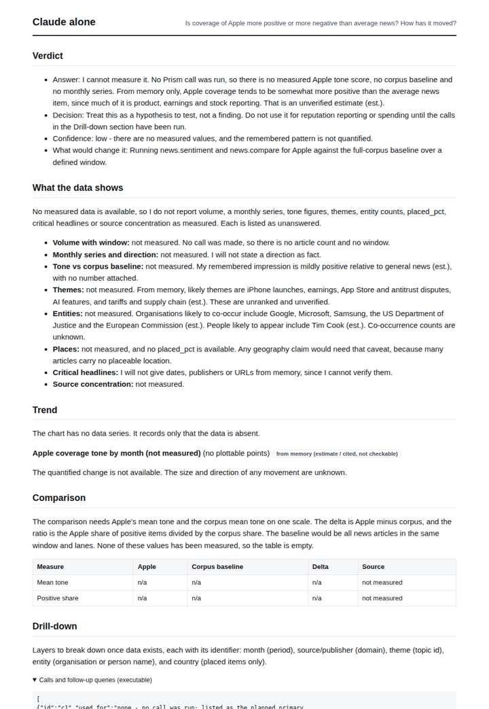
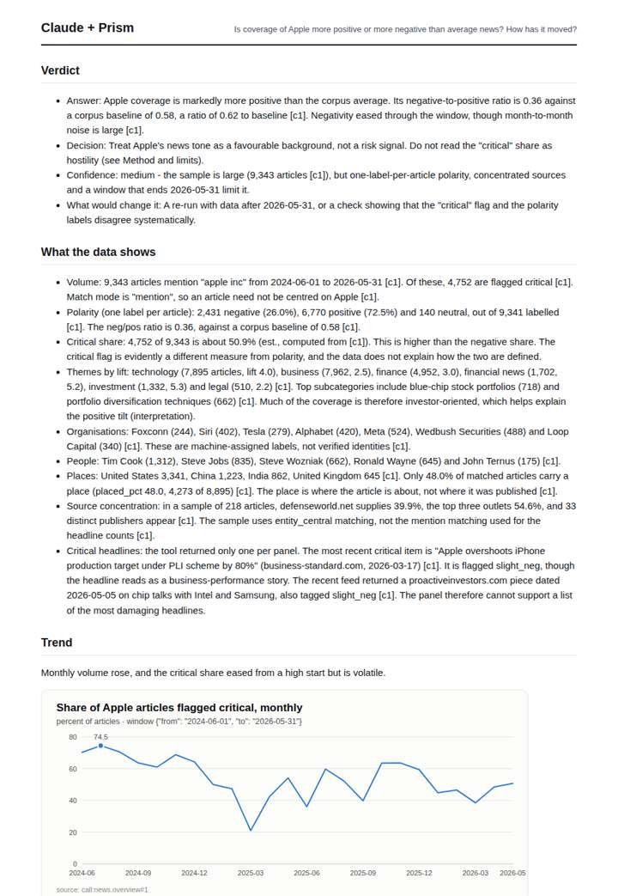
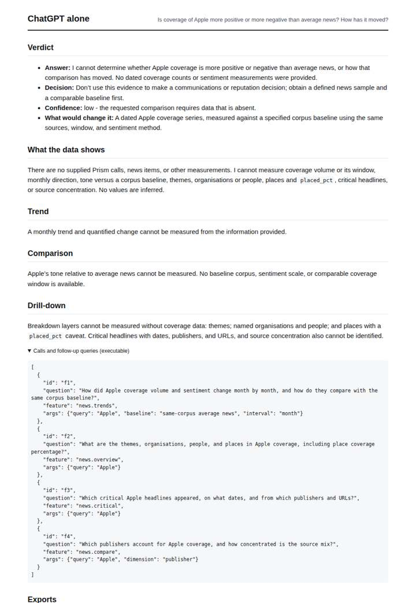
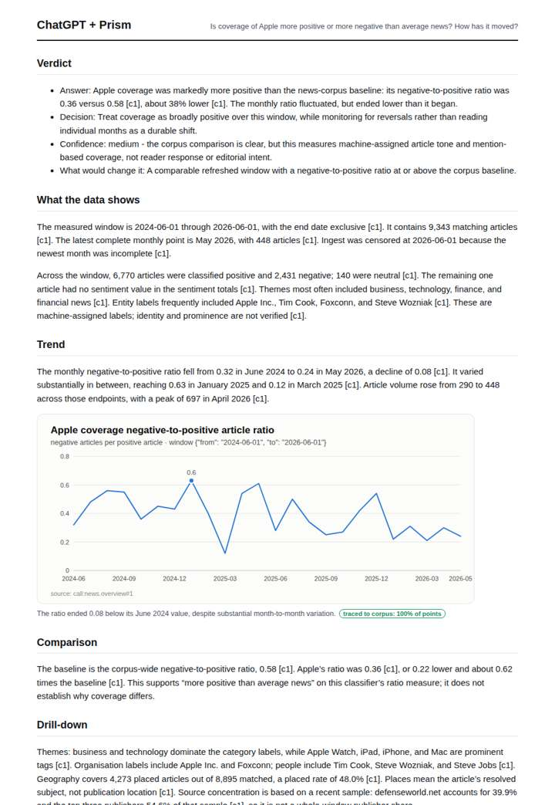

# Apple tone vs the baseline

**Question.** Is coverage of Apple more positive or more negative than average news? How has it moved?

**Category:** Company & competitive intelligence · **Pattern:** `pulse` · **Why it is hard:** Product launches create positive spikes; regulation creates negative ones.

| Score /100 | Claude alone | Claude + Prism | ChatGPT alone | ChatGPT + Prism |
|---|---|---|---|---|
| Weighted (strict) | 33.9 | **74.9** | 24.8 | 71.6 |
| Opus judge | 23.2 | 77.0 | 16.6 | 68.8 |
| GPT judge | 44.6 | 72.8 | 33.0 | 74.4 |

## Parameter scores (0-5)

| Parameter | Weight | Claude alone | Claude + Prism | ChatGPT alone | ChatGPT + Prism |
|---|---|---|---|---|---|
| Measured trend | 10 | 0.5 | 4.0 | 0.0 | 4.0 |
| Measured comparison | 7 | 1.0 | 4.0 | 0.0 | 4.0 |
| Visualisation from counted data | 10 | 0.5 | 4.0 | 0.0 | 3.5 |
| Exploration and drill-down | 7 | 1.5 | 2.5 | 1.0 | 2.0 |
| Data export with provenance | 8 | 0.5 | 4.5 | 0.0 | 3.0 |
| Reproducibility | 12 | 1.0 | 4.0 | 1.0 | 4.0 |
| Traceable references | 8 | 0.5 | 1.5 | 0.5 | 1.0 |
| Accuracy against the corpus | 12 | 4.0 | 3.5 | 4.0 | 4.0 |
| Calibration and limits | 8 | 4.0 | 4.5 | 2.5 | 4.0 |
| Decision-grade verdict | 12 | 3.0 | 4.0 | 2.5 | 4.5 |
| Facet coverage | 6 | 1.0 | 4.5 | 0.5 | 4.5 |

## Script findings

| Check | Claude alone | Claude + Prism | ChatGPT alone | ChatGPT + Prism |
|---|---|---|---|---|
| Numbers traced to the corpus | 0/0 | 104/106 | 0/0 | 27/28 |
| Charts (traced share) | memory | 100%, 100% | none | 100% |
| DOIs that resolve | 0/0 | 0/0 | 0/0 | 0/0 |
| Follow-up queries that ran | 3/7 | 2/6 | 0/4 | 1/5 |
| Invention gate | clear | clear | clear | clear |

**Claude Opus judge:** B and D both answer with traced numbers that Apple coverage is markedly more positive than the corpus baseline (0.36 vs 0.58). D goes further:
- It separates the 'critical' flag from negative polarity.
- It quantifies volume and critical trends.
- It flags the Colombia anomaly and the label-fill lag.
- It gives news items with URLs.

D has one averaging slip. A and C offer no measurement; C's honestly labelled memory guess happens to point the right way.

**GPT judge:** D is the strongest decision brief: it gives a measured comparison, a readable monthly movement, and a bounded verdict with relevant caveats. C provides richer exports and breakdowns, but its first-six-month tone average is miscalculated and its report adds more unsupported precision.

## Before / after (first screen)

| | Alone | With Prism |
|---|---|---|
| Claude |  |  |
| ChatGPT |  |  |

Full deliverables, rendered: [PDF](https://fliarbi.com/demo/docs/prism-benchmark-v2-4ed65c83/full/apple-sentiment.pdf). Raw answers, ground pass and judge outputs: `answers.json`, `ground.json`, `judge_opus.json`, `judge_gpt.json` in this folder.
