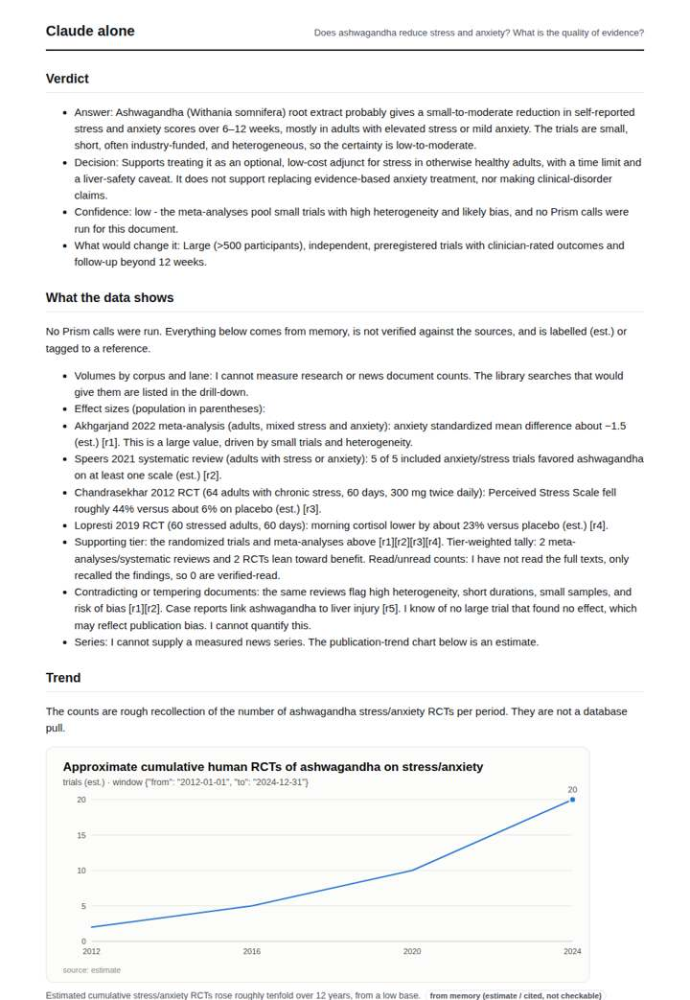
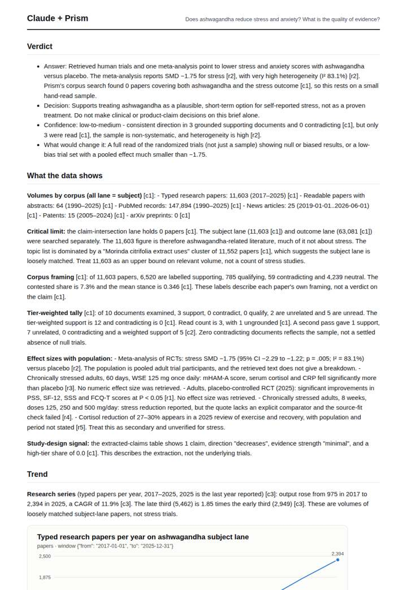
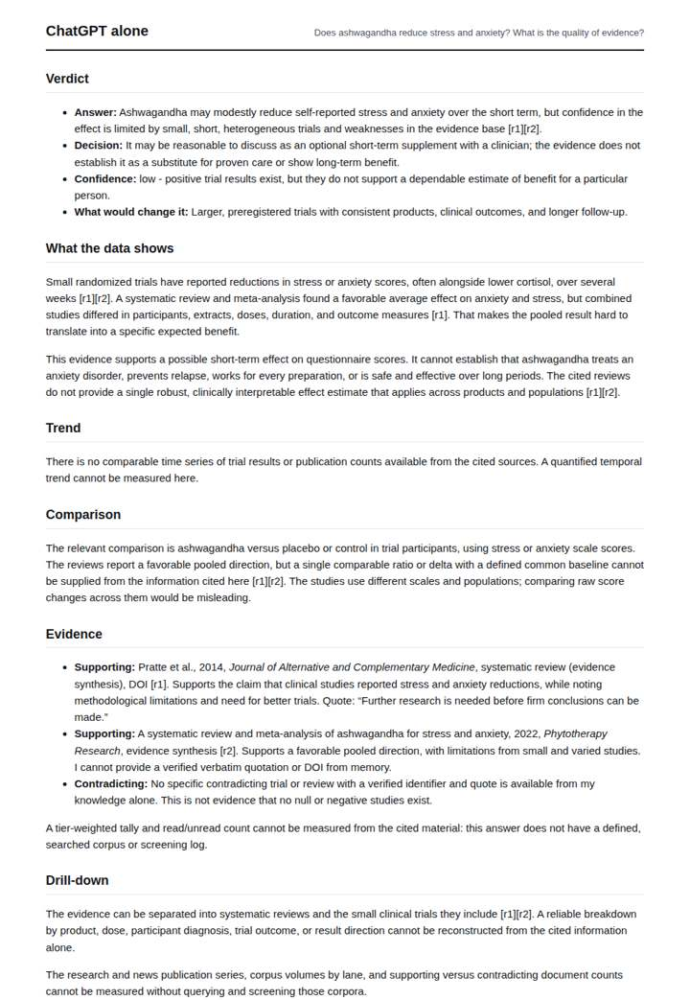
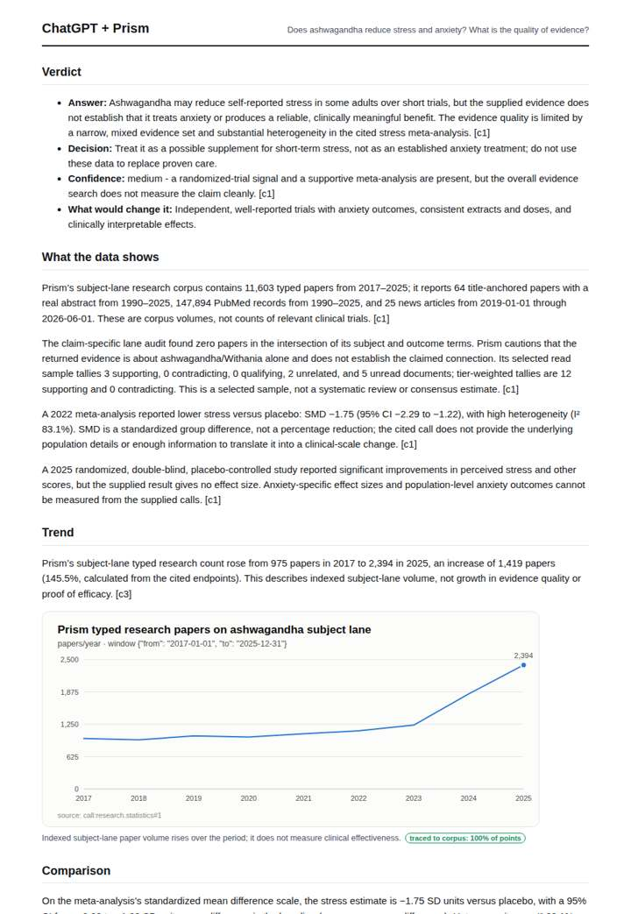

# Does ashwagandha reduce stress?

**Question.** Does ashwagandha reduce stress and anxiety? What is the quality of evidence?

**Category:** Consumer, brands & media · **Pattern:** `evidence` · **Why it is hard:** Small, industry-funded trials; tiering exposes it.

| Score /100 | Claude alone | Claude + Prism | ChatGPT alone | ChatGPT + Prism |
|---|---|---|---|---|
| Weighted (strict) | 25.8 | **75.1** | 27.2 | 74.4 |
| Opus judge | 27.0 | 71.6 | 19.2 | 70.8 |
| GPT judge | 24.6 | 78.6 | 35.2 | 78.0 |

## Parameter scores (0-5)

| Parameter | Weight | Claude alone | Claude + Prism | ChatGPT alone | ChatGPT + Prism |
|---|---|---|---|---|---|
| Measured trend | 10 | 1.0 | 4.5 | 0.0 | 3.5 |
| Measured comparison | 7 | 1.5 | 4.5 | 1.0 | 3.5 |
| Visualisation from counted data | 10 | 1.0 | 4.0 | 0.0 | 4.0 |
| Exploration and drill-down | 7 | 1.5 | 4.0 | 1.0 | 2.5 |
| Data export with provenance | 8 | 1.0 | 2.5 | 0.0 | 4.0 |
| Reproducibility | 12 | 1.0 | 4.0 | 1.0 | 3.0 |
| Traceable references | 8 | 1.0 | 1.0 | 0.0 | 4.0 |
| Accuracy against the corpus | 12 | 2.5 | 4.0 | 3.0 | 4.0 |
| Calibration and limits | 8 | 3.0 | 4.0 | 2.5 | 4.0 |
| Decision-grade verdict | 12 | 0.0 | 4.0 | 3.5 | 4.0 |
| Facet coverage | 6 | 1.0 | 4.5 | 2.0 | 4.5 |

## Script findings

| Check | Claude alone | Claude + Prism | ChatGPT alone | ChatGPT + Prism |
|---|---|---|---|---|
| Numbers traced to the corpus | 0/23 | 65/65 | 0/0 | 34/34 |
| Charts (traced share) | memory | 100% | none | 100% |
| DOIs that resolve | 0/0 | 7/7 | 0/1 | 2/2 |
| Follow-up queries that ran | 2/6 | 4/6 | 0/5 | 3/6 |
| Invention gate | tripped | clear | clear | clear |

**Claude Opus judge:** B and D both grounded the answer in the recorded evidence: the meta-analysis SMD −1.75 with I² 83.1%, an RCT and a zero-contradiction tally. Both stated that the corpus intersection is empty. B went further by catching the off-topic Morinda cluster and quantifying the trends and contrasts, while D had cleaner references and exports. A was honest memory with no measurement, and C was undermined by a fabricated DOI and by presenting calls as run when none were.

**GPT judge:** B is the strongest decision deliverable: it combines reproducible research and news trends, quantified contrasts, and a direct conclusion bounded by the empty claim-intersection lane and a selected read sample. C is close and has cleaner paper citations and exports, but its incomplete regenerate calls and omitted trend decomposition weaken auditability; both leave the funding and bias question unresolved in the supplied evidence.

## Before / after (first screen)

| | Alone | With Prism |
|---|---|---|
| Claude |  |  |
| ChatGPT |  |  |

Full deliverables, rendered: [PDF](https://fliarbi.com/demo/docs/prism-benchmark-v2-4ed65c83/full/ashwagandha-evidence.pdf). Raw answers, ground pass and judge outputs: `answers.json`, `ground.json`, `judge_opus.json`, `judge_gpt.json` in this folder.
