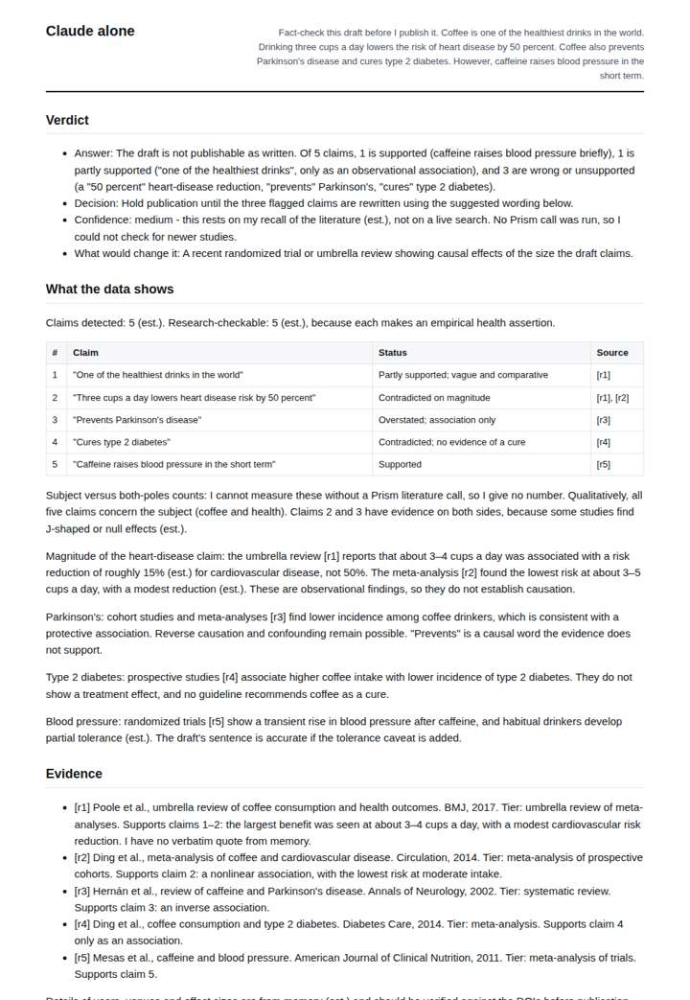
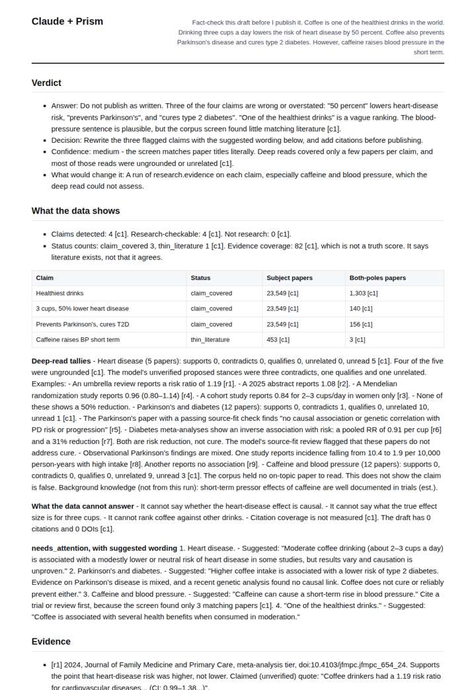
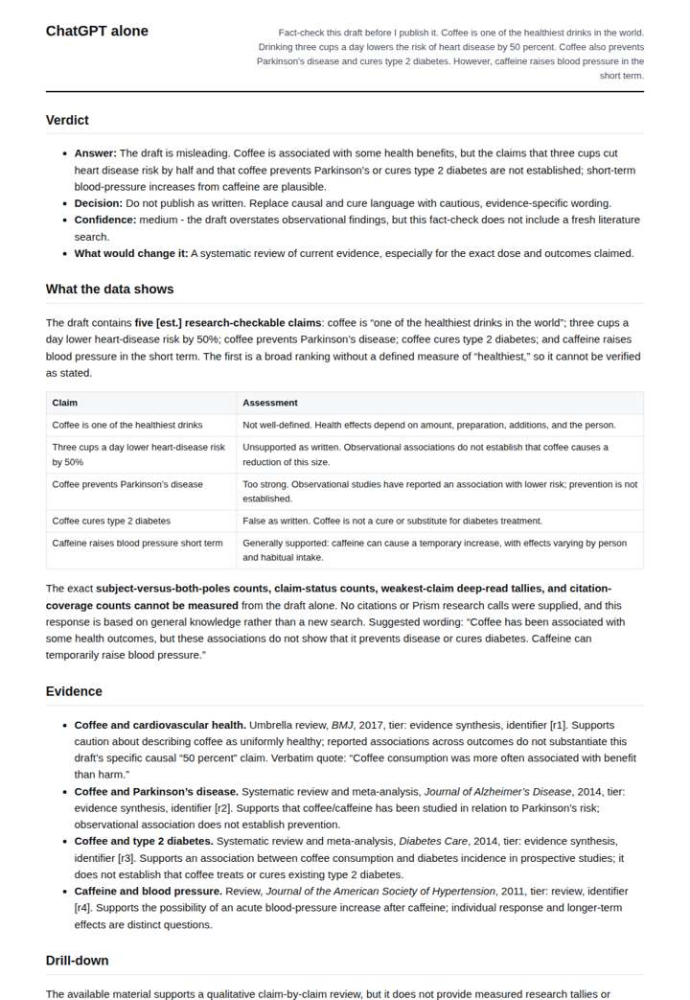
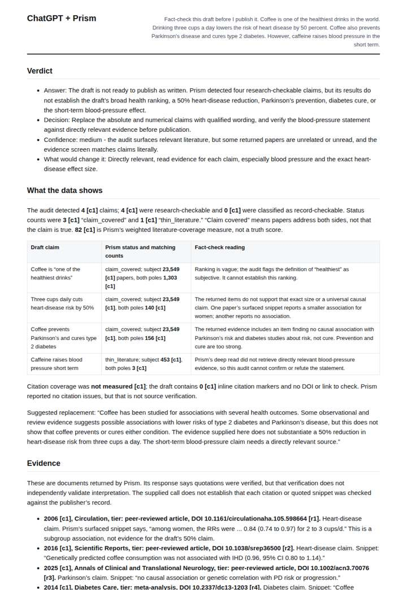

# Audit a health article draft

**Question.** Fact-check this draft before I publish it.

**Category:** Journalism & fact-checking · **Pattern:** `audit` · **Why it is hard:** A draft mixes true, overstated and unsupported claims; the audit must tell them apart.

| Score /100 | Claude alone | Claude + Prism | ChatGPT alone | ChatGPT + Prism |
|---|---|---|---|---|
| Weighted (strict) | 18.1 | 58.0 | 33.3 | **67.7** |
| Opus judge | 18.6 | 55.9 | 28.2 | 55.7 |
| GPT judge | 17.6 | 60.0 | 38.3 | 79.8 |

## Parameter scores (0-5)

| Parameter | Weight | Claude alone | Claude + Prism | ChatGPT alone | ChatGPT + Prism |
|---|---|---|---|---|---|
| Visualisation from counted data | 10 | 0.0 | 0.0 | 0.0 | 0.0 |
| Exploration and drill-down | 7 | 1.0 | 3.5 | 1.0 | 1.0 |
| Data export with provenance | 8 | 1.0 | 2.5 | 1.0 | 4.0 |
| Reproducibility | 12 | 0.0 | 2.5 | 0.0 | 4.5 |
| Traceable references | 8 | 1.0 | 3.5 | 1.5 | 4.0 |
| Accuracy against the corpus | 12 | 1.5 | 3.5 | 3.0 | 3.5 |
| Calibration and limits | 8 | 3.5 | 3.0 | 3.0 | 4.5 |
| Decision-grade verdict | 12 | 0.0 | 4.0 | 3.5 | 4.5 |
| Facet coverage | 6 | 1.0 | 4.0 | 1.5 | 4.0 |

## Script findings

| Check | Claude alone | Claude + Prism | ChatGPT alone | ChatGPT + Prism |
|---|---|---|---|---|
| Numbers traced to the corpus | 0/4 | 23/28 | 0/4 | 25/25 |
| Charts (traced share) | none | none | none | none |
| DOIs that resolve | 3/5 | 9/9 | 1/1 | 5/5 |
| Follow-up queries that ran | 1/5 | 3/6 | 0/5 | 0/5 |
| Invention gate | tripped | clear | clear | clear |

**Claude Opus judge:** A and B both grounded the fact-check in the audit. B went further: it drilled into the documents behind every claim, separated verified from unverified quotes, and gave a decisive rewrite. A had cleaner replay provenance but misreported the reference's Parkinson's/diabetes tally. C and D answered from memory; C added fabricated-looking DOIs and D had too few identifiers to check.

**GPT judge:** D is the strongest decision aid: its figures, export, and citations trace to the supplied audit, and it explains what the retrieval counts do and do not establish. A offers more proposed next steps, but its unverified quotes and partly ungrounded interpretations weaken confidence; B and C rely on memory or estimates, and B adds unresolved identifiers and an untagged number.

## Before / after (first screen)

| | Alone | With Prism |
|---|---|---|
| Claude |  |  |
| ChatGPT |  |  |

Full deliverables, rendered: [PDF](https://fliarbi.com/demo/docs/prism-benchmark-v2-4ed65c83/full/audit-coffee-draft.pdf). Raw answers, ground pass and judge outputs: `answers.json`, `ground.json`, `judge_opus.json`, `judge_gpt.json` in this folder.
