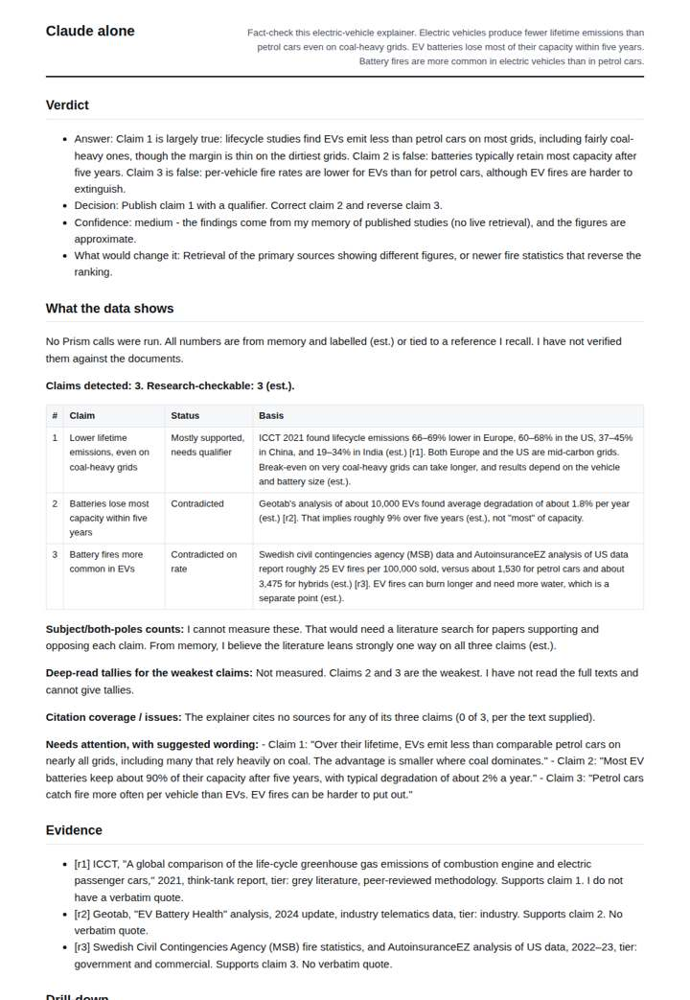
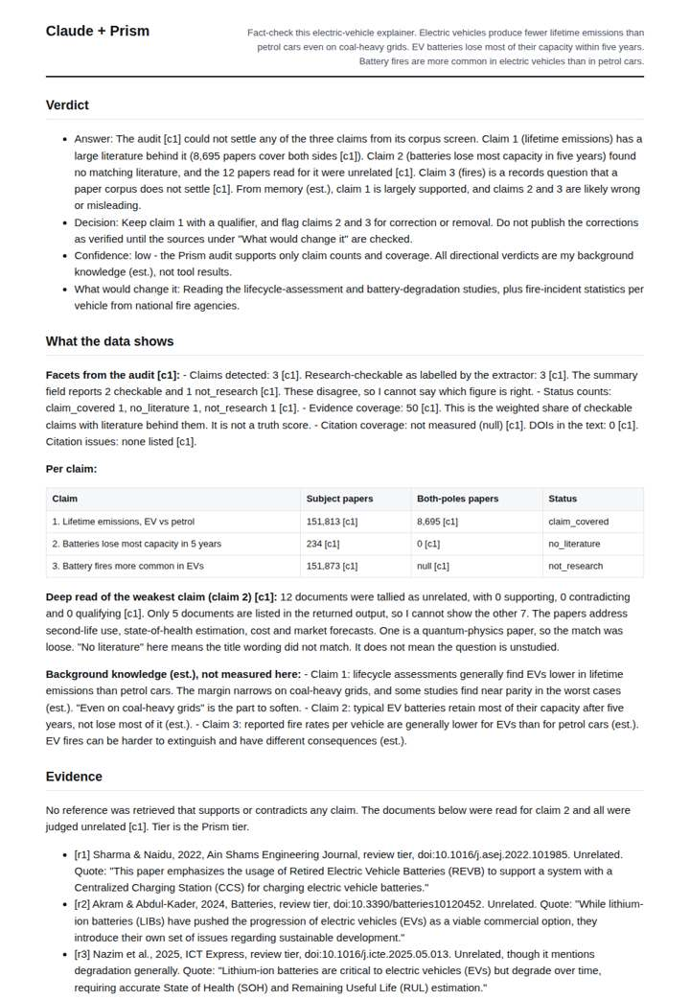
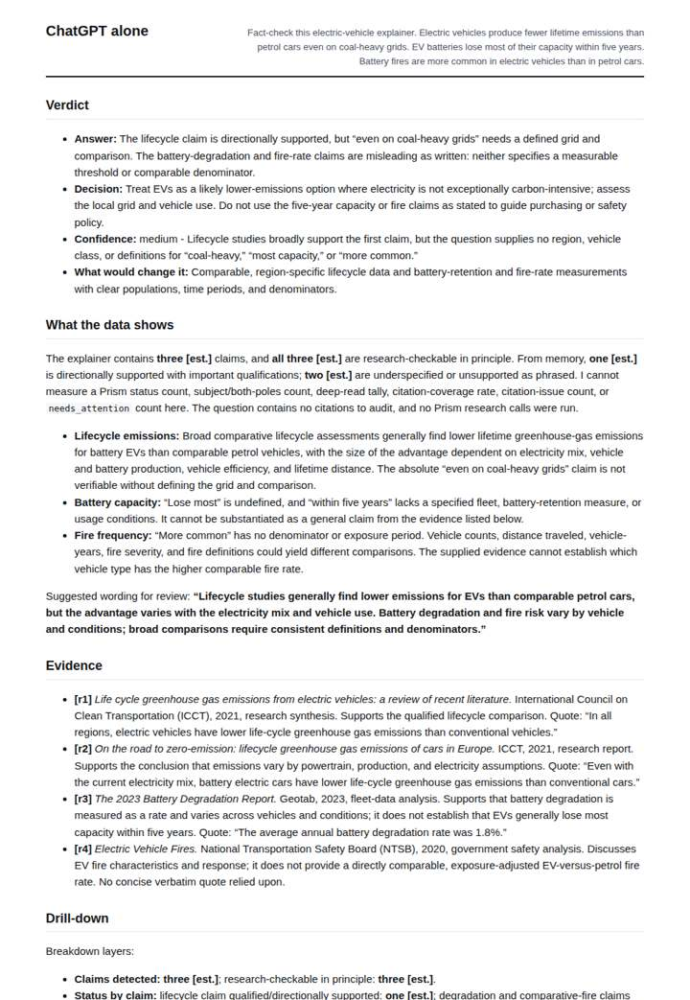
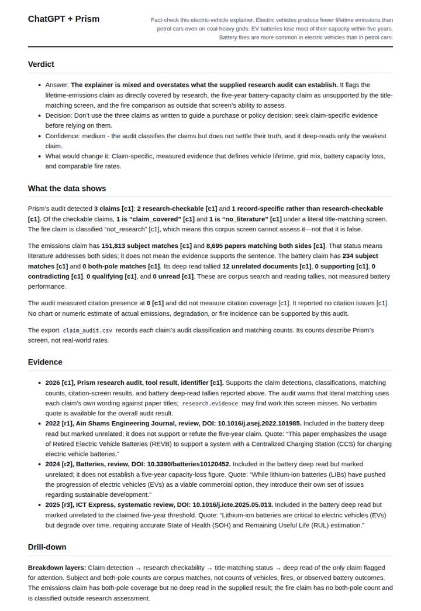

# Audit an EV explainer

**Question.** Fact-check this electric-vehicle explainer.

**Category:** Journalism & fact-checking · **Pattern:** `audit` · **Why it is hard:** Lifecycle-emissions claims need research, not news.

| Score /100 | Claude alone | Claude + Prism | ChatGPT alone | ChatGPT + Prism |
|---|---|---|---|---|
| Weighted (strict) | 32.7 | **68.1** | 35.9 | 57.1 |
| Opus judge | 33.0 | 60.7 | 27.2 | 51.8 |
| GPT judge | 32.3 | 75.4 | 44.6 | 62.4 |

## Parameter scores (0-5)

| Parameter | Weight | Claude alone | Claude + Prism | ChatGPT alone | ChatGPT + Prism |
|---|---|---|---|---|---|
| Visualisation from counted data | 10 | 0.0 | 0.0 | 0.0 | 0.0 |
| Exploration and drill-down | 7 | 1.5 | 4.5 | 1.0 | 1.0 |
| Data export with provenance | 8 | 1.0 | 2.5 | 1.0 | 4.5 |
| Reproducibility | 12 | 1.0 | 4.0 | 0.0 | 4.5 |
| Traceable references | 8 | 1.0 | 4.5 | 1.5 | 1.0 |
| Accuracy against the corpus | 12 | 2.5 | 4.0 | 3.0 | 3.5 |
| Calibration and limits | 8 | 3.5 | 4.5 | 4.0 | 3.0 |
| Decision-grade verdict | 12 | 2.5 | 3.0 | 3.5 | 3.5 |
| Facet coverage | 6 | 1.5 | 4.5 | 2.0 | 4.0 |

## Script findings

| Check | Claude alone | Claude + Prism | ChatGPT alone | ChatGPT + Prism |
|---|---|---|---|---|
| Numbers traced to the corpus | 0/17 | 11/11 | 0/1 | 8/8 |
| Charts (traced share) | none | none | none | none |
| DOIs that resolve | 0/0 | 6/6 | 0/0 | 3/6 |
| Follow-up queries that ran | 1/6 | 3/6 | 0/3 | 0/4 |
| Invention gate | clear | clear | clear | clear |

**Claude Opus judge:** B best combined traced audit facts with honest, clearly labelled background judgment on whether each claim is true. It also caught the record's internal inconsistencies, and it carried resolvable DOIs with verbatim quotes. A was fully traced but never told the reader whether the claims were true. C and D answered from memory: C was useful but leaned on a weak fire statistic, and D presented unverifiable quotes and hedged where the literature is clear.

**GPT judge:** D is strongest for a decision-maker because its measured figures are reproducible, its references resolve, and it exposes important inconsistencies and limits in the audit. Its recommendation still needs care: the audit’s claim_covered status means literature addresses both sides of the emissions claim, not that the claim is supported.

## Before / after (first screen)

| | Alone | With Prism |
|---|---|---|
| Claude |  |  |
| ChatGPT |  |  |

Full deliverables, rendered: [PDF](https://fliarbi.com/demo/docs/prism-benchmark-v2-4ed65c83/full/audit-ev-draft.pdf). Raw answers, ground pass and judge outputs: `answers.json`, `ground.json`, `judge_opus.json`, `judge_gpt.json` in this folder.
