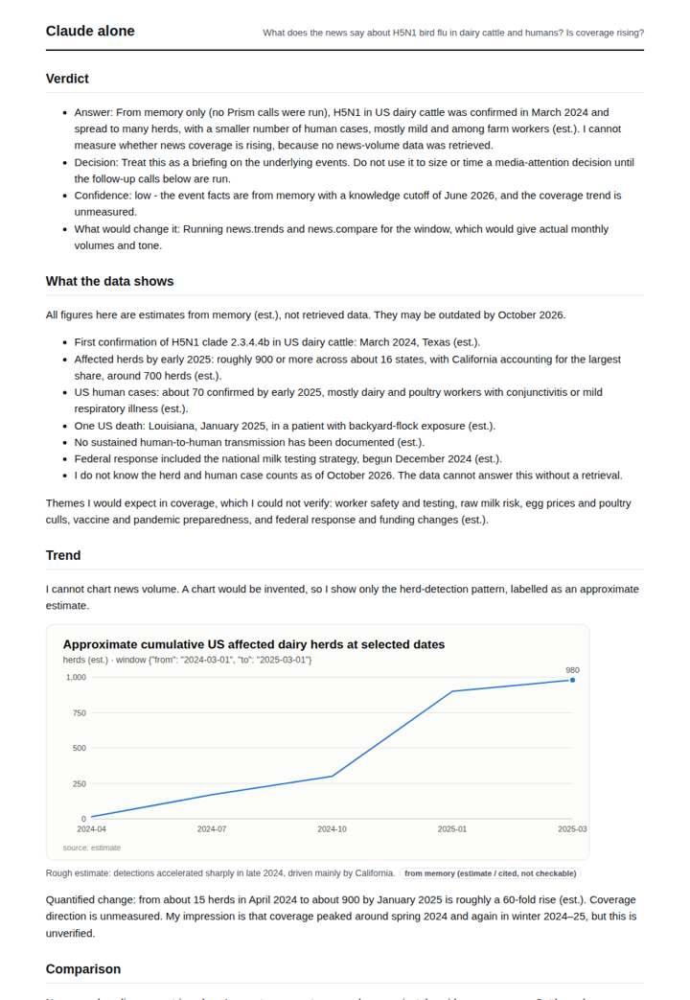
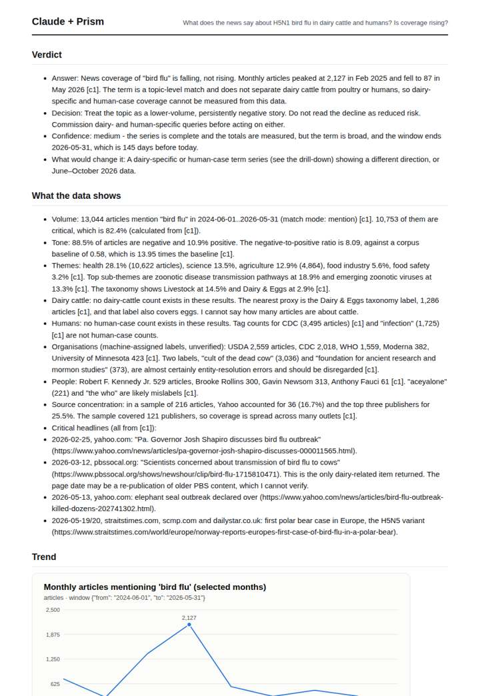
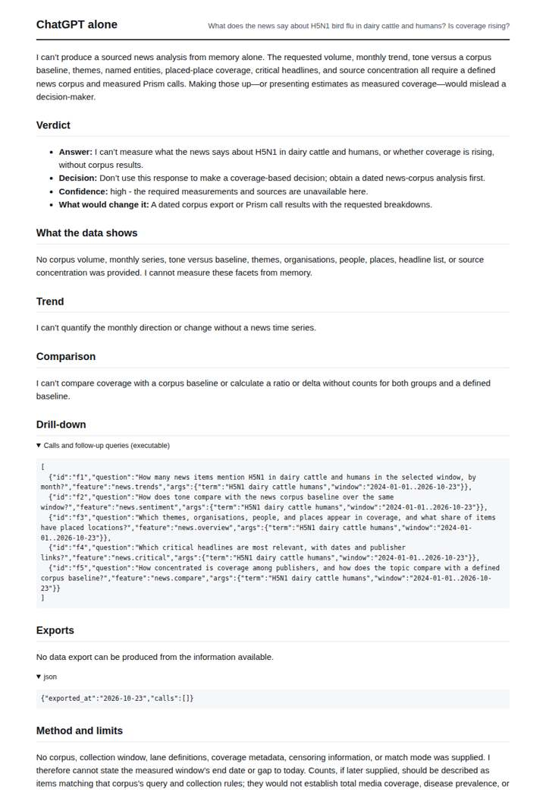
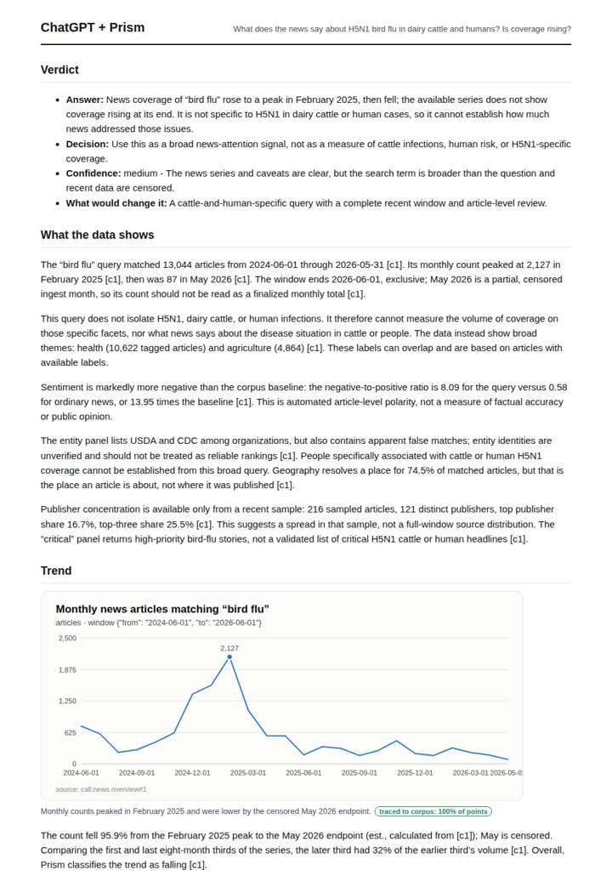

# H5N1 bird flu coverage

**Question.** What does the news say about H5N1 bird flu in dairy cattle and humans? Is coverage rising?

**Category:** Public health & epidemiology · **Pattern:** `pulse` · **Why it is hard:** Coverage spikes are driven by single events; the critical-share trend matters more than raw volume.

| Score /100 | Claude alone | Claude + Prism | ChatGPT alone | ChatGPT + Prism |
|---|---|---|---|---|
| Weighted (strict) | 34.0 | **73.7** | 21.2 | 63.2 |
| Opus judge | 28.8 | 75.6 | 14.2 | 63.6 |
| GPT judge | 39.2 | 71.8 | 28.2 | 62.8 |

## Parameter scores (0-5)

| Parameter | Weight | Claude alone | Claude + Prism | ChatGPT alone | ChatGPT + Prism |
|---|---|---|---|---|---|
| Measured trend | 10 | 1.0 | 4.5 | 0.0 | 3.5 |
| Measured comparison | 7 | 1.0 | 4.5 | 0.0 | 4.0 |
| Visualisation from counted data | 10 | 1.0 | 3.0 | 0.0 | 3.5 |
| Exploration and drill-down | 7 | 1.0 | 4.0 | 1.0 | 2.0 |
| Data export with provenance | 8 | 1.0 | 2.5 | 0.0 | 3.5 |
| Reproducibility | 12 | 1.0 | 4.5 | 0.5 | 4.0 |
| Traceable references | 8 | 0.5 | 1.0 | 0.5 | 0.5 |
| Accuracy against the corpus | 12 | 3.5 | 4.0 | 3.5 | 2.5 |
| Calibration and limits | 8 | 3.5 | 4.0 | 2.5 | 3.5 |
| Decision-grade verdict | 12 | 3.0 | 4.0 | 2.0 | 4.0 |
| Facet coverage | 6 | 1.0 | 4.0 | 0.5 | 3.0 |

## Script findings

| Check | Claude alone | Claude + Prism | ChatGPT alone | ChatGPT + Prism |
|---|---|---|---|---|
| Numbers traced to the corpus | 0/12 | 88/88 | 0/0 | 21/22 |
| Charts (traced share) | memory | 100% | none | 100% |
| DOIs that resolve | 0/0 | 0/0 | 0/0 | 0/0 |
| Follow-up queries that ran | 0/6 | 5/6 | 0/5 | 2/6 |
| Invention gate | clear | clear | clear | clear |

**Claude Opus judge:** A and B both read the measured series correctly: bird-flu coverage peaked in Feb 2025 and is falling. A went further. It quantified the critical-share trend, gave dated headlines with urls, caught entity mislabels, and honestly flagged that dairy and human coverage was not isolated. B was cleaner on the full series but thinner on drill-down and slightly misread censoring. C refused, and D offered labelled memory about the outbreak rather than coverage.

**GPT judge:** B is the strongest decision aid: it quantifies the broad bird-flu attention decline, decomposes total and critical volume, and supplies useful breakdowns and reproducible calls. Its main flaw is a material inconsistency about the censored May endpoint; C is more cautious but also mislabels that endpoint and omits the critical-share decomposition, while neither can establish cattle- or human-specific coverage from the broad query.

## Before / after (first screen)

| | Alone | With Prism |
|---|---|---|
| Claude |  |  |
| ChatGPT |  |  |

Full deliverables, rendered: [PDF](https://fliarbi.com/demo/docs/prism-benchmark-v2-4ed65c83/full/bird-flu-h5n1.pdf). Raw answers, ground pass and judge outputs: `answers.json`, `ground.json`, `judge_opus.json`, `judge_gpt.json` in this folder.
