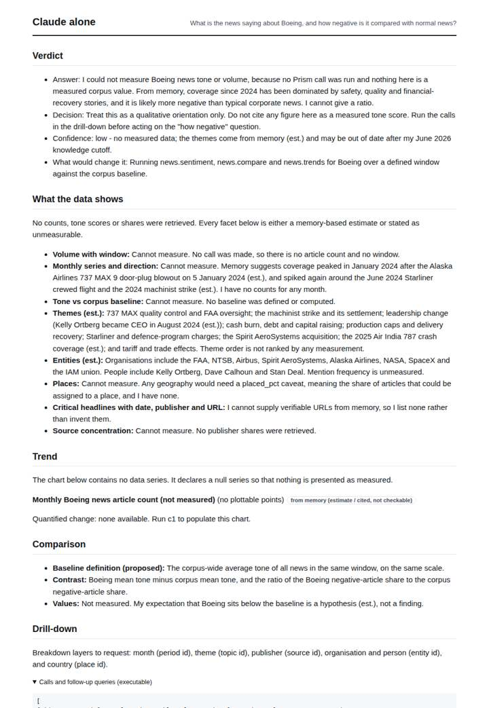
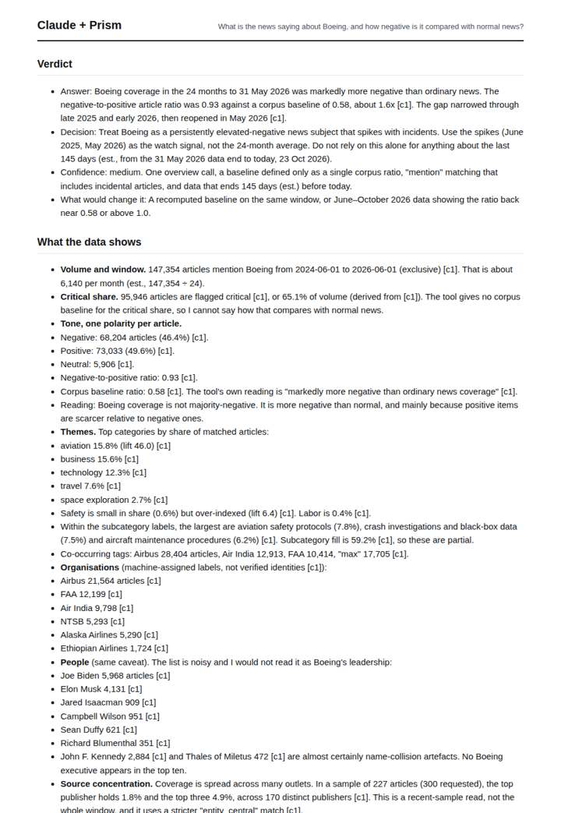
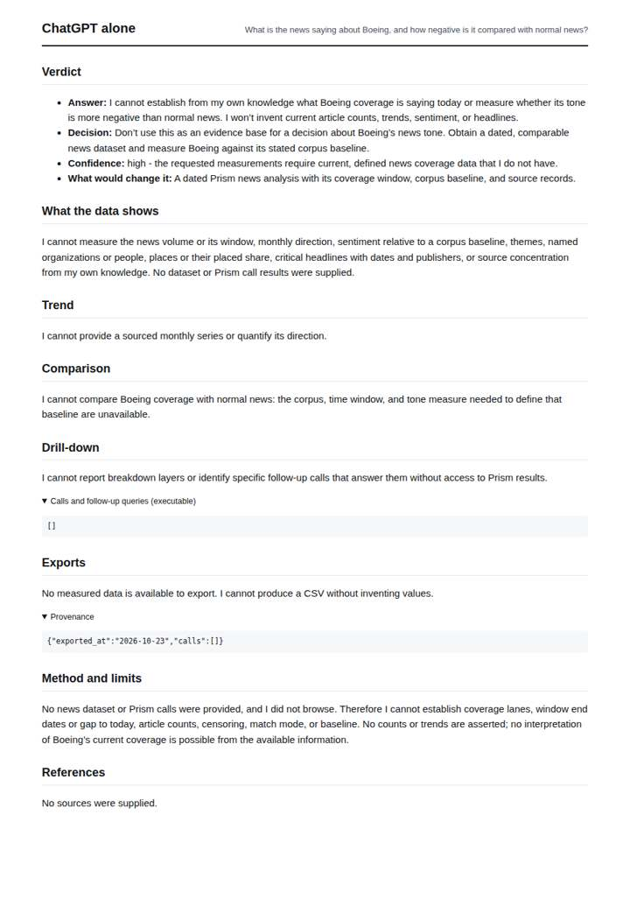
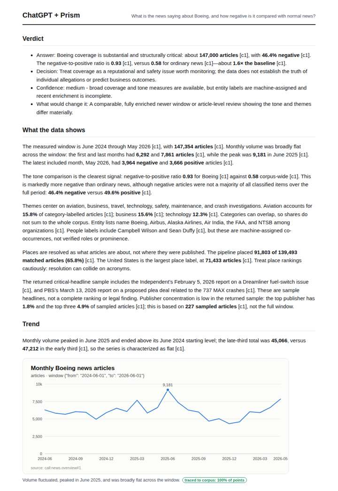

# Boeing crisis coverage

**Question.** What is the news saying about Boeing, and how negative is it compared with normal news?

**Category:** Company & competitive intelligence · **Pattern:** `pulse` · **Why it is hard:** Tone must be read against the corpus baseline; aviation news is negative by default.

| Score /100 | Claude alone | Claude + Prism | ChatGPT alone | ChatGPT + Prism |
|---|---|---|---|---|
| Weighted (strict) | 27.4 | **77.4** | 21.4 | 65.9 |
| Opus judge | 26.4 | 85.6 | 15.2 | 64.8 |
| GPT judge | 28.4 | 69.2 | 27.6 | 67.0 |

## Parameter scores (0-5)

| Parameter | Weight | Claude alone | Claude + Prism | ChatGPT alone | ChatGPT + Prism |
|---|---|---|---|---|---|
| Measured trend | 10 | 1.0 | 5.0 | 0.0 | 4.0 |
| Measured comparison | 7 | 1.0 | 4.5 | 0.0 | 4.5 |
| Visualisation from counted data | 10 | 1.0 | 4.0 | 0.0 | 3.0 |
| Exploration and drill-down | 7 | 1.0 | 2.5 | 0.0 | 2.0 |
| Data export with provenance | 8 | 1.0 | 4.0 | 0.0 | 3.0 |
| Reproducibility | 12 | 0.0 | 5.0 | 1.0 | 4.0 |
| Traceable references | 8 | 0.0 | 1.5 | 0.0 | 0.5 |
| Accuracy against the corpus | 12 | 3.0 | 3.5 | 3.0 | 4.0 |
| Calibration and limits | 8 | 2.5 | 4.5 | 2.5 | 3.0 |
| Decision-grade verdict | 12 | 2.5 | 3.0 | 2.5 | 3.5 |
| Facet coverage | 6 | 1.5 | 5.0 | 1.5 | 4.0 |

## Script findings

| Check | Claude alone | Claude + Prism | ChatGPT alone | ChatGPT + Prism |
|---|---|---|---|---|
| Numbers traced to the corpus | 0/4 | 128/128 | 0/0 | 33/35 |
| Charts (traced share) | memory | 100%, 100% | none | 100% |
| DOIs that resolve | 0/0 | 0/0 | 0/0 | 0/0 |
| Follow-up queries that ran | 2/5 | 2/7 | 0/0 | 1/4 |
| Invention gate | clear | clear | clear | clear |

**Claude Opus judge:** B answers the question the way a decision-maker needs. It reads tone against the corpus baseline (0.93 vs 0.58, 1.6x) and charts the monthly ratio against that baseline, which shows the gap closing in late 2025 and reopening in May 2026. It also flags the corpus's own artefacts: name collisions, a re-dated archive item and incidental critical hits. C has the same headline numbers but charts and exports only volume and drills down less. A and D are honest but unmeasured.

**GPT judge:** D is the strongest decision aid: it directly answers the baseline comparison with a defined ratio and delta, then bounds the interpretation with window, matching, and sample caveats. C offers richer traced trend and facet detail, but its subcategory-fill error and overlong verdict weaken reliability; neither report supplies the needed tone comparison as a chart.

## Before / after (first screen)

| | Alone | With Prism |
|---|---|---|
| Claude |  |  |
| ChatGPT |  |  |

Full deliverables, rendered: [PDF](https://fliarbi.com/demo/docs/prism-benchmark-v2-4ed65c83/full/boeing-crisis.pdf). Raw answers, ground pass and judge outputs: `answers.json`, `ground.json`, `judge_opus.json`, `judge_gpt.json` in this folder.
