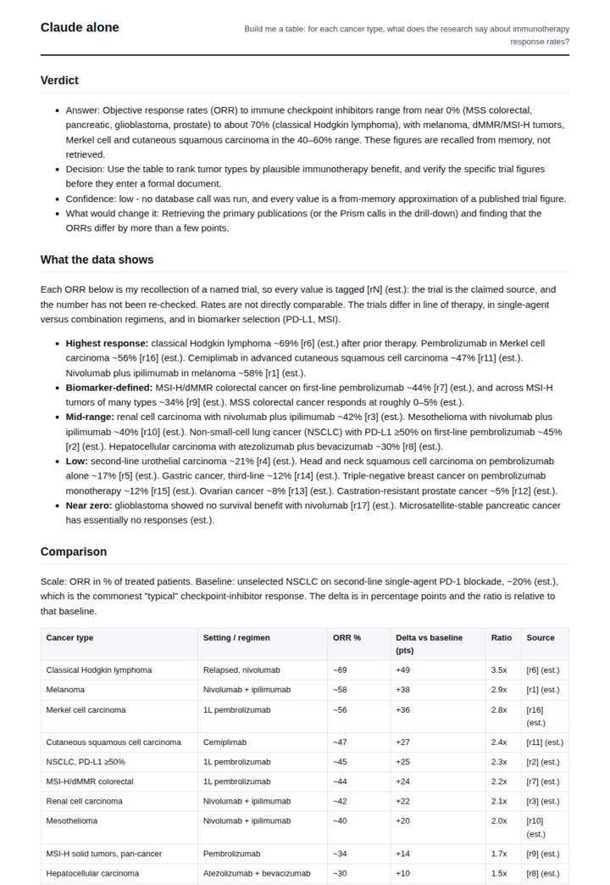
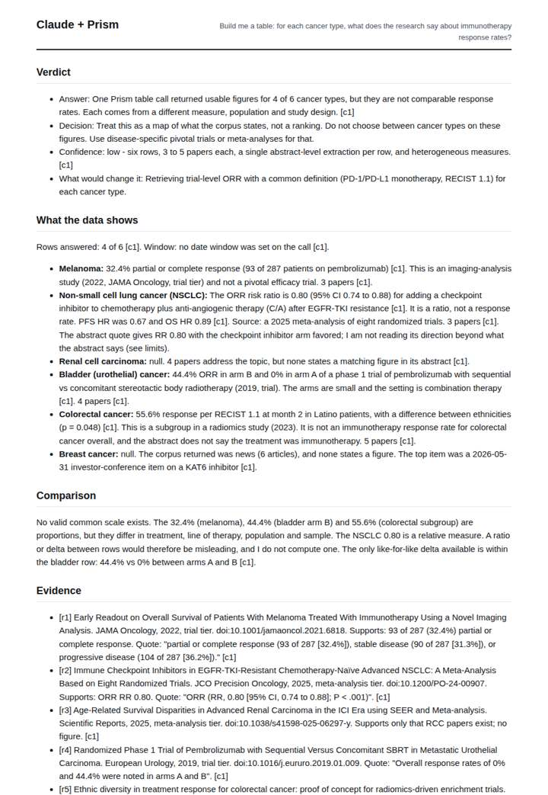
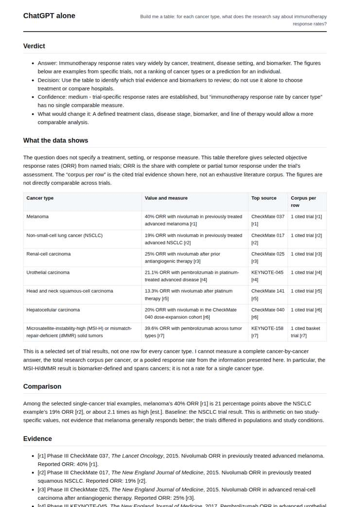
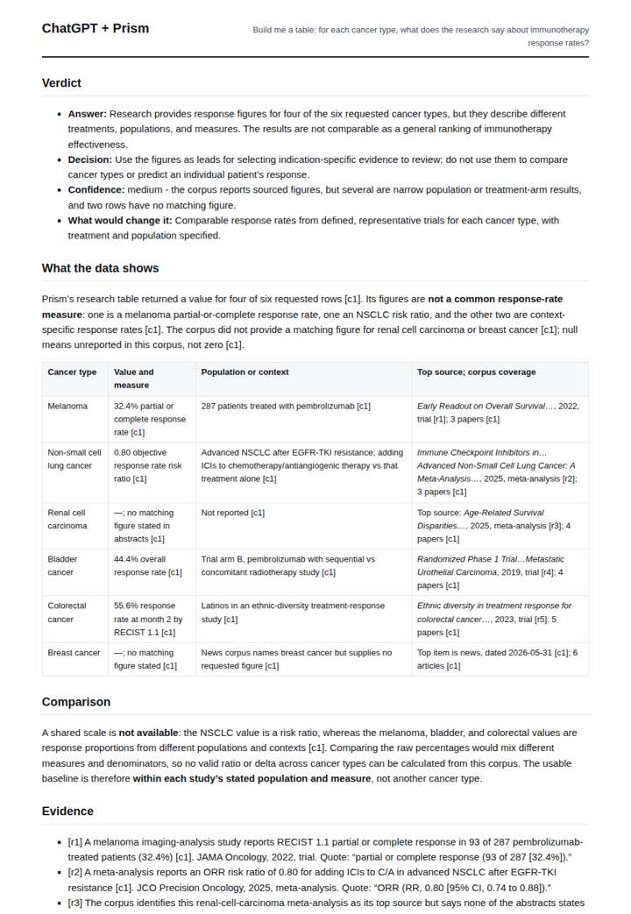

# Immunotherapy evidence table

**Question.** Build me a table: for each cancer type, what does the research say about immunotherapy response rates?

**Category:** Medical & clinical evidence · **Pattern:** `table` · **Why it is hard:** Each row needs its own source; a single answer pasted into ten rows is a fabrication.

| Score /100 | Claude alone | Claude + Prism | ChatGPT alone | ChatGPT + Prism |
|---|---|---|---|---|
| Weighted (strict) | 25.6 | **68.8** | 27.4 | 62.7 |
| Opus judge | 25.6 | 67.6 | 24.0 | 59.1 |
| GPT judge | 25.6 | 70.0 | 30.9 | 66.2 |

## Parameter scores (0-5)

| Parameter | Weight | Claude alone | Claude + Prism | ChatGPT alone | ChatGPT + Prism |
|---|---|---|---|---|---|
| Measured comparison | 7 | 2.0 | 3.5 | 1.5 | 1.0 |
| Visualisation from counted data | 10 | 0.0 | 0.0 | 0.0 | 0.0 |
| Exploration and drill-down | 7 | 1.0 | 1.0 | 1.0 | 1.0 |
| Data export with provenance | 8 | 1.0 | 3.0 | 1.0 | 4.5 |
| Reproducibility | 12 | 1.0 | 4.0 | 1.0 | 3.0 |
| Traceable references | 8 | 1.0 | 4.0 | 1.0 | 4.0 |
| Accuracy against the corpus | 12 | 3.0 | 5.0 | 1.0 | 4.5 |
| Calibration and limits | 8 | 3.0 | 4.5 | 3.0 | 4.0 |
| Decision-grade verdict | 12 | 0.0 | 4.5 | 3.0 | 4.5 |
| Facet coverage | 6 | 1.0 | 4.0 | 1.0 | 4.0 |

## Script findings

| Check | Claude alone | Claude + Prism | ChatGPT alone | ChatGPT + Prism |
|---|---|---|---|---|
| Numbers traced to the corpus | 0/73 | 22/23 | 0/20 | 6/7 |
| Charts (traced share) | none | none | none | none |
| DOIs that resolve | 0/0 | 5/5 | 6/7 | 5/5 |
| Follow-up queries that ran | 1/6 | 0/6 | 0/4 | 0/6 |
| Invention gate | tripped | clear | clear | clear |

**Claude Opus judge:** B and D both stayed faithful to the single recorded table call, kept nulls as nulls, and refused to rank non-comparable figures. D went further by reading the rows critically: the colorectal figure is a radiomics subgroup, the melanoma figure is an imaging study, and the breast news item is off-topic. A and C answered from memory; A presented wrong trial figures and a bad DOI as sourced fact, while C at least labelled every value as an estimate.

**GPT judge:** B is the strongest decision aid: it identifies the four reported rows, distinguishes the NSCLC risk ratio from response proportions, and explains why the figures cannot support a cross-cancer ranking. A has the cleaner export and provenance hygiene, but B’s within-row arm comparison and more explicit interpretation of the colorectal evidence make its answer more useful while remaining consistent with the record.

## Before / after (first screen)

| | Alone | With Prism |
|---|---|---|
| Claude |  |  |
| ChatGPT |  |  |

Full deliverables, rendered: [PDF](https://fliarbi.com/demo/docs/prism-benchmark-v2-4ed65c83/full/cancer-immunotherapy-table.pdf). Raw answers, ground pass and judge outputs: `answers.json`, `ground.json`, `judge_opus.json`, `judge_gpt.json` in this folder.
