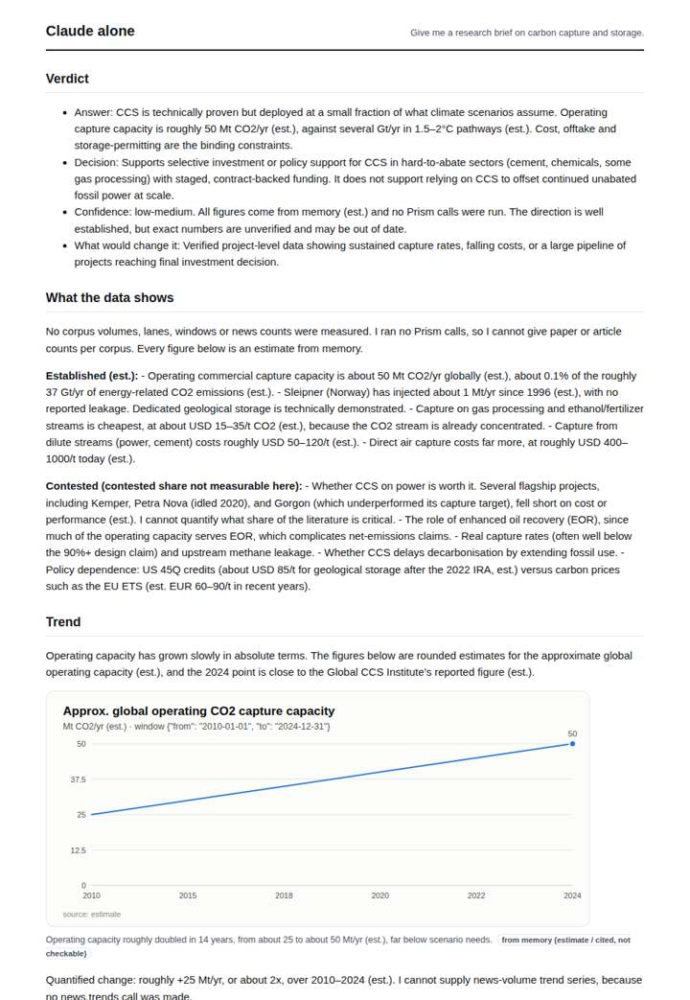
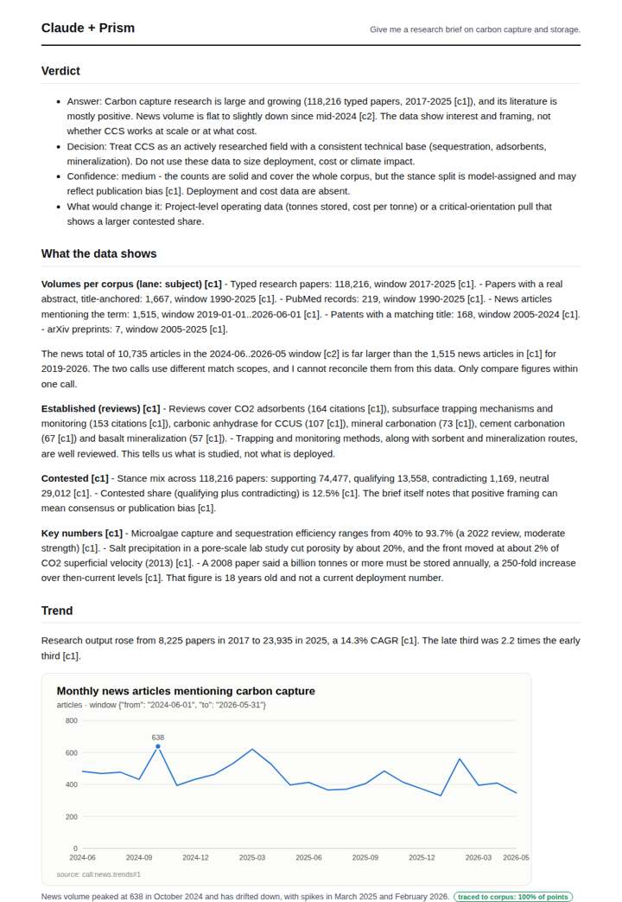
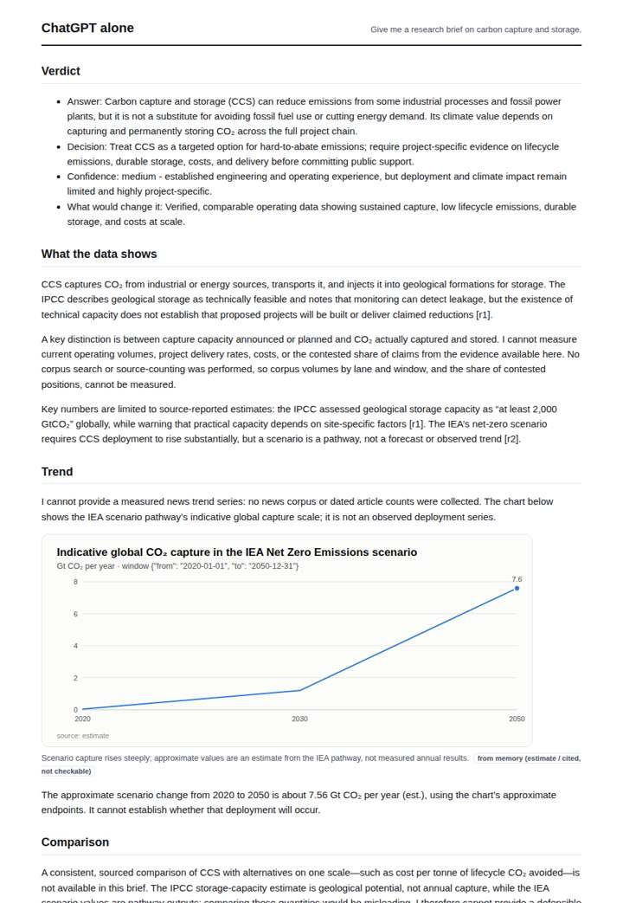
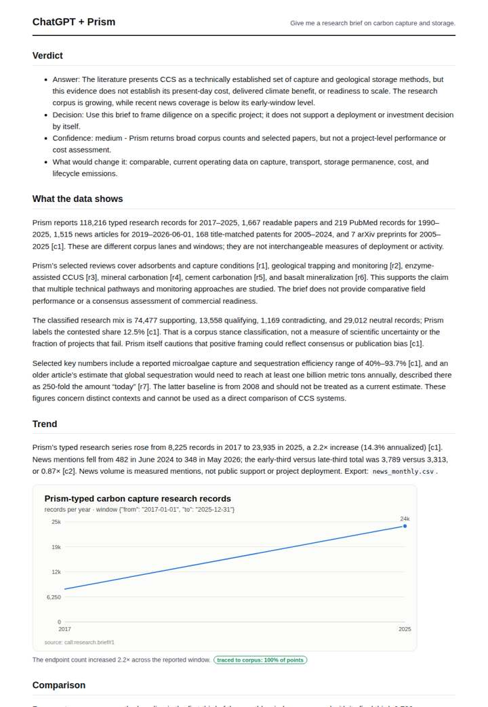

# Carbon capture brief

**Question.** Give me a research brief on carbon capture and storage.

**Category:** Energy & climate · **Pattern:** `brief` · **Why it is hard:** Patents and research tell different stories; the brief shows both.

| Score /100 | Claude alone | Claude + Prism | ChatGPT alone | ChatGPT + Prism |
|---|---|---|---|---|
| Weighted (strict) | 36.5 | **78.3** | 30.1 | 65.0 |
| Opus judge | 34.8 | 73.8 | 30.6 | 54.8 |
| GPT judge | 38.2 | 82.8 | 29.6 | 75.2 |

## Parameter scores (0-5)

| Parameter | Weight | Claude alone | Claude + Prism | ChatGPT alone | ChatGPT + Prism |
|---|---|---|---|---|---|
| Measured trend | 10 | 1.0 | 4.5 | 1.0 | 3.5 |
| Measured comparison | 7 | 2.0 | 4.5 | 0.5 | 4.0 |
| Visualisation from counted data | 10 | 1.0 | 3.5 | 1.0 | 2.5 |
| Exploration and drill-down | 7 | 1.5 | 3.0 | 1.0 | 1.0 |
| Data export with provenance | 8 | 1.0 | 3.0 | 1.0 | 3.0 |
| Reproducibility | 12 | 0.0 | 4.5 | 0.0 | 3.5 |
| Traceable references | 8 | 1.5 | 4.0 | 1.5 | 4.0 |
| Accuracy against the corpus | 12 | 3.5 | 4.0 | 2.5 | 3.0 |
| Calibration and limits | 8 | 3.5 | 4.0 | 3.5 | 4.5 |
| Decision-grade verdict | 12 | 3.5 | 4.0 | 3.0 | 3.5 |
| Facet coverage | 6 | 1.0 | 3.5 | 1.0 | 3.0 |

## Script findings

| Check | Claude alone | Claude + Prism | ChatGPT alone | ChatGPT + Prism |
|---|---|---|---|---|
| Numbers traced to the corpus | 0/27 | 69/69 | 0/5 | 27/29 |
| Charts (traced share) | memory | 100% | memory | 100% |
| DOIs that resolve | 1/1 | 6/6 | 0/0 | 7/7 |
| Follow-up queries that ran | 4/7 | 3/6 | 0/5 | 0/5 |
| Invention gate | clear | clear | clear | clear |

**Claude Opus judge:** C was the only deliverable that grounded volumes, stance mix, both trend windows and three-lens geography in traced numbers. It also caught the 1,515 vs 10,735 news-count anomaly and placed its limits next to the numbers. D was clean and well referenced, but it misread the tool's 2.2x thirds ratio as endpoint growth and left the available geography data unused. A and B were honest memory briefs with estimate labels that a decision-maker could not verify. None of the four seriously developed the patents-vs-research contrast the question flagged.

**GPT judge:** D is the strongest decision brief: it shows the research and patent corpus alongside traced research growth and a recent, slightly declining news series, while keeping the different windows distinct. Its partial monthly export and limited interpretation of what patent counts mean are the main gaps; B is more cautious but has no executed drill-down and less complete chart coverage.

## Before / after (first screen)

| | Alone | With Prism |
|---|---|---|
| Claude |  |  |
| ChatGPT |  |  |

Full deliverables, rendered: [PDF](https://fliarbi.com/demo/docs/prism-benchmark-v2-4ed65c83/full/carbon-capture-brief.pdf). Raw answers, ground pass and judge outputs: `answers.json`, `ground.json`, `judge_opus.json`, `judge_gpt.json` in this folder.
