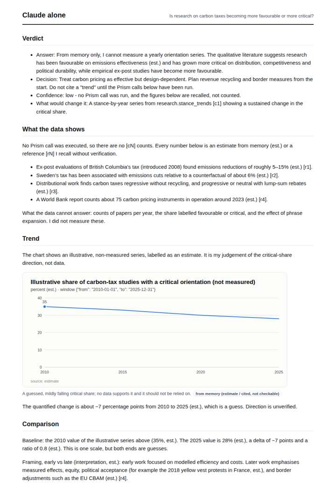
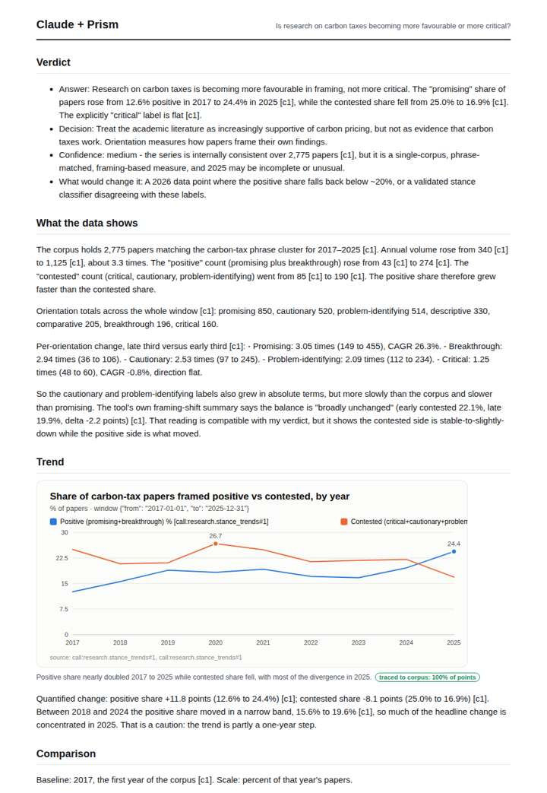
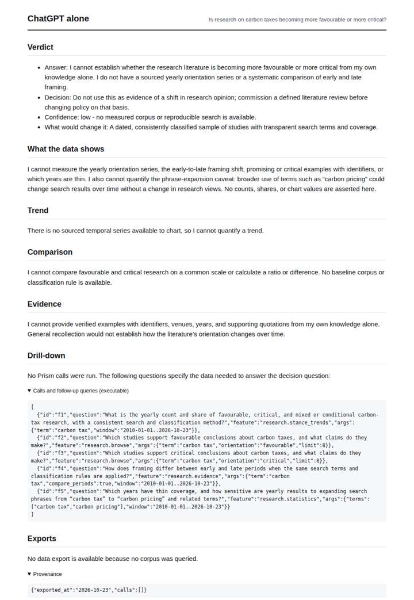
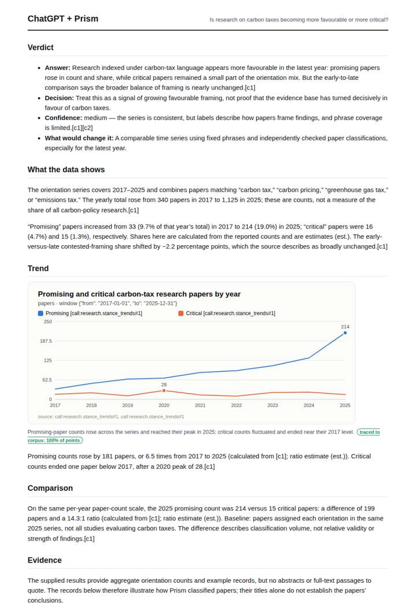

# Carbon tax research framing

**Question.** Is research on carbon taxes becoming more favourable or more critical?

**Category:** Policy & regulation · **Pattern:** `stance` · **Why it is hard:** Distributional critiques grew after 2018; the trend shows it.

| Score /100 | Claude alone | Claude + Prism | ChatGPT alone | ChatGPT + Prism |
|---|---|---|---|---|
| Weighted (strict) | 33.7 | **80.7** | 25.3 | 78.1 |
| Opus judge | 34.2 | 78.4 | 22.0 | 76.4 |
| GPT judge | 33.2 | 83.0 | 28.6 | 79.8 |

## Parameter scores (0-5)

| Parameter | Weight | Claude alone | Claude + Prism | ChatGPT alone | ChatGPT + Prism |
|---|---|---|---|---|---|
| Measured trend | 10 | 1.0 | 4.5 | 0.0 | 4.0 |
| Measured comparison | 7 | 1.5 | 4.5 | 0.5 | 4.5 |
| Visualisation from counted data | 10 | 1.0 | 4.5 | 0.0 | 3.5 |
| Exploration and drill-down | 7 | 2.0 | 4.0 | 2.0 | 4.0 |
| Data export with provenance | 8 | 1.0 | 3.0 | 0.0 | 4.0 |
| Reproducibility | 12 | 1.0 | 5.0 | 1.0 | 4.0 |
| Traceable references | 8 | 1.0 | 3.0 | 0.5 | 3.0 |
| Accuracy against the corpus | 12 | 3.0 | 3.5 | 3.0 | 4.0 |
| Calibration and limits | 8 | 3.0 | 4.0 | 3.0 | 4.0 |
| Decision-grade verdict | 12 | 2.5 | 4.0 | 2.5 | 4.0 |
| Facet coverage | 6 | 1.0 | 4.0 | 0.5 | 4.0 |

## Script findings

| Check | Claude alone | Claude + Prism | ChatGPT alone | ChatGPT + Prism |
|---|---|---|---|---|
| Numbers traced to the corpus | 0/7 | 87/87 | 0/0 | 24/25 |
| Charts (traced share) | memory | 100% | none | 100% |
| DOIs that resolve | 0/0 | 4/4 | 0/0 | 2/2 |
| Follow-up queries that ran | 2/6 | 4/6 | 2/5 | 3/4 |
| Invention gate | clear | clear | clear | clear |

**Claude Opus judge:** B and D both grounded their answers in the 2017-2025 stance series and both recompute correctly. B charted the right quantity (positive vs contested shares), flagged that the shift is concentrated in 2025, and caught false phrase matches. D plotted raw counts in a growing corpus. A and C were honest about having no measurement but gave a decision-maker nothing traceable. C's guessed series also mis-levels the critical share, and none of the four tested the distributional-critique claim directly.

**GPT judge:** B best supports a decision because it compares traced positive and contested shares over time, quantifies the shift, and acknowledges the stable broader framing summary. A is careful and well sourced but its chart emphasizes counts; C and D do not provide a measured trend.

## Before / after (first screen)

| | Alone | With Prism |
|---|---|---|
| Claude |  |  |
| ChatGPT |  |  |

Full deliverables, rendered: [PDF](https://fliarbi.com/demo/docs/prism-benchmark-v2-4ed65c83/full/carbon-tax-stance.pdf). Raw answers, ground pass and judge outputs: `answers.json`, `ground.json`, `judge_opus.json`, `judge_gpt.json` in this folder.
