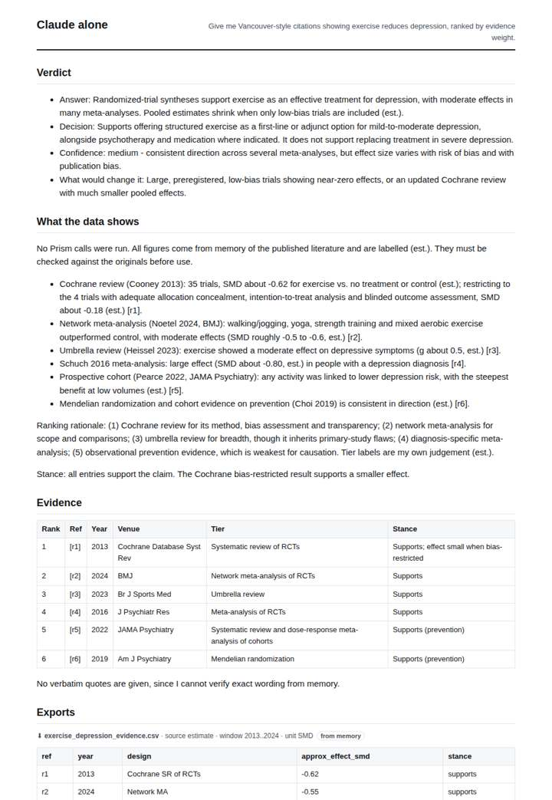
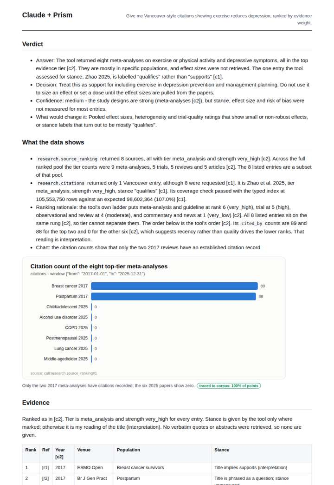
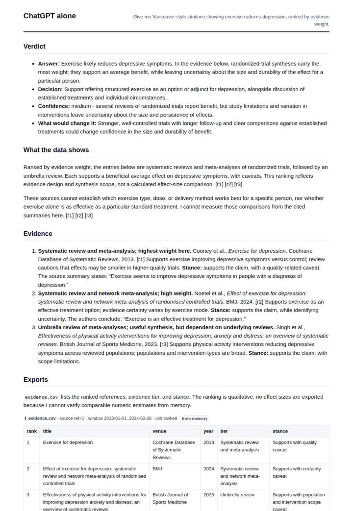
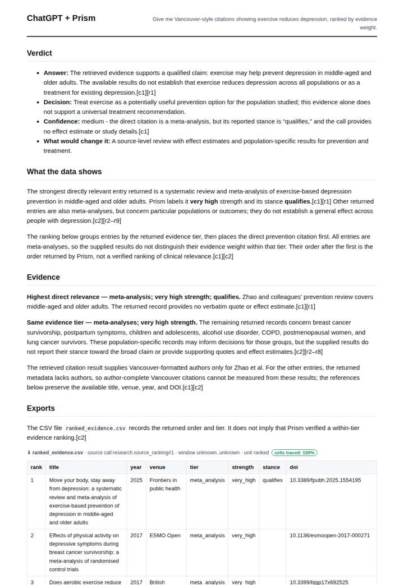

# Vancouver citations for exercise and depression

**Question.** Give me Vancouver-style citations showing exercise reduces depression, ranked by evidence weight.

**Category:** Academic research & literature review · **Pattern:** `citations` · **Why it is hard:** Meta-analyses outrank single trials; the ranking shows why.

| Score /100 | Claude alone | Claude + Prism | ChatGPT alone | ChatGPT + Prism |
|---|---|---|---|---|
| Weighted (strict) | 35.2 | **73.0** | 51.8 | 60.0 |
| Opus judge | 40.6 | 80.0 | 47.9 | 56.4 |
| GPT judge | 29.7 | 66.1 | 55.8 | 63.6 |

## Parameter scores (0-5)

| Parameter | Weight | Claude alone | Claude + Prism | ChatGPT alone | ChatGPT + Prism |
|---|---|---|---|---|---|
| Data export with provenance | 8 | 1.0 | 3.5 | 1.0 | 3.0 |
| Reproducibility | 12 | 0.0 | 4.0 | 1.0 | 2.0 |
| Traceable references | 8 | 3.5 | 3.5 | 3.5 | 3.0 |
| Accuracy against the corpus | 12 | 1.5 | 3.5 | 3.5 | 3.5 |
| Calibration and limits | 8 | 2.5 | 4.0 | 3.0 | 3.0 |
| Decision-grade verdict | 12 | 3.0 | 3.5 | 4.0 | 3.5 |
| Facet coverage | 6 | 1.0 | 3.5 | 1.5 | 3.0 |

## Script findings

| Check | Claude alone | Claude + Prism | ChatGPT alone | ChatGPT + Prism |
|---|---|---|---|---|
| Numbers traced to the corpus | 0/7 | 5/5 | 0/0 | 0/0 |
| Charts (traced share) | none | 100% | none | none |
| DOIs that resolve | 6/6 | 8/8 | 3/3 | 8/8 |
| Follow-up queries that ran | 1/4 | 3/6 | 0/0 | 0/3 |
| Invention gate | clear | clear | clear | clear |

**Claude Opus judge:** C was the only deliverable that grounded every element in the recorded calls. It exported a traced, provenance-complete CSV and read the tool honestly: only 1 of 8 Vancouver entries came back, and the evidence tier was flat across all eight sources. It also bounded its decision to what the data measured. A and B gave clinically sensible memory answers built on landmark reviews, but they are unverifiable, and B's effect sizes contain errors. D was grounded but drew too narrow a verdict from its own evidence and reshuffled the ranking.

**GPT judge:** C best preserves the distinction between the one directly returned prevention citation, whose stance qualifies, and the population-specific records that do not establish a universal treatment effect. B gives a useful, plausible memory-based answer with a practical decision, while A overstates what its retrieved records support and D relies on unverified numeric specifics.

## Before / after (first screen)

| | Alone | With Prism |
|---|---|---|
| Claude |  |  |
| ChatGPT |  |  |

Full deliverables, rendered: [PDF](https://fliarbi.com/demo/docs/prism-benchmark-v2-4ed65c83/full/citations-exercise-depression.pdf). Raw answers, ground pass and judge outputs: `answers.json`, `ground.json`, `judge_opus.json`, `judge_gpt.json` in this folder.
