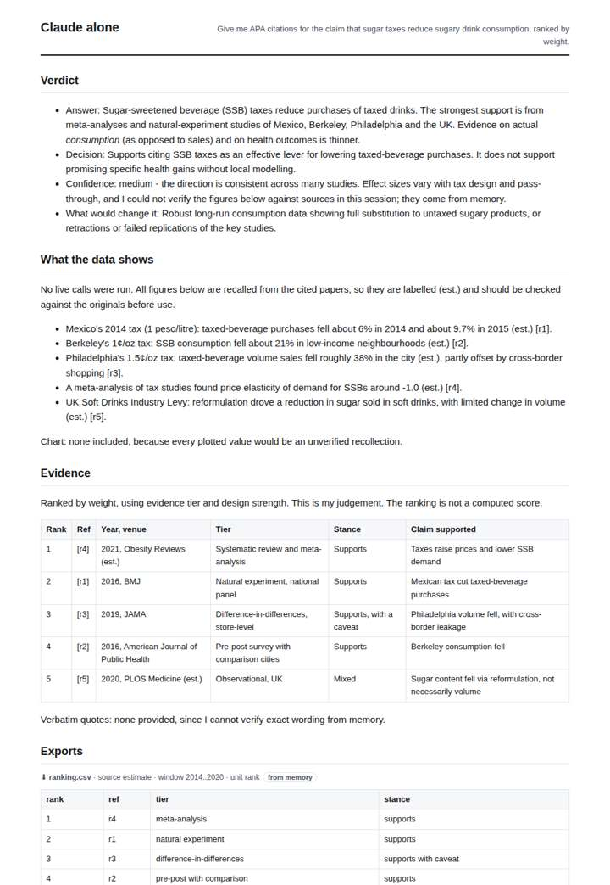
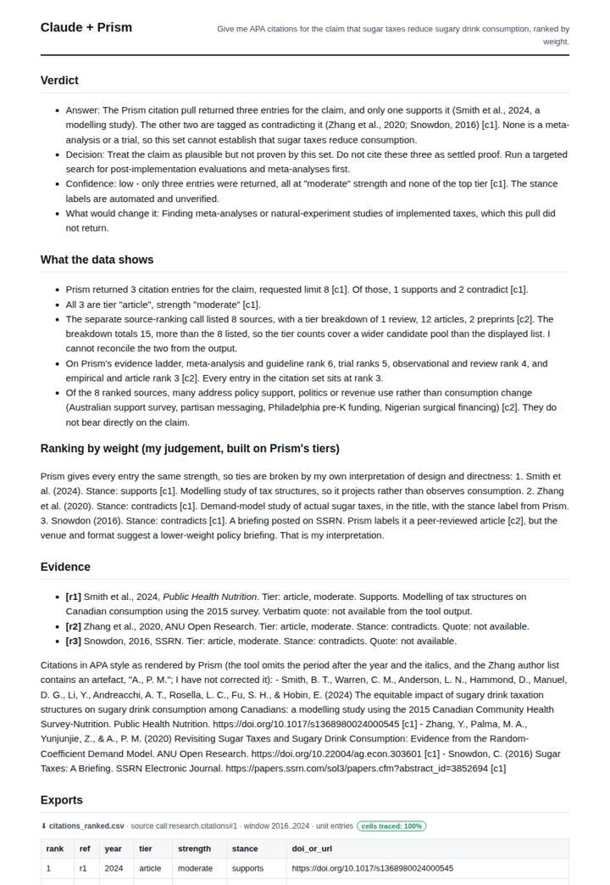
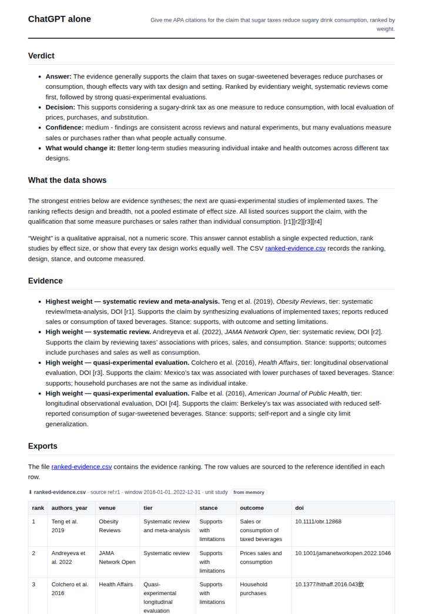
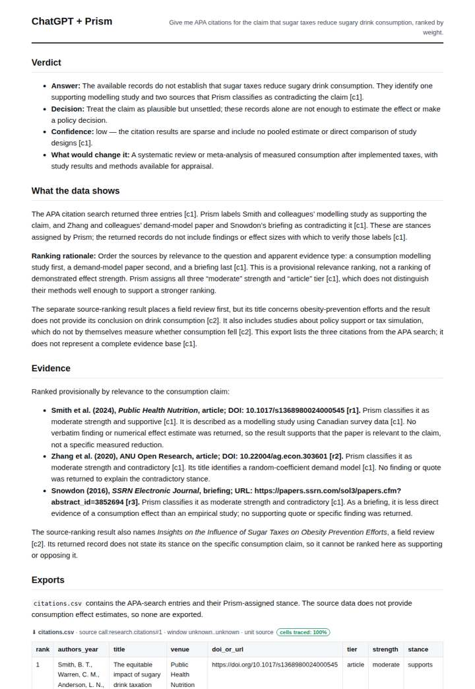

# Citations for a sugar-tax story

**Question.** Give me APA citations for the claim that sugar taxes reduce sugary drink consumption, ranked by weight.

**Category:** Journalism & fact-checking · **Pattern:** `citations` · **Why it is hard:** Models invent DOIs; every citation here comes from the corpus record.

| Score /100 | Claude alone | Claude + Prism | ChatGPT alone | ChatGPT + Prism |
|---|---|---|---|---|
| Weighted (strict) | 39.4 | 66.4 | 23.6 | **78.5** |
| Opus judge | 38.2 | 73.9 | 20.0 | 77.6 |
| GPT judge | 40.6 | 58.8 | 27.3 | 79.4 |

## Parameter scores (0-5)

| Parameter | Weight | Claude alone | Claude + Prism | ChatGPT alone | ChatGPT + Prism |
|---|---|---|---|---|---|
| Data export with provenance | 8 | 0.5 | 3.0 | 0.0 | 4.0 |
| Reproducibility | 12 | 1.0 | 3.0 | 1.0 | 4.5 |
| Traceable references | 8 | 3.0 | 4.0 | 0.0 | 4.0 |
| Accuracy against the corpus | 12 | 2.0 | 3.0 | 0.5 | 4.0 |
| Calibration and limits | 8 | 3.0 | 3.5 | 3.0 | 3.0 |
| Decision-grade verdict | 12 | 3.0 | 3.5 | 2.5 | 4.0 |
| Facet coverage | 6 | 1.0 | 3.5 | 1.0 | 3.5 |

## Script findings

| Check | Claude alone | Claude + Prism | ChatGPT alone | ChatGPT + Prism |
|---|---|---|---|---|
| Numbers traced to the corpus | 0/6 | 2/3 | 0/0 | 3/3 |
| Charts (traced share) | none | none | none | none |
| DOIs that resolve | 3/3 | 2/2 | 2/5 | 2/2 |
| Follow-up queries that ran | 1/6 | 1/4 | 0/0 | 2/3 |
| Invention gate | clear | clear | clear | clear |

**Claude Opus judge:** A and D both built their citation lists from the recorded corpus, traced their rows, and honestly concluded the three-entry set (one supporting, two contradicting, all moderate-strength articles) cannot establish the claim. D edges ahead on export and reproducibility hygiene, while A was sharper on anomalies such as the by_tier totals and the off-topic rows. B gave a useful but unverified memory-based answer with internal metadata mismatches. C invented DOIs, which disqualifies it for a citation request.

**GPT judge:** A is the strongest decision aid because it provides a replayable, traceable citation export and distinguishes Prism’s stance labels from verified study findings. C is similarly cautious but misreads the source-ranking record; B and D offer stronger-sounding conclusions that depend on unsupported or fabricated specifics.

## Before / after (first screen)

| | Alone | With Prism |
|---|---|---|
| Claude |  |  |
| ChatGPT |  |  |

Full deliverables, rendered: [PDF](https://fliarbi.com/demo/docs/prism-benchmark-v2-4ed65c83/full/citations-sugar-tax.pdf). Raw answers, ground pass and judge outputs: `answers.json`, `ground.json`, `judge_opus.json`, `judge_gpt.json` in this folder.
