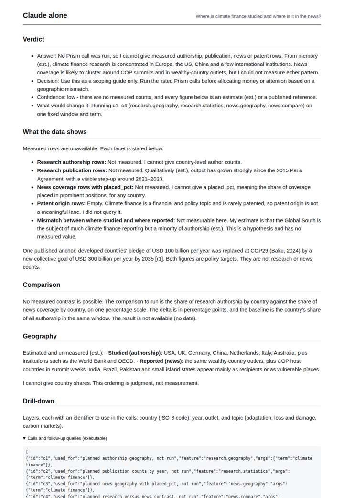
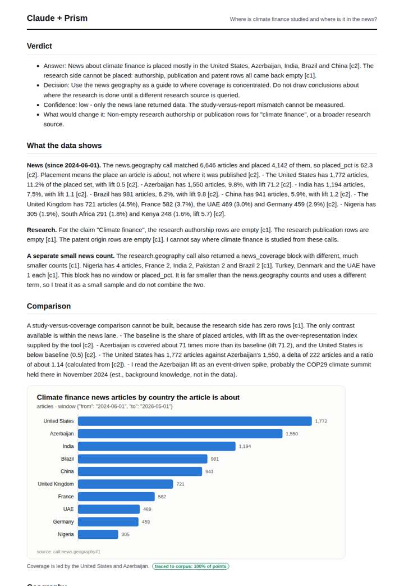
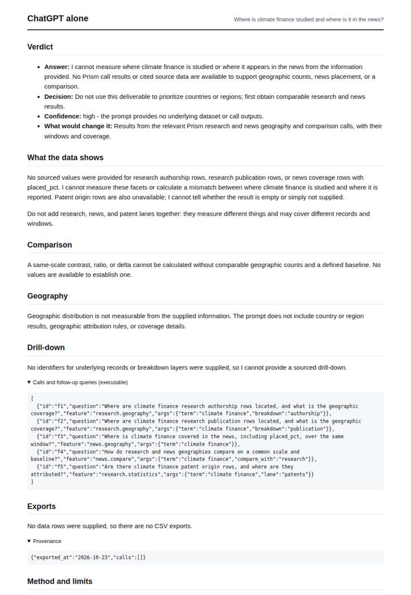
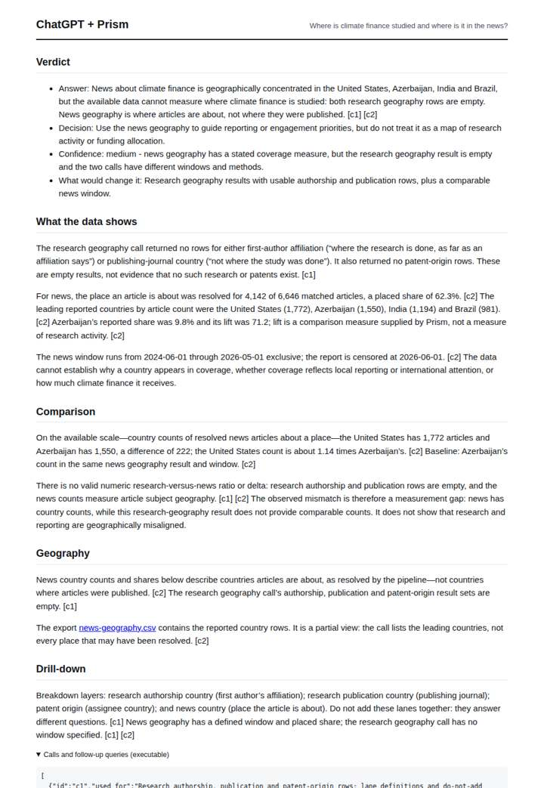

# Climate finance geography

**Question.** Where is climate finance studied and where is it in the news?

**Category:** Energy & climate · **Pattern:** `geo` · **Why it is hard:** Global South coverage vs Global North research.

| Score /100 | Claude alone | Claude + Prism | ChatGPT alone | ChatGPT + Prism |
|---|---|---|---|---|
| Weighted (strict) | 24.5 | **78.4** | 28.9 | 72.7 |
| Opus judge | 23.7 | 76.3 | 22.2 | 68.5 |
| GPT judge | 25.4 | 80.5 | 35.6 | 76.8 |

## Parameter scores (0-5)

| Parameter | Weight | Claude alone | Claude + Prism | ChatGPT alone | ChatGPT + Prism |
|---|---|---|---|---|---|
| Measured comparison | 7 | 0.5 | 4.0 | 0.5 | 4.5 |
| Visualisation from counted data | 10 | 0.0 | 4.5 | 0.0 | 0.0 |
| Exploration and drill-down | 7 | 1.0 | 3.5 | 1.0 | 3.5 |
| Data export with provenance | 8 | 1.0 | 3.0 | 0.0 | 4.0 |
| Reproducibility | 12 | 1.0 | 4.5 | 1.0 | 4.5 |
| Accuracy against the corpus | 12 | 2.0 | 3.5 | 3.5 | 4.0 |
| Calibration and limits | 8 | 2.0 | 4.0 | 3.0 | 4.5 |
| Decision-grade verdict | 12 | 2.0 | 4.0 | 2.0 | 4.0 |
| Facet coverage | 6 | 1.0 | 4.0 | 1.0 | 4.0 |

## Script findings

| Check | Claude alone | Claude + Prism | ChatGPT alone | ChatGPT + Prism |
|---|---|---|---|---|
| Numbers traced to the corpus | 0/2 | 45/45 | 0/0 | 15/16 |
| Charts (traced share) | none | 100% | none | none |
| DOIs that resolve | 0/0 | 0/0 | 0/0 | 0/0 |
| Follow-up queries that ran | 3/5 | 4/6 | 1/5 | 4/5 |
| Invention gate | clear | clear | clear | clear |

**Claude Opus judge:** B and D both grounded the news geography correctly and recognised the empty research lanes, so they did not invent a studied-vs-reported gap. D is the stronger of the two: it adds a traced chart, catches the small news block inside c1, and gives a properly bounded low-confidence verdict. A answered from memory and misdefined placed_pct, while C was honest but empty.

**GPT judge:** A best supports a decision-maker: it quantifies the news geography, states the empty research result, and keeps the two lanes from being mistaken for a measured mismatch. C is more visually complete, but its unsupported CSV rows and interpretation of lift weaken trust; neither deliverable can establish where climate finance is studied from these records.

## Before / after (first screen)

| | Alone | With Prism |
|---|---|---|
| Claude |  |  |
| ChatGPT |  |  |

Full deliverables, rendered: [PDF](https://fliarbi.com/demo/docs/prism-benchmark-v2-4ed65c83/full/climate-finance-geo.pdf). Raw answers, ground pass and judge outputs: `answers.json`, `ground.json`, `judge_opus.json`, `judge_gpt.json` in this folder.
