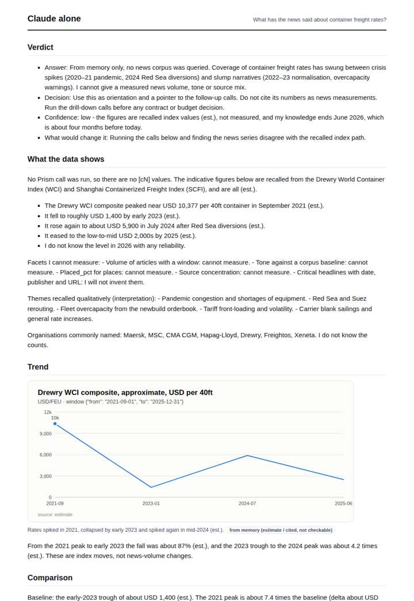
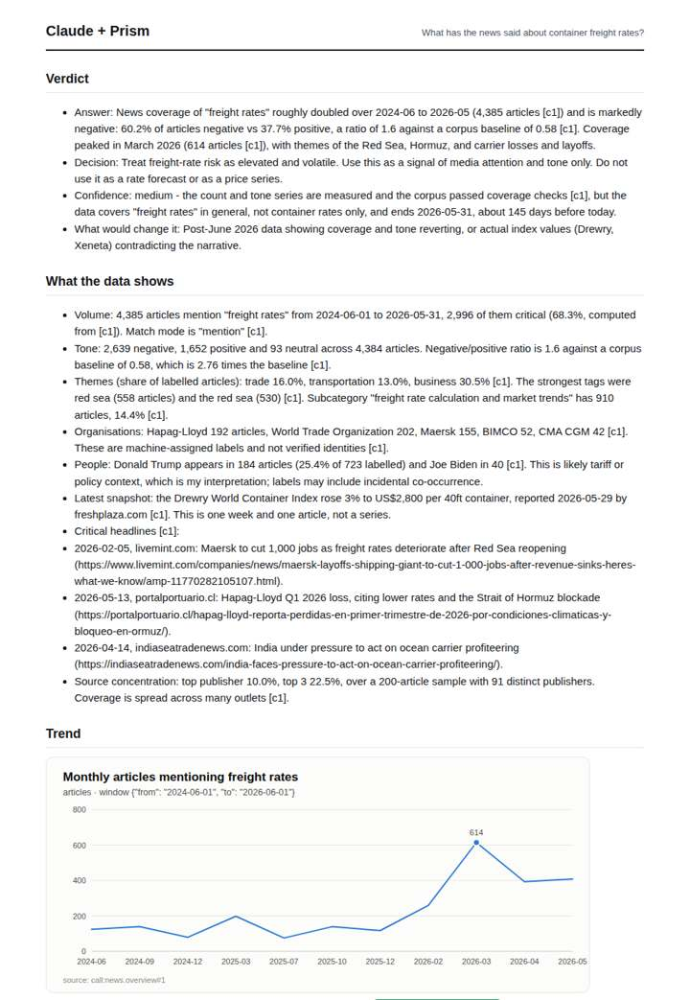
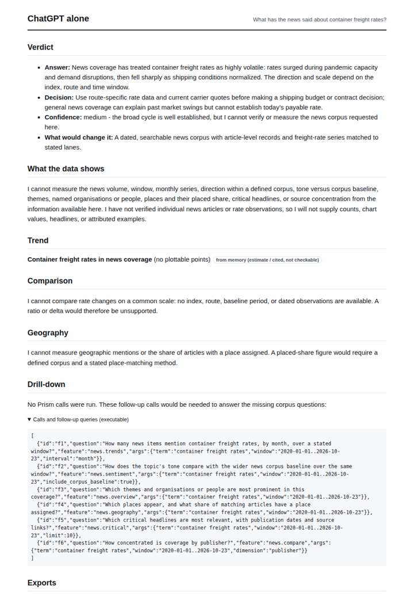
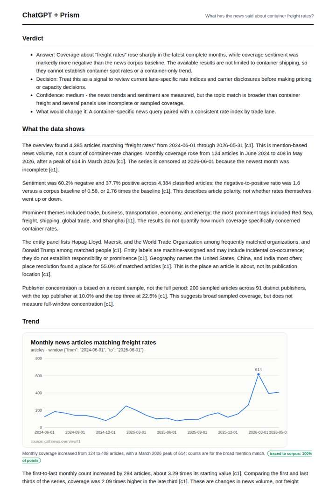

# Container freight rates

**Question.** What has the news said about container freight rates?

**Category:** Supply chain & trade · **Pattern:** `pulse` · **Why it is hard:** Rates spiked in 2024 on Red Sea diversions.

| Score /100 | Claude alone | Claude + Prism | ChatGPT alone | ChatGPT + Prism |
|---|---|---|---|---|
| Weighted (strict) | 33.6 | 68.7 | 25.6 | **79.2** |
| Opus judge | 34.0 | 73.6 | 20.6 | 74.4 |
| GPT judge | 33.2 | 63.8 | 30.6 | 84.0 |

## Parameter scores (0-5)

| Parameter | Weight | Claude alone | Claude + Prism | ChatGPT alone | ChatGPT + Prism |
|---|---|---|---|---|---|
| Measured trend | 10 | 1.0 | 4.5 | 0.0 | 4.0 |
| Measured comparison | 7 | 2.0 | 4.5 | 0.0 | 4.5 |
| Visualisation from counted data | 10 | 1.0 | 2.5 | 0.0 | 4.0 |
| Exploration and drill-down | 7 | 2.0 | 4.0 | 1.0 | 4.5 |
| Data export with provenance | 8 | 1.0 | 3.0 | 0.0 | 3.0 |
| Reproducibility | 12 | 1.0 | 5.0 | 1.0 | 5.0 |
| Traceable references | 8 | 0.5 | 1.0 | 0.5 | 2.0 |
| Accuracy against the corpus | 12 | 3.0 | 3.0 | 4.0 | 4.0 |
| Calibration and limits | 8 | 3.0 | 4.0 | 3.0 | 4.5 |
| Decision-grade verdict | 12 | 2.5 | 2.5 | 2.5 | 4.0 |
| Facet coverage | 6 | 1.0 | 4.0 | 0.5 | 3.5 |

## Script findings

| Check | Claude alone | Claude + Prism | ChatGPT alone | ChatGPT + Prism |
|---|---|---|---|---|
| Numbers traced to the corpus | 0/12 | 78/78 | 0/0 | 25/25 |
| Charts (traced share) | memory | 100% | memory | 100% |
| DOIs that resolve | 0/0 | 0/0 | 0/0 | 0/0 |
| Follow-up queries that ran | 4/6 | 3/6 | 0/6 | 4/5 |
| Invention gate | clear | clear | clear | clear |

**Claude Opus judge:** A and B both grounded their answers in the measured news corpus and were honest that 'freight rates' is broader than container rates. A went further, decomposing critical share, naming the tone extremes and exposing headline URLs inline. B's verdict was cleaner and better bounded, but its decomposition was thinner. C and D could not measure what the news said; D's labelled memory index path offers orientation but no news evidence.

**GPT judge:** A best supports a cautious decision: it traces the news-volume and tone findings, distinguishes them from container prices, and states what evidence is missing before acting. D has broader breakdowns, but its container framing and unsupported Drewry snapshot weaken the decision; B and C either offer no measured corpus answer or substitute recalled rate-index estimates.

## Before / after (first screen)

| | Alone | With Prism |
|---|---|---|
| Claude |  |  |
| ChatGPT |  |  |

Full deliverables, rendered: [PDF](https://fliarbi.com/demo/docs/prism-benchmark-v2-4ed65c83/full/container-freight-pulse.pdf). Raw answers, ground pass and judge outputs: `answers.json`, `ground.json`, `judge_opus.json`, `judge_gpt.json` in this folder.
