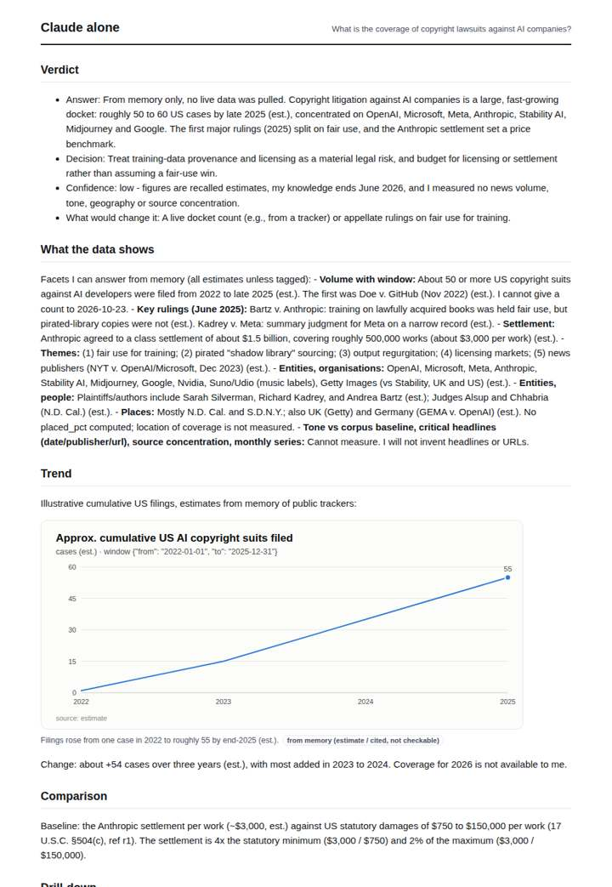
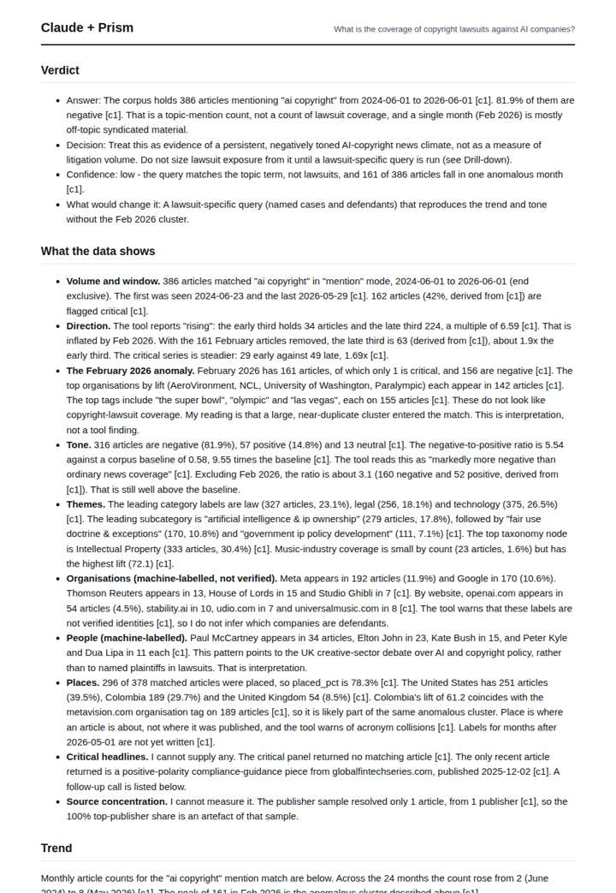
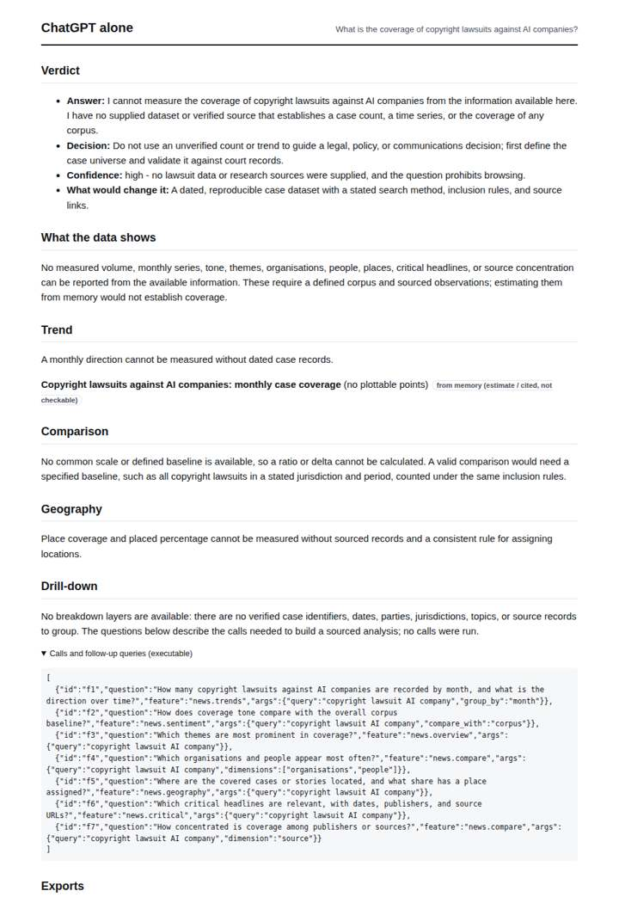
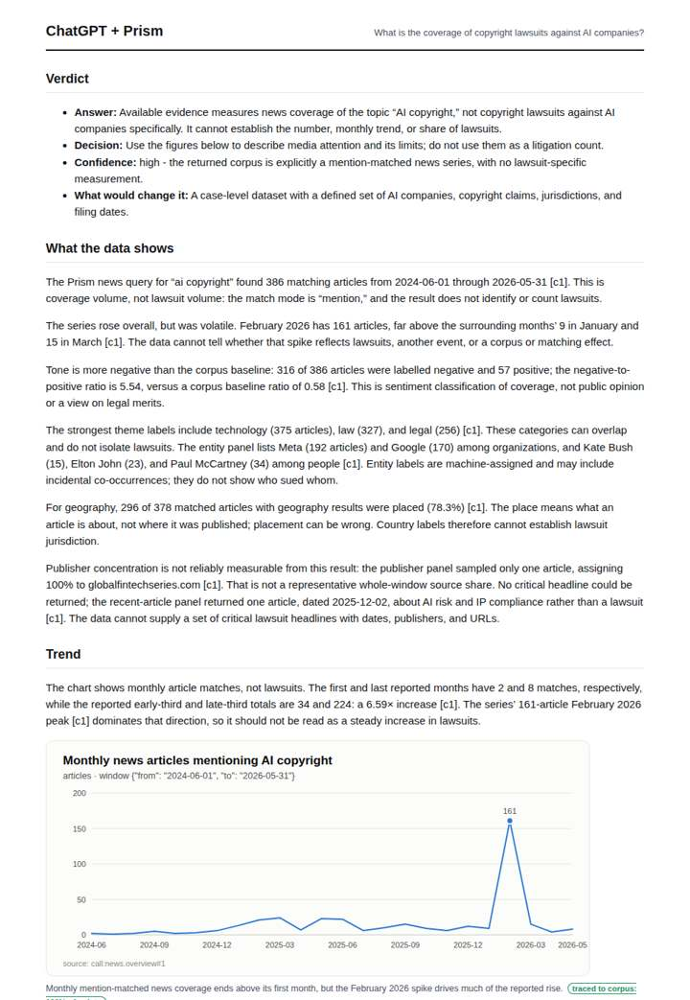

# AI copyright lawsuits

**Question.** What is the coverage of copyright lawsuits against AI companies?

**Category:** Legal & compliance · **Pattern:** `pulse` · **Why it is hard:** NYT v OpenAI and the Anthropic authors settlement are recent; recency is the test.

| Score /100 | Claude alone | Claude + Prism | ChatGPT alone | ChatGPT + Prism |
|---|---|---|---|---|
| Weighted (strict) | 30.9 | **79.3** | 18.2 | 72.5 |
| Opus judge | 34.8 | 77.8 | 22.2 | 71.8 |
| GPT judge | 27.0 | 80.8 | 14.2 | 73.2 |

## Parameter scores (0-5)

| Parameter | Weight | Claude alone | Claude + Prism | ChatGPT alone | ChatGPT + Prism |
|---|---|---|---|---|---|
| Measured trend | 10 | 1.0 | 4.5 | 0.0 | 4.0 |
| Measured comparison | 7 | 2.0 | 5.0 | 0.0 | 4.5 |
| Visualisation from counted data | 10 | 1.0 | 4.0 | 0.5 | 3.0 |
| Exploration and drill-down | 7 | 1.5 | 2.5 | 1.0 | 3.0 |
| Data export with provenance | 8 | 1.0 | 4.0 | 1.0 | 4.0 |
| Reproducibility | 12 | 0.0 | 5.0 | 1.0 | 4.0 |
| Traceable references | 8 | 1.5 | 1.0 | 0.0 | 1.0 |
| Accuracy against the corpus | 12 | 2.5 | 4.0 | 2.0 | 4.0 |
| Calibration and limits | 8 | 3.0 | 4.5 | 2.5 | 4.0 |
| Decision-grade verdict | 12 | 2.5 | 4.0 | 1.0 | 4.0 |
| Facet coverage | 6 | 1.0 | 4.5 | 0.5 | 4.0 |

## Script findings

| Check | Claude alone | Claude + Prism | ChatGPT alone | ChatGPT + Prism |
|---|---|---|---|---|
| Numbers traced to the corpus | 0/17 | 98/98 | 0/0 | 28/29 |
| Charts (traced share) | memory | 100% | memory | 100% |
| DOIs that resolve | 0/0 | 0/0 | 0/0 | 0/0 |
| Follow-up queries that ran | 5/7 | 2/6 | 0/7 | 3/6 |
| Invention gate | clear | clear | clear | clear |

**Claude Opus judge:** A and C both grounded the answer in the traced news series and correctly said it measures topic attention, not lawsuits. A went further: it identified the Feb 2026 spike as an off-topic syndicated cluster (and the Colombia artefact) and recomputed trend and tone without it, making it decision-grade. D supplied the recent litigation facts from labelled memory but measured no coverage, and B declined entirely.

**GPT judge:** B is the strongest decision aid: it quantifies the news trend, exposes the anomalous February spike, and separates topic mentions from actual lawsuit counts. A is also careful about that core limitation, but B better uses the critical-series decomposition and covers more of the available facets.

## Before / after (first screen)

| | Alone | With Prism |
|---|---|---|
| Claude |  |  |
| ChatGPT |  |  |

Full deliverables, rendered: [PDF](https://fliarbi.com/demo/docs/prism-benchmark-v2-4ed65c83/full/copyright-ai-pulse.pdf). Raw answers, ground pass and judge outputs: `answers.json`, `ground.json`, `judge_opus.json`, `judge_gpt.json` in this folder.
