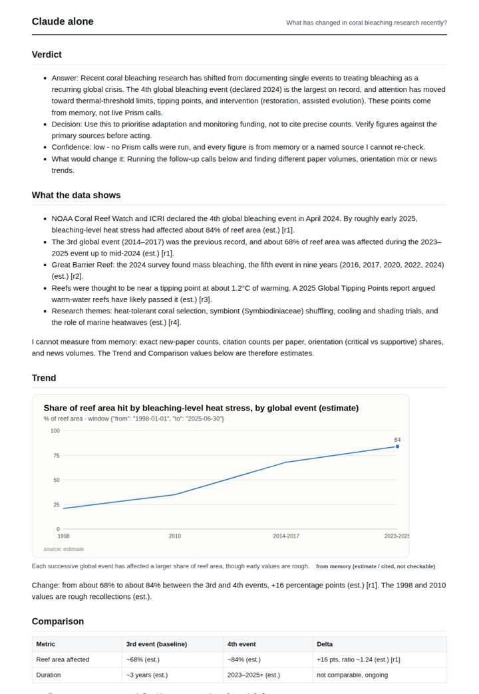
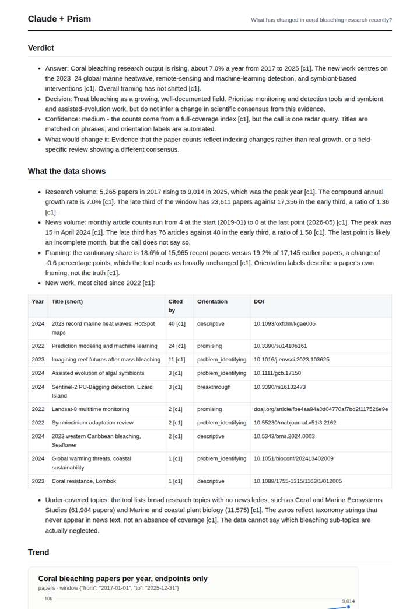
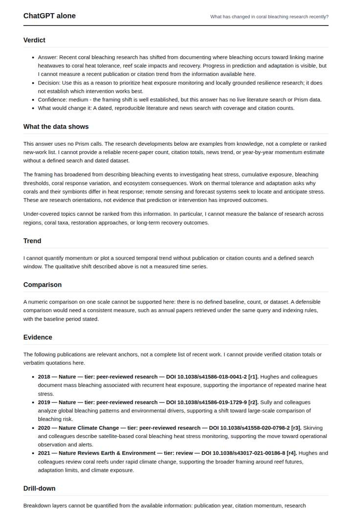
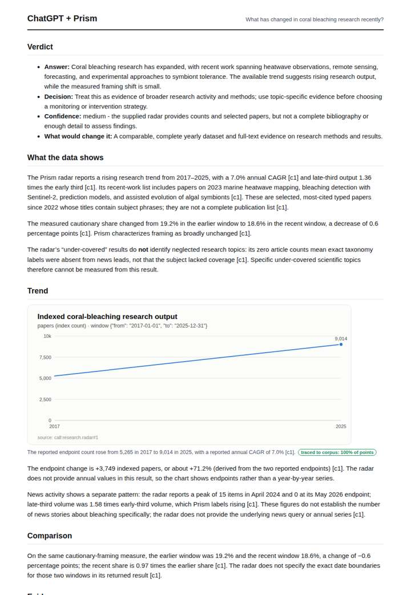

# Coral bleaching research radar

**Question.** What has changed in coral bleaching research recently?

**Category:** Environment & disasters · **Pattern:** `radar` · **Why it is hard:** The fourth global bleaching event is post-training for many models.

| Score /100 | Claude alone | Claude + Prism | ChatGPT alone | ChatGPT + Prism |
|---|---|---|---|---|
| Weighted (strict) | 36.1 | **69.8** | 20.1 | 68.2 |
| Opus judge | 33.4 | 71.8 | 17.0 | 67.2 |
| GPT judge | 38.8 | 67.8 | 23.2 | 69.2 |

## Parameter scores (0-5)

| Parameter | Weight | Claude alone | Claude + Prism | ChatGPT alone | ChatGPT + Prism |
|---|---|---|---|---|---|
| Measured trend | 10 | 1.0 | 4.0 | 0.0 | 4.0 |
| Measured comparison | 7 | 2.0 | 3.0 | 0.5 | 4.0 |
| Visualisation from counted data | 10 | 1.0 | 3.5 | 0.0 | 3.5 |
| Exploration and drill-down | 7 | 1.5 | 3.0 | 1.0 | 2.0 |
| Data export with provenance | 8 | 1.0 | 2.5 | 0.0 | 2.5 |
| Reproducibility | 12 | 1.0 | 4.0 | 1.0 | 2.5 |
| Traceable references | 8 | 2.0 | 3.0 | 0.0 | 3.5 |
| Accuracy against the corpus | 12 | 2.5 | 3.5 | 1.5 | 3.5 |
| Calibration and limits | 8 | 3.5 | 4.0 | 3.0 | 4.0 |
| Decision-grade verdict | 12 | 3.0 | 3.5 | 2.5 | 4.0 |
| Facet coverage | 6 | 1.0 | 4.0 | 1.0 | 4.0 |

## Script findings

| Check | Claude alone | Claude + Prism | ChatGPT alone | ChatGPT + Prism |
|---|---|---|---|---|
| Numbers traced to the corpus | 0/10 | 45/45 | 0/12 | 17/21 |
| Charts (traced share) | memory | 100% | none | 100% |
| DOIs that resolve | 1/1 | 9/9 | 1/4 | 4/4 |
| Follow-up queries that ran | 3/6 | 3/7 | 0/5 | 2/5 |
| Invention gate | clear | clear | clear | clear |

**Claude Opus judge:** C and D both grounded their answers in the radar call and read its traps correctly, notably the taxonomy-label zeros. C went further: it exposed the new-work layer with DOIs, compared research and news on early-vs-late thirds, and flagged the incomplete final news month, so it gives a decision-maker the most usable picture. A gave honest, labelled memory about the 4th global event but nothing measured. B fabricated three DOIs.

**GPT judge:** D is strongest for a decision-maker: its core research-volume and framing figures trace to the reference record, and it provides a useful set of recent papers with identifiers. Its main weakness is the claim that news grew faster than research, which compares different windows and lanes; C is more careful about that limitation but has weaker traceability and export coverage.

## Before / after (first screen)

| | Alone | With Prism |
|---|---|---|
| Claude |  |  |
| ChatGPT |  |  |

Full deliverables, rendered: [PDF](https://fliarbi.com/demo/docs/prism-benchmark-v2-4ed65c83/full/coral-bleaching-radar.pdf). Raw answers, ground pass and judge outputs: `answers.json`, `ground.json`, `judge_opus.json`, `judge_gpt.json` in this folder.
