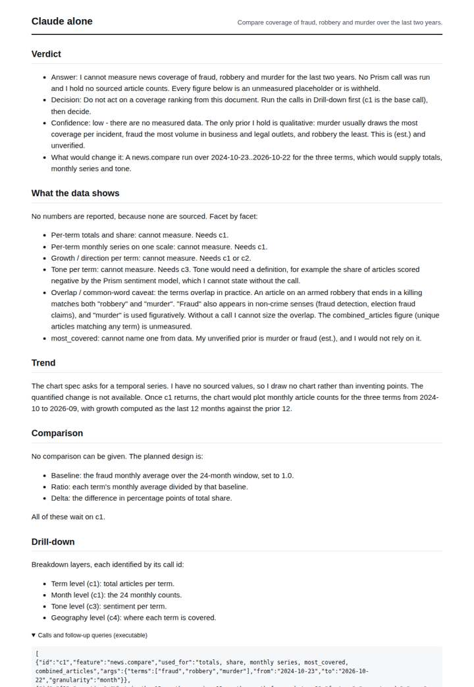
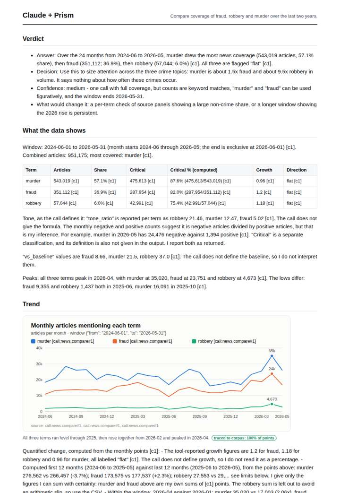
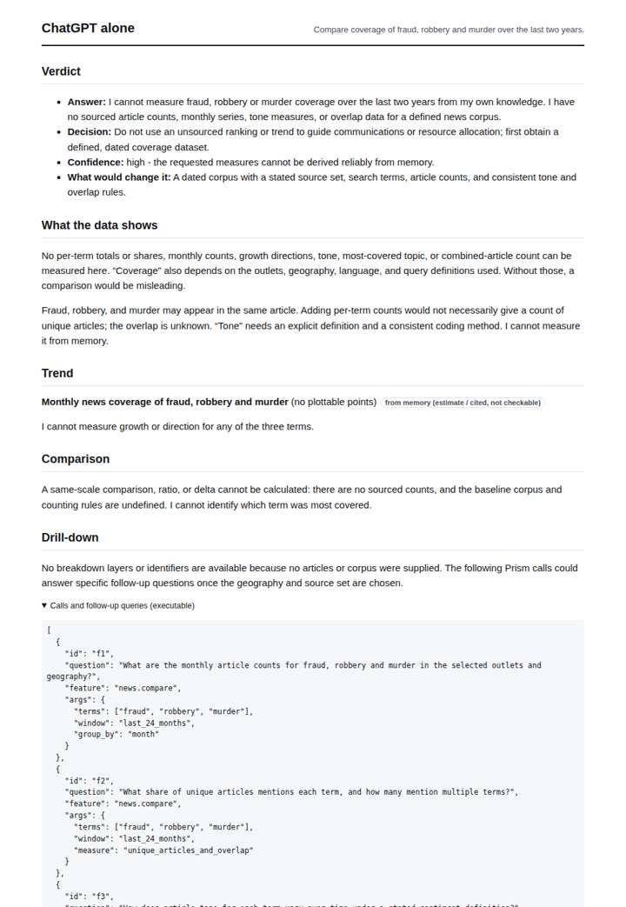
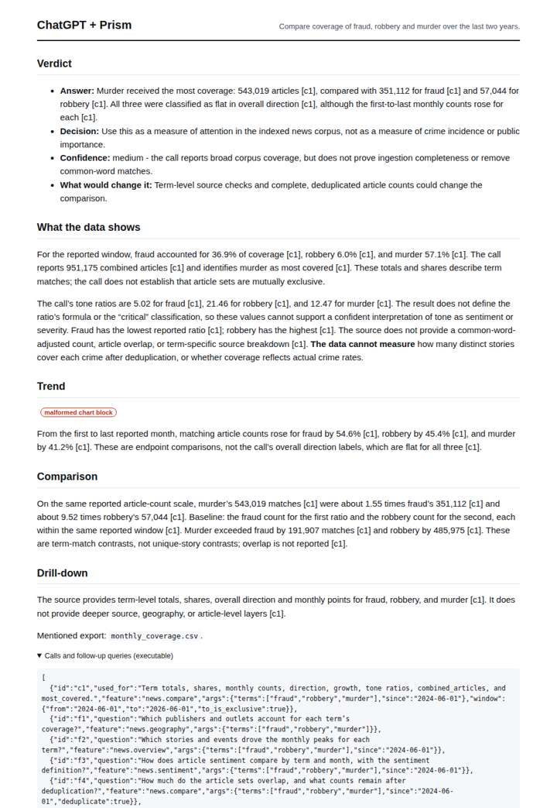

# Fraud vs theft vs violence in the news

**Question.** Compare coverage of fraud, robbery and murder over the last two years.

**Category:** Crime & public safety · **Pattern:** `compare` · **Why it is hard:** Violent crime dominates criticality even when fraud dominates volume.

| Score /100 | Claude alone | Claude + Prism | ChatGPT alone | ChatGPT + Prism |
|---|---|---|---|---|
| Weighted (strict) | 21.8 | **56.5** | 25.5 | 48.5 |
| Opus judge | 19.8 | 63.0 | 22.4 | 49.3 |
| GPT judge | 23.9 | 50.0 | 28.7 | 47.6 |

## Parameter scores (0-5)

| Parameter | Weight | Claude alone | Claude + Prism | ChatGPT alone | ChatGPT + Prism |
|---|---|---|---|---|---|
| Measured trend | 10 | 0.0 | 2.5 | 0.0 | 1.0 |
| Measured comparison | 7 | 0.0 | 4.5 | 0.0 | 4.0 |
| Visualisation from counted data | 10 | 0.0 | 2.5 | 0.5 | 0.0 |
| Exploration and drill-down | 7 | 0.5 | 1.5 | 0.5 | 1.0 |
| Data export with provenance | 8 | 0.0 | 3.0 | 0.5 | 3.0 |
| Reproducibility | 12 | 0.0 | 3.0 | 1.0 | 3.0 |
| Accuracy against the corpus | 12 | 3.0 | 2.0 | 3.0 | 3.0 |
| Calibration and limits | 8 | 3.5 | 3.0 | 3.0 | 3.5 |
| Decision-grade verdict | 12 | 2.5 | 3.0 | 2.5 | 3.0 |
| Facet coverage | 6 | 0.5 | 4.0 | 0.5 | 3.0 |

## Script findings

| Check | Claude alone | Claude + Prism | ChatGPT alone | ChatGPT + Prism |
|---|---|---|---|---|
| Numbers traced to the corpus | 0/5 | 87/94 | 0/0 | 19/22 |
| Charts (traced share) | none | 100% | memory | memory |
| DOIs that resolve | 0/0 | 0/0 | 0/0 | 0/0 |
| Follow-up queries that ran | 0/5 | 2/6 | 0/4 | 0/5 |
| Invention gate | clear | clear | clear | clear |

**Claude Opus judge:** A was the only deliverable to address the question's crux: murder dominates on both volume and critical share (87.6% vs 82.0% for fraud and 75.4% for robbery). It also caught the non-deduplicated combined total and placed the 5-month currency gap next to the numbers. However, its hand-computed 12-month sums are wrong. C traced the same data and exported the full monthly series, but its chart is broken and it ignored criticality. B and D were honest refusals that give a decision-maker nothing measured.

**GPT judge:** D is the most decision-useful because it compares all three topics on the same measured scale, exposes criticality alongside volume, and supplies the monthly series and provenance. Its trend arithmetic and coverage interpretation need correction; C is more cautious about limits but does not quantify trend adequately and leaves key comparison facets unresolved.

## Before / after (first screen)

| | Alone | With Prism |
|---|---|---|
| Claude |  |  |
| ChatGPT |  |  |

Full deliverables, rendered: [PDF](https://fliarbi.com/demo/docs/prism-benchmark-v2-4ed65c83/full/crime-safety-compare.pdf). Raw answers, ground pass and judge outputs: `answers.json`, `ground.json`, `judge_opus.json`, `judge_gpt.json` in this folder.
