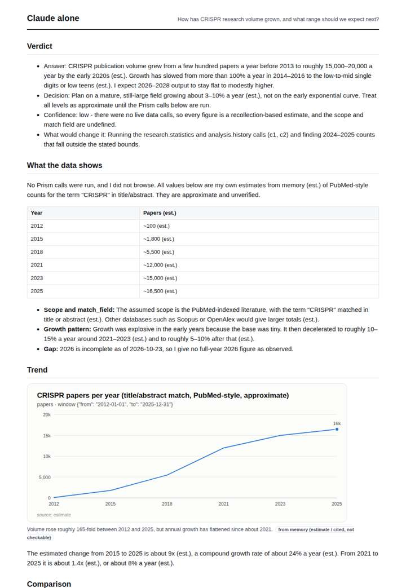
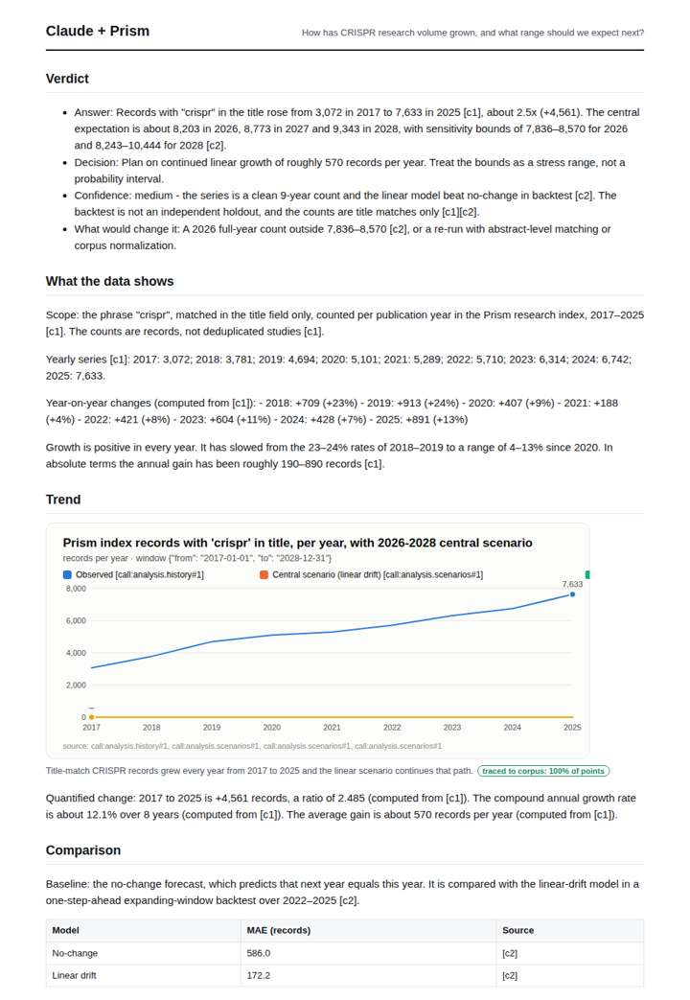
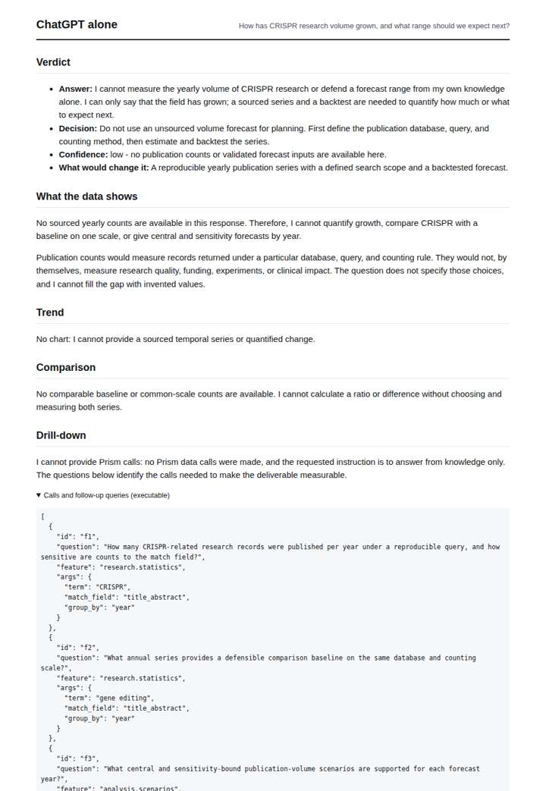
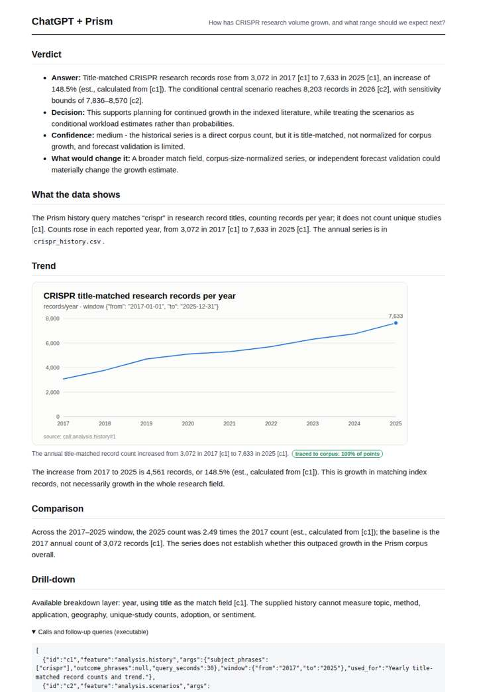

# CRISPR research trend

**Question.** How has CRISPR research volume grown, and what range should we expect next?

**Category:** Academic research & literature review · **Pattern:** `history` · **Why it is hard:** A maturing field: growth is slowing; the range must reflect it.

| Score /100 | Claude alone | Claude + Prism | ChatGPT alone | ChatGPT + Prism |
|---|---|---|---|---|
| Weighted (strict) | 30.8 | **80.9** | 23.0 | 67.5 |
| Opus judge | 30.2 | 83.0 | 19.8 | 62.0 |
| GPT judge | 31.3 | 78.7 | 26.3 | 73.0 |

## Parameter scores (0-5)

| Parameter | Weight | Claude alone | Claude + Prism | ChatGPT alone | ChatGPT + Prism |
|---|---|---|---|---|---|
| Measured trend | 10 | 1.0 | 4.5 | 0.0 | 3.5 |
| Measured comparison | 7 | 1.5 | 4.0 | 0.0 | 3.5 |
| Visualisation from counted data | 10 | 1.0 | 4.5 | 0.0 | 3.5 |
| Exploration and drill-down | 7 | 1.0 | 2.0 | 1.0 | 2.0 |
| Data export with provenance | 8 | 1.0 | 4.5 | 0.0 | 4.0 |
| Reproducibility | 12 | 1.0 | 4.0 | 1.0 | 3.0 |
| Accuracy against the corpus | 12 | 2.0 | 4.0 | 3.5 | 3.5 |
| Calibration and limits | 8 | 3.0 | 4.5 | 3.0 | 4.0 |
| Decision-grade verdict | 12 | 2.5 | 4.0 | 1.5 | 3.5 |
| Facet coverage | 6 | 1.0 | 4.0 | 0.5 | 3.0 |

## Script findings

| Check | Claude alone | Claude + Prism | ChatGPT alone | ChatGPT + Prism |
|---|---|---|---|---|
| Numbers traced to the corpus | 0/40 | 65/68 | 0/0 | 13/15 |
| Charts (traced share) | memory | 100% | none | 100% |
| DOIs that resolve | 0/0 | 0/0 | 0/0 | 0/0 |
| Follow-up queries that ran | 1/5 | 2/7 | 0/4 | 1/4 |
| Invention gate | clear | clear | clear | clear |

**Claude Opus judge:** A turned the traced series into a decision. It reads the slowdown year by year, gives exact CAGR and backtest deltas, charts central and bounds, and sets a falsifiable 2026 trigger. B traced the same data but never addressed the slowing growth that makes this question hard, and charted only the history. C declined to answer, and D offered internally inconsistent memory estimates on a different scale.

**GPT judge:** D is the strongest decision aid: it combines the traced historical series, quantified growth, backtest comparison, and conditional 2026–2028 range with useful limits. B is careful and reproducible but leaves the scenario comparison and mature-field slowdown less developed; D’s main weakness is overstating coverage and underplaying the 2025 rebound.

## Before / after (first screen)

| | Alone | With Prism |
|---|---|---|
| Claude |  |  |
| ChatGPT |  |  |

Full deliverables, rendered: [PDF](https://fliarbi.com/demo/docs/prism-benchmark-v2-4ed65c83/full/crispr-history.pdf). Raw answers, ground pass and judge outputs: `answers.json`, `ground.json`, `judge_opus.json`, `judge_gpt.json` in this folder.
