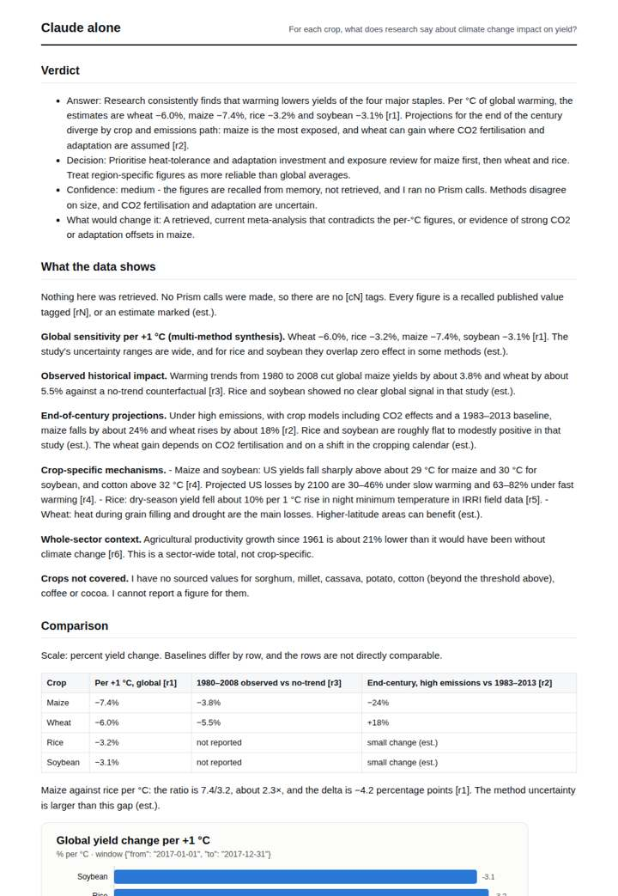
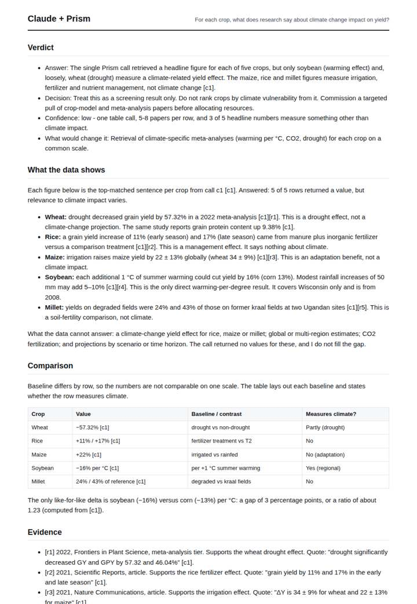
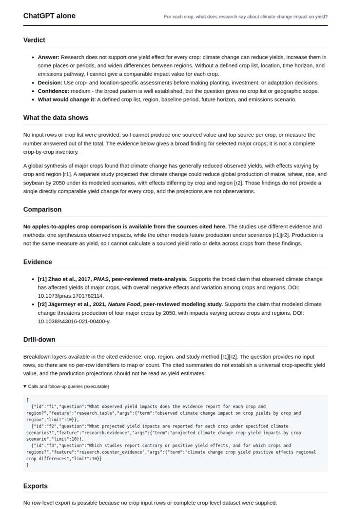
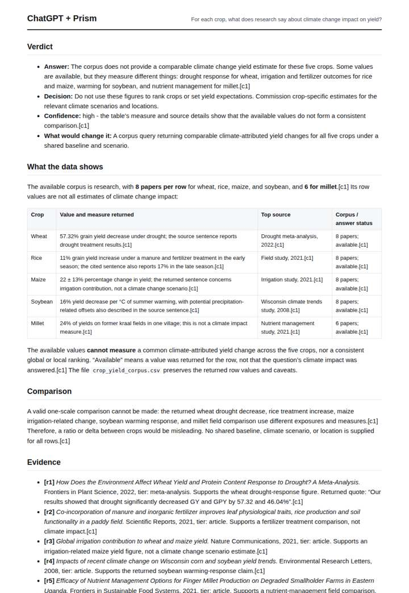

# Climate impact on crop yields

**Question.** For each crop, what does research say about climate change impact on yield?

**Category:** Agriculture & food security · **Pattern:** `table` · **Why it is hard:** Each crop has a separate literature; one number cannot serve all rows.

| Score /100 | Claude alone | Claude + Prism | ChatGPT alone | ChatGPT + Prism |
|---|---|---|---|---|
| Weighted (strict) | 41.1 | **70.1** | 29.4 | 62.9 |
| Opus judge | 42.0 | 66.4 | 16.7 | 58.2 |
| GPT judge | 40.2 | 73.8 | 42.2 | 67.6 |

## Parameter scores (0-5)

| Parameter | Weight | Claude alone | Claude + Prism | ChatGPT alone | ChatGPT + Prism |
|---|---|---|---|---|---|
| Measured comparison | 7 | 2.0 | 4.5 | 0.5 | 1.0 |
| Visualisation from counted data | 10 | 1.0 | 0.0 | 0.0 | 0.0 |
| Exploration and drill-down | 7 | 1.0 | 1.0 | 1.0 | 1.0 |
| Data export with provenance | 8 | 1.0 | 0.0 | 1.0 | 4.0 |
| Reproducibility | 12 | 1.0 | 5.0 | 0.0 | 3.0 |
| Traceable references | 8 | 4.0 | 4.5 | 3.0 | 4.5 |
| Accuracy against the corpus | 12 | 2.5 | 5.0 | 3.0 | 5.0 |
| Calibration and limits | 8 | 3.0 | 5.0 | 3.0 | 3.0 |
| Decision-grade verdict | 12 | 3.0 | 4.5 | 2.0 | 4.5 |
| Facet coverage | 6 | 2.0 | 4.5 | 1.0 | 4.5 |

## Script findings

| Check | Claude alone | Claude + Prism | ChatGPT alone | ChatGPT + Prism |
|---|---|---|---|---|
| Numbers traced to the corpus | 0/35 | 26/26 | 0/4 | 9/9 |
| Charts (traced share) | memory | none | none | none |
| DOIs that resolve | 6/6 | 5/5 | 2/2 | 5/5 |
| Follow-up queries that ran | 0/6 | 0/6 | 0/3 | 0/3 |
| Invention gate | clear | clear | clear | clear |

**Claude Opus judge:** B and C both saw that the database's five crop values mostly measure fertilizer, irrigation and soil effects, not climate impact. B went further: it kept the one valid like-for-like warming contrast (soybean vs corn per °C), quoted every source verbatim and placed its limits next to the numbers. A gave the most useful substantive answer from real, correctly recalled literature, but none of it is measured or reproducible. D gave neither data nor a usable answer, and it carried a garbled reference title.

**GPT judge:** B best equips a decision-maker to distinguish the one returned warming result from drought, irrigation, fertilizer, and soil-management figures, while stating that the crops cannot be ranked from these mixed measures. D is the strongest traceable row export and reaches the same cautious decision, but B adds the more useful explicit comparison and fuller limits.

## Before / after (first screen)

| | Alone | With Prism |
|---|---|---|
| Claude |  |  |
| ChatGPT |  |  |

Full deliverables, rendered: [PDF](https://fliarbi.com/demo/docs/prism-benchmark-v2-4ed65c83/full/crop-yields-climate-table.pdf). Raw answers, ground pass and judge outputs: `answers.json`, `ground.json`, `judge_opus.json`, `judge_gpt.json` in this folder.
