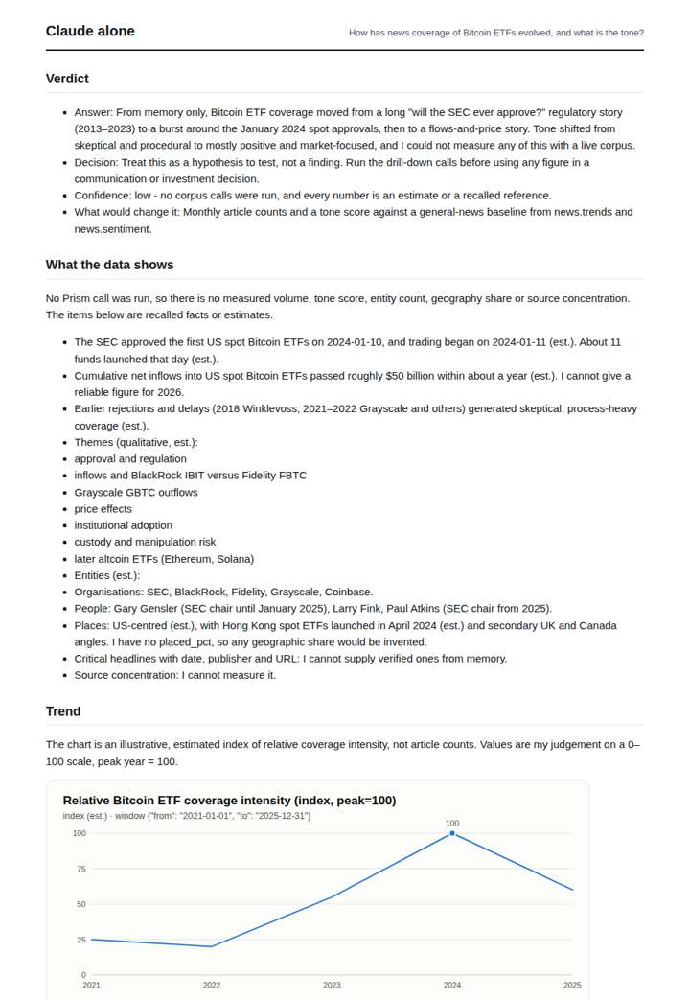
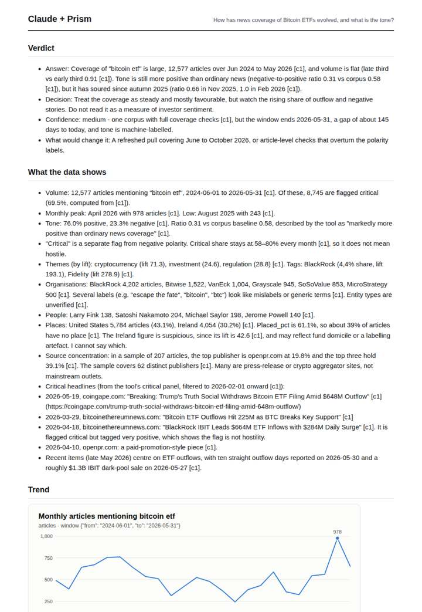
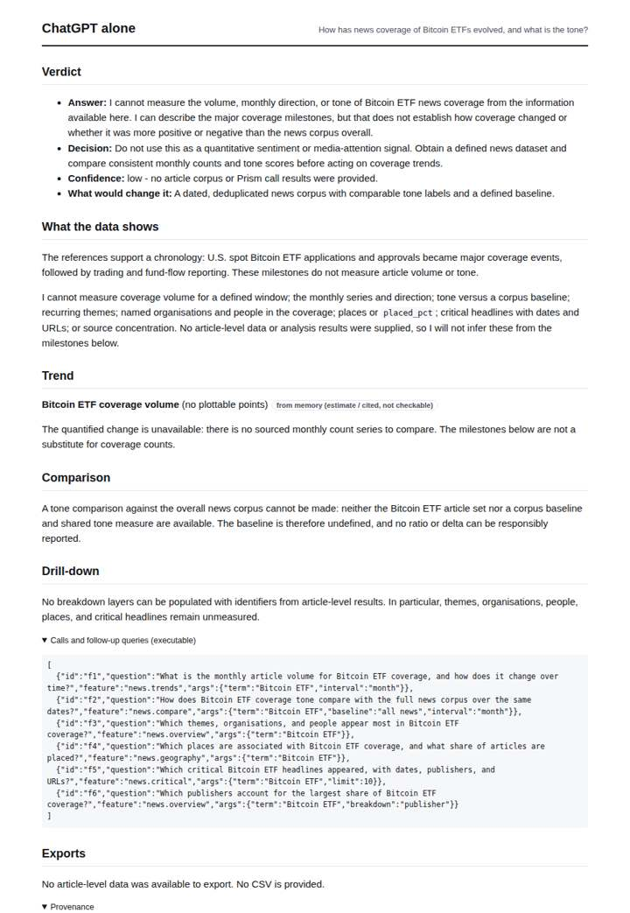
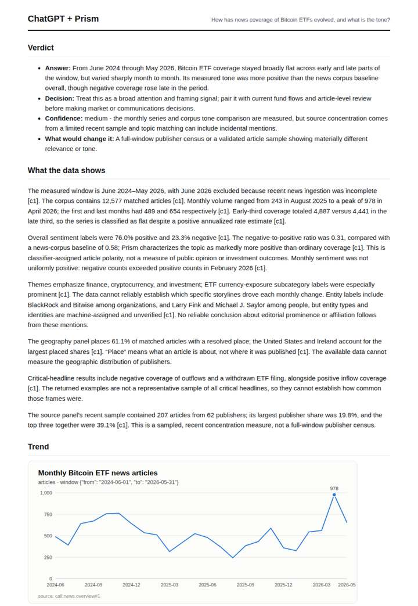

# Bitcoin ETF coverage

**Question.** How has news coverage of Bitcoin ETFs evolved, and what is the tone?

**Category:** Finance & markets · **Pattern:** `pulse` · **Why it is hard:** Coverage is concentrated in a few publishers; the source concentration is part of the answer.

| Score /100 | Claude alone | Claude + Prism | ChatGPT alone | ChatGPT + Prism |
|---|---|---|---|---|
| Weighted (strict) | 29.1 | **73.7** | 31.1 | 64.3 |
| Opus judge | 26.4 | 74.6 | 22.2 | 58.4 |
| GPT judge | 31.8 | 72.8 | 40.0 | 70.2 |

## Parameter scores (0-5)

| Parameter | Weight | Claude alone | Claude + Prism | ChatGPT alone | ChatGPT + Prism |
|---|---|---|---|---|---|
| Measured trend | 10 | 1.0 | 4.0 | 0.0 | 4.5 |
| Measured comparison | 7 | 1.0 | 5.0 | 0.0 | 4.5 |
| Visualisation from counted data | 10 | 1.0 | 4.5 | 0.5 | 3.5 |
| Exploration and drill-down | 7 | 1.5 | 3.5 | 1.5 | 2.0 |
| Data export with provenance | 8 | 1.0 | 3.0 | 0.0 | 3.0 |
| Reproducibility | 12 | 0.0 | 4.5 | 1.0 | 3.5 |
| Traceable references | 8 | 0.0 | 1.0 | 1.5 | 0.5 |
| Accuracy against the corpus | 12 | 3.0 | 3.5 | 4.0 | 2.5 |
| Calibration and limits | 8 | 3.5 | 3.0 | 4.0 | 3.0 |
| Decision-grade verdict | 12 | 2.5 | 3.5 | 2.5 | 4.0 |
| Facet coverage | 6 | 1.0 | 5.0 | 1.0 | 4.0 |

## Script findings

| Check | Claude alone | Claude + Prism | ChatGPT alone | ChatGPT + Prism |
|---|---|---|---|---|
| Numbers traced to the corpus | 0/10 | 73/73 | 0/0 | 28/29 |
| Charts (traced share) | memory | 100%, 100% | memory | 100% |
| DOIs that resolve | 0/0 | 0/0 | 0/0 | 0/0 |
| Follow-up queries that ran | 3/6 | 3/5 | 3/6 | 2/5 |
| Invention gate | clear | clear | clear | clear |

**Claude Opus judge:** C and A both traced a flat two-year volume series and a tone ratio well below the corpus baseline. Only C charted tone, showing the souring after Sept 2025, and only C named the concentrated publishers, gave dated headlines and flagged label anomalies. A misread February 2026 as net-negative and had no headline layer. B and D honestly declined to measure anything, which leaves a decision-maker without the volume, tone or concentration answer.

**GPT judge:** D is the strongest decision aid because it combines traced volume and tone series, a defined baseline comparison, source concentration, headline examples, and explicit limits. Its incorrect peak caption and a few unsupported coverage or match-mode claims need correction; C is cleaner in its trend interpretation but omits a tone chart and offers less usable drill-down.

## Before / after (first screen)

| | Alone | With Prism |
|---|---|---|
| Claude |  |  |
| ChatGPT |  |  |

Full deliverables, rendered: [PDF](https://fliarbi.com/demo/docs/prism-benchmark-v2-4ed65c83/full/crypto-etf-pulse.pdf). Raw answers, ground pass and judge outputs: `answers.json`, `ground.json`, `judge_opus.json`, `judge_gpt.json` in this folder.
