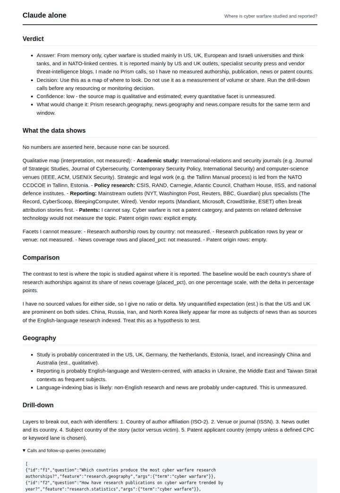
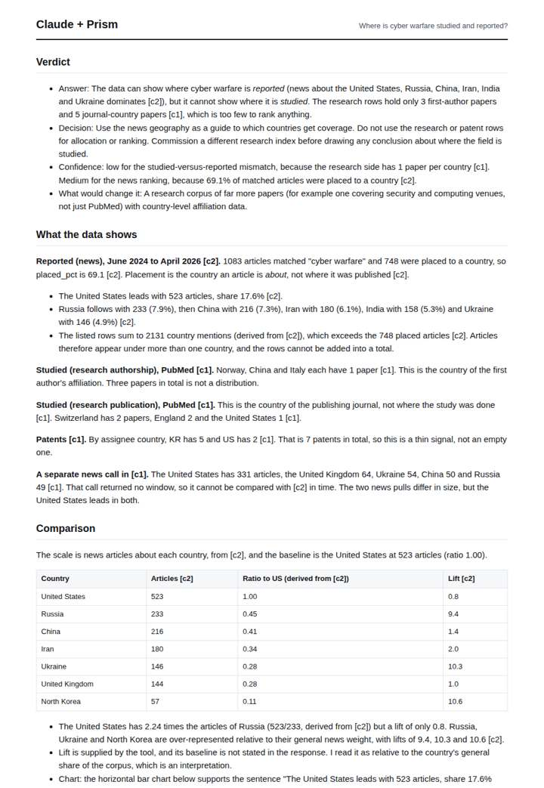
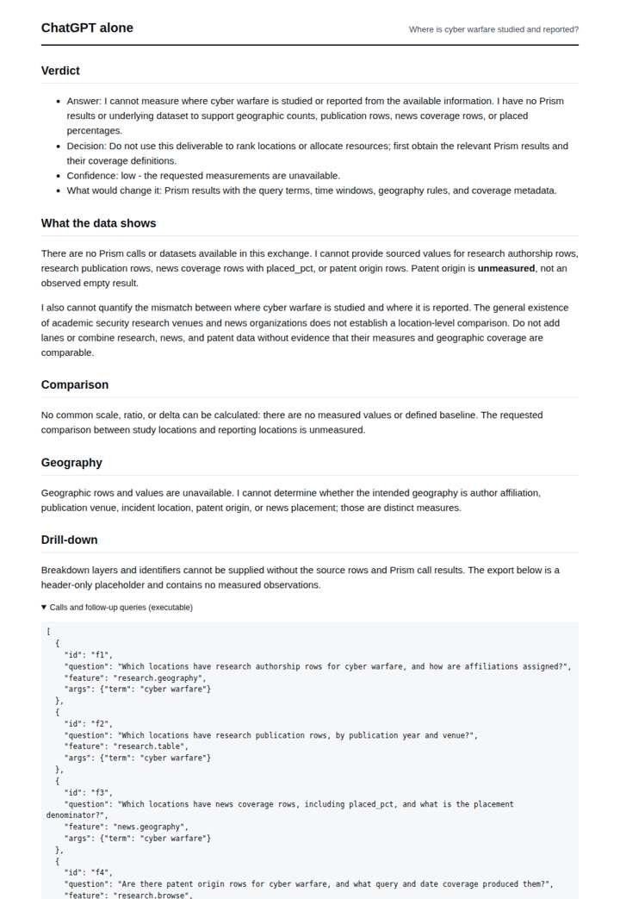
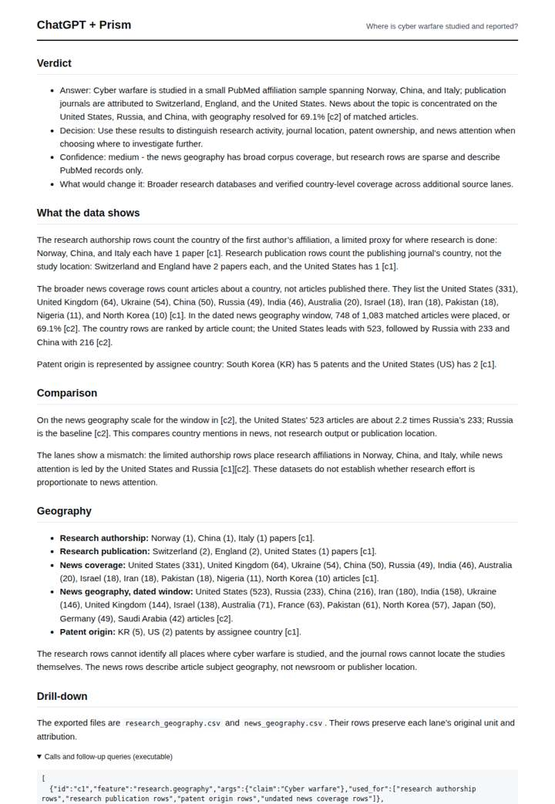

# Cyber warfare geography

**Question.** Where is cyber warfare studied and reported?

**Category:** Defence & geopolitics · **Pattern:** `geo` · **Why it is hard:** Attribution is political; the geography of coverage is itself a signal.

| Score /100 | Claude alone | Claude + Prism | ChatGPT alone | ChatGPT + Prism |
|---|---|---|---|---|
| Weighted (strict) | 29.4 | **72.4** | 27.7 | 64.5 |
| Opus judge | 27.3 | 74.9 | 24.1 | 59.0 |
| GPT judge | 31.5 | 70.0 | 31.2 | 70.0 |

## Parameter scores (0-5)

| Parameter | Weight | Claude alone | Claude + Prism | ChatGPT alone | ChatGPT + Prism |
|---|---|---|---|---|---|
| Measured comparison | 7 | 0.5 | 4.0 | 0.0 | 2.5 |
| Visualisation from counted data | 10 | 0.0 | 3.0 | 0.0 | 0.0 |
| Exploration and drill-down | 7 | 1.0 | 3.0 | 1.5 | 4.0 |
| Data export with provenance | 8 | 1.0 | 4.0 | 1.0 | 3.5 |
| Reproducibility | 12 | 1.0 | 4.0 | 1.0 | 4.0 |
| Accuracy against the corpus | 12 | 2.5 | 3.5 | 3.0 | 3.5 |
| Calibration and limits | 8 | 3.0 | 4.5 | 2.5 | 4.0 |
| Decision-grade verdict | 12 | 2.5 | 3.0 | 2.0 | 3.5 |
| Facet coverage | 6 | 1.0 | 4.0 | 0.5 | 4.5 |

## Script findings

| Check | Claude alone | Claude + Prism | ChatGPT alone | ChatGPT + Prism |
|---|---|---|---|---|
| Numbers traced to the corpus | 0/0 | 61/63 | 0/0 | 52/52 |
| Charts (traced share) | none | 100% | none | none |
| DOIs that resolve | 0/0 | 0/0 | 0/0 | 0/0 |
| Follow-up queries that ran | 2/7 | 3/6 | 1/5 | 5/5 |
| Invention gate | clear | clear | clear | clear |

**Claude Opus judge:** B and D used the same two calls. B read them critically: it noted that news rows overlap (2131 mentions vs 748 placed), flagged the conflict between the two news pulls and the undefined lift and share_pct baselines, and concluded that 'where it is studied' cannot be answered from 3 the health literature index papers. D presented the same sparse research rows as an answer at medium confidence and had no chart. A and C were honest about having no data, but C's memory map is the only one a decision-maker could act on qualitatively.

**GPT judge:** B best equips a decision-maker to distinguish where research authorship, journals, patents, and news attention are recorded, and it carries the clearest traceable drill-down and provenance. D offers a stronger same-window news comparison, but its unsupported overlap inference and lift interpretation weaken accuracy, while neither deliverable can establish a direct geographic ratio between studied and reported activity.

## Before / after (first screen)

| | Alone | With Prism |
|---|---|---|
| Claude |  |  |
| ChatGPT |  |  |

Full deliverables, rendered: [PDF](https://fliarbi.com/demo/docs/prism-benchmark-v2-4ed65c83/full/cyber-warfare-geo.pdf). Raw answers, ground pass and judge outputs: `answers.json`, `ground.json`, `judge_opus.json`, `judge_gpt.json` in this folder.
