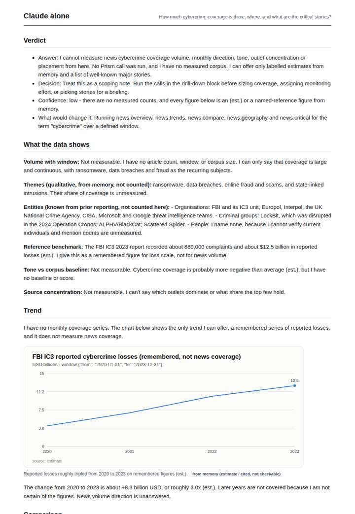
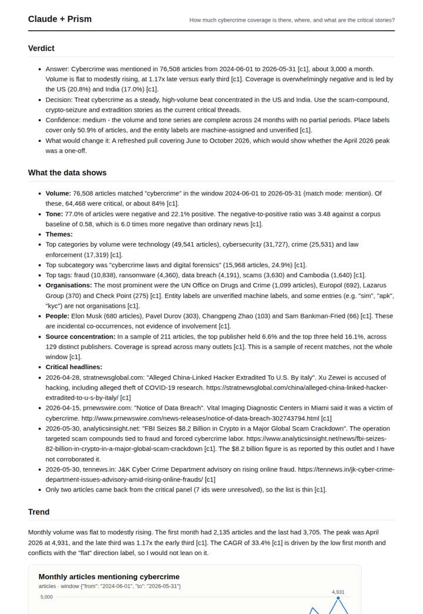
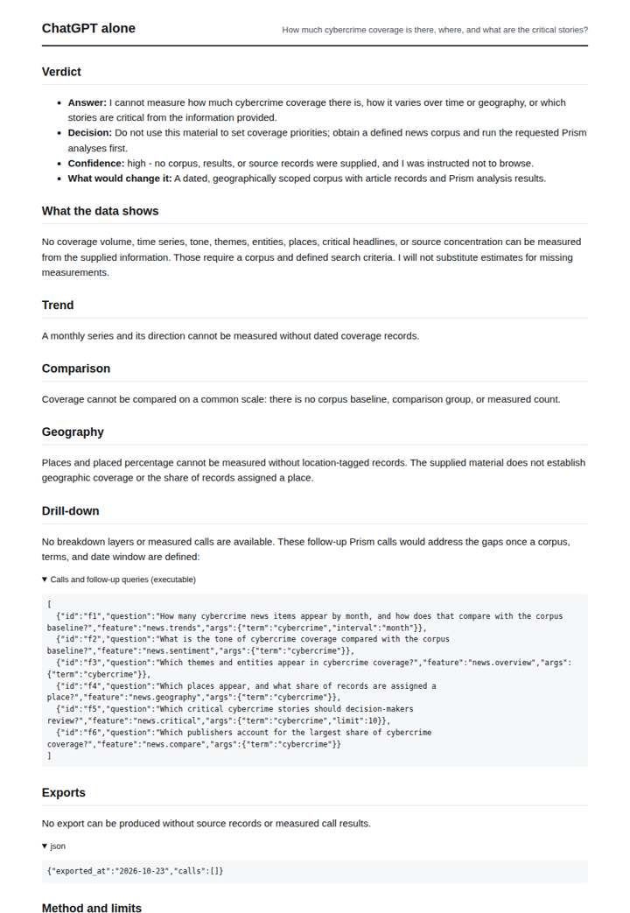
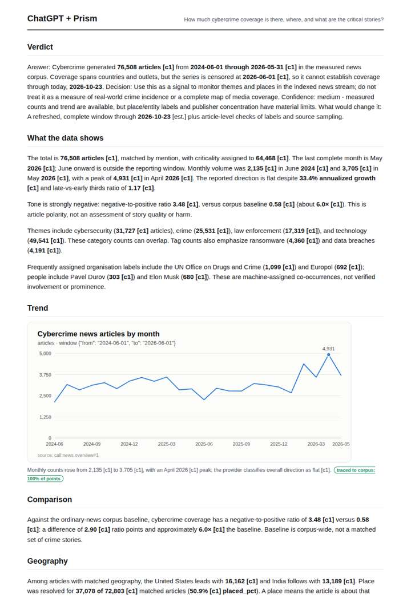

# Cybercrime coverage

**Question.** How much cybercrime coverage is there, where, and what are the critical stories?

**Category:** Crime & public safety · **Pattern:** `pulse` · **Why it is hard:** Ransomware, fraud and data breaches split the coverage; themes separate them.

| Score /100 | Claude alone | Claude + Prism | ChatGPT alone | ChatGPT + Prism |
|---|---|---|---|---|
| Weighted (strict) | 28.7 | **69.6** | 20.1 | 68.6 |
| Opus judge | 30.4 | 74.2 | 18.2 | 69.4 |
| GPT judge | 27.0 | 65.0 | 22.0 | 67.8 |

## Parameter scores (0-5)

| Parameter | Weight | Claude alone | Claude + Prism | ChatGPT alone | ChatGPT + Prism |
|---|---|---|---|---|---|
| Measured trend | 10 | 1.0 | 4.5 | 0.0 | 4.0 |
| Measured comparison | 7 | 1.0 | 4.5 | 0.0 | 4.5 |
| Visualisation from counted data | 10 | 1.0 | 3.5 | 0.0 | 3.0 |
| Exploration and drill-down | 7 | 1.5 | 2.5 | 1.5 | 2.5 |
| Data export with provenance | 8 | 1.0 | 3.0 | 0.0 | 4.0 |
| Reproducibility | 12 | 1.0 | 4.5 | 0.5 | 4.5 |
| Traceable references | 8 | 1.0 | 0.5 | 0.0 | 0.5 |
| Accuracy against the corpus | 12 | 2.5 | 4.0 | 3.0 | 3.5 |
| Calibration and limits | 8 | 3.0 | 2.5 | 3.0 | 4.0 |
| Decision-grade verdict | 12 | 1.5 | 3.5 | 2.0 | 3.0 |
| Facet coverage | 6 | 1.0 | 4.5 | 0.0 | 4.0 |

## Script findings

| Check | Claude alone | Claude + Prism | ChatGPT alone | ChatGPT + Prism |
|---|---|---|---|---|
| Numbers traced to the corpus | 0/8 | 87/87 | 0/0 | 36/36 |
| Charts (traced share) | memory | 100% | none | 100% |
| DOIs that resolve | 0/0 | 0/0 | 0/0 | 0/0 |
| Follow-up queries that ran | 3/6 | 2/6 | 4/6 | 1/5 |
| Invention gate | clear | clear | clear | clear |

**Claude Opus judge:** C and B both measured the same window, but C went further for a decision-maker. It split the coverage into fraud, ransomware and data-breach themes, decomposed critical and tone counts by month, and flagged anomalies in the data (non-organisation entity labels, the CAGR vs flat-label conflict, the high-lift Cambodia row). It also named the actual critical story threads. A and D lacked data: A gave honest memory estimates about losses rather than coverage, and D gave a well-formed refusal.

**GPT judge:** C is the strongest decision aid: it ties its monthly series, geography, tone, and sample caveats to a replayable source and exports the key tables. B is more expansive and offers more story examples, but its unsupported Cambodia geography row and inconsistent trend reading reduce trust; neither deliverable fully resolves the critical-story facet.

## Before / after (first screen)

| | Alone | With Prism |
|---|---|---|
| Claude |  |  |
| ChatGPT |  |  |

Full deliverables, rendered: [PDF](https://fliarbi.com/demo/docs/prism-benchmark-v2-4ed65c83/full/cybercrime-pulse.pdf). Raw answers, ground pass and judge outputs: `answers.json`, `ground.json`, `judge_opus.json`, `judge_gpt.json` in this folder.
