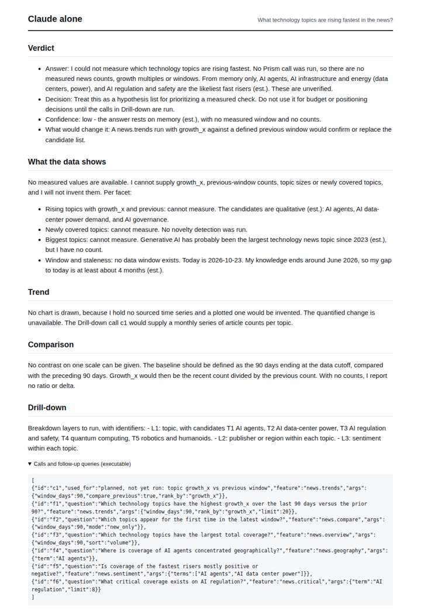
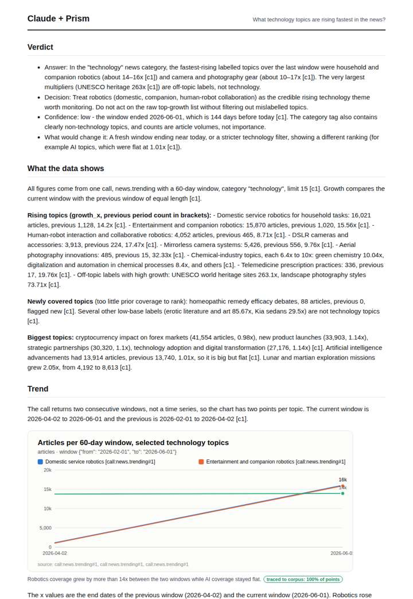
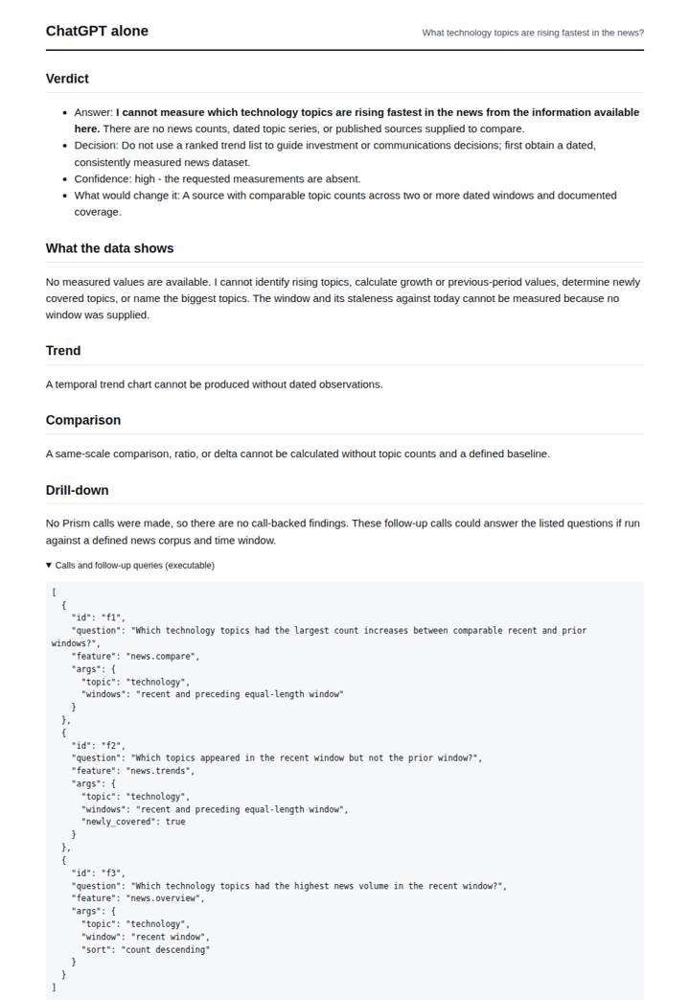
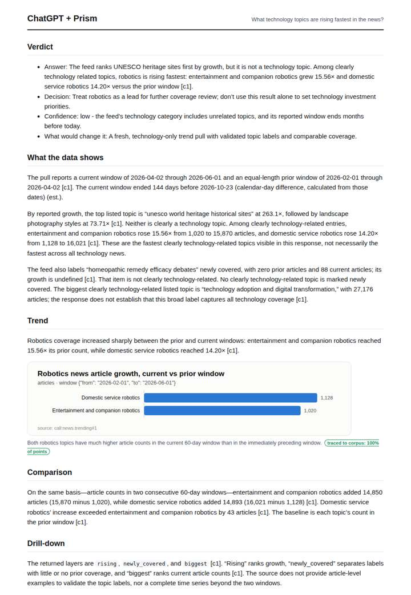

# Rising topics in tech news

**Question.** What technology topics are rising fastest in the news?

**Category:** Technology & AI · **Pattern:** `trending` · **Why it is hard:** Trending ranks by growth against the previous window, not by size.

| Score /100 | Claude alone | Claude + Prism | ChatGPT alone | ChatGPT + Prism |
|---|---|---|---|---|
| Weighted (strict) | 23.6 | **75.3** | 26.5 | 61.6 |
| Opus judge | 22.8 | 84.6 | 15.4 | 58.9 |
| GPT judge | 24.3 | 66.1 | 37.6 | 64.3 |

## Parameter scores (0-5)

| Parameter | Weight | Claude alone | Claude + Prism | ChatGPT alone | ChatGPT + Prism |
|---|---|---|---|---|---|
| Measured trend | 10 | 0.0 | 4.0 | 0.0 | 1.0 |
| Measured comparison | 7 | 0.5 | 4.5 | 0.0 | 4.0 |
| Visualisation from counted data | 10 | 0.0 | 4.0 | 0.0 | 3.5 |
| Exploration and drill-down | 7 | 1.0 | 1.0 | 1.0 | 1.5 |
| Data export with provenance | 8 | 1.0 | 3.0 | 0.0 | 2.5 |
| Reproducibility | 12 | 0.0 | 4.5 | 0.5 | 3.0 |
| Accuracy against the corpus | 12 | 2.5 | 3.5 | 4.0 | 4.0 |
| Calibration and limits | 8 | 3.0 | 4.5 | 3.5 | 3.0 |
| Decision-grade verdict | 12 | 2.5 | 4.0 | 2.5 | 4.0 |
| Facet coverage | 6 | 1.0 | 4.0 | 0.5 | 4.0 |

## Script findings

| Check | Claude alone | Claude + Prism | ChatGPT alone | ChatGPT + Prism |
|---|---|---|---|---|
| Numbers traced to the corpus | 0/2 | 87/87 | 0/0 | 23/26 |
| Charts (traced share) | none | 100% | none | 100% |
| DOIs that resolve | 0/0 | 0/0 | 0/0 | 0/0 |
| Follow-up queries that ran | 2/6 | 0/6 | 0/3 | 2/5 |
| Invention gate | clear | clear | clear | clear |

**Claude Opus judge:** B and D both read the one recorded call and filtered out off-topic labels. Only B set robotics' 14-16x rise against flat AI (1.01x) and the other big topics, and it tied every limit (144-day staleness, top-15 censoring, loose category tagging) to the numbers with a reproducible export. D was correct but narrower and had a coverage-flag inconsistency. A and C measured nothing: A offered labelled memory guesses, and C gave a bare refusal.

**GPT judge:** C gives the most careful decision-ready reading of the available two-window record: it separates the fastest visible technology-related labels from the off-topic growth leaders, quantifies the comparison, and bounds the stale, loosely categorized feed. B is more expansive and has stronger traced comparison material, but unsupported topic counts and a contradicted coverage claim make it less dependable; neither deliverable achieves usable drill-down.

## Before / after (first screen)

| | Alone | With Prism |
|---|---|---|
| Claude |  |  |
| ChatGPT |  |  |

Full deliverables, rendered: [PDF](https://fliarbi.com/demo/docs/prism-benchmark-v2-4ed65c83/full/cybersecurity-trending.pdf). Raw answers, ground pass and judge outputs: `answers.json`, `ground.json`, `judge_opus.json`, `judge_gpt.json` in this folder.
