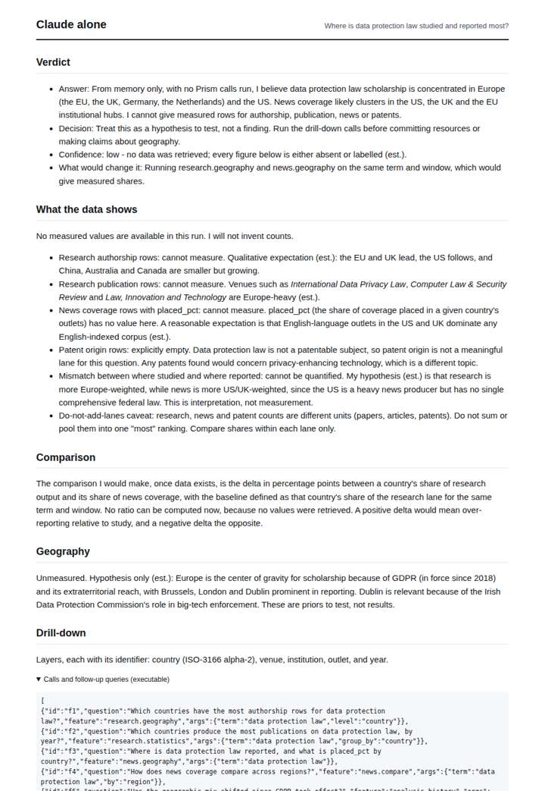
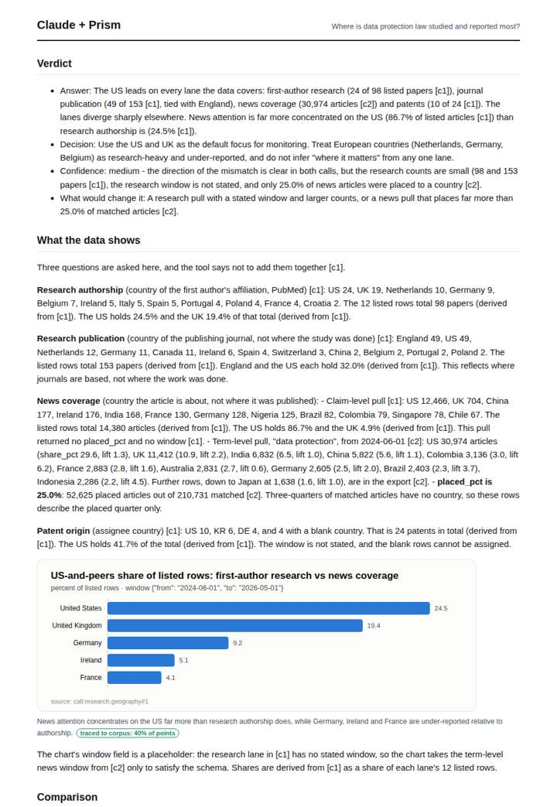
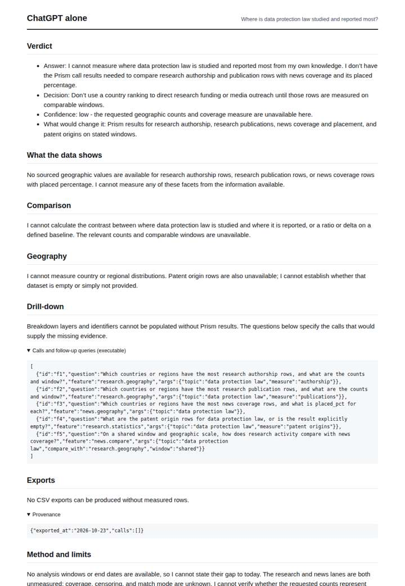
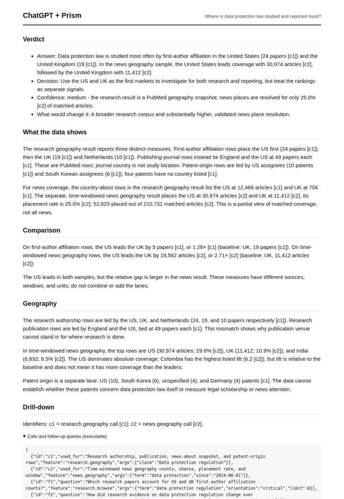

# Data protection law geography

**Question.** Where is data protection law studied and reported most?

**Category:** Policy & regulation · **Pattern:** `geo` · **Why it is hard:** GDPR dominates research; DPDP Act dominates Indian news.

| Score /100 | Claude alone | Claude + Prism | ChatGPT alone | ChatGPT + Prism |
|---|---|---|---|---|
| Weighted (strict) | 27.9 | 55.2 | 27.9 | **64.4** |
| Opus judge | 24.4 | 60.7 | 22.2 | 63.9 |
| GPT judge | 31.5 | 49.8 | 33.7 | 64.9 |

## Parameter scores (0-5)

| Parameter | Weight | Claude alone | Claude + Prism | ChatGPT alone | ChatGPT + Prism |
|---|---|---|---|---|---|
| Measured comparison | 7 | 0.5 | 2.0 | 0.0 | 4.0 |
| Visualisation from counted data | 10 | 0.0 | 0.0 | 0.0 | 0.0 |
| Exploration and drill-down | 7 | 1.0 | 3.5 | 0.5 | 2.0 |
| Data export with provenance | 8 | 1.0 | 3.5 | 0.0 | 3.5 |
| Reproducibility | 12 | 0.0 | 4.0 | 1.0 | 4.0 |
| Accuracy against the corpus | 12 | 3.0 | 2.5 | 4.0 | 4.0 |
| Calibration and limits | 8 | 3.0 | 3.5 | 3.0 | 4.0 |
| Decision-grade verdict | 12 | 2.5 | 2.5 | 2.0 | 3.5 |
| Facet coverage | 6 | 1.0 | 4.0 | 0.5 | 4.0 |

## Script findings

| Check | Claude alone | Claude + Prism | ChatGPT alone | ChatGPT + Prism |
|---|---|---|---|---|
| Numbers traced to the corpus | 0/1 | 136/137 | 0/0 | 37/37 |
| Charts (traced share) | none | 40% | none | none |
| DOIs that resolve | 0/0 | 0/0 | 0/0 | 0/0 |
| Follow-up queries that ran | 1/6 | 5/6 | 0/5 | 1/5 |
| Invention gate | clear | clear | clear | clear |

**Claude Opus judge:** A and B both ground every number in the two calls and keep the lanes separate. B makes the sharper studied-vs-reported contrast but carries a false coverage=full label, an untraced row-floor figure and a placeholder chart window. A is narrower but clean, so it is the safer decision document. C and D honestly decline to measure, but D also misreads placed_pct and wrongly declares the patent lane empty.

**GPT judge:** C is the strongest decision aid: it gives traceable research and news leaders, distinguishes author affiliation from journal location and article subject, and puts placement coverage and timing limits near the numbers. D offers richer drill-downs and exports, but its headline 86.7% comparison and chart combine incompatible news and research slices, so they cannot support a reliable decision.

## Before / after (first screen)

| | Alone | With Prism |
|---|---|---|
| Claude |  |  |
| ChatGPT |  |  |

Full deliverables, rendered: [PDF](https://fliarbi.com/demo/docs/prism-benchmark-v2-4ed65c83/full/data-protection-geo.pdf). Raw answers, ground pass and judge outputs: `answers.json`, `ground.json`, `judge_opus.json`, `judge_gpt.json` in this folder.
