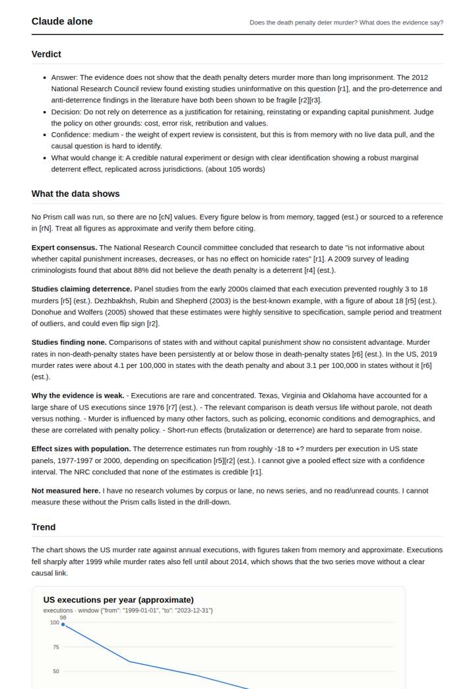
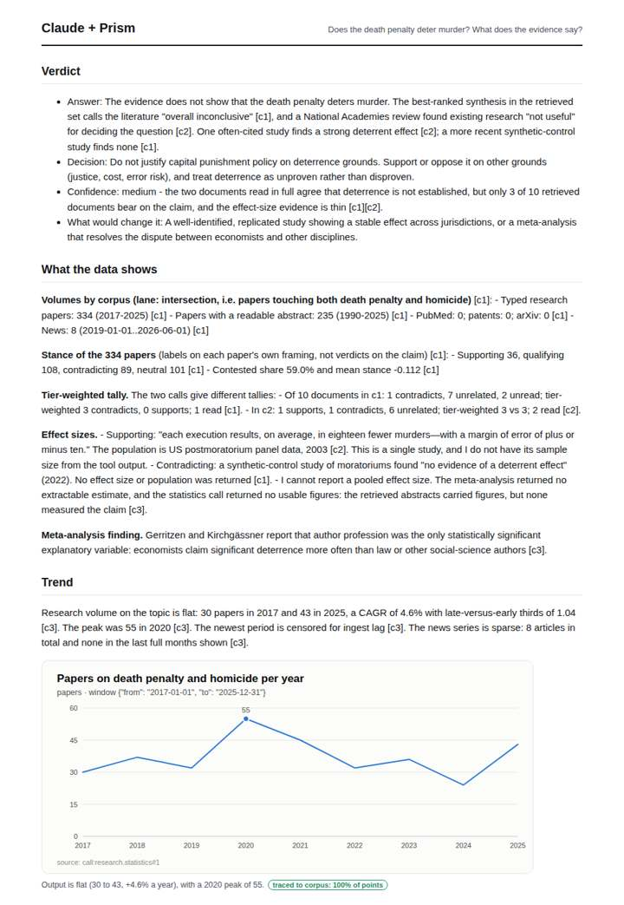
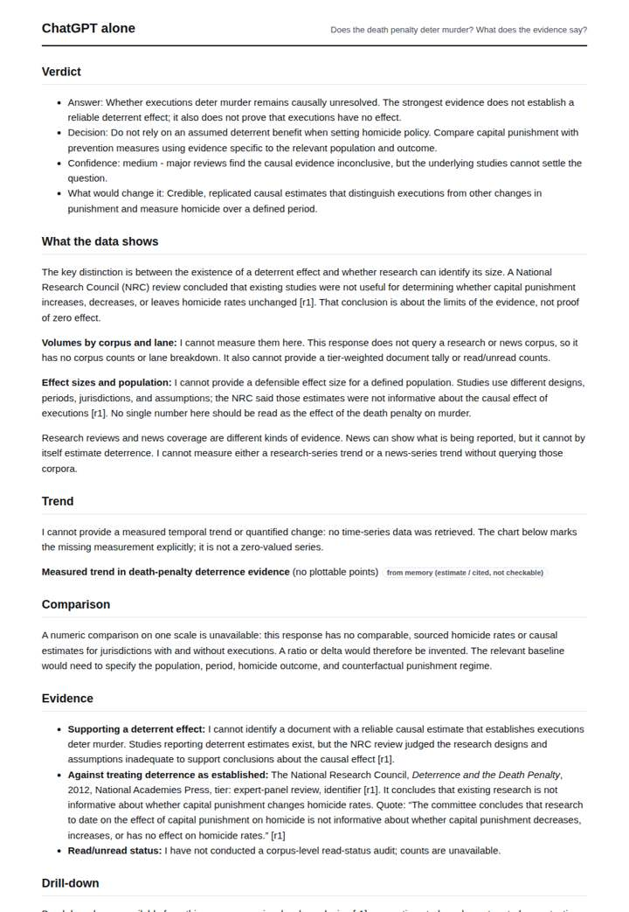
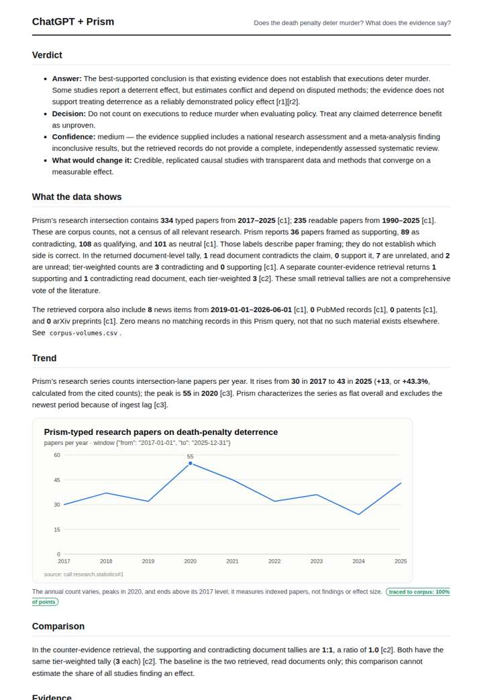

# Does the death penalty deter crime?

**Question.** Does the death penalty deter murder? What does the evidence say?

**Category:** Legal & compliance · **Pattern:** `evidence` · **Why it is hard:** Econometric claims of deterrence are heavily contested.

| Score /100 | Claude alone | Claude + Prism | ChatGPT alone | ChatGPT + Prism |
|---|---|---|---|---|
| Weighted (strict) | 28.3 | 73.8 | 41.2 | **77.7** |
| Opus judge | 26.2 | 74.4 | 36.4 | 69.4 |
| GPT judge | 30.4 | 73.2 | 46.0 | 86.0 |

## Parameter scores (0-5)

| Parameter | Weight | Claude alone | Claude + Prism | ChatGPT alone | ChatGPT + Prism |
|---|---|---|---|---|---|
| Measured trend | 10 | 1.0 | 3.5 | 0.5 | 4.0 |
| Measured comparison | 7 | 2.0 | 3.0 | 0.5 | 4.0 |
| Visualisation from counted data | 10 | 1.0 | 3.0 | 1.0 | 4.0 |
| Exploration and drill-down | 7 | 1.5 | 3.0 | 2.5 | 4.5 |
| Data export with provenance | 8 | 1.0 | 3.0 | 1.0 | 4.0 |
| Reproducibility | 12 | 1.0 | 4.5 | 1.0 | 4.5 |
| Traceable references | 8 | 2.0 | 5.0 | 3.0 | 1.0 |
| Accuracy against the corpus | 12 | 2.0 | 3.0 | 4.0 | 3.5 |
| Calibration and limits | 8 | 3.5 | 4.5 | 3.0 | 4.0 |
| Decision-grade verdict | 12 | 0.0 | 4.0 | 3.5 | 4.5 |
| Facet coverage | 6 | 1.5 | 4.0 | 2.0 | 4.5 |

## Script findings

| Check | Claude alone | Claude + Prism | ChatGPT alone | ChatGPT + Prism |
|---|---|---|---|---|
| Numbers traced to the corpus | 0/21 | 39/39 | 0/0 | 18/18 |
| Charts (traced share) | memory | 100% | memory | 100% |
| DOIs that resolve | 1/1 | 3/3 | 1/1 | 3/6 |
| Follow-up queries that ran | 1/6 | 2/6 | 3/6 | 3/4 |
| Invention gate | tripped | clear | clear | clear |

**Claude Opus judge:** B and D both grounded their numbers in the database and reached the same calibrated answer: deterrence is unproven rather than disproven. B wins on fully resolvable, tiered references and on limits that change the reading, notably that the corpus starts in 2017 and so omits the classic deterrence literature. A was honest but empty. C filled gaps with memory figures and inconsistent citations, and put an untagged number in its verdict.

**GPT judge:** A is the strongest decision aid: it gives a clear, bounded answer and makes its retrieved evidence, comparison, and limitations reproducible. C offers the richest grounded detail, but its reading-status claim and incomplete trend coverage weaken trust; B is appropriately cautious but cannot measure the evidence, while D relies heavily on unverifiable estimates.

## Before / after (first screen)

| | Alone | With Prism |
|---|---|---|
| Claude |  |  |
| ChatGPT |  |  |

Full deliverables, rendered: [PDF](https://fliarbi.com/demo/docs/prism-benchmark-v2-4ed65c83/full/death-penalty-deterrence.pdf). Raw answers, ground pass and judge outputs: `answers.json`, `ground.json`, `judge_opus.json`, `judge_gpt.json` in this folder.
