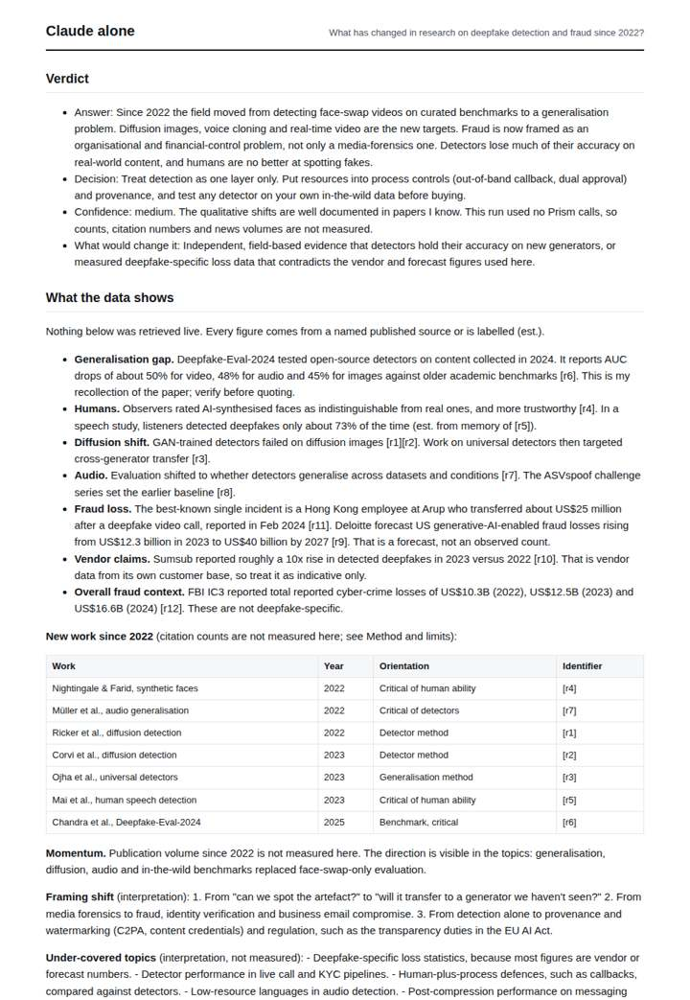
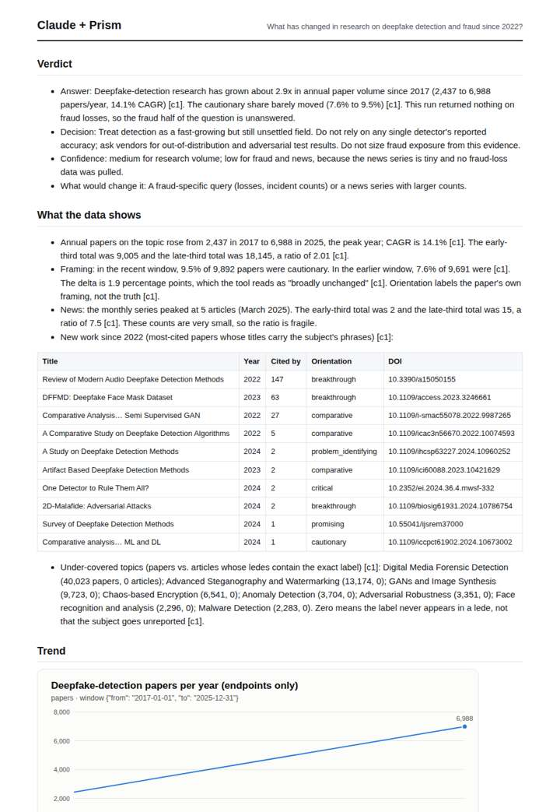
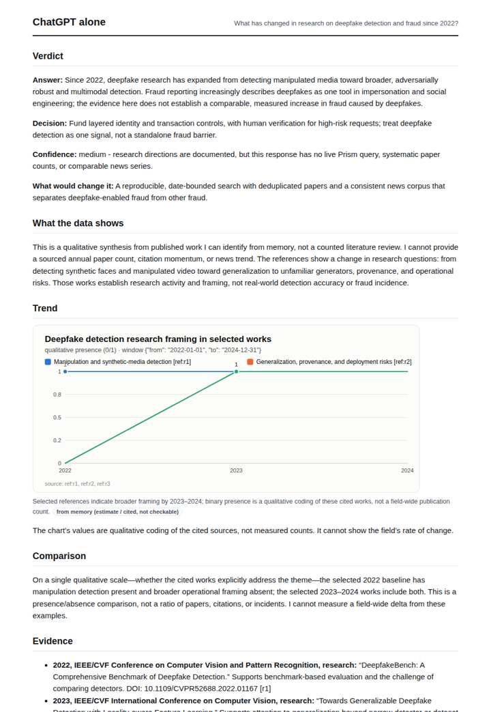
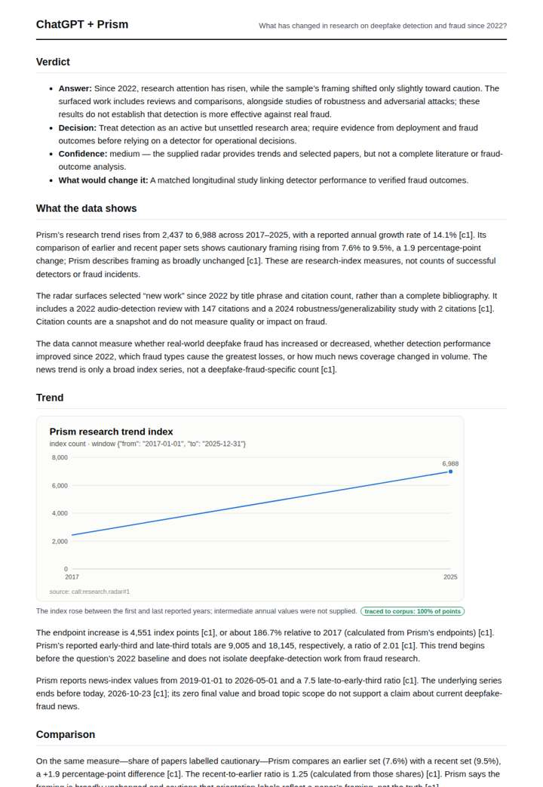

# Deepfake fraud research radar

**Question.** What has changed in research on deepfake detection and fraud since 2022?

**Category:** Crime & public safety · **Pattern:** `radar` · **Why it is hard:** Generative AI moved this field in 2023; recency is everything.

| Score /100 | Claude alone | Claude + Prism | ChatGPT alone | ChatGPT + Prism |
|---|---|---|---|---|
| Weighted (strict) | 40.2 | **77.4** | 34.9 | 75.4 |
| Opus judge | 36.4 | 77.4 | 25.6 | 66.4 |
| GPT judge | 44.0 | 77.4 | 44.2 | 84.4 |

## Parameter scores (0-5)

| Parameter | Weight | Claude alone | Claude + Prism | ChatGPT alone | ChatGPT + Prism |
|---|---|---|---|---|---|
| Measured trend | 10 | 1.0 | 4.0 | 1.0 | 3.5 |
| Measured comparison | 7 | 2.0 | 4.0 | 1.0 | 4.5 |
| Visualisation from counted data | 10 | 1.0 | 3.0 | 1.0 | 3.0 |
| Exploration and drill-down | 7 | 2.0 | 3.0 | 1.5 | 2.5 |
| Data export with provenance | 8 | 1.0 | 3.0 | 1.0 | 3.5 |
| Reproducibility | 12 | 0.0 | 5.0 | 1.0 | 4.0 |
| Traceable references | 8 | 3.0 | 3.5 | 2.5 | 3.5 |
| Accuracy against the corpus | 12 | 3.5 | 4.0 | 2.5 | 4.0 |
| Calibration and limits | 8 | 3.5 | 4.5 | 3.5 | 4.5 |
| Decision-grade verdict | 12 | 3.5 | 4.0 | 2.5 | 4.5 |
| Facet coverage | 6 | 1.5 | 4.0 | 1.5 | 3.5 |

## Script findings

| Check | Claude alone | Claude + Prism | ChatGPT alone | ChatGPT + Prism |
|---|---|---|---|---|
| Numbers traced to the corpus | 0/30 | 57/57 | 0/4 | 24/25 |
| Charts (traced share) | memory | 100% | memory | 100% |
| DOIs that resolve | 2/2 | 10/10 | 3/3 | 4/4 |
| Follow-up queries that ran | 3/7 | 1/6 | 2/6 | 2/5 |
| Invention gate | clear | clear | clear | clear |

**Claude Opus judge:** C and A both grounded their numbers in the radar call. C exposed the full new-work and under-covered layers, named the peak and the censoring, and admitted that the fraud half was unmeasured, which made it the most decision-ready. D gave a knowledgeable memory synthesis with honest labels but nothing traceable. B rested on mis-cited references.

**GPT judge:** C is the strongest decision-grade answer: it accurately quantifies research growth, distinguishes framing from truth, and clearly bounds what the data cannot say about fraud. D is close and more complete on surfaced papers, but overstates comparability for framing windows whose dates are missing; neither response measures deepfake-specific fraud outcomes.

## Before / after (first screen)

| | Alone | With Prism |
|---|---|---|
| Claude |  |  |
| ChatGPT |  |  |

Full deliverables, rendered: [PDF](https://fliarbi.com/demo/docs/prism-benchmark-v2-4ed65c83/full/deepfake-fraud-radar.pdf). Raw answers, ground pass and judge outputs: `answers.json`, `ground.json`, `judge_opus.json`, `judge_gpt.json` in this folder.
