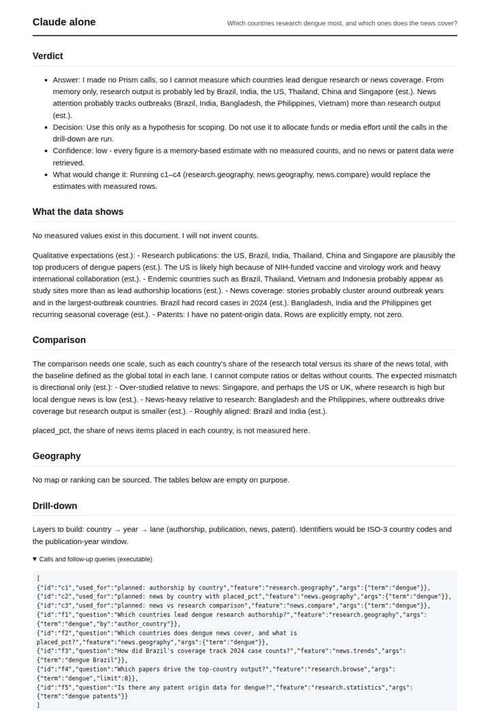
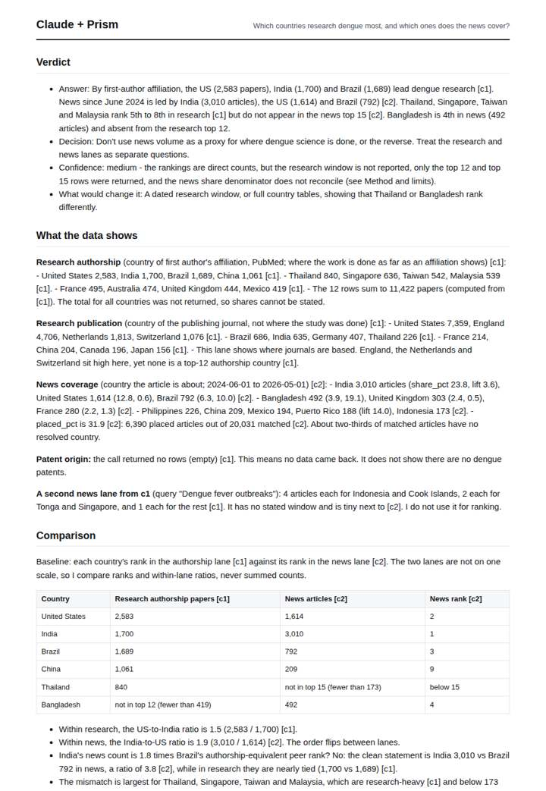
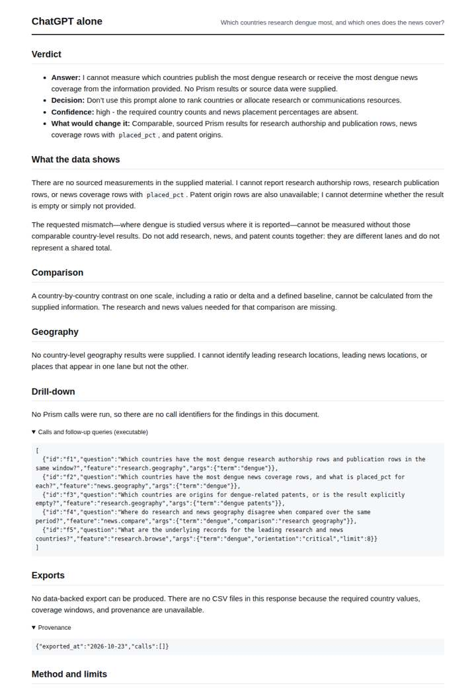
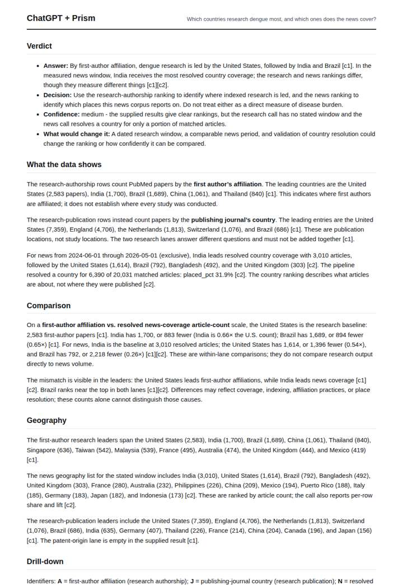

# Where dengue is studied vs reported

**Question.** Which countries research dengue most, and which ones does the news cover?

**Category:** Public health & epidemiology · **Pattern:** `geo` · **Why it is hard:** Research comes from the rich world; outbreaks happen elsewhere. The interesting signal is the mismatch.

| Score /100 | Claude alone | Claude + Prism | ChatGPT alone | ChatGPT + Prism |
|---|---|---|---|---|
| Weighted (strict) | 29.6 | **80.2** | 29.5 | 56.2 |
| Opus judge | 30.2 | 72.9 | 17.3 | 55.9 |
| GPT judge | 29.0 | 87.6 | 41.7 | 56.6 |

## Parameter scores (0-5)

| Parameter | Weight | Claude alone | Claude + Prism | ChatGPT alone | ChatGPT + Prism |
|---|---|---|---|---|---|
| Measured comparison | 7 | 1.0 | 4.5 | 0.5 | 2.5 |
| Visualisation from counted data | 10 | 0.0 | 4.0 | 0.0 | 0.0 |
| Exploration and drill-down | 7 | 1.5 | 3.5 | 1.5 | 2.0 |
| Data export with provenance | 8 | 1.0 | 4.5 | 0.0 | 3.0 |
| Reproducibility | 12 | 1.0 | 4.5 | 0.5 | 4.0 |
| Accuracy against the corpus | 12 | 2.5 | 4.0 | 4.0 | 3.5 |
| Calibration and limits | 8 | 3.0 | 4.0 | 2.5 | 3.5 |
| Decision-grade verdict | 12 | 2.0 | 3.0 | 2.5 | 3.0 |
| Facet coverage | 6 | 1.0 | 4.5 | 0.5 | 3.5 |

## Script findings

| Check | Claude alone | Claude + Prism | ChatGPT alone | ChatGPT + Prism |
|---|---|---|---|---|
| Numbers traced to the corpus | 0/0 | 113/115 | 0/0 | 75/75 |
| Charts (traced share) | none | 100%, 100% | none | none |
| DOIs that resolve | 0/0 | 0/0 | 0/0 | 0/0 |
| Follow-up queries that ran | 2/5 | 4/6 | 2/5 | 1/3 |
| Invention gate | clear | clear | clear | clear |

**Claude Opus judge:** D and C both traced the same two calls, but only D turned them into the studied-versus-reported contrast the question asks for. D names the research-heavy, news-light countries and the reverse case, charts both lanes, and catches the share_pct denominator anomaly. C stayed with within-lane ratios, had no chart and slipped on the window gap. A and B made no measurements; A at least offered labelled hypotheses, while B offered nothing usable.

**GPT judge:** A is the strongest decision aid: it directly quantifies the research and news leaders, shows within-lane ratios, and exposes traceable country tables with detailed limits. D is careful and reproducible but leaves the central mismatch largely qualitative; B abstains accurately, while C substitutes unsupported estimates for measurements.

## Before / after (first screen)

| | Alone | With Prism |
|---|---|---|
| Claude |  |  |
| ChatGPT |  |  |

Full deliverables, rendered: [PDF](https://fliarbi.com/demo/docs/prism-benchmark-v2-4ed65c83/full/dengue-geography.pdf). Raw answers, ground pass and judge outputs: `answers.json`, `ground.json`, `judge_opus.json`, `judge_gpt.json` in this folder.
