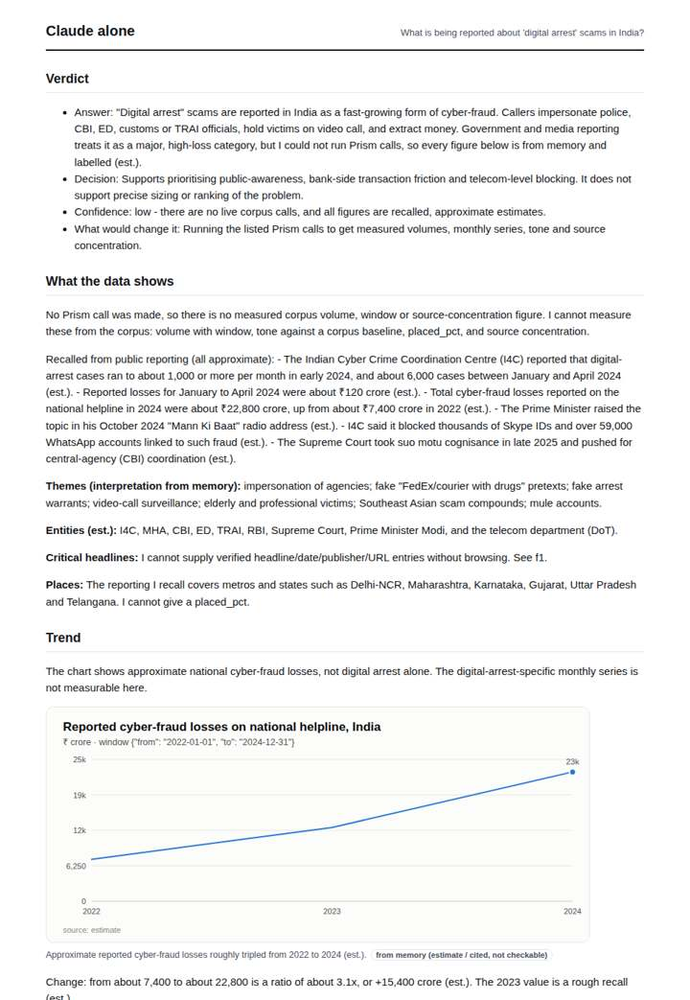
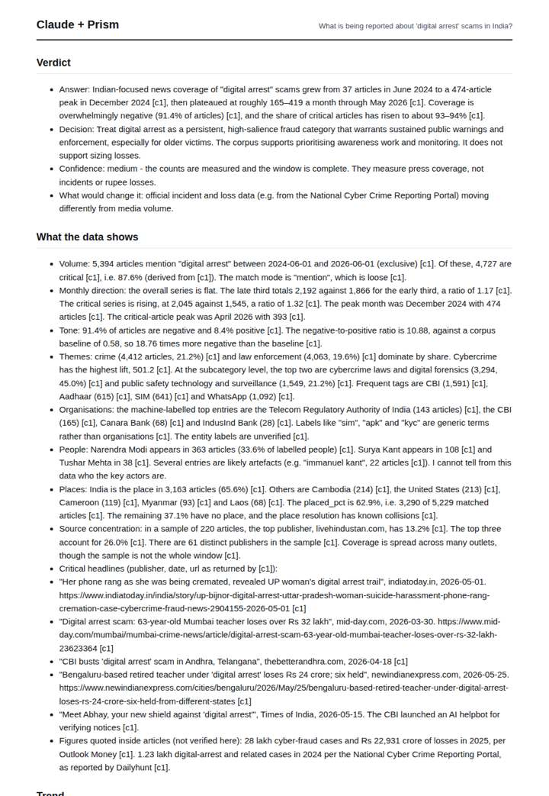
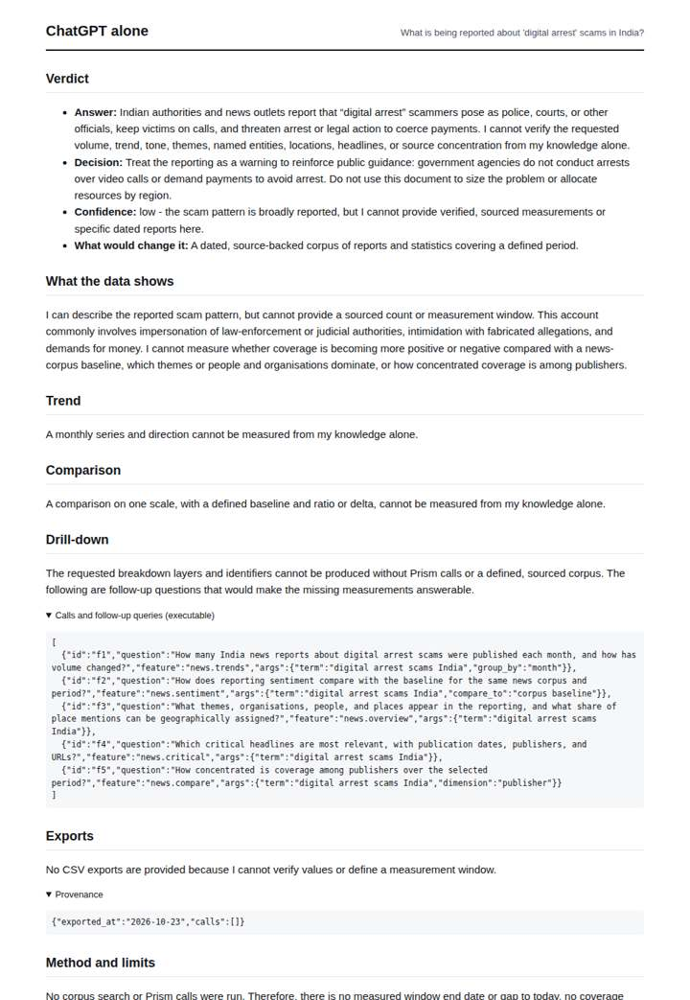
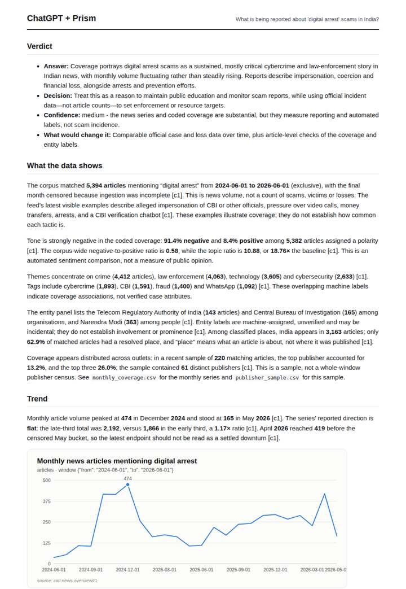

# Digital arrest scams in India

**Question.** What is being reported about 'digital arrest' scams in India?

**Category:** Crime & public safety · **Pattern:** `pulse` · **Why it is hard:** A 2024+ phrase that most models have never seen in training.

| Score /100 | Claude alone | Claude + Prism | ChatGPT alone | ChatGPT + Prism |
|---|---|---|---|---|
| Weighted (strict) | 28.6 | 61.5 | 23.8 | **74.8** |
| Opus judge | 26.4 | 73.0 | 21.8 | 64.2 |
| GPT judge | 30.8 | 50.0 | 25.8 | 85.4 |

## Parameter scores (0-5)

| Parameter | Weight | Claude alone | Claude + Prism | ChatGPT alone | ChatGPT + Prism |
|---|---|---|---|---|---|
| Measured trend | 10 | 1.0 | 4.0 | 0.0 | 4.5 |
| Measured comparison | 7 | 1.5 | 4.0 | 0.0 | 4.5 |
| Visualisation from counted data | 10 | 1.0 | 3.0 | 0.0 | 3.5 |
| Exploration and drill-down | 7 | 1.5 | 2.5 | 1.0 | 3.5 |
| Data export with provenance | 8 | 1.0 | 2.5 | 0.0 | 4.5 |
| Reproducibility | 12 | 1.0 | 3.5 | 1.0 | 4.5 |
| Traceable references | 8 | 0.5 | 1.0 | 0.5 | 0.5 |
| Accuracy against the corpus | 12 | 2.0 | 3.5 | 3.0 | 3.5 |
| Calibration and limits | 8 | 3.0 | 2.5 | 3.0 | 4.5 |
| Decision-grade verdict | 12 | 2.0 | 3.0 | 2.5 | 3.5 |
| Facet coverage | 6 | 1.0 | 4.0 | 1.0 | 4.0 |

## Script findings

| Check | Claude alone | Claude + Prism | ChatGPT alone | ChatGPT + Prism |
|---|---|---|---|---|
| Numbers traced to the corpus | 0/15 | 91/91 | 0/0 | 38/38 |
| Charts (traced share) | memory | 100% | none | 100% |
| DOIs that resolve | 0/0 | 0/0 | 0/0 | 0/0 |
| Follow-up queries that ran | 3/7 | 2/6 | 0/5 | 3/5 |
| Invention gate | clear | clear | clear | clear |

**Claude Opus judge:** C and B both grounded their work in the same traced corpus call. C went further: it decomposed critical against total coverage, surfaced dated headlines with URLs, and flagged entity-label artefacts. B gave cleaner exports but misread the censoring and omitted headlines. A and D had no measured data; A declined honestly, while D offered memory estimates about a different quantity.

**GPT judge:** A is the strongest decision aid: it answers the question with a traced, correctly qualified coverage trend, tone comparison, useful breakdowns, and reproducible exports. C offers broad coverage of facets but misreads the overall direction and censoring, while B and D either rely on estimates or cannot measure the requested reporting pattern.

## Before / after (first screen)

| | Alone | With Prism |
|---|---|---|
| Claude |  |  |
| ChatGPT |  |  |

Full deliverables, rendered: [PDF](https://fliarbi.com/demo/docs/prism-benchmark-v2-4ed65c83/full/digital-arrest-scam.pdf). Raw answers, ground pass and judge outputs: `answers.json`, `ground.json`, `judge_opus.json`, `judge_gpt.json` in this folder.
