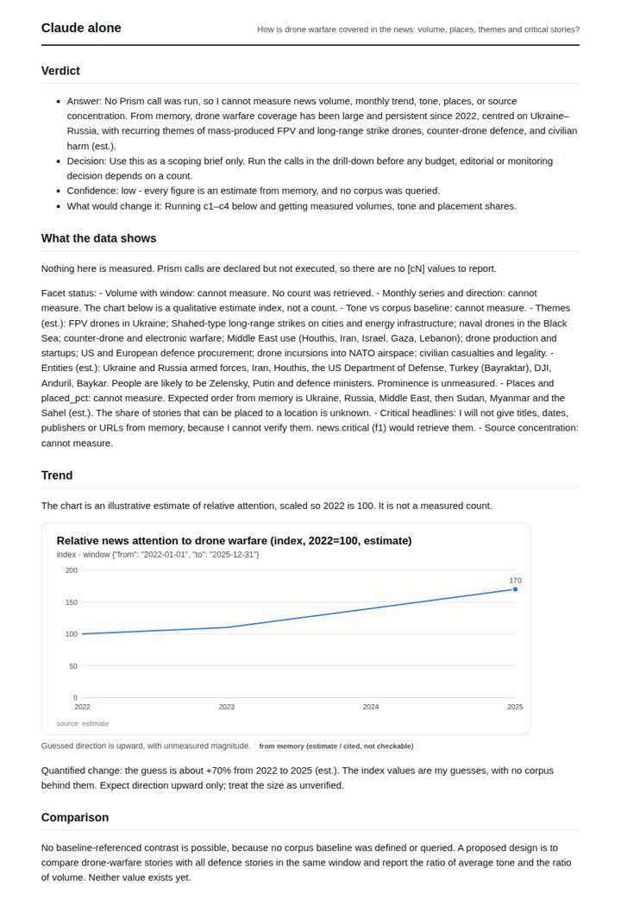
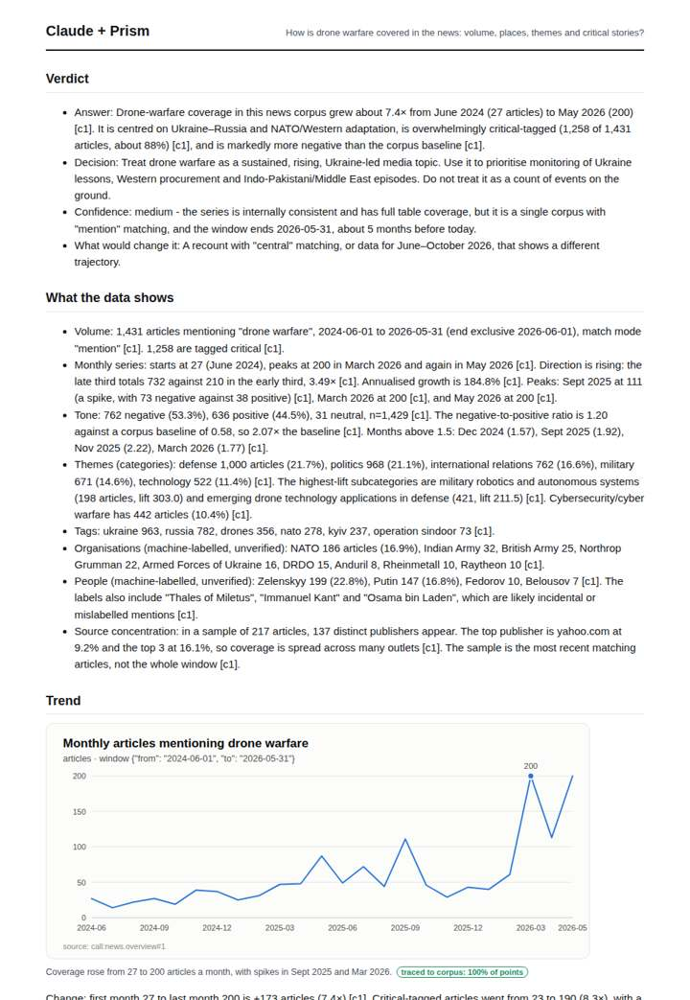
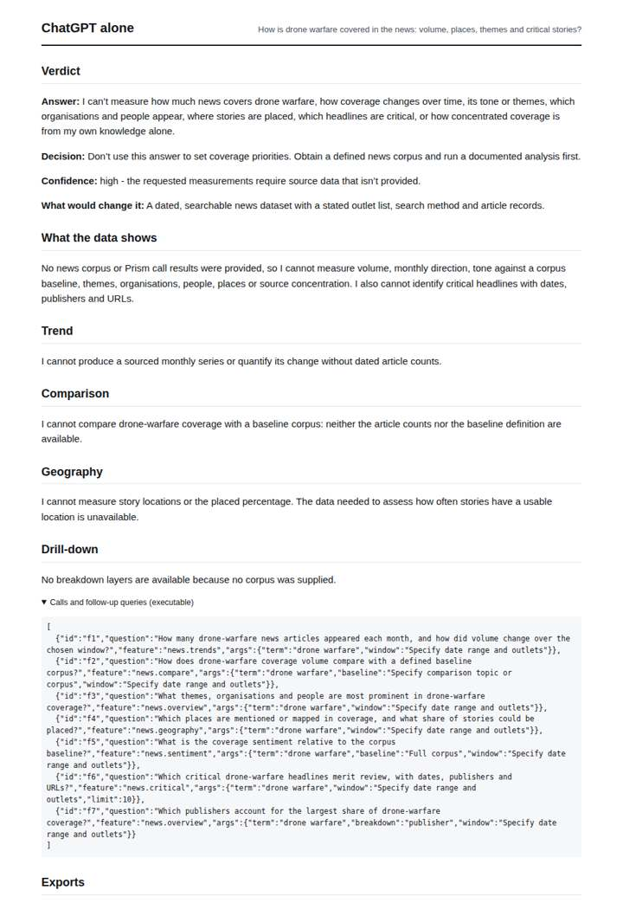
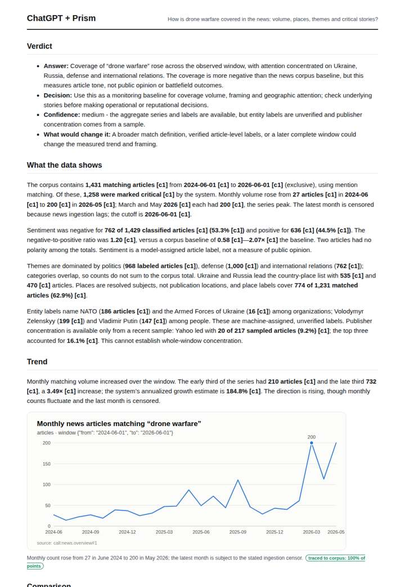

# Drone warfare coverage

**Question.** How is drone warfare covered in the news: volume, places, themes and critical stories?

**Category:** Defence & geopolitics · **Pattern:** `pulse` · **Why it is hard:** Ukraine, the Middle East and South Asia each carry a distinct drone story.

| Score /100 | Claude alone | Claude + Prism | ChatGPT alone | ChatGPT + Prism |
|---|---|---|---|---|
| Weighted (strict) | 27.0 | **69.3** | 23.6 | 68.1 |
| Opus judge | 25.0 | 69.6 | 18.2 | 62.2 |
| GPT judge | 29.0 | 69.0 | 29.0 | 74.0 |

## Parameter scores (0-5)

| Parameter | Weight | Claude alone | Claude + Prism | ChatGPT alone | ChatGPT + Prism |
|---|---|---|---|---|---|
| Measured trend | 10 | 1.0 | 5.0 | 0.0 | 4.0 |
| Measured comparison | 7 | 0.0 | 4.5 | 0.0 | 4.5 |
| Visualisation from counted data | 10 | 1.0 | 3.5 | 0.0 | 3.5 |
| Exploration and drill-down | 7 | 1.0 | 4.0 | 1.0 | 3.0 |
| Data export with provenance | 8 | 1.0 | 3.0 | 0.0 | 3.0 |
| Reproducibility | 12 | 0.0 | 4.0 | 1.0 | 4.0 |
| Traceable references | 8 | 0.5 | 1.0 | 0.5 | 1.0 |
| Accuracy against the corpus | 12 | 3.0 | 3.0 | 3.0 | 3.5 |
| Calibration and limits | 8 | 3.0 | 2.5 | 4.0 | 3.5 |
| Decision-grade verdict | 12 | 2.5 | 3.5 | 2.0 | 3.5 |
| Facet coverage | 6 | 1.0 | 4.0 | 0.5 | 3.5 |

## Script findings

| Check | Claude alone | Claude + Prism | ChatGPT alone | ChatGPT + Prism |
|---|---|---|---|---|
| Numbers traced to the corpus | 0/3 | 123/123 | 0/0 | 48/49 |
| Charts (traced share) | memory | 100% | none | 100% |
| DOIs that resolve | 0/0 | 0/0 | 0/0 | 0/0 |
| Follow-up queries that ran | 1/5 | 4/6 | 0/7 | 1/5 |
| Invention gate | clear | clear | clear | clear |

**Claude Opus judge:** B and D both traced the real series, but B went further. It decomposed critical vs total, read lift to separate distinctive places (Ukraine, Russia) from background ones (US), and surfaced the India–Pakistan (Operation Sindoor) and Middle East strands the question hinges on, with dated headlines that carry urls. D was accurate in outline but generic, and it misread the censor as applying to May. A and C were honest that they had no data, so they offer a decision-maker nothing measured.

**GPT judge:** D is the strongest decision brief: it answers volume, tone and place coverage with traced figures, a reproducible monthly export, and concrete headline examples while bounding what those measures mean. C has richer breakdowns, but its reversed March/April peak values and unsupported geography detail weaken confidence; neither database-backed deliverable charts the requested tone comparison.

## Before / after (first screen)

| | Alone | With Prism |
|---|---|---|
| Claude |  |  |
| ChatGPT |  |  |

Full deliverables, rendered: [PDF](https://fliarbi.com/demo/docs/prism-benchmark-v2-4ed65c83/full/drone-warfare-pulse.pdf). Raw answers, ground pass and judge outputs: `answers.json`, `ground.json`, `judge_opus.json`, `judge_gpt.json` in this folder.
