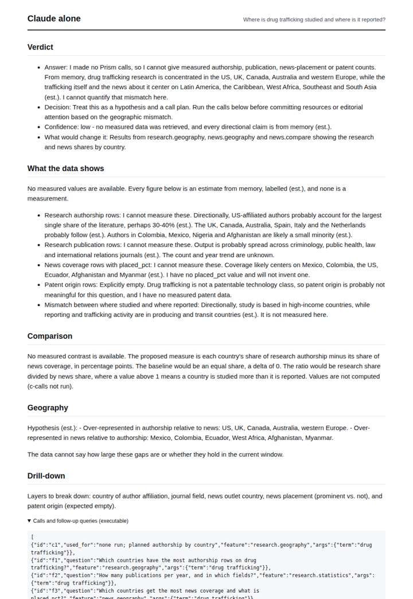
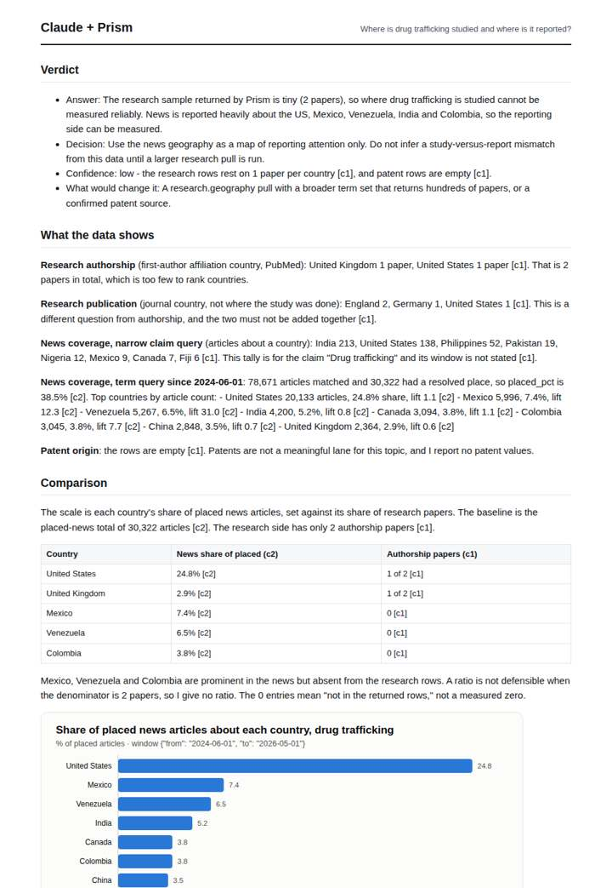
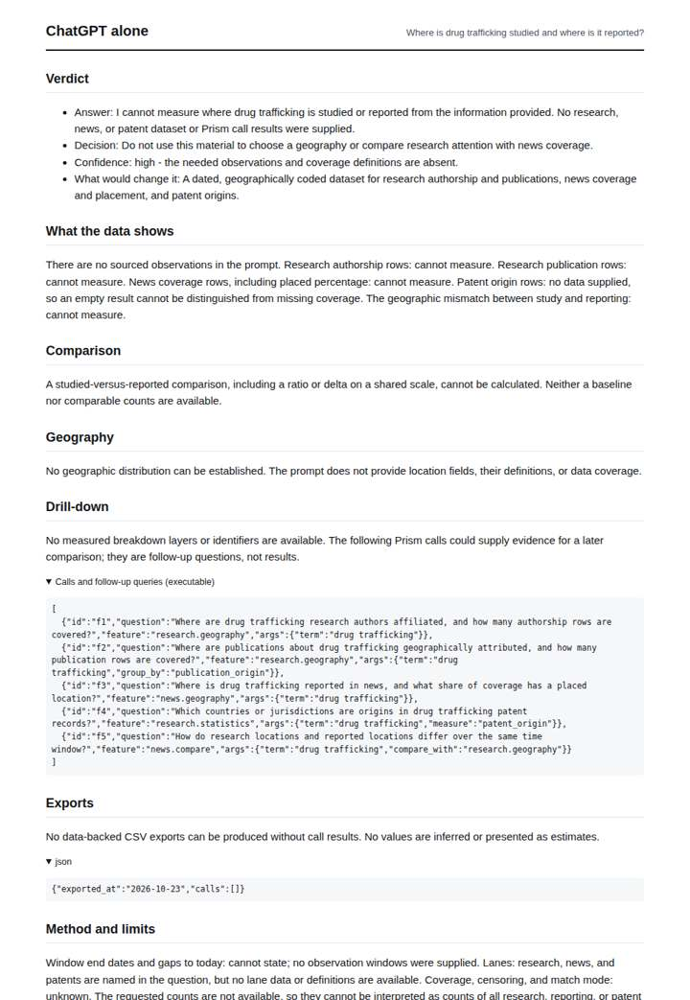
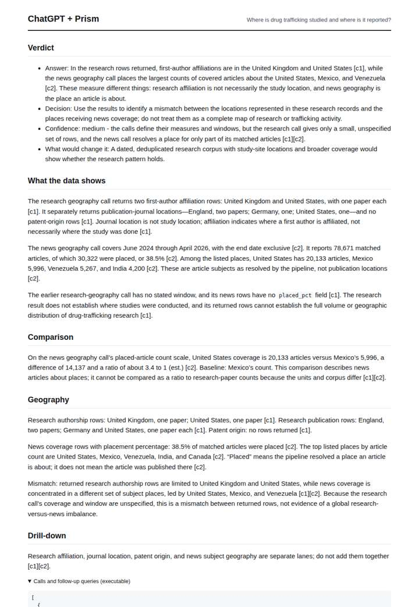

# Drug trafficking geography

**Question.** Where is drug trafficking studied and where is it reported?

**Category:** Crime & public safety · **Pattern:** `geo` · **Why it is hard:** Place resolution has acronym collisions; the caveat matters.

| Score /100 | Claude alone | Claude + Prism | ChatGPT alone | ChatGPT + Prism |
|---|---|---|---|---|
| Weighted (strict) | 33.2 | **75.2** | 28.0 | 63.5 |
| Opus judge | 28.5 | 73.9 | 17.3 | 58.8 |
| GPT judge | 37.8 | 76.6 | 38.8 | 68.3 |

## Parameter scores (0-5)

| Parameter | Weight | Claude alone | Claude + Prism | ChatGPT alone | ChatGPT + Prism |
|---|---|---|---|---|---|
| Measured comparison | 7 | 0.5 | 3.0 | 0.5 | 3.0 |
| Visualisation from counted data | 10 | 0.0 | 3.0 | 0.0 | 0.0 |
| Exploration and drill-down | 7 | 1.5 | 3.5 | 1.5 | 2.5 |
| Data export with provenance | 8 | 1.0 | 3.0 | 0.0 | 4.5 |
| Reproducibility | 12 | 1.0 | 4.5 | 0.5 | 4.5 |
| Accuracy against the corpus | 12 | 3.5 | 4.5 | 3.5 | 4.0 |
| Calibration and limits | 8 | 3.0 | 4.0 | 2.5 | 3.0 |
| Decision-grade verdict | 12 | 2.5 | 3.5 | 2.5 | 3.0 |
| Facet coverage | 6 | 1.0 | 4.5 | 0.5 | 4.0 |

## Script findings

| Check | Claude alone | Claude + Prism | ChatGPT alone | ChatGPT + Prism |
|---|---|---|---|---|
| Numbers traced to the corpus | 0/2 | 47/47 | 0/0 | 15/15 |
| Charts (traced share) | none | 100% | none | none |
| DOIs that resolve | 0/0 | 0/0 | 0/0 | 0/0 |
| Follow-up queries that ran | 2/6 | 4/6 | 1/5 | 1/4 |
| Invention gate | clear | clear | clear | clear |

**Claude Opus judge:** D was the only deliverable that grounded both lanes, charted the traced news shares, and read the evidence honestly. It concluded that a 2-paper research sample cannot support a studied-vs-reported verdict, and it named what would close the gap. C traced its numbers well but compared news to news instead of answering the studied-vs-reported question, and it lacked a chart. A and B were honest but unmeasured, with A at least offering a labelled hypothesis.

**GPT judge:** B is the strongest decision aid: it traces both research and news geography, explains why their counts cannot be directly compared, and carries the key coverage and timing caveats. Its main weakness is that the chart covers only news and the headline comparison does not establish a measured research-versus-reporting gap; C has stronger exports, but its comparison also stops short of that core contrast.

## Before / after (first screen)

| | Alone | With Prism |
|---|---|---|
| Claude |  |  |
| ChatGPT |  |  |

Full deliverables, rendered: [PDF](https://fliarbi.com/demo/docs/prism-benchmark-v2-4ed65c83/full/drug-trafficking-geo.pdf). Raw answers, ground pass and judge outputs: `answers.json`, `ground.json`, `judge_opus.json`, `judge_gpt.json` in this folder.
