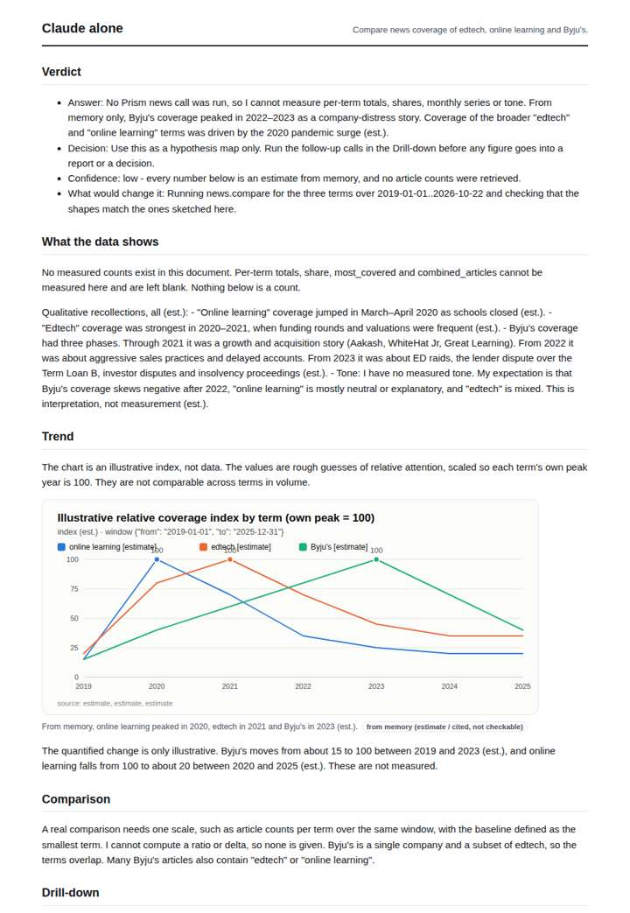
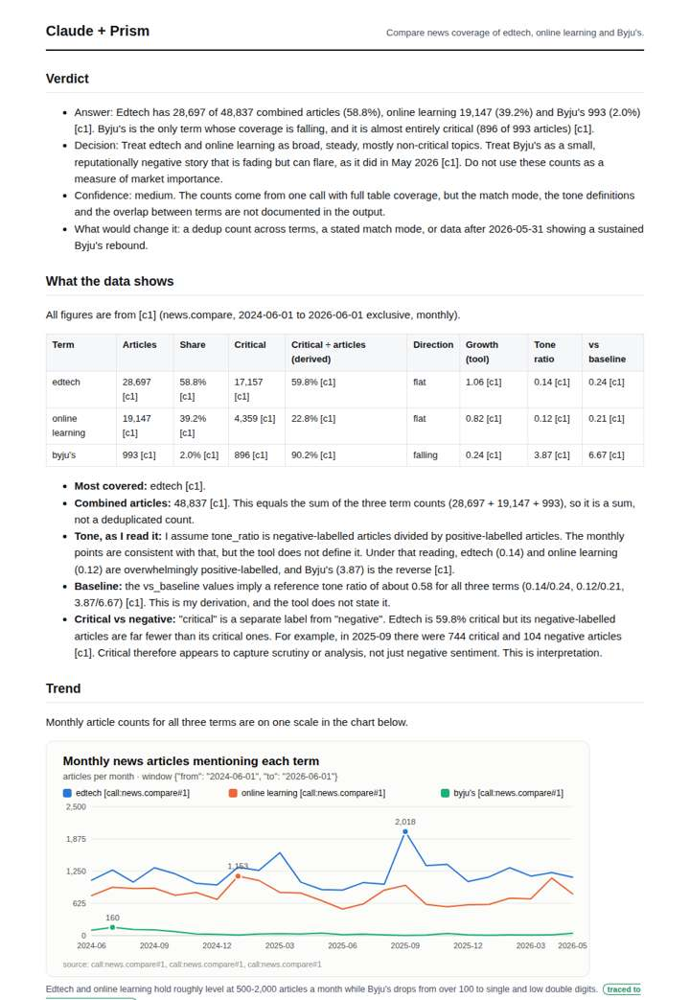
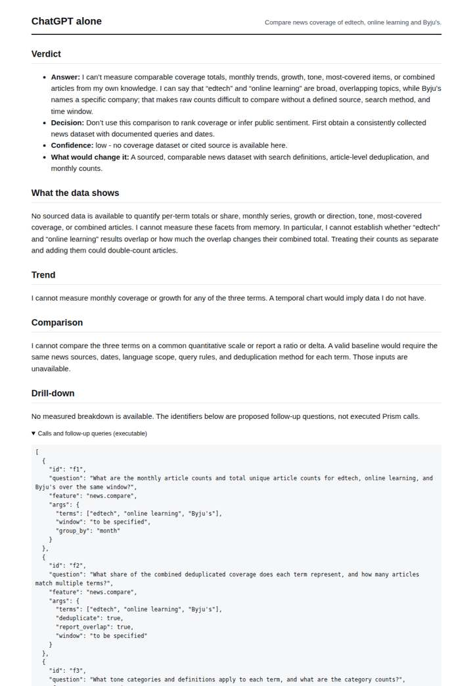
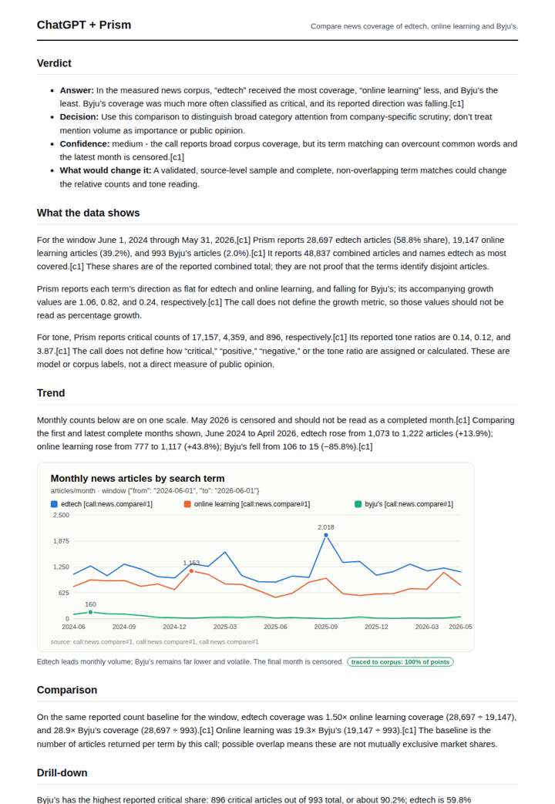

# Edtech in the news

**Question.** Compare news coverage of edtech, online learning and Byju's.

**Category:** Education & labour · **Pattern:** `compare` · **Why it is hard:** Byju's collapse dominates Indian edtech coverage in 2024.

| Score /100 | Claude alone | Claude + Prism | ChatGPT alone | ChatGPT + Prism |
|---|---|---|---|---|
| Weighted (strict) | 34.3 | **74.8** | 27.4 | 73.4 |
| Opus judge | 28.7 | 79.3 | 19.8 | 59.6 |
| GPT judge | 40.0 | 70.2 | 35.0 | 87.2 |

## Parameter scores (0-5)

| Parameter | Weight | Claude alone | Claude + Prism | ChatGPT alone | ChatGPT + Prism |
|---|---|---|---|---|---|
| Measured trend | 10 | 1.0 | 4.5 | 0.0 | 3.5 |
| Measured comparison | 7 | 1.0 | 5.0 | 0.0 | 4.5 |
| Visualisation from counted data | 10 | 1.0 | 3.5 | 0.0 | 4.0 |
| Exploration and drill-down | 7 | 1.0 | 2.0 | 1.0 | 2.0 |
| Data export with provenance | 8 | 1.0 | 4.0 | 0.0 | 4.0 |
| Reproducibility | 12 | 0.0 | 4.0 | 1.0 | 4.5 |
| Accuracy against the corpus | 12 | 3.5 | 3.5 | 4.0 | 3.5 |
| Calibration and limits | 8 | 4.0 | 3.0 | 4.0 | 2.5 |
| Decision-grade verdict | 12 | 3.0 | 3.5 | 2.0 | 3.5 |
| Facet coverage | 6 | 1.0 | 4.5 | 0.5 | 4.5 |

## Script findings

| Check | Claude alone | Claude + Prism | ChatGPT alone | ChatGPT + Prism |
|---|---|---|---|---|
| Numbers traced to the corpus | 0/6 | 111/117 | 0/0 | 43/46 |
| Charts (traced share) | memory | 100% | none | 100% |
| DOIs that resolve | 0/0 | 0/0 | 0/0 | 0/0 |
| Follow-up queries that ran | 1/6 | 2/6 | 0/4 | 1/5 |
| Invention gate | clear | clear | clear | clear |

**Claude Opus judge:** B alone turns the single news.compare call into a decision-ready answer. Its first-12 vs last-12 changes, ratios and critical-share contrasts all recompute exactly, and it shows Byju's is about 2% of volume but 90% critical, which undercuts the 'Byju's dominates' premise for this window. B also catches the summed (not deduplicated) combined total and the critical-vs-negative distinction. C used the same data but misread censoring and drew a misleading direction from endpoint months, while A and D offered only memory or nothing measurable.

**GPT judge:** B is strongest for a decision-maker: it gives a reproducible, same-window comparison, a complete monthly chart and export, and keeps attention counts distinct from importance and public opinion. D adds useful trend detail, but its unsupported coverage figures and contradiction about edtech being mostly non-critical weaken trust in its conclusion.

## Before / after (first screen)

| | Alone | With Prism |
|---|---|---|
| Claude |  |  |
| ChatGPT |  |  |

Full deliverables, rendered: [PDF](https://fliarbi.com/demo/docs/prism-benchmark-v2-4ed65c83/full/edtech-compare.pdf). Raw answers, ground pass and judge outputs: `answers.json`, `ground.json`, `judge_opus.json`, `judge_gpt.json` in this folder.
