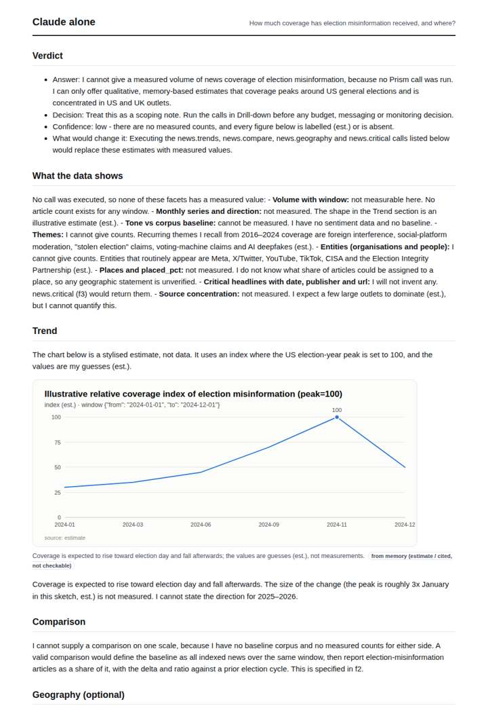
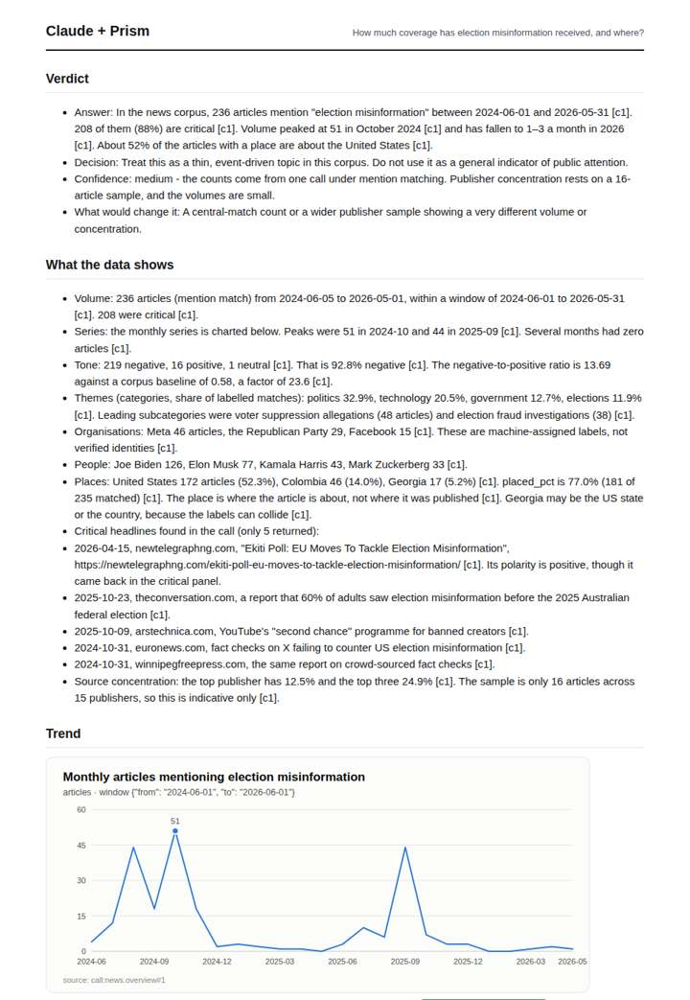
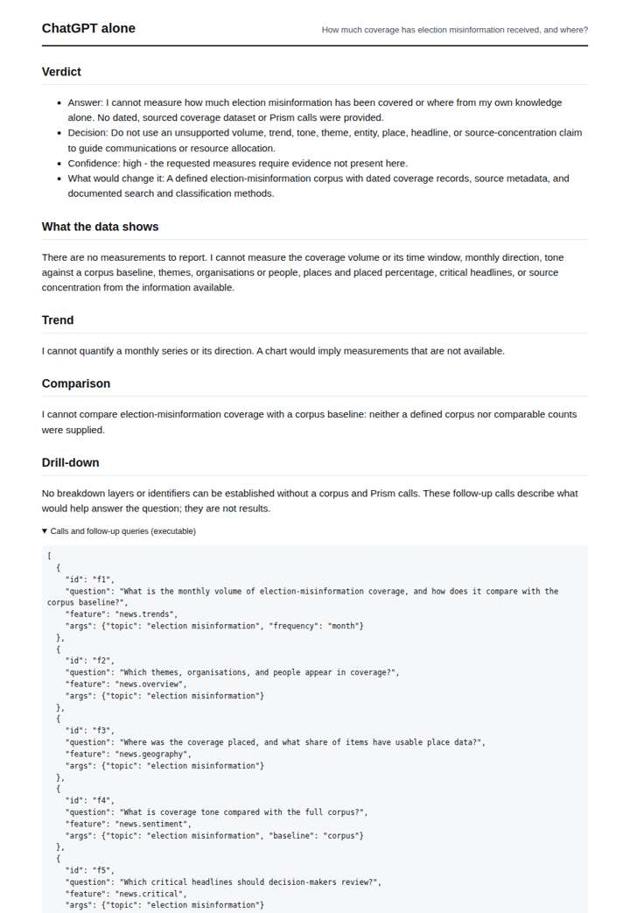
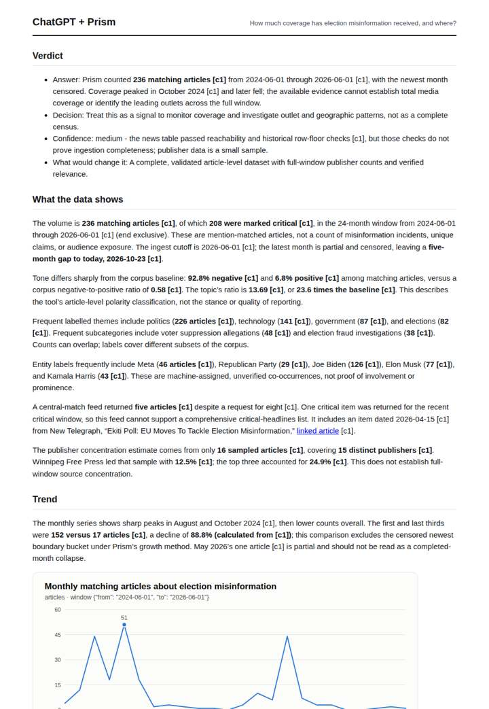

# Election misinformation coverage

**Question.** How much coverage has election misinformation received, and where?

**Category:** Journalism & fact-checking · **Pattern:** `pulse` · **Why it is hard:** 2024 was a global election year; coverage is spread across dozens of countries.

| Score /100 | Claude alone | Claude + Prism | ChatGPT alone | ChatGPT + Prism |
|---|---|---|---|---|
| Weighted (strict) | 33.2 | 62.9 | 24.4 | **69.3** |
| Opus judge | 26.4 | 68.6 | 18.2 | 60.6 |
| GPT judge | 40.0 | 57.2 | 30.6 | 78.0 |

## Parameter scores (0-5)

| Parameter | Weight | Claude alone | Claude + Prism | ChatGPT alone | ChatGPT + Prism |
|---|---|---|---|---|---|
| Measured trend | 10 | 1.0 | 4.0 | 0.0 | 3.5 |
| Measured comparison | 7 | 1.0 | 4.5 | 0.0 | 4.5 |
| Visualisation from counted data | 10 | 1.0 | 3.0 | 0.0 | 3.5 |
| Exploration and drill-down | 7 | 2.0 | 3.0 | 1.0 | 1.0 |
| Data export with provenance | 8 | 1.0 | 2.5 | 0.0 | 4.0 |
| Reproducibility | 12 | 0.0 | 4.0 | 1.0 | 4.5 |
| Traceable references | 8 | 0.5 | 1.0 | 0.5 | 1.0 |
| Accuracy against the corpus | 12 | 3.5 | 3.0 | 4.0 | 3.5 |
| Calibration and limits | 8 | 4.0 | 2.5 | 3.0 | 4.5 |
| Decision-grade verdict | 12 | 2.5 | 3.0 | 2.0 | 3.5 |
| Facet coverage | 6 | 1.5 | 4.0 | 0.5 | 4.0 |

## Script findings

| Check | Claude alone | Claude + Prism | ChatGPT alone | ChatGPT + Prism |
|---|---|---|---|---|
| Numbers traced to the corpus | 0/2 | 65/65 | 0/0 | 36/36 |
| Charts (traced share) | memory | 100% | none | 100% |
| DOIs that resolve | 0/0 | 0/0 | 0/0 | 0/0 |
| Follow-up queries that ran | 4/7 | 1/5 | 0/6 | 0/5 |
| Invention gate | clear | clear | clear | clear |

**Claude Opus judge:** A and B both traced the same Prism call. A also reported where coverage sits (US 52%, Colombia 14%) inside its verdict, quantified both spikes including Sept 2025, and flagged label anomalies such as the Georgia collision and theme noise. B dropped the 2025 spike and misread the censored month. C and D honestly declined to measure, so they offer a decision-maker nothing beyond a list of calls to run.

**GPT judge:** A is the strongest decision aid: it traces volume, trend, geography and tone to a replayable source, quantifies the fall and baseline contrast, and places the key coverage limits near the findings. C provides broader detail but misstates the window and labels a censored export complete; B is candid but offers no measurements, while D is explicitly a scoping estimate.

## Before / after (first screen)

| | Alone | With Prism |
|---|---|---|
| Claude |  |  |
| ChatGPT |  |  |

Full deliverables, rendered: [PDF](https://fliarbi.com/demo/docs/prism-benchmark-v2-4ed65c83/full/election-misinformation-pulse.pdf). Raw answers, ground pass and judge outputs: `answers.json`, `ground.json`, `judge_opus.json`, `judge_gpt.json` in this folder.
