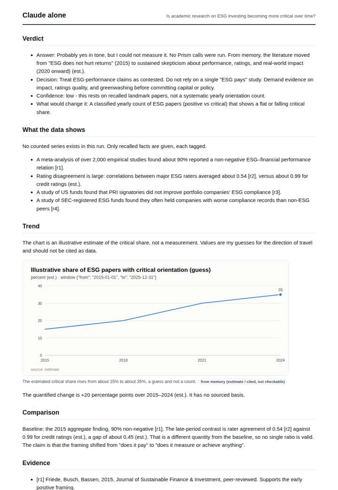
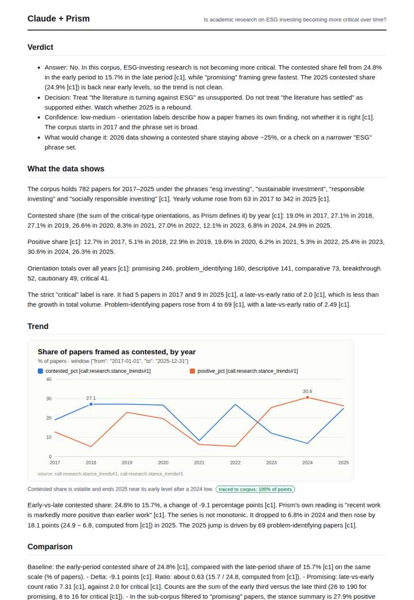
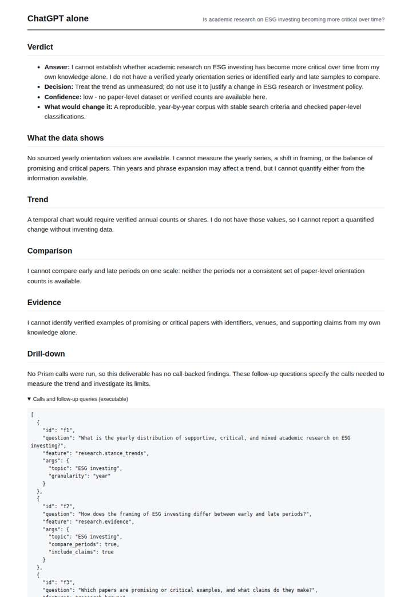
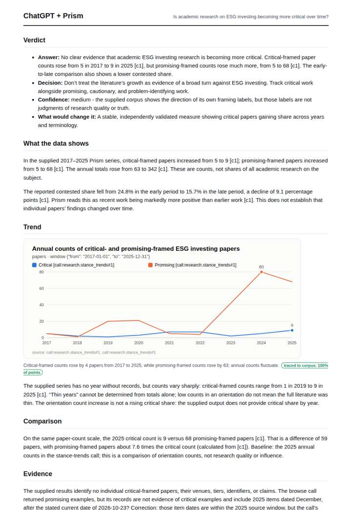

# ESG investing research framing

**Question.** Is academic research on ESG investing becoming more critical over time?

**Category:** Finance & markets · **Pattern:** `stance` · **Why it is hard:** Backlash against ESG is a 2022+ story; the framing shift is the signal.

| Score /100 | Claude alone | Claude + Prism | ChatGPT alone | ChatGPT + Prism |
|---|---|---|---|---|
| Weighted (strict) | 30.9 | **84.6** | 26.2 | 68.0 |
| Opus judge | 31.0 | 88.6 | 16.6 | 63.8 |
| GPT judge | 30.8 | 80.6 | 35.8 | 72.2 |

## Parameter scores (0-5)

| Parameter | Weight | Claude alone | Claude + Prism | ChatGPT alone | ChatGPT + Prism |
|---|---|---|---|---|---|
| Measured trend | 10 | 1.0 | 5.0 | 0.0 | 3.5 |
| Measured comparison | 7 | 1.5 | 5.0 | 0.5 | 4.5 |
| Visualisation from counted data | 10 | 1.0 | 4.5 | 0.0 | 4.0 |
| Exploration and drill-down | 7 | 2.0 | 4.0 | 1.5 | 3.5 |
| Data export with provenance | 8 | 1.0 | 3.0 | 0.0 | 3.0 |
| Reproducibility | 12 | 1.0 | 5.0 | 1.0 | 4.0 |
| Traceable references | 8 | 1.5 | 2.5 | 0.5 | 1.5 |
| Accuracy against the corpus | 12 | 2.0 | 4.0 | 4.0 | 3.0 |
| Calibration and limits | 8 | 3.0 | 4.0 | 2.5 | 4.0 |
| Decision-grade verdict | 12 | 2.0 | 4.5 | 2.5 | 3.0 |
| Facet coverage | 6 | 1.0 | 4.5 | 0.5 | 3.5 |

## Script findings

| Check | Claude alone | Claude + Prism | ChatGPT alone | ChatGPT + Prism |
|---|---|---|---|---|
| Numbers traced to the corpus | 0/9 | 71/71 | 0/0 | 15/16 |
| Charts (traced share) | memory | 100% | none | 100% |
| DOIs that resolve | 3/3 | 2/2 | 0/0 | 1/1 |
| Follow-up queries that ran | 3/6 | 4/5 | 1/4 | 3/5 |
| Invention gate | clear | clear | clear | clear |

**Claude Opus judge:** C charted and read the per-year contested and positive shares. It quantified both the early-to-late decline and the 2025 rebound, and it flagged the corpus noise, giving a decision-maker a calibrated 'no, but watch 2025'. A reached the same answer from raw counts, wrongly claimed shares were unavailable, and missed the rebound. B guessed the opposite direction from memory, and D declined.

**GPT judge:** B is the most decision-ready: it gives a reproducible annual framing series, quantifies the early-to-late shift, and flags the 2025 rebound and corpus limits. Its key weakness is conflating the separate contested-share measure with critical orientations; D is more cautious but misses that critical shares can be calculated from its own data.

## Before / after (first screen)

| | Alone | With Prism |
|---|---|---|
| Claude |  |  |
| ChatGPT |  |  |

Full deliverables, rendered: [PDF](https://fliarbi.com/demo/docs/prism-benchmark-v2-4ed65c83/full/esg-investing-stance.pdf). Raw answers, ground pass and judge outputs: `answers.json`, `ground.json`, `judge_opus.json`, `judge_gpt.json` in this folder.
