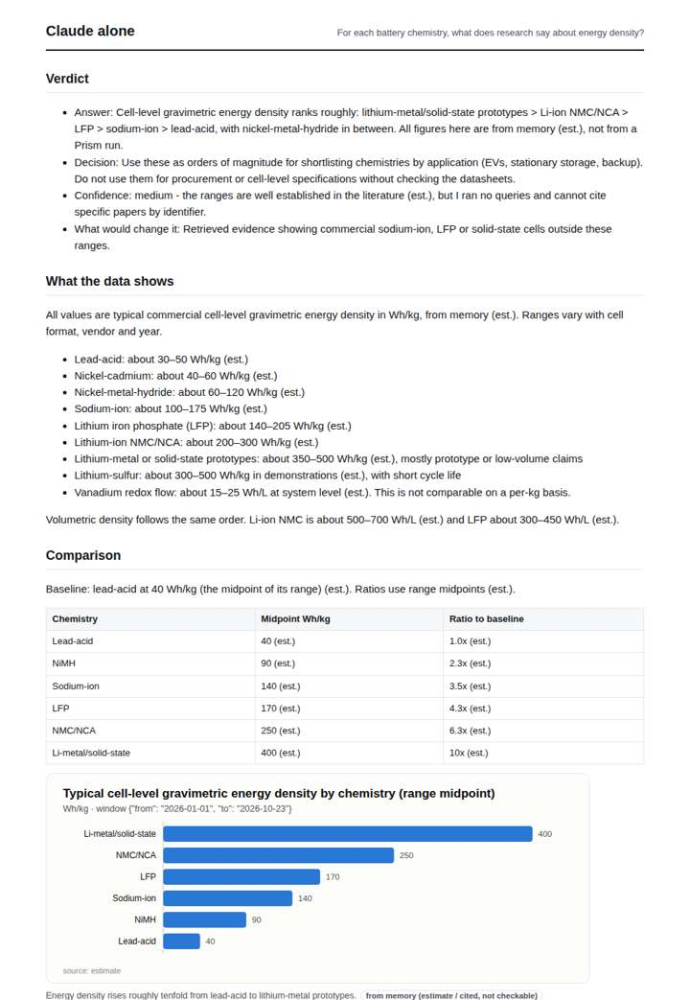
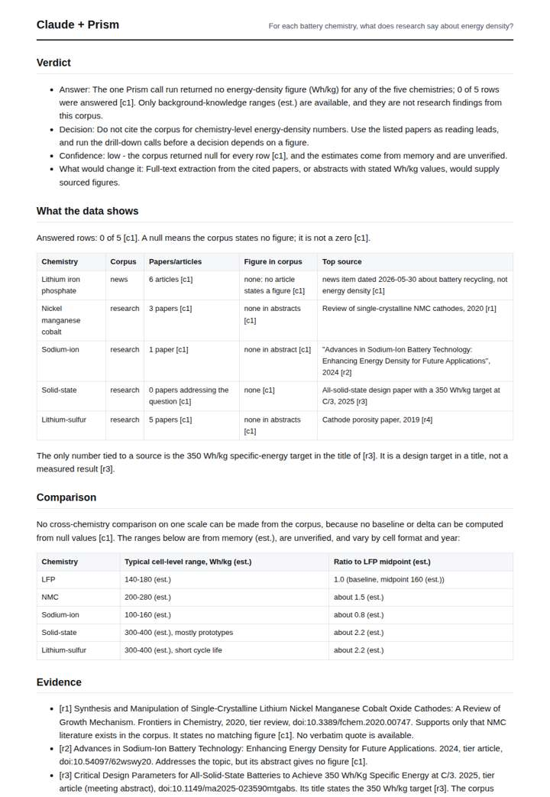
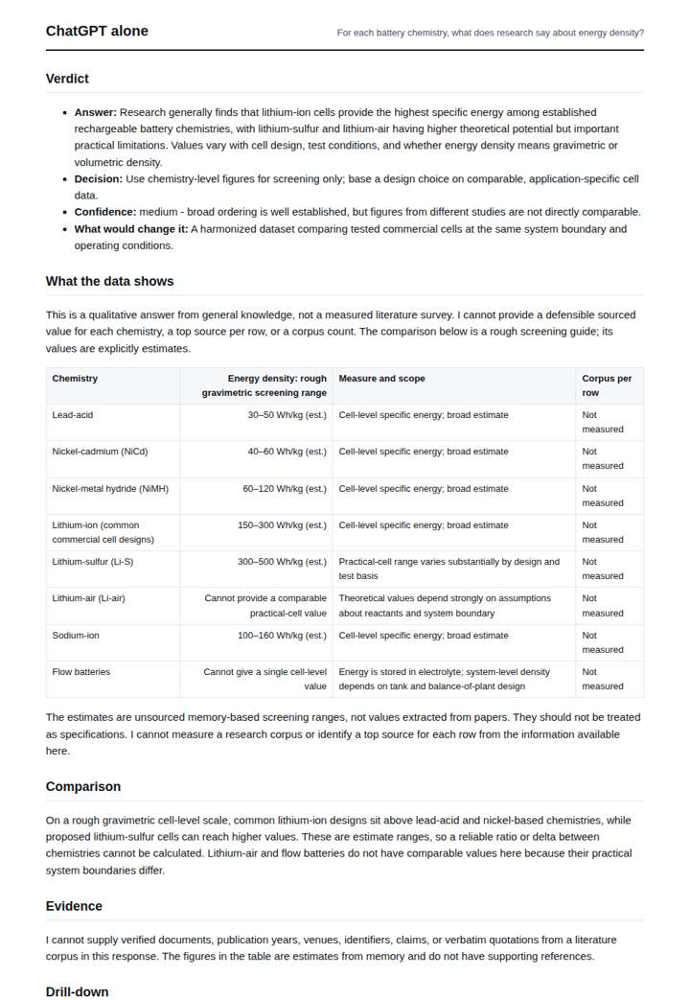
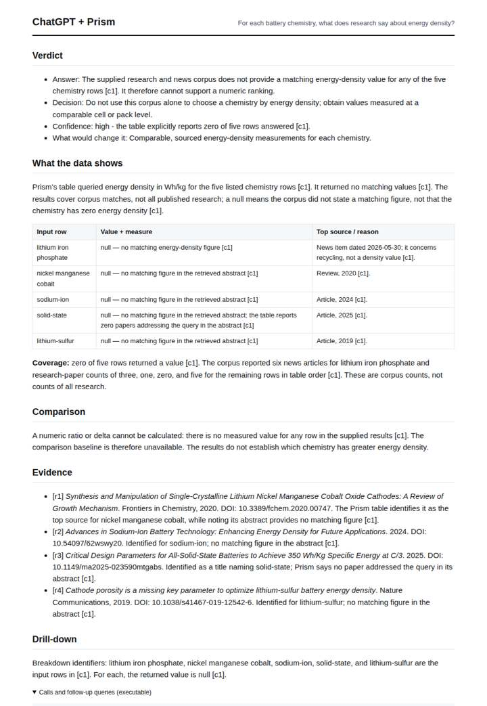

# EV battery chemistries table

**Question.** For each battery chemistry, what does research say about energy density?

**Category:** Energy & climate · **Pattern:** `table` · **Why it is hard:** Each row must carry its own figure and source; null means the corpus does not state one.

| Score /100 | Claude alone | Claude + Prism | ChatGPT alone | ChatGPT + Prism |
|---|---|---|---|---|
| Weighted (strict) | 32.0 | 50.6 | 28.0 | **55.8** |
| Opus judge | 32.4 | 55.3 | 28.4 | 53.1 |
| GPT judge | 31.6 | 45.8 | 27.6 | 58.4 |

## Parameter scores (0-5)

| Parameter | Weight | Claude alone | Claude + Prism | ChatGPT alone | ChatGPT + Prism |
|---|---|---|---|---|---|
| Measured comparison | 7 | 1.0 | 1.5 | 1.0 | 0.0 |
| Visualisation from counted data | 10 | 1.0 | 0.0 | 0.0 | 0.0 |
| Exploration and drill-down | 7 | 1.0 | 1.0 | 1.0 | 1.0 |
| Data export with provenance | 8 | 1.0 | 1.0 | 0.0 | 4.5 |
| Reproducibility | 12 | 1.0 | 2.0 | 1.0 | 2.0 |
| Traceable references | 8 | 0.5 | 3.5 | 0.5 | 3.5 |
| Accuracy against the corpus | 12 | 2.5 | 4.0 | 2.5 | 4.0 |
| Calibration and limits | 8 | 3.0 | 4.5 | 3.0 | 4.5 |
| Decision-grade verdict | 12 | 3.0 | 3.5 | 3.0 | 4.0 |
| Facet coverage | 6 | 1.0 | 4.0 | 1.0 | 4.0 |

## Script findings

| Check | Claude alone | Claude + Prism | ChatGPT alone | ChatGPT + Prism |
|---|---|---|---|---|
| Numbers traced to the corpus | 0/35 | 10/19 | 0/12 | 0/0 |
| Charts (traced share) | memory | none | none | none |
| DOIs that resolve | 0/0 | 4/4 | 0/0 | 4/4 |
| Follow-up queries that ran | 1/6 | 0/6 | 0/5 | 0/3 |
| Invention gate | clear | clear | clear | clear |

**Claude Opus judge:** A and B both report the corpus honestly: 0 of 5 rows have a stated energy-density figure. B goes further for a decision-maker. It catches the solid-state 0-papers anomaly and the off-topic LFP news row, quantifies the 146-day staleness, and keeps clearly labelled memory ranges apart from corpus results. C and D answer only from memory with no traceable sources; C also has midpoint slips and a fabricated chart window.

**GPT judge:** A is the strongest decision aid because it preserves nulls row by row, traces them to the supplied corpus response, and explains why those nulls cannot support a ranking. C covers the same rows but weakens its answer with unverified estimates and treats a title target as a relevant figure; B and D are candid about memory estimates but do not deliver grounded findings for the requested rows.

## Before / after (first screen)

| | Alone | With Prism |
|---|---|---|
| Claude |  |  |
| ChatGPT |  |  |

Full deliverables, rendered: [PDF](https://fliarbi.com/demo/docs/prism-benchmark-v2-4ed65c83/full/ev-battery-table.pdf). Raw answers, ground pass and judge outputs: `answers.json`, `ground.json`, `judge_opus.json`, `judge_gpt.json` in this folder.
