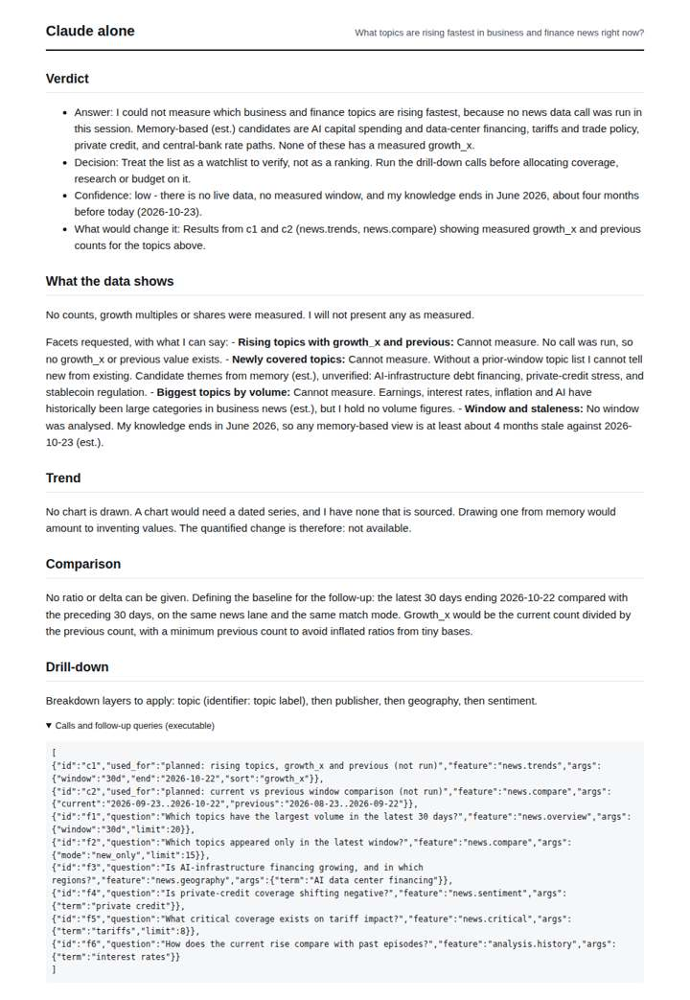
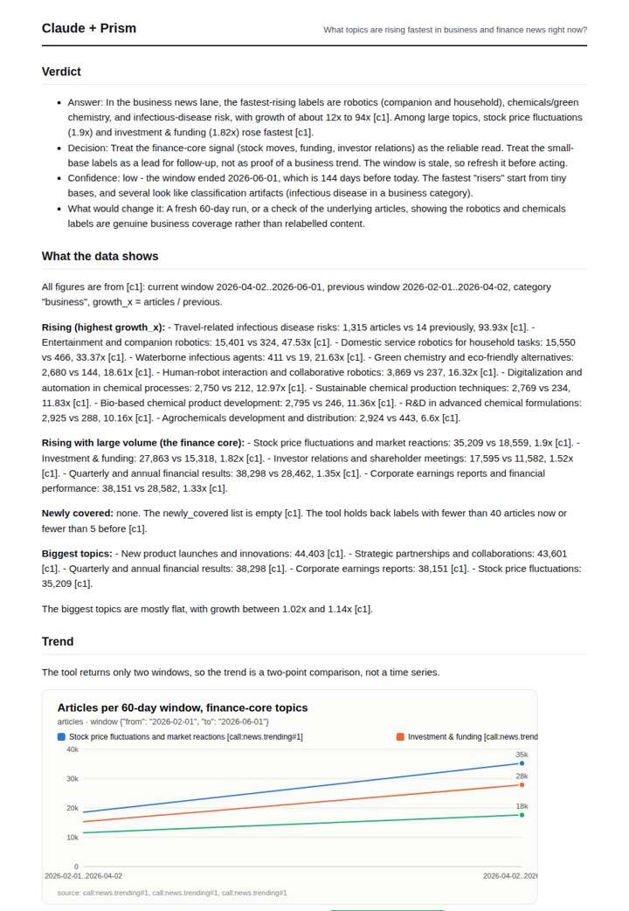
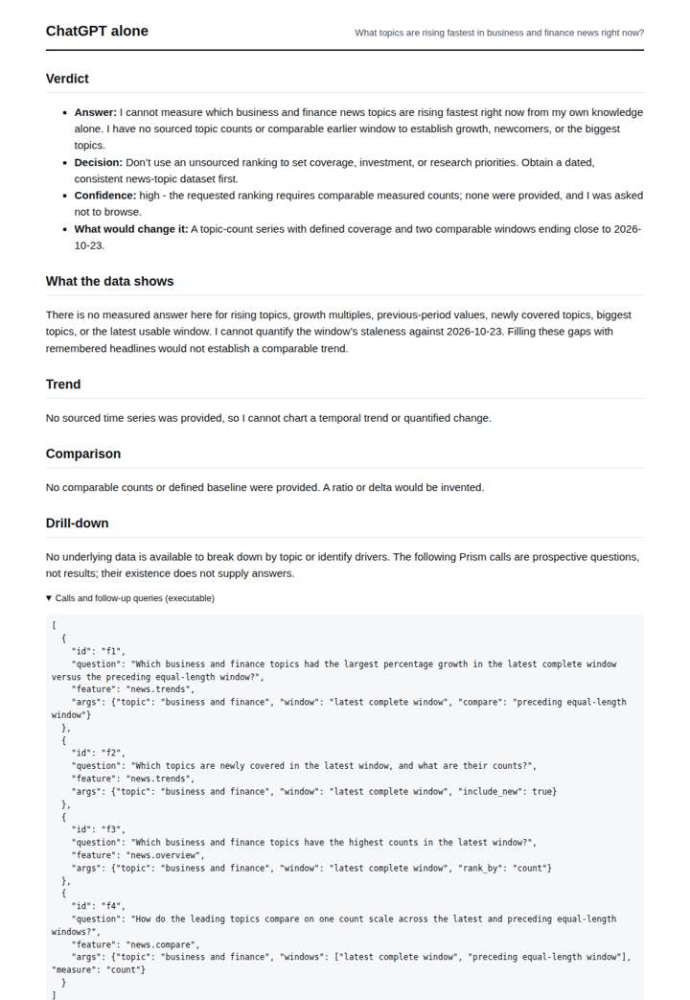
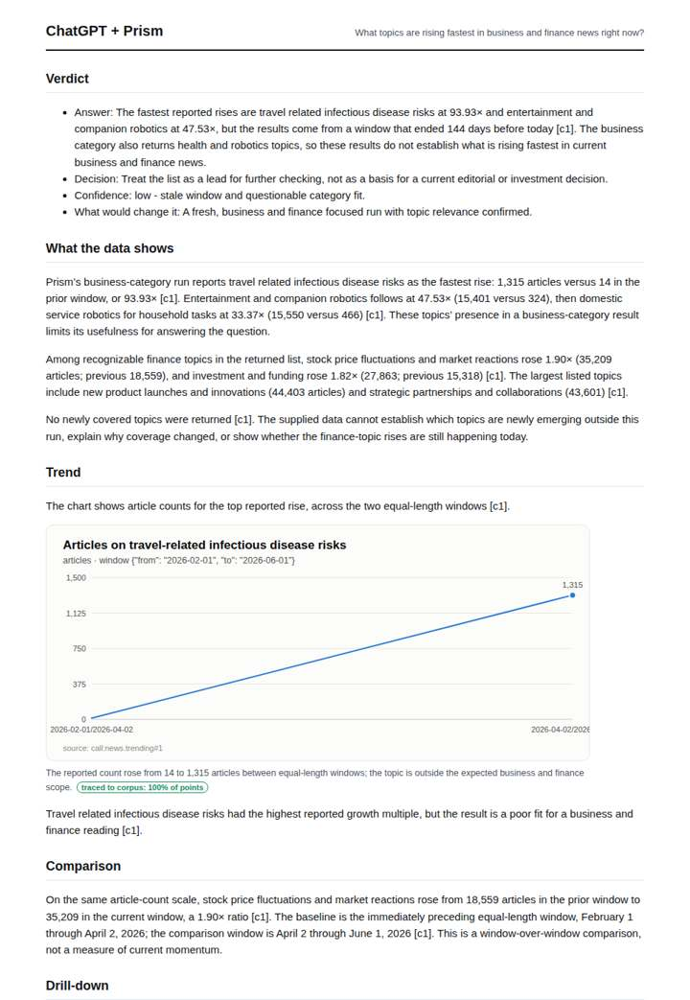

# What is trending in business news

**Question.** What topics are rising fastest in business and finance news right now?

**Category:** Finance & markets · **Pattern:** `trending` · **Why it is hard:** Trending must run on curated subcategories; raw tags surface boilerplate.

| Score /100 | Claude alone | Claude + Prism | ChatGPT alone | ChatGPT + Prism |
|---|---|---|---|---|
| Weighted (strict) | 26.2 | 79.9 | 25.7 | **80.2** |
| Opus judge | 22.8 | 80.2 | 17.2 | 69.1 |
| GPT judge | 29.6 | 79.6 | 34.1 | 91.3 |

## Parameter scores (0-5)

| Parameter | Weight | Claude alone | Claude + Prism | ChatGPT alone | ChatGPT + Prism |
|---|---|---|---|---|---|
| Measured trend | 10 | 0.0 | 4.5 | 0.0 | 3.5 |
| Measured comparison | 7 | 0.5 | 4.5 | 0.0 | 4.0 |
| Visualisation from counted data | 10 | 0.0 | 4.5 | 0.0 | 4.0 |
| Exploration and drill-down | 7 | 1.0 | 1.0 | 1.0 | 4.0 |
| Data export with provenance | 8 | 1.0 | 4.0 | 0.0 | 3.5 |
| Reproducibility | 12 | 0.0 | 4.5 | 0.5 | 4.5 |
| Accuracy against the corpus | 12 | 3.5 | 4.0 | 4.0 | 4.5 |
| Calibration and limits | 8 | 3.0 | 3.0 | 3.0 | 3.0 |
| Decision-grade verdict | 12 | 2.5 | 4.5 | 2.5 | 4.5 |
| Facet coverage | 6 | 1.0 | 4.5 | 0.5 | 4.0 |

## Script findings

| Check | Claude alone | Claude + Prism | ChatGPT alone | ChatGPT + Prism |
|---|---|---|---|---|
| Numbers traced to the corpus | 0/2 | 94/95 | 0/0 | 25/26 |
| Charts (traced share) | none | 100% | none | 100% |
| DOIs that resolve | 0/0 | 0/0 | 0/0 | 0/0 |
| Follow-up queries that ran | 2/6 | 0/6 | 0/4 | 4/4 |
| Invention gate | clear | clear | clear | clear |

**Claude Opus judge:** C and D both used the same measured run and flagged its 144-day staleness. D separated the fragile small-base risers (robotics, chemicals, disease labels) from the finance core (stock moves 1.9x, funding 1.82x), using exact deltas, an overlap caveat and a chart that supports its verdict. C stopped at noting that the category fit was questionable. A and B honestly declined to measure, so they offer a decision-maker nothing beyond a prompt to go get data.

**GPT judge:** A is the strongest decision aid: it answers with traced growth, exposes the surprising category mismatch, and recommends treating the stale results as leads rather than current signals. B is richer in comparisons, but its unsupported investor-relations figures and incorrect summary of biggest-topic growth weaken trust; C and D are candid about lacking measurements but cannot answer the question.

## Before / after (first screen)

| | Alone | With Prism |
|---|---|---|
| Claude |  |  |
| ChatGPT |  |  |

Full deliverables, rendered: [PDF](https://fliarbi.com/demo/docs/prism-benchmark-v2-4ed65c83/full/fintech-trending.pdf). Raw answers, ground pass and judge outputs: `answers.json`, `ground.json`, `judge_opus.json`, `judge_gpt.json` in this folder.
