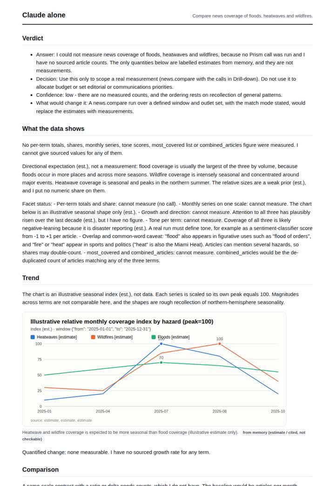
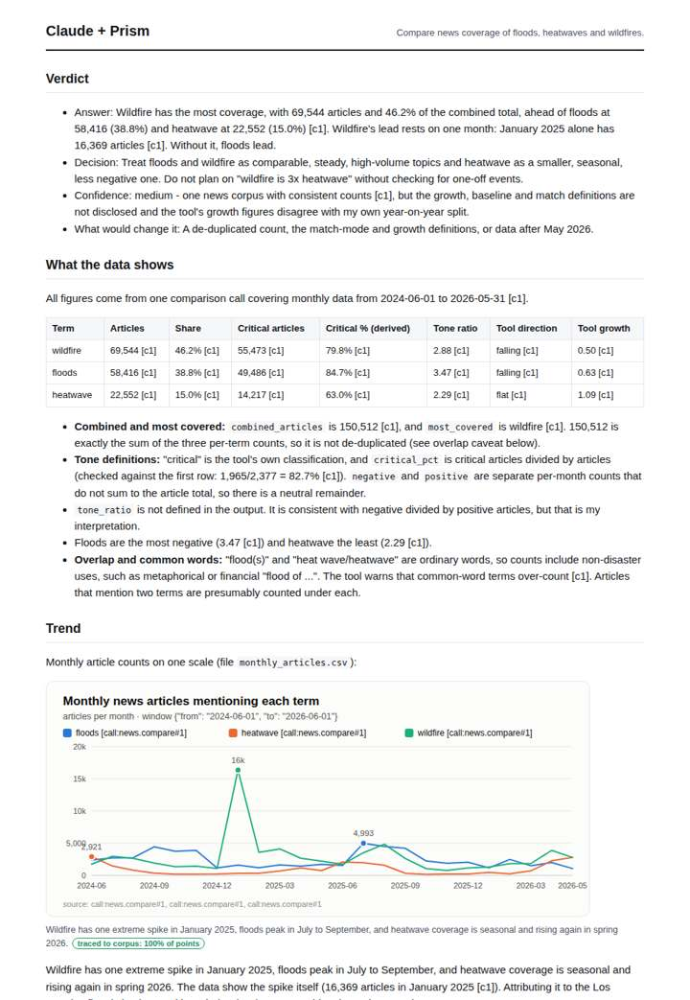
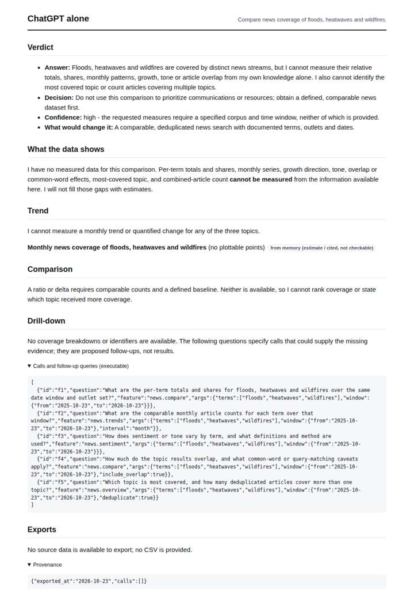
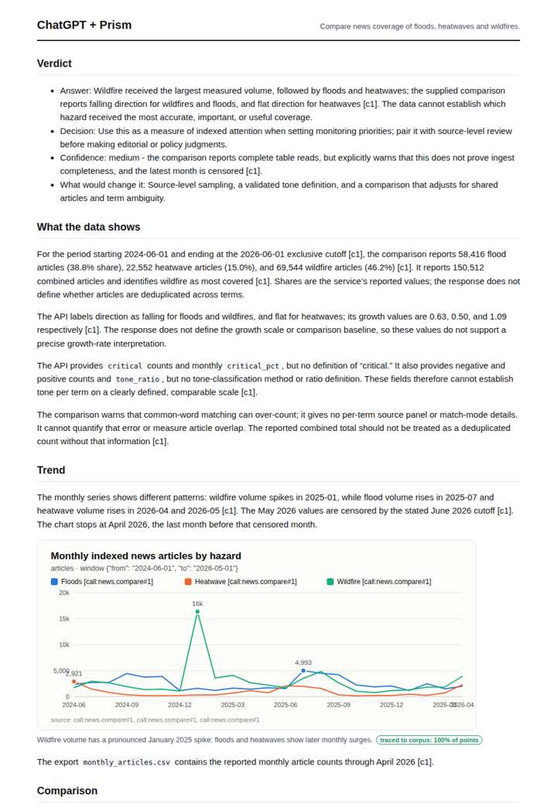

# Floods vs heatwaves vs wildfires

**Question.** Compare news coverage of floods, heatwaves and wildfires.

**Category:** Environment & disasters · **Pattern:** `compare` · **Why it is hard:** Seasonality: each hazard peaks in a different month.

| Score /100 | Claude alone | Claude + Prism | ChatGPT alone | ChatGPT + Prism |
|---|---|---|---|---|
| Weighted (strict) | 27.0 | **75.1** | 28.0 | 57.6 |
| Opus judge | 26.1 | 77.8 | 19.8 | 58.5 |
| GPT judge | 27.8 | 72.4 | 36.3 | 56.7 |

## Parameter scores (0-5)

| Parameter | Weight | Claude alone | Claude + Prism | ChatGPT alone | ChatGPT + Prism |
|---|---|---|---|---|---|
| Measured trend | 10 | 1.0 | 3.5 | 0.0 | 3.0 |
| Measured comparison | 7 | 1.0 | 4.5 | 0.0 | 4.0 |
| Visualisation from counted data | 10 | 1.0 | 4.0 | 0.5 | 2.5 |
| Exploration and drill-down | 7 | 1.0 | 3.0 | 1.0 | 1.0 |
| Data export with provenance | 8 | 1.0 | 4.5 | 0.0 | 1.5 |
| Reproducibility | 12 | 0.0 | 3.5 | 1.0 | 4.0 |
| Accuracy against the corpus | 12 | 2.0 | 3.5 | 4.0 | 2.5 |
| Calibration and limits | 8 | 3.5 | 4.0 | 3.0 | 3.5 |
| Decision-grade verdict | 12 | 2.0 | 3.5 | 2.5 | 3.0 |
| Facet coverage | 6 | 1.0 | 4.0 | 0.5 | 3.5 |

## Script findings

| Check | Claude alone | Claude + Prism | ChatGPT alone | ChatGPT + Prism |
|---|---|---|---|---|
| Numbers traced to the corpus | 0/4 | 74/81 | 0/0 | 19/19 |
| Charts (traced share) | memory | 100% | memory | 100% |
| DOIs that resolve | 0/0 | 0/0 | 0/0 | 0/0 |
| Follow-up queries that ran | 0/6 | 2/6 | 0/5 | 0/5 |
| Invention gate | clear | clear | clear | clear |

**Claude Opus judge:** C was the only deliverable to read the data rather than restate it. It showed that wildfire's lead depends on the single January 2025 spike, recomputed a year-on-year split that disagrees with the tool's growth labels, and handled censoring correctly. B was traced and clean on its totals, but it misread the censoring and did not engage with seasonality or the spike. A and D honestly declined to measure, which leaves a decision-maker with nothing to act on.

**GPT judge:** A is the most decision-ready because it combines traced seasonal data, quantified same-window comparisons, complete exports and explicit caveats, though its trend reconciliation and unsupported coverage figures need correction. D is strong on the measured totals and limits but has inconsistent May handling; B is honest but offers no measurements, while C adds unsupported estimates.

## Before / after (first screen)

| | Alone | With Prism |
|---|---|---|
| Claude |  |  |
| ChatGPT |  |  |

Full deliverables, rendered: [PDF](https://fliarbi.com/demo/docs/prism-benchmark-v2-4ed65c83/full/floods-vs-heatwaves.pdf). Raw answers, ground pass and judge outputs: `answers.json`, `ground.json`, `judge_opus.json`, `judge_gpt.json` in this folder.
