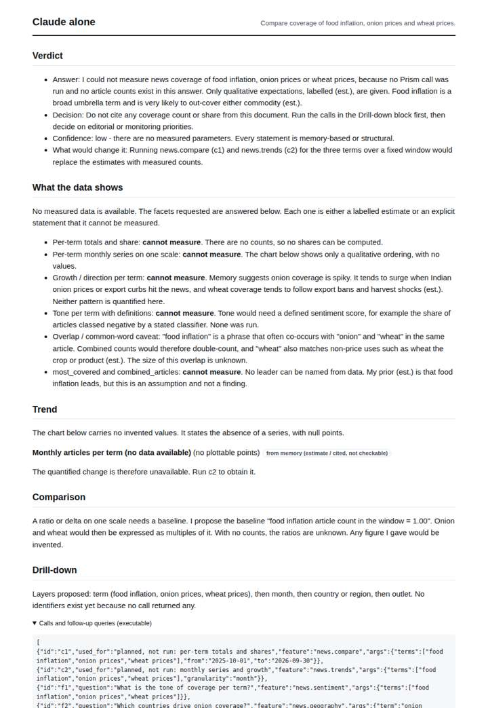
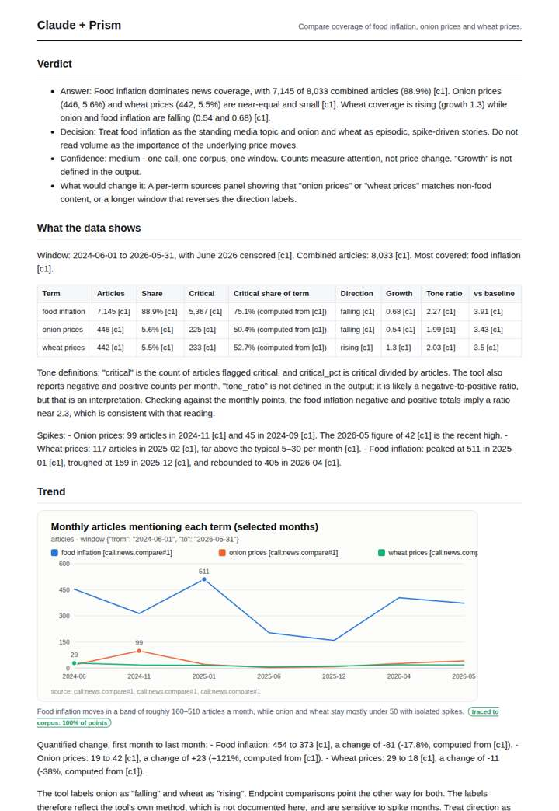
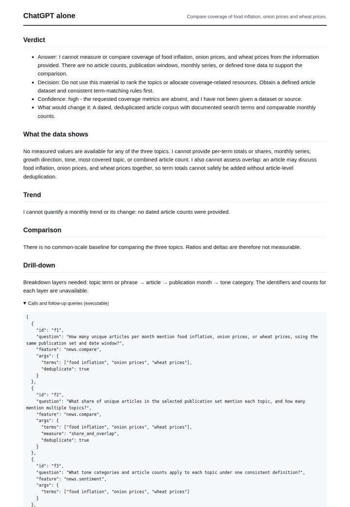
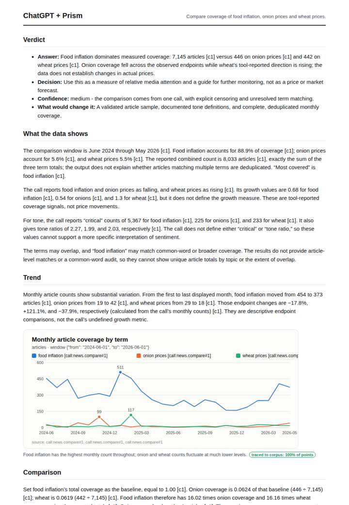

# Food prices in the news

**Question.** Compare coverage of food inflation, onion prices and wheat prices.

**Category:** Agriculture & food security · **Pattern:** `compare` · **Why it is hard:** Onion price coverage is seasonal and India-specific.

| Score /100 | Claude alone | Claude + Prism | ChatGPT alone | ChatGPT + Prism |
|---|---|---|---|---|
| Weighted (strict) | 32.0 | 65.0 | 24.1 | **70.0** |
| Opus judge | 30.2 | 69.8 | 18.0 | 56.7 |
| GPT judge | 33.7 | 60.2 | 30.2 | 83.3 |

## Parameter scores (0-5)

| Parameter | Weight | Claude alone | Claude + Prism | ChatGPT alone | ChatGPT + Prism |
|---|---|---|---|---|---|
| Measured trend | 10 | 1.0 | 3.5 | 0.0 | 3.5 |
| Measured comparison | 7 | 1.0 | 4.0 | 0.0 | 4.0 |
| Visualisation from counted data | 10 | 1.0 | 2.0 | 0.0 | 4.0 |
| Exploration and drill-down | 7 | 2.0 | 3.0 | 1.0 | 2.0 |
| Data export with provenance | 8 | 1.0 | 2.5 | 0.0 | 4.0 |
| Reproducibility | 12 | 0.0 | 3.5 | 1.0 | 4.5 |
| Accuracy against the corpus | 12 | 3.5 | 3.5 | 3.5 | 3.0 |
| Calibration and limits | 8 | 2.5 | 3.5 | 2.5 | 4.0 |
| Decision-grade verdict | 12 | 2.5 | 3.0 | 2.0 | 2.5 |
| Facet coverage | 6 | 1.0 | 4.5 | 1.0 | 3.5 |

## Script findings

| Check | Claude alone | Claude + Prism | ChatGPT alone | ChatGPT + Prism |
|---|---|---|---|---|
| Numbers traced to the corpus | 0/2 | 74/74 | 0/0 | 33/35 |
| Charts (traced share) | memory | 100% | none | 100% |
| DOIs that resolve | 0/0 | 0/0 | 0/0 | 0/0 |
| Follow-up queries that ran | 3/5 | 4/6 | 0/4 | 2/4 |
| Invention gate | clear | clear | clear | clear |

**Claude Opus judge:** B and D both grounded every number in the single news.compare call, and A and C produced no measurements. D read the data more carefully: it named the spike months and computed critical shares. It also caught that the tool's direction labels contradict the endpoints, whereas B's verdict misstated the direction of onion coverage. D's weaknesses are a selected-months chart that drops the wheat spike and a verdict that restates the direction labels it had just questioned.

**GPT judge:** A is the strongest decision aid: it compares all three terms on one traced window, gives a complete monthly series and reproducible ratios, and distinguishes media attention from price movement. B adds useful spike observations but has material window, coverage, and overlap errors; C and D are transparent about missing measurements but do not answer the comparison.

## Before / after (first screen)

| | Alone | With Prism |
|---|---|---|
| Claude |  |  |
| ChatGPT |  |  |

Full deliverables, rendered: [PDF](https://fliarbi.com/demo/docs/prism-benchmark-v2-4ed65c83/full/food-inflation-compare.pdf). Raw answers, ground pass and judge outputs: `answers.json`, `ground.json`, `judge_opus.json`, `judge_gpt.json` in this folder.
