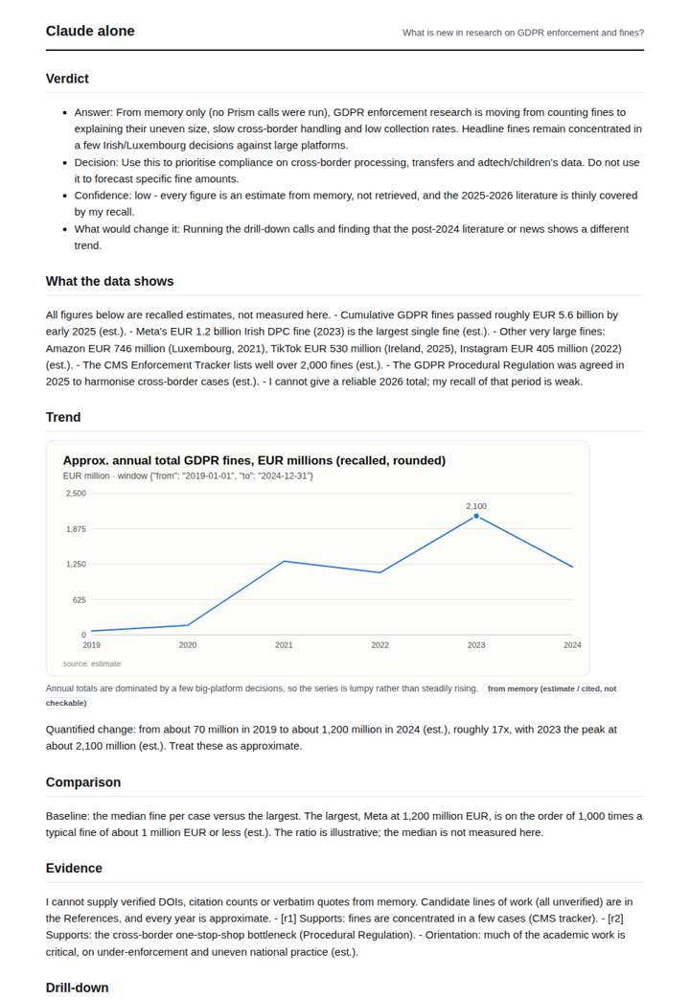
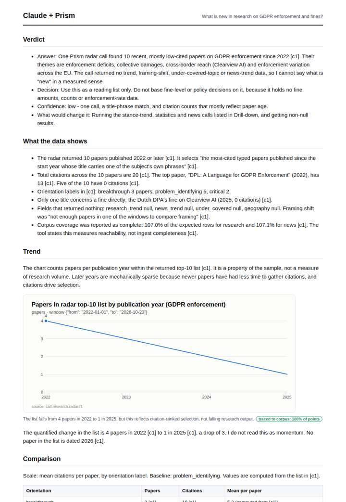
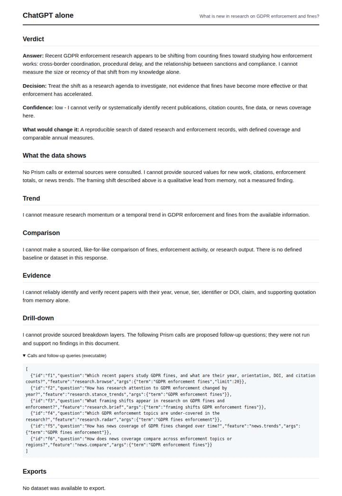
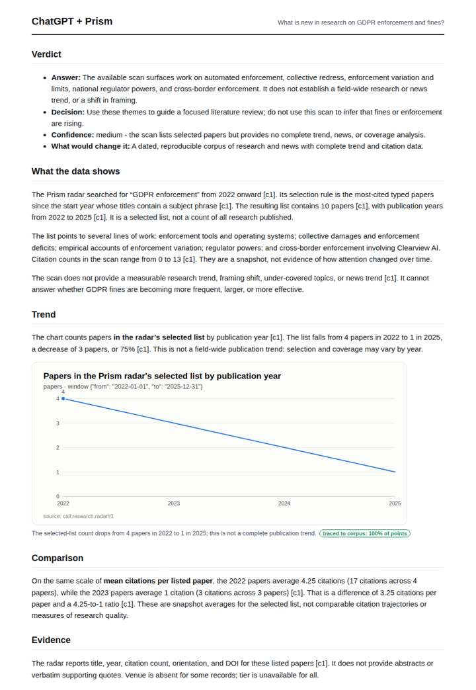

# GDPR enforcement research

**Question.** What is new in research on GDPR enforcement and fines?

**Category:** Legal & compliance · **Pattern:** `radar` · **Why it is hard:** Legal scholarship is slow; the radar shows how little is new.

| Score /100 | Claude alone | Claude + Prism | ChatGPT alone | ChatGPT + Prism |
|---|---|---|---|---|
| Weighted (strict) | 33.9 | 60.0 | 24.5 | **68.9** |
| Opus judge | 31.8 | 61.0 | 21.8 | 66.2 |
| GPT judge | 36.0 | 59.0 | 27.2 | 71.6 |

## Parameter scores (0-5)

| Parameter | Weight | Claude alone | Claude + Prism | ChatGPT alone | ChatGPT + Prism |
|---|---|---|---|---|---|
| Measured trend | 10 | 1.0 | 3.5 | 0.0 | 3.0 |
| Measured comparison | 7 | 2.0 | 3.0 | 0.0 | 3.5 |
| Visualisation from counted data | 10 | 1.0 | 3.0 | 0.0 | 3.0 |
| Exploration and drill-down | 7 | 1.5 | 2.0 | 1.5 | 2.0 |
| Data export with provenance | 8 | 1.0 | 0.0 | 0.0 | 4.0 |
| Reproducibility | 12 | 1.0 | 3.0 | 1.0 | 4.0 |
| Traceable references | 8 | 1.0 | 3.0 | 0.5 | 3.0 |
| Accuracy against the corpus | 12 | 3.0 | 3.0 | 3.5 | 4.0 |
| Calibration and limits | 8 | 3.5 | 4.0 | 3.0 | 3.5 |
| Decision-grade verdict | 12 | 2.0 | 4.0 | 2.0 | 3.5 |
| Facet coverage | 6 | 1.5 | 4.0 | 1.0 | 4.0 |

## Script findings

| Check | Claude alone | Claude + Prism | ChatGPT alone | ChatGPT + Prism |
|---|---|---|---|---|
| Numbers traced to the corpus | 0/14 | 16/19 | 0/0 | 21/23 |
| Charts (traced share) | memory | 100% | none | 100% |
| DOIs that resolve | 0/0 | 10/10 | 0/0 | 10/10 |
| Follow-up queries that ran | 2/6 | 2/6 | 2/6 | 1/5 |
| Invention gate | clear | clear | clear | clear |

**Claude Opus judge:** A and B both grounded their answers in the same 10-paper radar list and correctly declined to read it as a field trend. B's fully traced, provenance-tagged export gave it the edge. A had stronger placed limits, but it carried untraced coverage figures and an export that contradicts its prose. C and D answered from memory: C honestly said almost nothing, and D substituted estimated fine totals for the research question that was asked.

**GPT judge:** D is the strongest decision aid: it answers what the recent selected papers cover, quantifies a carefully bounded comparison, and preserves the distinction between a radar shortlist and field-wide trends. A is also careful but has weaker reproducibility and export, while B and C lack traced evidence; C’s estimated fine series is especially easy to mistake for a measured trend.

## Before / after (first screen)

| | Alone | With Prism |
|---|---|---|
| Claude |  |  |
| ChatGPT |  |  |

Full deliverables, rendered: [PDF](https://fliarbi.com/demo/docs/prism-benchmark-v2-4ed65c83/full/gdpr-fines-radar.pdf). Raw answers, ground pass and judge outputs: `answers.json`, `ground.json`, `judge_opus.json`, `judge_gpt.json` in this folder.
