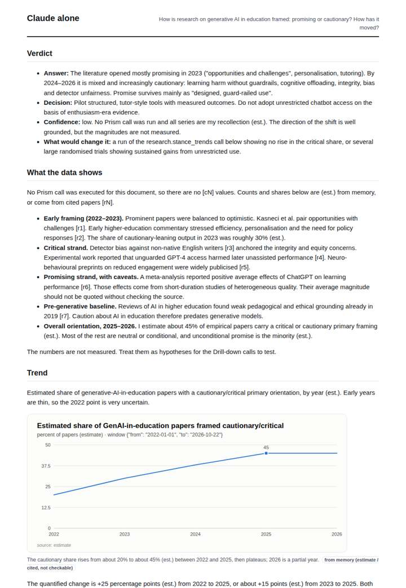
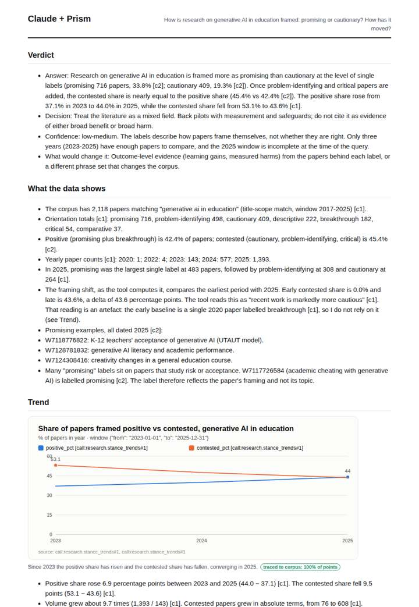
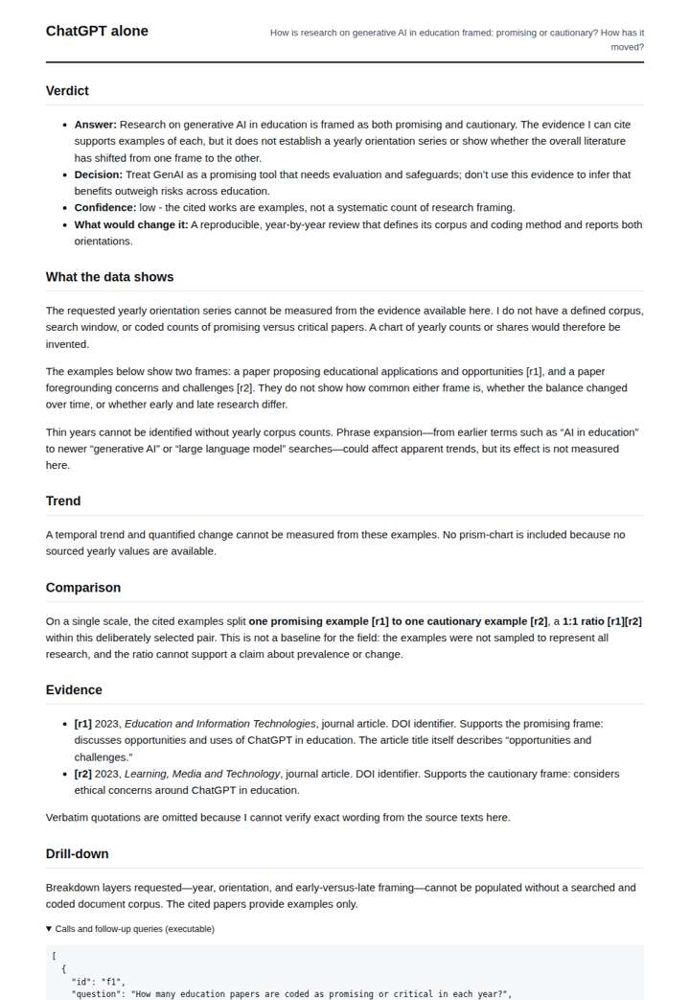
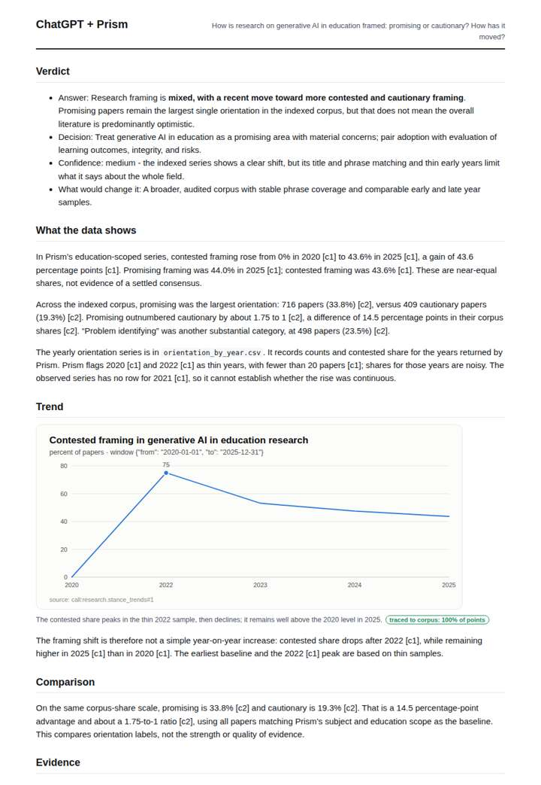

# Generative AI in education

**Question.** How is research on generative AI in education framed: promising or cautionary? How has it moved?

**Category:** Technology & AI · **Pattern:** `stance` · **Why it is hard:** A 2023+ literature: almost entirely after most training cut-offs.

| Score /100 | Claude alone | Claude + Prism | ChatGPT alone | ChatGPT + Prism |
|---|---|---|---|---|
| Weighted (strict) | 36.7 | **82.0** | 21.4 | 76.5 |
| Opus judge | 32.6 | 83.0 | 17.0 | 67.2 |
| GPT judge | 40.8 | 81.0 | 25.8 | 85.8 |

## Parameter scores (0-5)

| Parameter | Weight | Claude alone | Claude + Prism | ChatGPT alone | ChatGPT + Prism |
|---|---|---|---|---|---|
| Measured trend | 10 | 1.0 | 5.0 | 0.0 | 3.5 |
| Measured comparison | 7 | 2.0 | 5.0 | 0.5 | 4.5 |
| Visualisation from counted data | 10 | 1.0 | 4.5 | 0.0 | 4.0 |
| Exploration and drill-down | 7 | 1.5 | 4.0 | 1.5 | 4.0 |
| Data export with provenance | 8 | 1.0 | 3.0 | 0.0 | 4.0 |
| Reproducibility | 12 | 0.0 | 5.0 | 1.0 | 5.0 |
| Traceable references | 8 | 3.5 | 3.0 | 0.0 | 3.0 |
| Accuracy against the corpus | 12 | 2.5 | 3.5 | 1.5 | 3.0 |
| Calibration and limits | 8 | 3.5 | 4.5 | 3.0 | 4.5 |
| Decision-grade verdict | 12 | 3.0 | 3.0 | 2.5 | 3.0 |
| Facet coverage | 6 | 1.5 | 5.0 | 1.5 | 4.0 |

## Script findings

| Check | Claude alone | Claude + Prism | ChatGPT alone | ChatGPT + Prism |
|---|---|---|---|---|
| Numbers traced to the corpus | 0/12 | 75/75 | 0/0 | 27/27 |
| Charts (traced share) | memory | 100% | none | 100% |
| DOIs that resolve | 6/6 | 4/4 | 0/2 | 3/3 |
| Follow-up queries that ran | 1/7 | 5/6 | 2/4 | 4/5 |
| Invention gate | clear | clear | clear | clear |

**Claude Opus judge:** D was the only deliverable to read the measured series correctly. Over the usable 2023–2025 years, the positive share rose and the contested share fell, which converges to a balanced field. D flagged the tool's 'more cautious' reading as an artefact of a one-paper baseline, and it also noted the off-topic phrase contamination. A was equally well traced but repeated that artefact in its verdict, against its own chart. B gave honest memory estimates that point the wrong way. C answered nothing and had misattributed DOIs.

**GPT judge:** A is the strongest decision aid: it traces the movement, compares orientations on defined scales, and keeps thin years and corpus limits visible. B offers a richer decomposition, but incorrectly calls the 2025 window incomplete and overreads a keyword facet; C and D cannot establish a measured trend.

## Before / after (first screen)

| | Alone | With Prism |
|---|---|---|
| Claude |  |  |
| ChatGPT |  |  |

Full deliverables, rendered: [PDF](https://fliarbi.com/demo/docs/prism-benchmark-v2-4ed65c83/full/gen-ai-education-stance.pdf). Raw answers, ground pass and judge outputs: `answers.json`, `ground.json`, `judge_opus.json`, `judge_gpt.json` in this folder.
