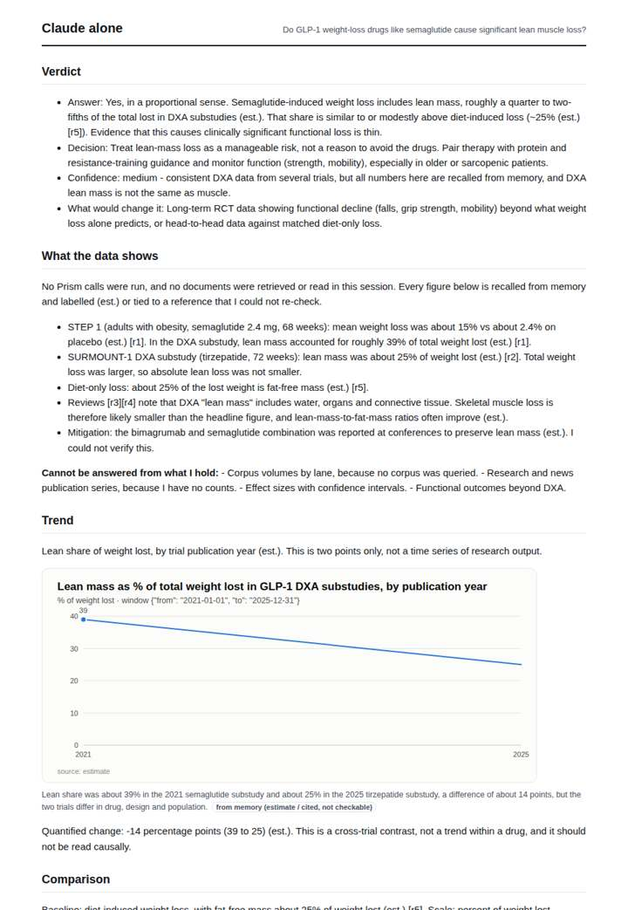
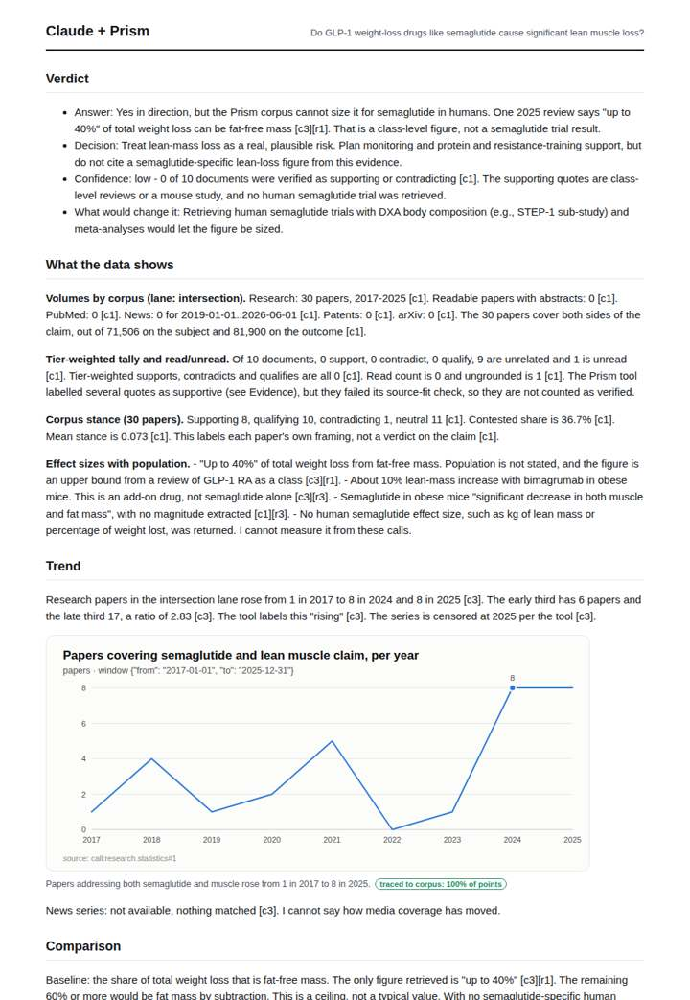
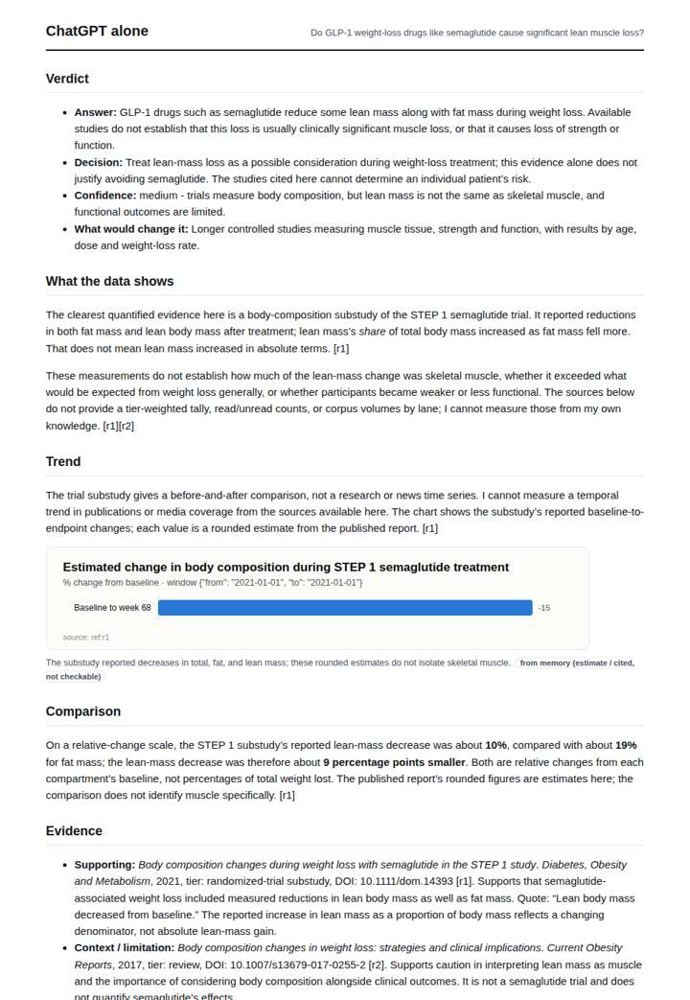
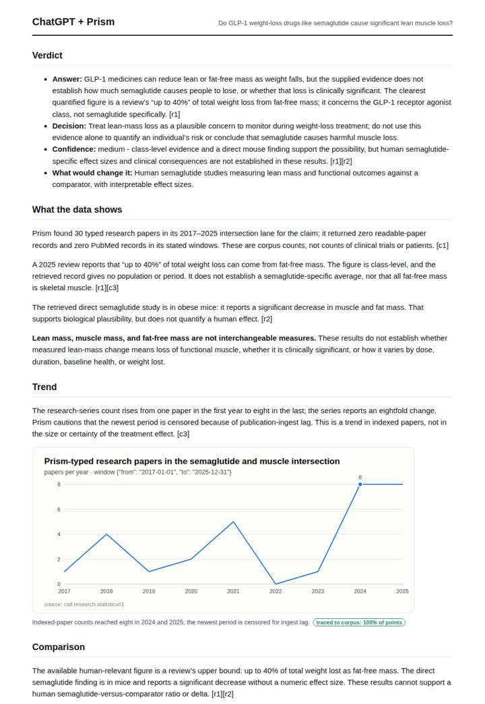

# GLP-1 drugs and muscle loss

**Question.** Do GLP-1 weight-loss drugs like semaglutide cause significant lean muscle loss?

**Category:** Medical & clinical evidence · **Pattern:** `evidence` · **Why it is hard:** A fast-moving 2023-2026 literature; model training data ends before most of it.

| Score /100 | Claude alone | Claude + Prism | ChatGPT alone | ChatGPT + Prism |
|---|---|---|---|---|
| Weighted (strict) | 40.4 | **67.7** | 31.6 | 65.9 |
| Opus judge | 36.6 | 73.8 | 29.8 | 64.2 |
| GPT judge | 44.2 | 61.6 | 33.4 | 67.6 |

## Parameter scores (0-5)

| Parameter | Weight | Claude alone | Claude + Prism | ChatGPT alone | ChatGPT + Prism |
|---|---|---|---|---|---|
| Measured trend | 10 | 1.0 | 3.5 | 0.0 | 3.5 |
| Measured comparison | 7 | 2.0 | 1.5 | 2.0 | 2.5 |
| Visualisation from counted data | 10 | 1.0 | 3.5 | 1.0 | 3.5 |
| Exploration and drill-down | 7 | 1.0 | 2.0 | 1.0 | 1.0 |
| Data export with provenance | 8 | 1.0 | 2.5 | 1.0 | 2.5 |
| Reproducibility | 12 | 1.0 | 4.0 | 0.0 | 4.0 |
| Traceable references | 8 | 2.5 | 4.0 | 1.0 | 4.0 |
| Accuracy against the corpus | 12 | 3.0 | 3.5 | 3.0 | 3.5 |
| Calibration and limits | 8 | 3.5 | 4.5 | 3.0 | 3.0 |
| Decision-grade verdict | 12 | 4.0 | 3.5 | 3.5 | 4.0 |
| Facet coverage | 6 | 1.5 | 4.0 | 1.5 | 3.5 |

## Script findings

| Check | Claude alone | Claude + Prism | ChatGPT alone | ChatGPT + Prism |
|---|---|---|---|---|
| Numbers traced to the corpus | 0/25 | 27/27 | 0/7 | 12/13 |
| Charts (traced share) | memory | 100% | memory | 100% |
| DOIs that resolve | 1/1 | 4/4 | 1/2 | 3/3 |
| Follow-up queries that ran | 0/6 | 1/5 | 0/5 | 0/3 |
| Invention gate | clear | clear | clear | clear |

**Claude Opus judge:** D and B both grounded their answers in the recorded calls and reached the same calibrated conclusion: lean-mass loss is plausible at class level, but there is no human semaglutide effect size. D went further than B. It quantified the trend, exported the tally, and caught the corpus's own anomalies, including the mismatched subject headings term, the off-topic documents and the source-fit failures. A and C were honest memory syntheses; C gives the more expert-recognisable picture, but neither can be traced or reproduced.

**GPT judge:** B is the strongest decision aid: it answers directly, separates class-level human evidence from a mouse finding, and traces its annual series and citations. Its 2025 censoring treatment and incomplete exports and limits keep it short of a fully reproducible, decision-grade deliverable; C is similarly well sourced but weakens its answer with an ungrounded diet comparison.

## Before / after (first screen)

| | Alone | With Prism |
|---|---|---|
| Claude |  |  |
| ChatGPT |  |  |

Full deliverables, rendered: [PDF](https://fliarbi.com/demo/docs/prism-benchmark-v2-4ed65c83/full/glp1-weight-loss-muscle.pdf). Raw answers, ground pass and judge outputs: `answers.json`, `ground.json`, `judge_opus.json`, `judge_gpt.json` in this folder.
