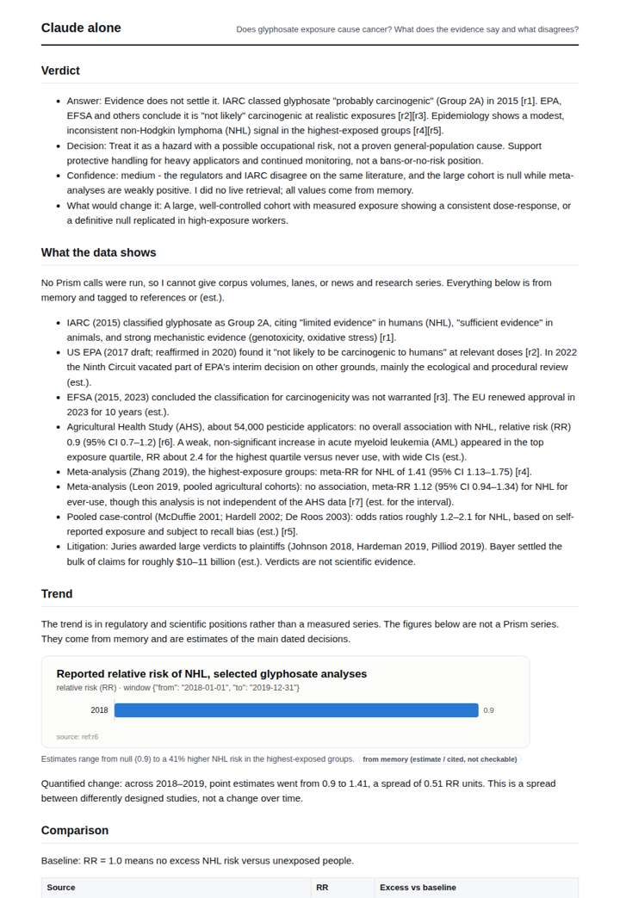
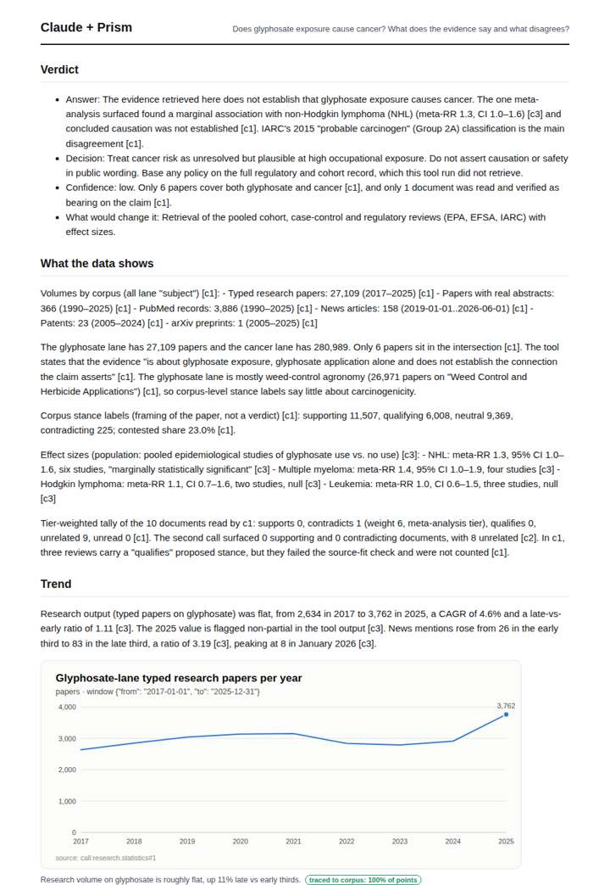
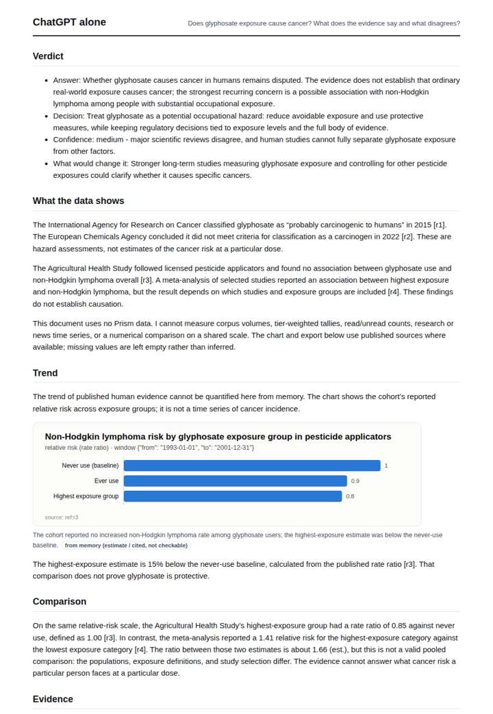
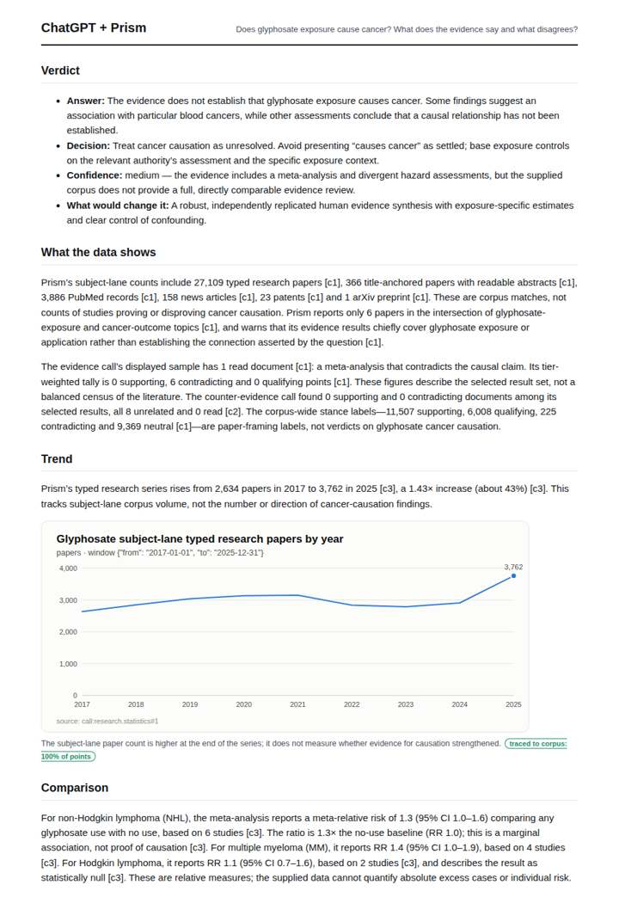

# Does glyphosate cause cancer?

**Question.** Does glyphosate exposure cause cancer? What does the evidence say and what disagrees?

**Category:** Agriculture & food security · **Pattern:** `evidence` · **Why it is hard:** IARC classification vs regulators: the literature is polarised.

| Score /100 | Claude alone | Claude + Prism | ChatGPT alone | ChatGPT + Prism |
|---|---|---|---|---|
| Weighted (strict) | 32.6 | **72.3** | 34.4 | 67.6 |
| Opus judge | 33.4 | 69.4 | 29.8 | 68.2 |
| GPT judge | 31.8 | 75.2 | 39.0 | 67.0 |

## Parameter scores (0-5)

| Parameter | Weight | Claude alone | Claude + Prism | ChatGPT alone | ChatGPT + Prism |
|---|---|---|---|---|---|
| Measured trend | 10 | 0.5 | 4.0 | 0.5 | 3.0 |
| Measured comparison | 7 | 2.0 | 4.5 | 2.0 | 4.0 |
| Visualisation from counted data | 10 | 1.0 | 4.0 | 1.0 | 3.0 |
| Exploration and drill-down | 7 | 1.0 | 3.0 | 1.0 | 1.0 |
| Data export with provenance | 8 | 1.0 | 3.0 | 1.0 | 3.0 |
| Reproducibility | 12 | 0.0 | 4.5 | 1.0 | 4.5 |
| Traceable references | 8 | 2.5 | 1.0 | 1.0 | 4.0 |
| Accuracy against the corpus | 12 | 2.0 | 3.0 | 2.5 | 3.0 |
| Calibration and limits | 8 | 3.0 | 4.0 | 3.0 | 3.5 |
| Decision-grade verdict | 12 | 3.5 | 4.0 | 3.5 | 4.0 |
| Facet coverage | 6 | 1.5 | 4.5 | 2.0 | 3.5 |

## Script findings

| Check | Claude alone | Claude + Prism | ChatGPT alone | ChatGPT + Prism |
|---|---|---|---|---|
| Numbers traced to the corpus | 0/32 | 62/62 | 0/7 | 31/31 |
| Charts (traced share) | memory | 100% | memory | 100% |
| DOIs that resolve | 4/4 | 5/6 | 2/3 | 3/3 |
| Follow-up queries that ran | 0/6 | 1/6 | 0/4 | 0/4 |
| Invention gate | clear | clear | clear | clear |

**Claude Opus judge:** B and C both grounded their numbers in the recorded calls. B read the research series correctly as flat, added the news trend and all four cancer-specific RRs, and gave a confidence level justified by the 6-paper intersection; C misread the series direction and dropped news. The memory-only deliverables A and D gave reasonable narrative answers but carried unverifiable or wrong specifics, and A had a fabricated IARC DOI.

**GPT judge:** A is strongest for a decision-maker because it combines the most complete traced evidence, quantified comparisons, and explicit limits, while directly answering the causation question. Its unsupported export window, censored endpoint handling, and one unresolvable DOI keep the deliverable short of fully reliable.

## Before / after (first screen)

| | Alone | With Prism |
|---|---|---|
| Claude |  |  |
| ChatGPT |  |  |

Full deliverables, rendered: [PDF](https://fliarbi.com/demo/docs/prism-benchmark-v2-4ed65c83/full/glyphosate-cancer.pdf). Raw answers, ground pass and judge outputs: `answers.json`, `ground.json`, `judge_opus.json`, `judge_gpt.json` in this folder.
