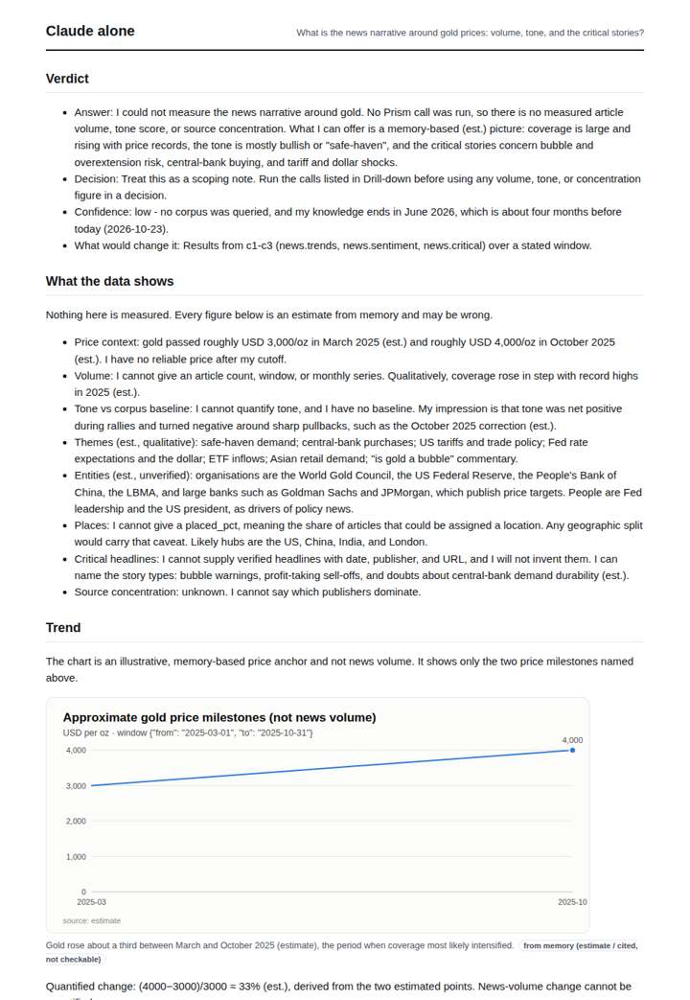
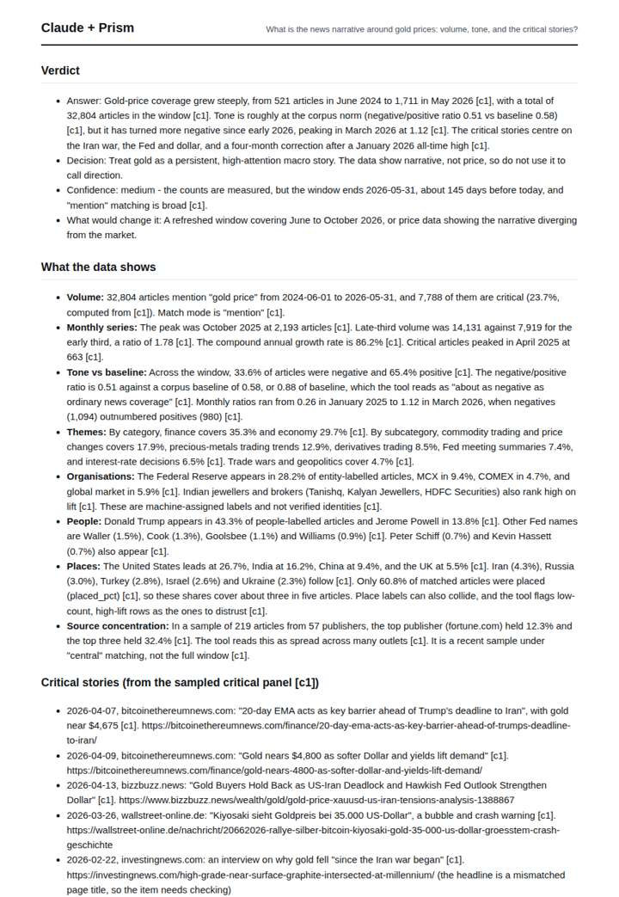
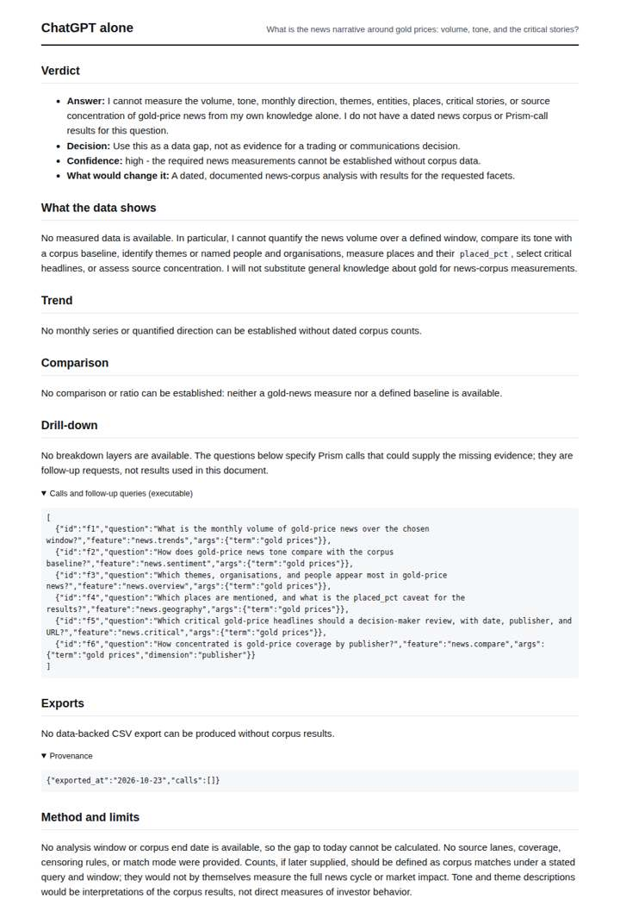
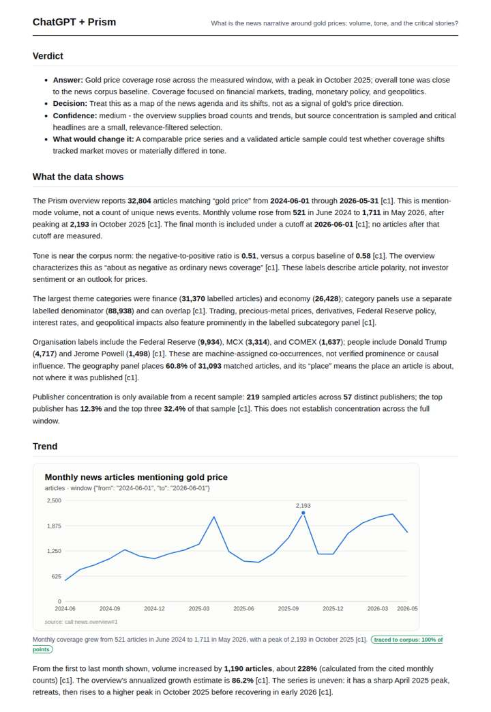

# Gold price narrative

**Question.** What is the news narrative around gold prices: volume, tone, and the critical stories?

**Category:** Finance & markets · **Pattern:** `pulse` · **Why it is hard:** Gold hit records through 2025-2026; tone and criticality move differently from volume.

| Score /100 | Claude alone | Claude + Prism | ChatGPT alone | ChatGPT + Prism |
|---|---|---|---|---|
| Weighted (strict) | 32.2 | 66.8 | 27.2 | **69.8** |
| Opus judge | 30.2 | 70.2 | 19.6 | 66.6 |
| GPT judge | 34.2 | 63.4 | 34.8 | 73.0 |

## Parameter scores (0-5)

| Parameter | Weight | Claude alone | Claude + Prism | ChatGPT alone | ChatGPT + Prism |
|---|---|---|---|---|---|
| Measured trend | 10 | 1.0 | 4.5 | 0.0 | 4.0 |
| Measured comparison | 7 | 1.0 | 4.5 | 0.0 | 4.5 |
| Visualisation from counted data | 10 | 1.0 | 2.5 | 0.0 | 3.0 |
| Exploration and drill-down | 7 | 2.0 | 2.5 | 1.0 | 3.5 |
| Data export with provenance | 8 | 1.0 | 3.0 | 0.0 | 3.0 |
| Reproducibility | 12 | 1.0 | 4.0 | 1.0 | 4.0 |
| Traceable references | 8 | 0.5 | 1.0 | 0.0 | 1.0 |
| Accuracy against the corpus | 12 | 3.5 | 3.0 | 4.0 | 4.0 |
| Calibration and limits | 8 | 3.0 | 4.5 | 3.0 | 4.0 |
| Decision-grade verdict | 12 | 2.0 | 3.0 | 3.0 | 3.5 |
| Facet coverage | 6 | 1.0 | 4.5 | 1.5 | 3.5 |

## Script findings

| Check | Claude alone | Claude + Prism | ChatGPT alone | ChatGPT + Prism |
|---|---|---|---|---|
| Numbers traced to the corpus | 0/5 | 89/91 | 0/0 | 28/29 |
| Charts (traced share) | memory | 100%, 100% | none | 100% |
| DOIs that resolve | 0/0 | 0/0 | 0/0 | 0/0 |
| Follow-up queries that ran | 4/7 | 1/6 | 5/6 | 4/5 |
| Invention gate | clear | clear | clear | clear |

**Claude Opus judge:** D gave a decision-maker the full picture: volume decomposed into critical and tone, the spring-2026 negative turn against baseline, dated critical headlines with URLs, and limits placed where they bite. It has one denominator misreading on geography. A was accurate and tidy, but it charted only volume and missed the tone reversal its own data contained. B and C honestly declined to measure, so they offer scoping, not evidence.

**GPT judge:** B best supports a decision-maker with a traced monthly volume series, a correctly defined tone comparison, and a bounded account of themes and sampled headlines. D covers more facets and charts tone, but its chart window is misleading and its verdict leans on an unsupported price-correction claim; neither deliverable provides fully resolving references for the critical stories.

## Before / after (first screen)

| | Alone | With Prism |
|---|---|---|
| Claude |  |  |
| ChatGPT |  |  |

Full deliverables, rendered: [PDF](https://fliarbi.com/demo/docs/prism-benchmark-v2-4ed65c83/full/gold-price-pulse.pdf). Raw answers, ground pass and judge outputs: `answers.json`, `ground.json`, `judge_opus.json`, `judge_gpt.json` in this folder.
